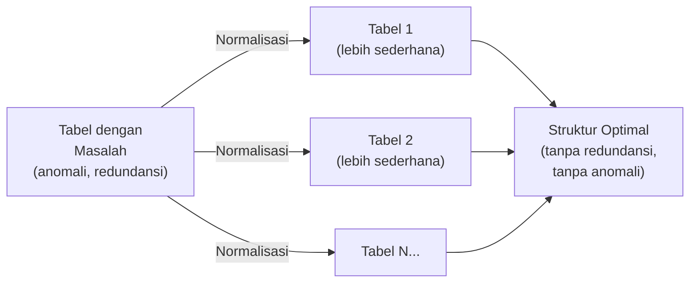
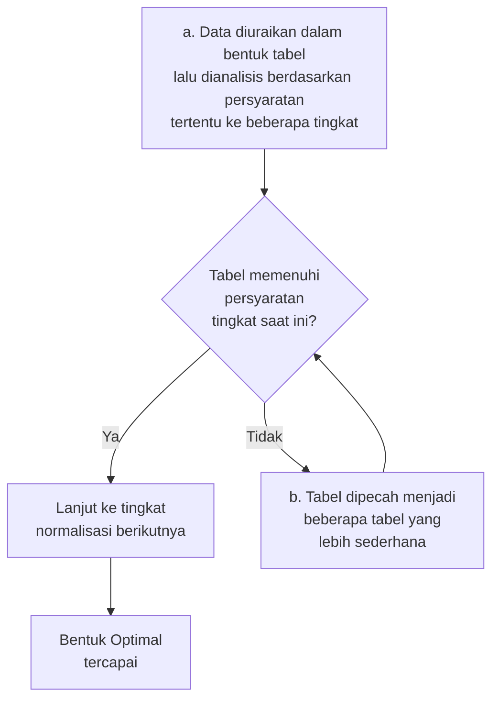
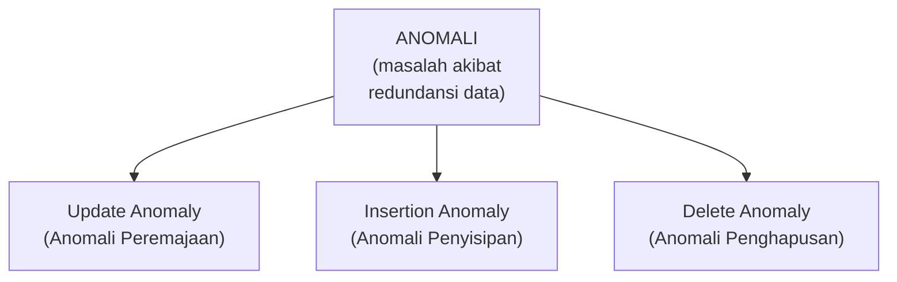
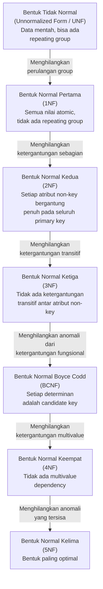
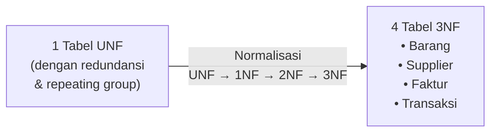
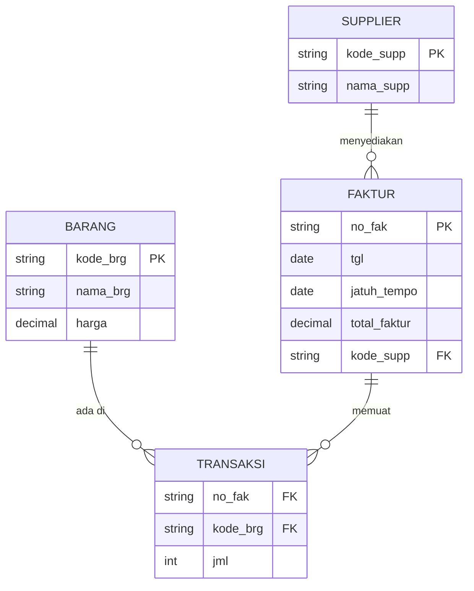
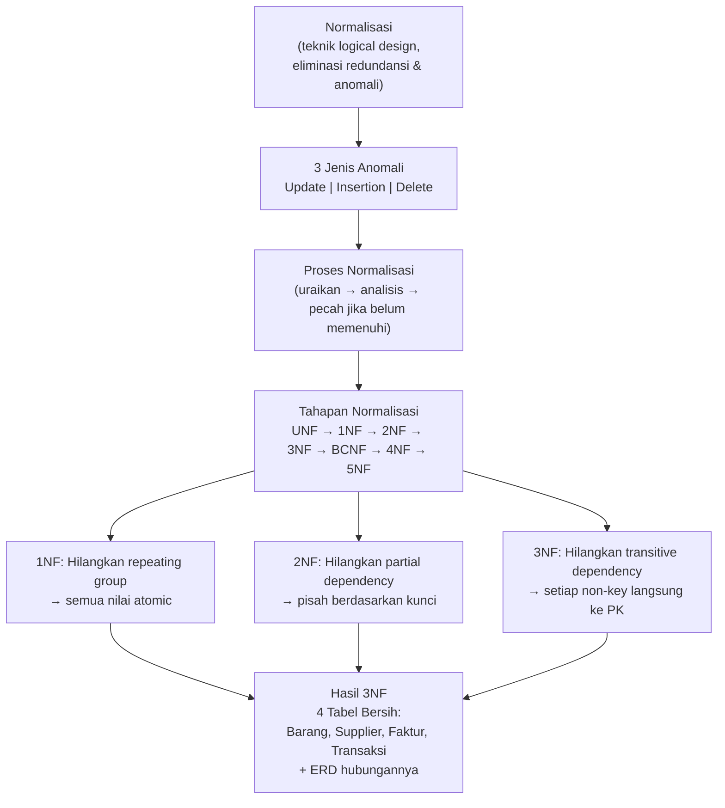

# Sesi 5 — Normalisasi

**STSI4105 Basis Data**
Program Studi Sistem Informasi — Universitas Terbuka

> Catatan: dokumen ini merupakan ekstraksi sekaligus elaborasi dari materi *Aktivitas 4 — Normalisasi*. Setiap konsep dijelaskan lebih dalam dengan konteks, analogi, dan contoh langkah-demi-langkah menggunakan studi kasus Faktur Pembelian. Diagram normalisasi digambarkan ulang menggunakan mermaid.

---

## 1. Pengertian Normalisasi

> **Normalisasi** merupakan sebuah teknik dalam membangun *logical design* sebuah basis data — teknik pengelompokan atribut dari suatu relasi sehingga membentuk struktur relasi yang baik (tanpa redundansi) dengan menerapkan sejumlah aturan dan kriteria standar.

> Normalisasi adalah proses untuk **mengubah suatu relasi atau tabel yang memiliki masalah** ke dalam dua buah tabel atau lebih untuk menghilangkan/meminimalisasi masalah tersebut. Masalah yang dimaksud ini sering disebut dengan istilah **anomali**.

> **Analogi**: bayangkan sebuah lemari arsip di mana satu map berisi dokumen dari banyak departemen yang berbeda — jika satu dokumen diubah, Anda harus mencari dan mengubah semua salinannya satu per satu. Normalisasi adalah proses memisahkan dokumen-dokumen itu ke dalam map yang tepat, sehingga setiap data hanya ada di satu tempat.

---

## 2. Proses Normalisasi

Secara garis besar, proses normalisasi berjalan dalam dua langkah berulang:

---

## 3. Anomali (*Anomaly*)

Anomali adalah masalah yang timbul akibat **redundansi data** dalam tabel yang tidak dinormalisasi. Terdapat **tiga jenis anomali**:

### 3.1 Anomali Peremajaan (*Update Anomaly*)

> *Error* yang terjadi sebagai akibat operasi **perubahan (*update*)** *tuple* atau *record* dari sebuah tabel.

Karena data yang sama tersebar di banyak baris (*redundansi*), jika satu baris diubah tetapi baris lain tidak, terjadi **inkonsistensi data**.

**Contoh**: Kolom `Telepon Cabang` untuk cabang Jakarta diubah di baris ke-2, tetapi baris lain yang juga berisi data cabang Jakarta tidak ikut diperbarui — akibatnya, cabang Jakarta seolah-olah memiliki dua nomor telepon yang berbeda.

### 3.2 Anomali Penyisipan (*Insertion Anomaly*)

> *Error* yang terjadi sebagai akibat operasi **menyisipkan (*insert*)** *tuple/record* baru pada sebuah relasi.

Saat menyisipkan data baru, kolom-kolom yang tidak relevan dengan data baru tersebut tetap harus diisi — atau justru ada kolom kunci yang tidak bisa diisi karena nilainya belum tersedia.

**Contoh**: Saat menambahkan transaksi baru, kolom `Cabang`, `Manajer Cabang`, dan `Telp Cabang` ikut harus diisi meski informasi tersebut sudah ada di baris lain. Atau, kolom `cabang` di baris ke-4 tidak terisi karena belum ada — menyebabkan data cacat.

### 3.3 Anomali Penghapusan (*Delete Anomaly*)

> *Error* yang terjadi sebagai akibat operasi **penghapusan (*delete*)** *tuple* atau *record* dari sebuah relasi.

Ketika sebuah baris dihapus untuk alasan tertentu, **data lain yang tidak seharusnya hilang ikut terhapus**.

**Contoh**: Saat baris ke-1 dihapus (karena transaksinya dibatalkan), semua informasi terkait Cabang "Bandung" juga ikut hilang — padahal informasi cabang seharusnya tetap ada.

---

## 4. Tahapan Normalisasi

Normalisasi dilakukan secara bertahap — setiap tahap menghilangkan satu jenis masalah ketergantungan data:

| Tahap | Syarat | Yang Dihilangkan |
|---|---|---|
| **UNF → 1NF** | Semua nilai harus atomic; tidak ada repeating group; setiap record lengkap | Perulangan group (*repeating group*) |
| **1NF → 2NF** | Setiap atribut non-key bergantung **penuh** pada seluruh primary key (bukan hanya sebagian) | Ketergantungan sebagian (*partial dependency*) |
| **2NF → 3NF** | Tidak ada atribut non-key yang bergantung pada atribut non-key lain (harus bergantung langsung pada PK) | Ketergantungan transitif (*transitive dependency*) |
| **3NF → BCNF** | Setiap determinan harus merupakan *candidate key* | Anomali dari ketergantungan fungsional |
| **BCNF → 4NF** | Tidak ada *multivalue dependency* | Ketergantungan multivalue |
| **4NF → 5NF** | Tidak ada *join dependency* yang tidak trivial | Anomali-anomali yang tersisa |

> Dalam praktik sehari-hari, basis data yang sudah mencapai **3NF sudah cukup baik** untuk kebanyakan sistem. BCNF, 4NF, dan 5NF digunakan untuk sistem yang membutuhkan integritas data sangat tinggi atau struktur data yang sangat kompleks.

---

## 5. Studi Kasus: Normalisasi Faktur Pembelian

### Dokumen Sumber

Data diambil dari sebuah **Faktur Pembelian** PT. Denmas Makmur:

| Field | Nilai |
|---|---|
| Kode Pemasok | A101 |
| Nama Pemasok | Akbar Comp |
| Tanggal Faktur | 07/03/2019 |
| Nomor Faktur | 111 |
| Jatuh Tempo | 07/04/2019 |

| Kode Barang | Nama Barang | Jumlah | Harga | Total |
|---|---|---|---|---|
| A1 | DD RAM 128 | 10 | 200.000 | 2.000.000 |
| A2 | Gforce-FX 5200 | 10 | 500.000 | 5.000.000 |
| A3 | Athlon 2500+ | 10 | 700.000 | 7.000.000 |
| | | | **Total Faktur** | **14.000.000** |

---

### Tahap 0 — Bentuk Un-Normal Form (UNF)

Langkah pertama: tuliskan **semua field** dari dokumen faktur ke dalam satu tabel. Ini menghasilkan bentuk **Unnormalized (UNF)** karena ada baris-baris yang memiliki sel kosong (*repeating group*):

| tgl | jatuh_tempo | kode_supp | nama_supp | kode_brg | nama_brg | jumlah | harga | total | total_faktur |
|---|---|---|---|---|---|---|---|---|---|
| 07/03/19 | 07/04/19 | A101 | Akbar Comp | A1 | DDRam 128 | 10 | 200.000 | 2.000.000 | 14.000.000 |
| *(kosong)* | *(kosong)* | *(kosong)* | *(kosong)* | A2 | Gforce FX-5200 | 10 | 500.000 | 5.000.000 | *(kosong)* |
| *(kosong)* | *(kosong)* | *(kosong)* | *(kosong)* | A3 | Adlon 2500+ | 10 | 700.000 | 7.000.000 | *(kosong)* |

> **Masalah UNF**: baris ke-2 dan ke-3 memiliki sel kosong (`tgl`, `kode_supp`, `nama_supp`, dll.) — data tidak lengkap per baris. Ini disebut *repeating group* dan akan menyulitkan operasi query serta menimbulkan anomali.

---

### Tahap 1 — Bentuk Normal Pertama (1NF)

**Syarat 1NF**: setiap field harus bernilai **atomic** (tidak bisa dibagi lagi) dan setiap record harus **lengkap** (tidak ada sel kosong).

Solusi: tambahkan `no_fak` sebagai identifikasi faktur, lalu **duplikasi** data header faktur ke setiap baris sehingga setiap record mandiri dan lengkap:

| no_fak | tgl | jatuh_tempo | kode_supp | nama_supp | kode_brg | nama_brg | jml | harga | total | total_faktur |
|---|---|---|---|---|---|---|---|---|---|---|
| 111 | 07/03/19 | 07/04/19 | A101 | Akbar Comp | A1 | DDRam 128 | 10 | 200.000 | 2.000.000 | 14.000.000 |
| 111 | 07/03/19 | 07/04/19 | A101 | Akbar Comp | A2 | Gforce Fx 5200 | 10 | 500.000 | 5.000.000 | 14.000.000 |
| 111 | 07/03/19 | 07/04/19 | A101 | Akbar Comp | A3 | Adlon 2500+ | 10 | 700.000 | 7.000.000 | 14.000.000 |

> **Masalah 1NF**: setiap baris sudah lengkap dan atomic — tetapi kini ada **redundansi massif**: data faktur (`no_fak`, `tgl`, `jatuh_tempo`, `kode_supp`, `nama_supp`, `total_faktur`) diulang di setiap baris. Jika data supplier berubah, harus diperbarui di semua baris → **Update Anomaly**. Inilah yang mendorong ke 2NF.

---

### Tahap 2 — Bentuk Normal Kedua (2NF)

**Syarat 2NF**: sudah memenuhi 1NF, **dan** setiap atribut non-key bergantung **penuh** pada seluruh primary key (bukan hanya sebagian dari composite key).

**Langkah 2NF**:
a. Identifikasi kunci-kunci kandidat yang bersifat unik:
   1. `no_fak` (Nomor Faktur)
   2. `kode_supp` (Kode Pemasok)
   3. `kode_brg` (Kode Barang)

b. Pisahkan field-field berdasarkan ketergantungannya pada masing-masing kunci — bentuklah **tiga tabel terpisah**:

**Tabel Barang** (bergantung pada `kode_brg`):

| kode_brg | nama_brg | harga |
|---|---|---|
| A1 | DDRam 128 | 200.000 |
| A2 | Gforce Fx 5200 | 500.000 |
| A3 | Adlon 2500+ | 700.000 |

**Tabel Supplier** (bergantung pada `kode_supp`):

| kode_supp | nama_supp |
|---|---|
| A101 | Akbar Comp |
| A101 | Adil Comp |
| A101 | Ozone Comp |

**Tabel Faktur** (bergantung pada `no_fak` + `kode_supp` + `kode_brg`):

| no_fak | tgl | jatuh_tempo | kode_supp | kode_brg | jml | total_faktur |
|---|---|---|---|---|---|---|
| 111 | 07/03/19 | 07/04/19 | A101 | A1 | 10 | 14.000.000 |
| 111 | 07/03/19 | 07/04/19 | A101 | A2 | 10 | 14.000.000 |
| 111 | 07/03/19 | 07/04/19 | A101 | A3 | 10 | 14.000.000 |

> **Masalah 2NF yang tersisa**: pada Tabel Faktur, field `tgl`, `jatuh_tempo`, dan `total_faktur` hanya bergantung pada `no_fak` (bukan pada kombinasi `no_fak + kode_brg`) — ini adalah **ketergantungan transitif** yang akan diselesaikan di 3NF.

---

### Tahap 3 — Bentuk Normal Ketiga (3NF)

**Syarat 3NF**: sudah memenuhi 2NF, **dan** tidak ada field yang bergantung transitif pada field non-key lain — setiap atribut non-key harus bergantung **langsung dan penuh** pada primary key.

**Masalah yang diselesaikan**: pada Tabel Faktur di 2NF, field `tgl`, `jatuh_tempo`, `total_faktur` hanya bergantung pada `no_fak` — sementara `jml` bergantung pada kombinasi `no_fak + kode_brg`. Ini adalah ketergantungan transitif yang harus dipecah.

**Solusi**: pisahkan Tabel Faktur menjadi dua tabel:

**Tabel Barang** (tidak berubah dari 2NF):

| kode_brg | nama_brg | harga |
|---|---|---|
| A1 | DDRam 128 | 200.000 |
| A2 | Gforce Fx 5200 | 500.000 |
| A3 | Adlon 2500+ | 700.000 |

**Tabel Supplier** (diperbaiki — kode_supp sekarang unik per supplier):

| kode_supp | nama_supp |
|---|---|
| A101 | Akbar Comp |
| A102 | Adil Comp |
| A103 | Ozone Comp |

**Tabel Faktur** (hanya data yang bergantung pada `no_fak`):

| no_fak | tgl | jatuh_tempo | kode_supp | total_faktur |
|---|---|---|---|---|
| 111 | 07/03/19 | 07/04/19 | A101 | 14.000.000 |

**Tabel Transaksi** (data yang bergantung pada `no_fak + kode_brg`):

| no_fak | kode_brg | jml |
|---|---|---|
| 111 | A1 | 10 |
| 111 | A2 | 10 |
| 111 | A3 | 10 |

---

### Hasil Akhir Normalisasi (3NF): 4 Tabel

Dari satu tabel UNF yang penuh masalah, normalisasi menghasilkan **4 tabel yang bersih** tanpa redundansi dan anomali:

**ERD Hasil Normalisasi:**

---

## 6. Perbandingan Sebelum dan Sesudah Normalisasi

| Aspek | UNF (sebelum) | 3NF (sesudah) |
|---|---|---|
| **Jumlah tabel** | 1 tabel besar | 4 tabel terpisah |
| **Redundansi** | Tinggi — data faktur diulang per baris barang | Minimal — setiap data tersimpan sekali |
| **Update Anomaly** | Rawan — ubah satu baris, harus ubah semua | Tidak ada — ubah di satu tabel, cukup |
| **Insertion Anomaly** | Rawan — data baru membutuhkan semua kolom terisi | Tidak ada — tambah barang tanpa perlu faktur |
| **Delete Anomaly** | Rawan — hapus faktur, hilang juga data supplier | Tidak ada — data supplier terpisah di tabelnya |
| **Integritas data** | Lemah | Kuat — dijaga oleh FK constraints |

---

## Ringkasan Keterkaitan Antar Konsep

Inti dari sesi ini: **normalisasi** adalah proses sistematis mengubah tabel yang penuh redundansi dan anomali menjadi struktur tabel yang bersih dan efisien. Prosesnya bertahap — setiap bentuk normal memiliki syarat yang lebih ketat dari sebelumnya. Dari satu tabel UNF yang berisi data faktur pembelian (dengan repeating groups, redundansi supplier, dan ketergantungan campur aduk), normalisasi menghasilkan empat tabel 3NF yang masing-masing menyimpan satu jenis entitas dengan jelas — sebuah fondasi yang siap diimplementasikan dalam SQL.

---

*Selamat Belajar...*
