# Sesi 6 — Redudansi dan De-Normalisasi

**STSI4105 Basis Data**
Program Studi Sistem Informasi — Universitas Terbuka

> Catatan: dokumen ini merupakan ekstraksi sekaligus elaborasi dari materi *Aktivitas 5 — Redudansi dan De-Normalisasi*. Setiap konsep dijelaskan lebih dalam dengan konteks, analogi, dan contoh kasus nyata. Diagram dari slide digambarkan ulang menggunakan mermaid.

---

## 1. Pengertian Redudansi

> **Redudansi** merupakan duplikasi data yang disimpan secara berulang di beberapa lokasi. Karena disimpannya di beberapa tempat, data tersebut dapat menyebabkan ketidakkonsistenan (*inconsistent*).

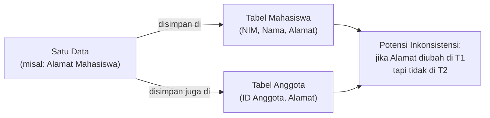

> **Analogi**: bayangkan nomor telepon darurat yang tertulis di dua papan pengumuman berbeda. Saat nomor berubah, jika hanya satu papan yang diperbarui, siapapun yang melihat papan satunya akan menghubungi nomor yang salah. Inilah bahaya redundansi data.

### Redudansi dalam Basis Data Relasional

Pada basis data relasional, redundansi **tidak bisa dihilangkan sama sekali**. Ada alasan yang mendasar di balik ini:

> Dengan redudansilah atribut-atribut yang berfungsi sebagai **key primer** menjaga keterhubungan antara tabel yang satu dengan tabel yang lain.

Dengan kata lain, **Foreign Key (FK)** adalah bentuk redundansi yang disengaja dan diperlukan — `id_barang` di tabel `pembelian` adalah duplikasi dari `id_barang` di tabel `barang`, tetapi tanpanya kita tidak bisa menghubungkan dua tabel tersebut.

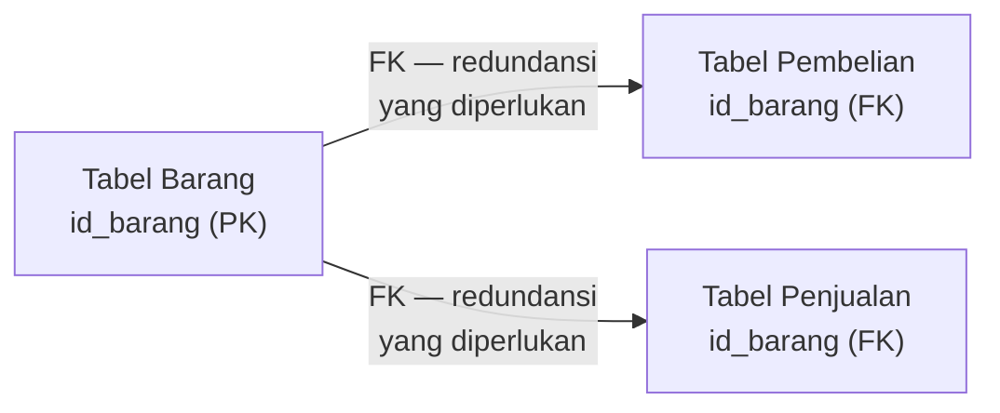

Yang perlu dihindari bukan **semua** redundansi, melainkan **redundansi yang tidak perlu** (redundansi atribut non-key yang tidak berfungsi sebagai penghubung antar tabel):

| Jenis Redundansi | Contoh | Status |
|---|---|---|
| **Diperlukan** (FK) | `id_barang` di tabel pembelian | Harus ada — sebagai penghubung antar tabel |
| **Tidak Diperlukan** | Kolom `Alamat` tersimpan di dua tabel berbeda tanpa relasi FK | Harus dihilangkan via normalisasi |

> **Sebuah redudansi yang terjadi di dalam basis data harus dibuat seminimal mungkin** karena berpotensi mengganggu integritas basis data.
>
> **Normalisasi merupakan upaya untuk mengoptimalkan redudansi tersebut.**

---

## 2. Contoh Kasus 1 — Redudansi Field Alamat

### Skenario

Seorang mahasiswa tercatat dengan NIM, Nama, dan Alamat pada tabel **Mahasiswa**. Namun, Alamat mahasiswa tersebut juga ikut tercatat pada tabel **Anggota** perpustakaan.

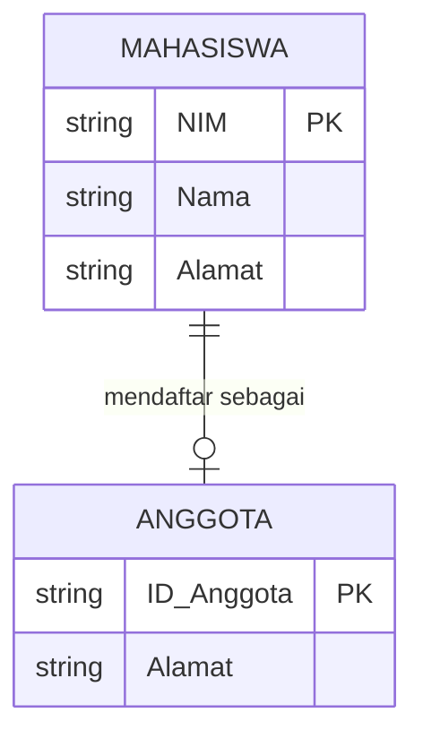

### Masalah yang Muncul

Field `Alamat` mengalami **redundansi data** karena tersimpan di dua tabel yang berbeda.

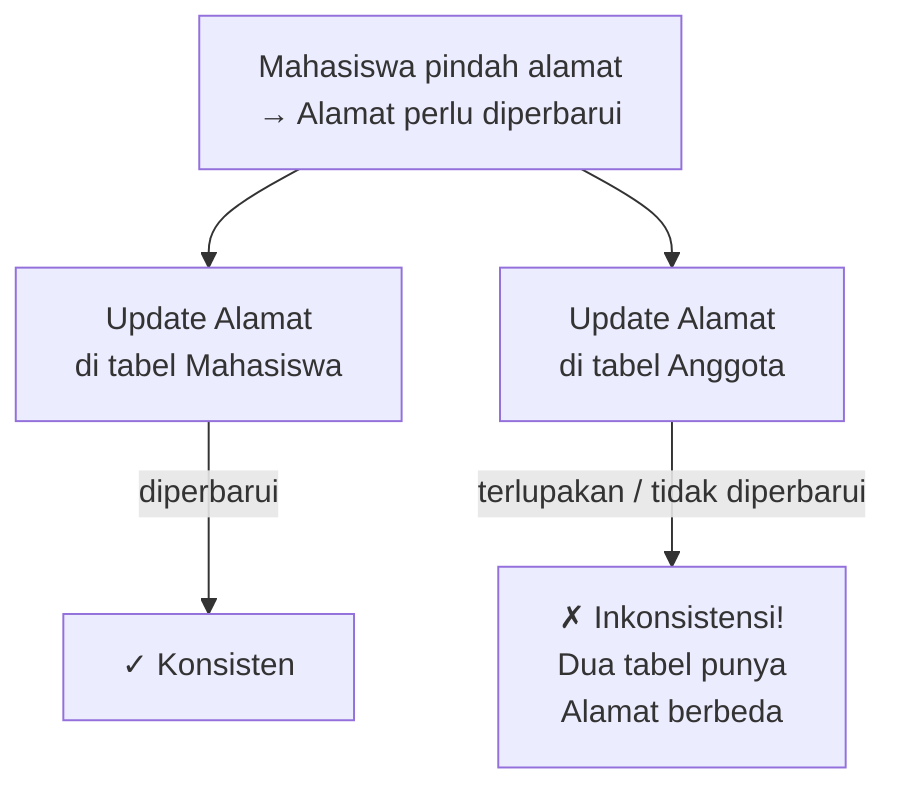

| Tabel | Alamat tersimpan | Skenario bermasalah |
|---|---|---|
| **Mahasiswa** | Jl. Merdeka No. 5 (baru) | Diperbarui |
| **Anggota** | Jl. Kenanga No. 12 (lama) | Lupa diperbarui → **inkonsisten** |

### Solusi

Hapus field `Alamat` dari tabel `Anggota` — gunakan relasi ke tabel `Mahasiswa` agar Alamat hanya tersimpan di satu tempat:

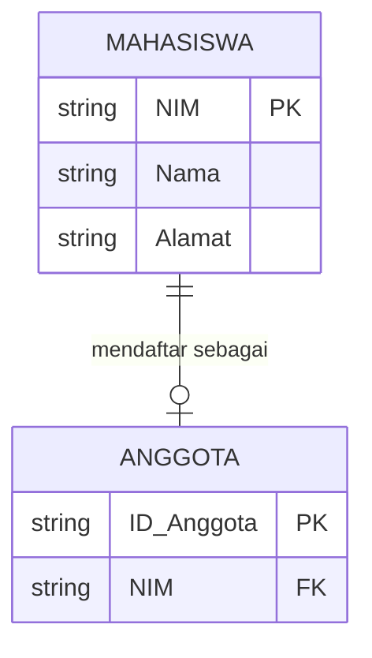

Kini `Alamat` hanya ada di satu tempat. Tabel `Anggota` mengambil Alamat via JOIN ke tabel `Mahasiswa` menggunakan FK `NIM`.

---

## 3. Contoh Kasus 2 — Redudansi Foreign Key di Banyak Tabel

### Skenario

Pada basis data toko, terdapat empat tabel:
- **Kategori**: menyimpan data kategori barang
- **Barang**: menyimpan detail barang, berelasi ke Kategori via `id_kategori`
- **Pembelian**: mencatat transaksi pembelian, berelasi ke Barang via `id_barang`
- **Penjualan**: mencatat transaksi penjualan, berelasi ke Barang via `id_barang`

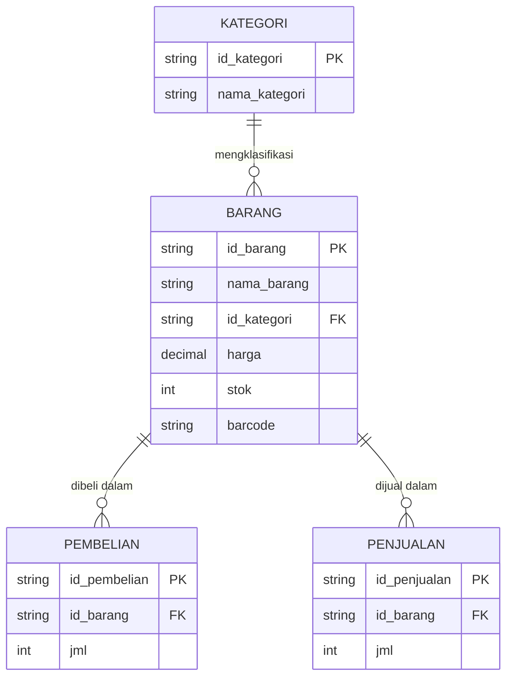

### Masalah yang Muncul

Field `id_barang` muncul di **tiga tabel sekaligus** — tabel `barang`, `pembelian`, dan `penjualan`:

| Tabel | Field | Status |
|---|---|---|
| `barang` | `id_barang` (PK) | Sumber data utama |
| `pembelian` | `id_barang` (FK) | Redundansi — diperlukan sebagai penghubung |
| `penjualan` | `id_barang` (FK) | Redundansi — diperlukan sebagai penghubung |

Jika `id_barang` di tabel `barang` diperbaharui (misalnya dari `B001` menjadi `PRD-001`), maka **seluruh tabel yang menyimpan `id_barang`** juga harus diperbaharui secara bersamaan — `pembelian` dan `penjualan`. Jika tidak, basis data akan inkonsisten.

> **Catatan penting**: ini adalah contoh **redundansi yang diperlukan** (FK). Solusinya bukan menghapus FK, melainkan memastikan mekanisme `ON UPDATE CASCADE` aktif — sehingga saat `id_barang` di tabel induk diperbarui, semua tabel anak otomatis ikut diperbarui oleh DBMS.

---

## 4. Pengertian De-Normalisasi

> **De-Normalisasi** merupakan proses pengembalian tabel yang tadinya normal menjadi tidak normal.
>
> **Tujuan**: untuk meningkatkan *performance* basis data.

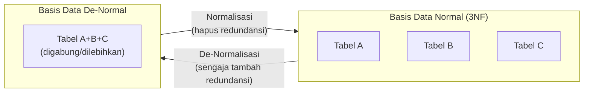

### Trade-off: Normalisasi vs De-Normalisasi

Normalisasi dan de-normalisasi adalah dua sisi dari spektrum yang sama. Tidak ada yang selalu "benar" — keputusan tergantung pada kebutuhan sistem:

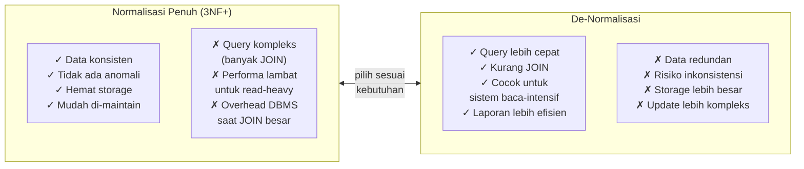

| Aspek | Normalisasi | De-Normalisasi |
|---|---|---|
| **Prioritas** | Integritas data | Performa query |
| **Cocok untuk** | Sistem transaksional (banyak insert/update/delete) | Sistem analitik/laporan (banyak read) |
| **Contoh use case** | Sistem kasir, e-commerce | Dashboard BI, laporan penjualan |
| **Risiko utama** | Query lambat (banyak JOIN) | Inkonsistensi data |

> **Kapan de-normalisasi dilakukan?** Ketika performa query menjadi hambatan nyata (*bottleneck*) dalam sistem — misalnya query laporan yang melibatkan 5+ tabel JOIN dan dijalankan ribuan kali per hari. De-normalisasi adalah keputusan sadar dengan konsekuensi yang harus dikelola.

---

## 5. Bentuk-Bentuk De-Normalisasi

De-normalisasi dapat diwujudkan dalam bentuk **perluasan aspek redudansi** yang dikontrol. Terdapat tiga bentuk utama:

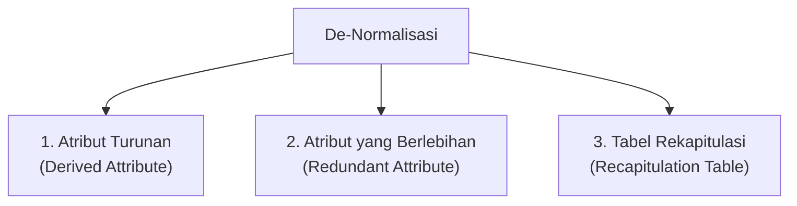

### 5.1 Atribut Turunan (*Derived Attribute*)

**Definisi**: kolom yang nilainya sebenarnya bisa **dihitung** dari kolom-kolom lain yang sudah ada di tabel yang sama.

Dalam normalisasi murni, atribut turunan **tidak perlu disimpan** karena bisa dihitung saat query. Namun dalam de-normalisasi, kita sengaja menyimpan hasil hitungan tersebut agar tidak perlu menghitung ulang setiap kali query dijalankan.

**Contoh**:

| Tabel Transaksi (Normalized — tanpa atribut turunan) |
|---|
| `id_transaksi` (PK), `id_barang` (FK), `harga`, `jumlah` |

```sql
-- Query harus menghitung setiap kali
SELECT id_transaksi, harga * jumlah AS total_harga FROM transaksi;
```

| Tabel Transaksi (De-normalized — dengan atribut turunan) |
|---|
| `id_transaksi` (PK), `id_barang` (FK), `harga`, `jumlah`, **`total_harga`** |

```sql
-- total_harga sudah tersimpan, query langsung ambil
SELECT id_transaksi, total_harga FROM transaksi;
```

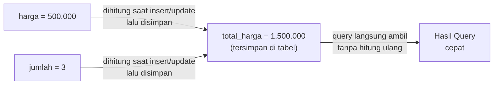

**Trade-off**: setiap kali `harga` atau `jumlah` diperbarui, kolom `total_harga` juga harus diperbarui (biasanya lewat trigger di DBMS).

### 5.2 Atribut yang Berlebihan (*Redundant Attribute*)

**Definisi**: kolom yang datanya sebenarnya sudah ada di tabel lain, tetapi **sengaja diduplikasi** ke tabel saat ini untuk menghindari operasi JOIN.

Dalam normalisasi murni, data ini tidak perlu ada di sini — cukup JOIN ke tabel asalnya. Namun jika JOIN tersebut mahal (tabel besar, sering diakses), de-normalisasi dengan menduplikasi kolom bisa mempercepat query secara signifikan.

**Contoh**:

| Normalized — nama_barang hanya di tabel barang |
|---|
| `barang`: `id_barang` (PK), `nama_barang`, `harga` |
| `transaksi`: `id_transaksi` (PK), `id_barang` (FK), `jumlah` |

```sql
-- Harus JOIN untuk tampilkan nama_barang
SELECT t.id_transaksi, b.nama_barang, t.jumlah 
FROM transaksi t JOIN barang b ON t.id_barang = b.id_barang;
```

| De-normalized — nama_barang diduplikasi ke tabel transaksi |
|---|
| `barang`: `id_barang` (PK), `nama_barang`, `harga` |
| `transaksi`: `id_transaksi` (PK), `id_barang` (FK), **`nama_barang`**, `jumlah` |

```sql
-- Tidak perlu JOIN
SELECT id_transaksi, nama_barang, jumlah FROM transaksi;
```

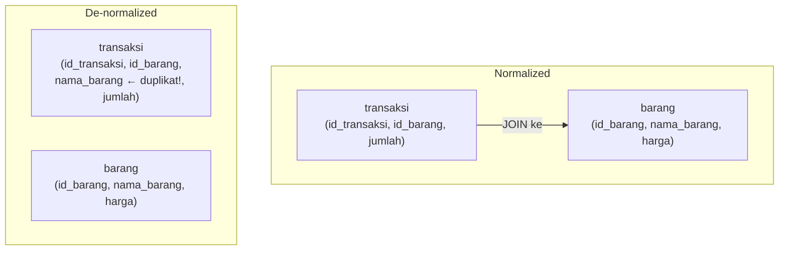

**Trade-off**: jika `nama_barang` di tabel `barang` diubah, kolom `nama_barang` di tabel `transaksi` juga harus ikut diperbarui — kalau tidak, akan terjadi inkonsistensi.

### 5.3 Tabel Rekapitulasi (*Recapitulation Table*)

**Definisi**: membuat **tabel terpisah** yang berisi data ringkasan/agregasi (*summary*) dari tabel-tabel lain. Tujuannya adalah menghindari operasi GROUP BY / agregasi yang berat dijalankan berulang kali saat query laporan.

**Contoh**: sistem penjualan yang setiap hari menghasilkan ribuan transaksi. Untuk laporan harian, query agregasi bisa sangat berat:

```sql
-- Query berat — dijalankan ratusan kali per hari
SELECT DATE(tgl_transaksi), SUM(total) AS total_penjualan, COUNT(*) AS jumlah_transaksi
FROM penjualan
GROUP BY DATE(tgl_transaksi);
```

Solusi de-normalisasi: buat tabel rekapitulasi yang diisi secara otomatis (lewat scheduled job/trigger):

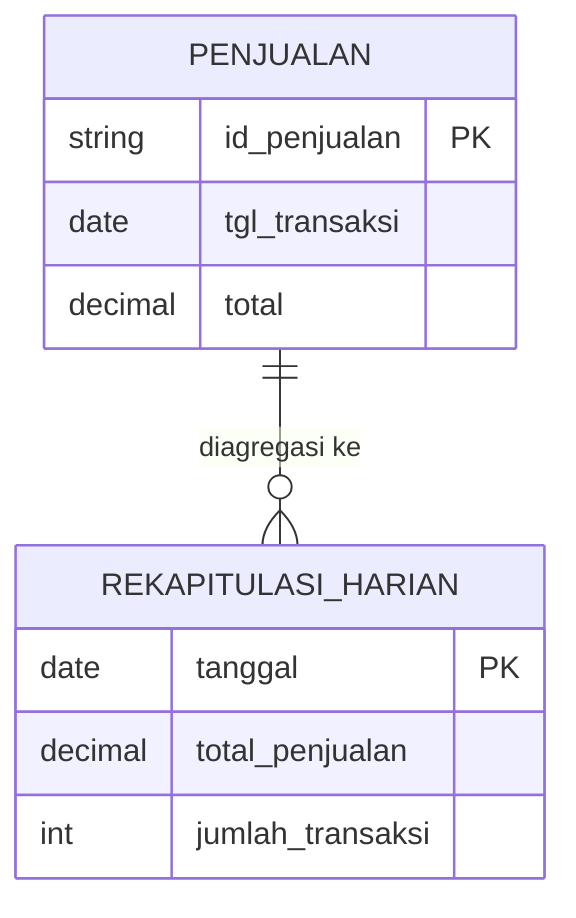

```sql
-- Query ringan dari tabel rekapitulasi
SELECT tanggal, total_penjualan, jumlah_transaksi
FROM rekapitulasi_harian
WHERE tanggal = '2024-03-07';
```

| Aspek | Tanpa Rekapitulasi | Dengan Rekapitulasi |
|---|---|---|
| **Kecepatan query laporan** | Lambat (scan jutaan baris) | Cepat (query satu baris per hari) |
| **Beban DBMS** | Tinggi saat laporan diakses | Ringan — beban dipindah ke proses aggregasi |
| **Ketepatan data** | Selalu real-time | Mungkin tertunda (tergantung jadwal update) |
| **Kompleksitas sistem** | Rendah | Tinggi (perlu mekanisme update rekapitulasi) |

> **Analogi**: tabel rekapitulasi seperti rangkuman harian yang disiapkan setiap malam. Pagi harinya, manajer cukup membaca rangkuman — tidak perlu membuka ribuan struk transaksi satu per satu.

---

## 6. Kapan Memilih Normalisasi vs De-Normalisasi?

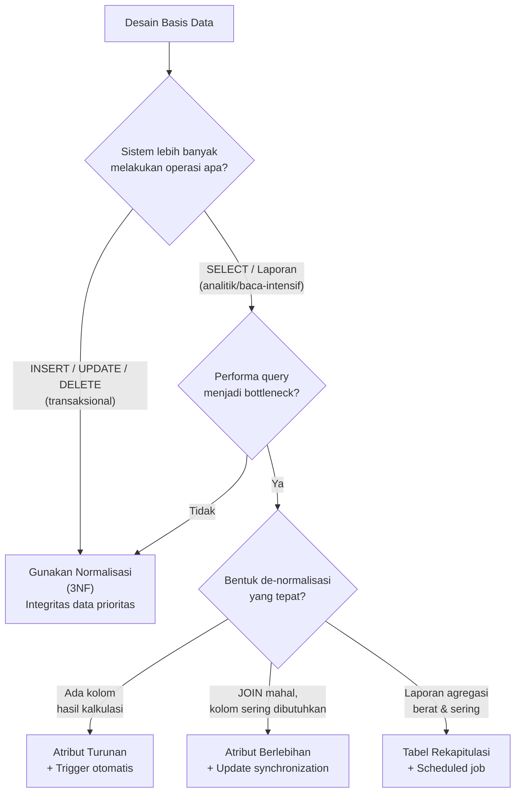

---

## Ringkasan Keterkaitan Antar Konsep

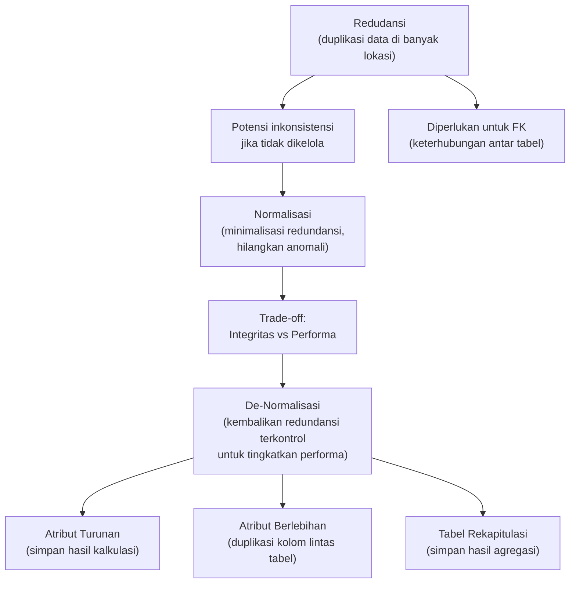

Inti dari sesi ini: **redundansi adalah pisau bermata dua** — di satu sisi harus diminimalkan (via normalisasi) agar data konsisten dan bebas anomali, tetapi di sisi lain tidak bisa dihilangkan sepenuhnya karena FK justru mengandalkan redundansi untuk menghubungkan tabel. **De-normalisasi** adalah langkah sadar — mundur selangkah dari normalisasi penuh — untuk mengorbankan sedikit konsistensi demi keuntungan performa yang signifikan. Tiga bentuknya (atribut turunan, atribut berlebihan, tabel rekapitulasi) masing-masing cocok untuk skenario yang berbeda, dan semua membutuhkan mekanisme sinkronisasi agar redundansi yang sengaja dibuat tetap terjaga konsistensinya.

---

*Selamat Belajar...*
