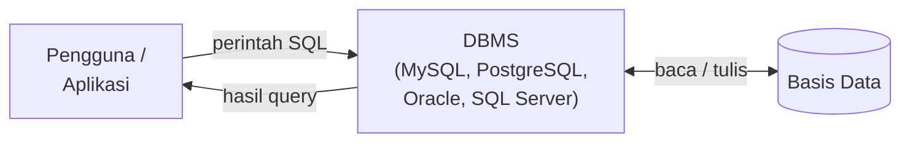
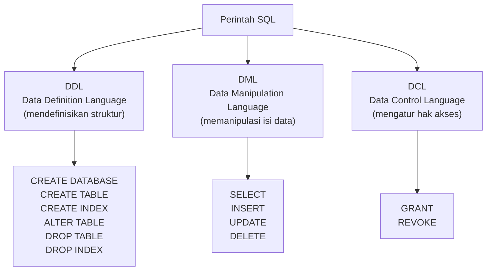
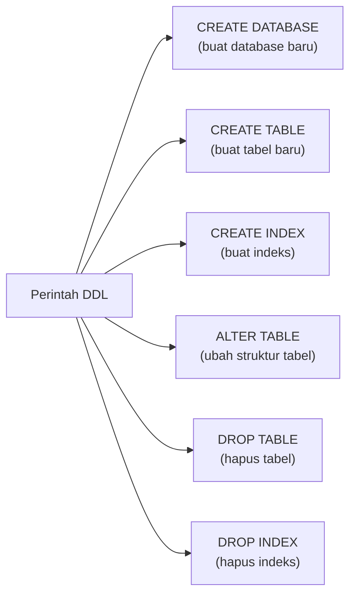
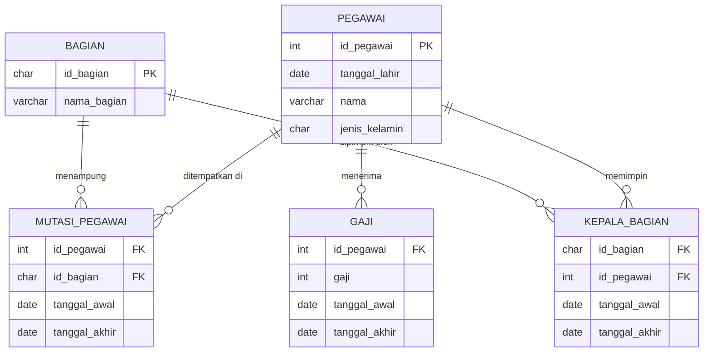
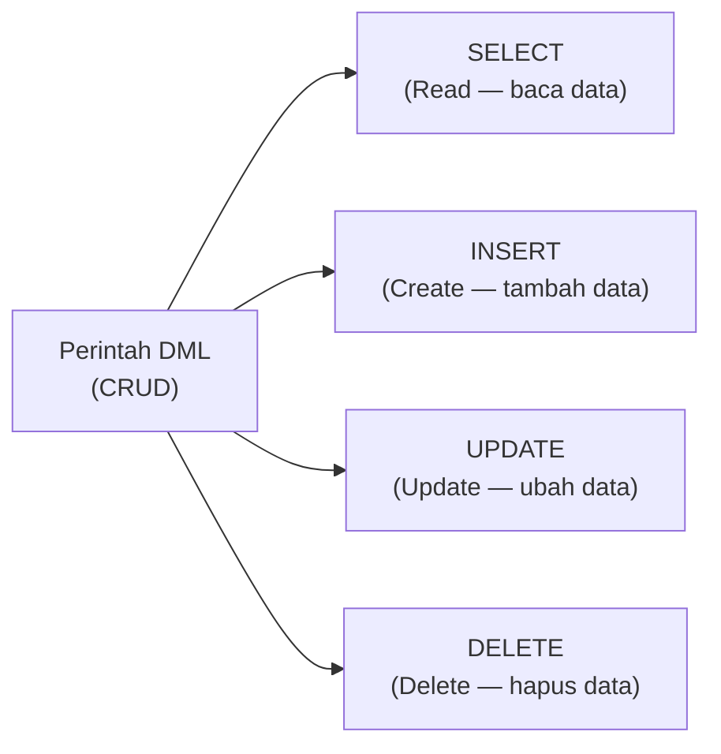
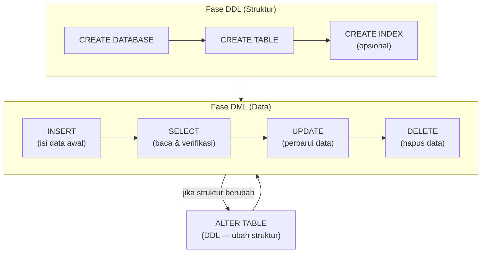
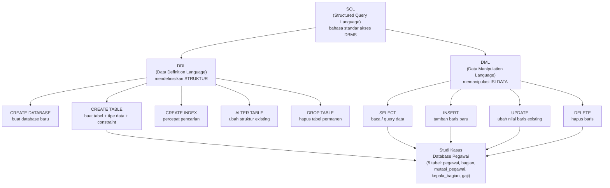

# Sesi 7 — SQL dan DML

**STSI4105 Basis Data**
Program Studi Sistem Informasi — Universitas Terbuka

> Catatan: dokumen ini merupakan ekstraksi sekaligus elaborasi dari materi *Aktivitas 7 — SQL dan DML*. Setiap perintah SQL dijelaskan dengan syntax lengkap, contoh kode nyata, dan studi kasus basis data "pegawai". Diagram ERD dari slide digambarkan ulang menggunakan mermaid.

---

## 1. Pengertian SQL

> ***Structured Query Language* (SQL)** adalah bahasa khusus yang digunakan untuk mengakses dan mengelola DBMS (*Database Management System*).

SQL telah distandarkan (oleh ANSI/ISO) namun telah berkembang banyak varian dan bentuk sesuai dengan kebutuhan pengembang dan penyedia DBMS.



### Mengapa SQL Penting?

SQL adalah **bahasa universal** untuk berinteraksi dengan basis data relasional. Apapun DBMS yang digunakan — MySQL, PostgreSQL, Oracle, SQL Server — sintaks dasarnya menggunakan SQL. Menguasai SQL berarti mampu bekerja di hampir semua sistem basis data relasional.

### Varian SQL di Berbagai DBMS

| DBMS | Varian SQL | Catatan |
|---|---|---|
| **MySQL / MariaDB** | MySQL SQL | Paling umum untuk web; open source |
| **PostgreSQL** | PL/pgSQL | Paling mendekati standar ANSI SQL |
| **Oracle** | PL/SQL | Banyak digunakan enterprise |
| **SQL Server** | T-SQL (Transact-SQL) | Produk Microsoft |
| **SQLite** | SQLite SQL | Ringan, file-based, sering untuk mobile |

---

## 2. Kategorisasi Perintah SQL

Perintah SQL dibagi menjadi beberapa kelompok berdasarkan fungsinya:



| Kelompok | Singkatan | Fungsi | Contoh Perintah |
|---|---|---|---|
| **DDL** | Data Definition Language | Mendefinisikan/mengubah **struktur** objek basis data | `CREATE`, `ALTER`, `DROP` |
| **DML** | Data Manipulation Language | Memanipulasi **isi data** di dalam tabel | `SELECT`, `INSERT`, `UPDATE`, `DELETE` |
| **DCL** | Data Control Language | Mengatur **hak akses** pengguna | `GRANT`, `REVOKE` |

### Tabel Pernyataan SQL

| No | Pernyataan | Kelompok | Keterangan |
|---|---|---|---|
| 1 | `ALTER` | DDL | Mengubah struktur tabel |
| 2 | `CREATE` | DDL | Membuat tabel atau indeks |
| 3 | `INSERT` | DML | Menambah sebuah baris dalam tabel |
| 4 | `SELECT` | DML | Memilih baris dan kolom pada tabel |
| 5 | `UPDATE` | DML | Mengubah nilai pada sebuah baris |

---

## 3. Tipe Data SQL

Sebelum mempelajari DDL, penting memahami tipe data yang digunakan mendefinisikan kolom:

| Tipe Data | Keterangan | Contoh Nilai | Contoh Deklarasi |
|---|---|---|---|
| `INT` | Bilangan bulat | 1, 100, -5 | `id_pegawai INT` |
| `VARCHAR(n)` | Teks variabel, maks n karakter | "Budi Santoso" | `nama VARCHAR(50)` |
| `CHAR(n)` | Teks tetap n karakter (diisi spasi jika kurang) | "L", "P", "A101" | `jenis_kelamin CHAR(1)` |
| `DATE` | Tanggal (YYYY-MM-DD) | 1990-05-17 | `tanggal_lahir DATE` |
| `DECIMAL(p,s)` | Bilangan desimal, p digit total, s di belakang koma | 9999.99 | `gaji DECIMAL(10,2)` |
| `TEXT` | Teks panjang tak terbatas | Paragraf panjang | `keterangan TEXT` |
| `BOOLEAN` | Nilai benar/salah | TRUE, FALSE | `aktif BOOLEAN` |

> **Kapan pakai `CHAR` vs `VARCHAR`?** Gunakan `CHAR(n)` saat panjang nilai selalu tetap (kode pos, kode bagian, jenis kelamin). Gunakan `VARCHAR(n)` saat panjang bervariasi (nama orang, alamat). `CHAR` sedikit lebih cepat karena tidak perlu menyimpan informasi panjang string.

---

## 4. Constraint (Kendala)

*Constraint* adalah aturan yang diterapkan pada kolom untuk menjaga integritas data:

| Constraint | Keterangan | Contoh |
|---|---|---|
| `NOT NULL` | Kolom tidak boleh kosong | `nama VARCHAR(50) NOT NULL` |
| `PRIMARY KEY` | Unik dan tidak boleh NULL — identitas baris | `id_pegawai INT PRIMARY KEY` |
| `FOREIGN KEY` | Nilai harus ada di tabel referensi — penghubung antar tabel | `FOREIGN KEY (id_bagian) REFERENCES bagian(id_bagian)` |
| `UNIQUE` | Nilai tidak boleh duplikat (boleh NULL) | `email VARCHAR(100) UNIQUE` |
| `DEFAULT` | Nilai otomatis jika tidak diisi | `status CHAR(1) DEFAULT 'A'` |
| `CHECK` | Nilai harus memenuhi kondisi tertentu | `CHECK (jenis_kelamin IN ('L','P'))` |

---

## 5. Perintah DDL (*Data Definition Language*)

DDL digunakan untuk mendefinisikan, mengubah, dan menghapus **struktur** objek basis data (database, tabel, indeks). DDL **tidak menyentuh isi data** — hanya struktur wadahnya.



### 5.1 CREATE DATABASE

Membuat basis data baru.

```sql
-- Syntax
CREATE DATABASE nama_database;

-- Contoh
CREATE DATABASE pegawai;
```

Setelah database dibuat, aktifkan dengan:

```sql
USE pegawai;
```

### 5.2 CREATE TABLE

Membuat tabel baru di dalam database yang aktif.

```sql
-- Syntax umum
CREATE TABLE nama_tabel (
    nama_kolom1  tipe_data  [constraint],
    nama_kolom2  tipe_data  [constraint],
    ...
    [CONSTRAINT pk_nama PRIMARY KEY (kolom_pk)],
    [CONSTRAINT fk_nama FOREIGN KEY (kolom_fk) REFERENCES tabel_referensi(kolom_ref)]
);
```

**Contoh — tabel pegawai**:

```sql
CREATE TABLE pegawai (
    id_pegawai    INT           NOT NULL,
    tanggal_lahir DATE          NOT NULL,
    nama          VARCHAR(50)   NOT NULL,
    jenis_kelamin CHAR(1)       NOT NULL,
    PRIMARY KEY (id_pegawai)
);
```

### 5.3 CREATE INDEX

Membuat indeks pada kolom tertentu untuk mempercepat pencarian data. Indeks bekerja seperti indeks buku — alih-alih membaca seluruh isi tabel, DBMS langsung loncat ke posisi yang tepat.

```sql
-- Syntax
CREATE INDEX nama_index ON nama_tabel (nama_kolom);

-- Contoh: buat indeks pada kolom nama di tabel pegawai
CREATE INDEX idx_nama_pegawai ON pegawai (nama);
```

> **Kapan membuat indeks?** Pada kolom yang sering digunakan di klausa `WHERE`, `JOIN`, atau `ORDER BY`. Indeks mempercepat READ tapi memperlambat sedikit INSERT/UPDATE/DELETE karena indeks harus diperbarui setiap kali data berubah.

### 5.4 ALTER TABLE

Mengubah struktur tabel yang sudah ada — menambah, mengubah, atau menghapus kolom.

```sql
-- Menambah kolom baru
ALTER TABLE nama_tabel ADD nama_kolom tipe_data [constraint];

-- Mengubah tipe data kolom
ALTER TABLE nama_tabel MODIFY nama_kolom tipe_data_baru;

-- Menghapus kolom
ALTER TABLE nama_tabel DROP COLUMN nama_kolom;

-- Menambah constraint PRIMARY KEY
ALTER TABLE nama_tabel ADD PRIMARY KEY (nama_kolom);

-- Contoh: tambahkan kolom email ke tabel pegawai
ALTER TABLE pegawai ADD email VARCHAR(100);

-- Contoh: tambahkan kolom golongan dengan nilai default
ALTER TABLE pegawai ADD golongan CHAR(2) DEFAULT 'IA';
```

### 5.5 DROP TABLE

Menghapus tabel beserta seluruh datanya secara permanen.

```sql
-- Syntax
DROP TABLE nama_tabel;

-- Contoh
DROP TABLE pegawai;
```

> **Peringatan**: `DROP TABLE` tidak bisa dibatalkan (*irreversible*). Seluruh data di dalamnya ikut terhapus. Pastikan ada backup sebelum menjalankan perintah ini di sistem produksi.

### 5.6 DROP INDEX

Menghapus indeks yang sudah dibuat.

```sql
-- Syntax (MySQL)
DROP INDEX nama_index ON nama_tabel;

-- Contoh
DROP INDEX idx_nama_pegawai ON pegawai;
```

---

## 6. Studi Kasus — Basis Data "pegawai"

### 6.1 Deskripsi Kasus

Membuat basis data dengan nama **"pegawai"** yang memiliki 5 tabel:

| Tabel | Deskripsi |
|---|---|
| `pegawai` | Data master pegawai (ID, nama, tgl lahir, jenis kelamin) |
| `bagian` | Data departemen/divisi perusahaan |
| `mutasi_pegawai` | Riwayat penempatan pegawai di bagian tertentu |
| `kepala_bagian` | Riwayat siapa yang menjabat kepala bagian |
| `gaji` | Riwayat besaran gaji pegawai dari waktu ke waktu |

### 6.2 ERD Basis Data Pegawai



### 6.3 SQL DDL Lengkap — Membangun Database Pegawai

**Langkah 1 — Buat database dan aktifkan:**

```sql
CREATE DATABASE pegawai;
USE pegawai;
```

**Langkah 2 — Buat tabel pegawai (tabel induk utama):**

```sql
CREATE TABLE pegawai (
    id_pegawai    INT           NOT NULL,
    tanggal_lahir DATE          NOT NULL,
    nama          VARCHAR(50)   NOT NULL,
    jenis_kelamin CHAR(1)       NOT NULL,
    PRIMARY KEY (id_pegawai)
);
```

**Langkah 3 — Buat tabel bagian:**

```sql
CREATE TABLE bagian (
    id_bagian   CHAR(4)       NOT NULL,
    nama_bagian VARCHAR(40)   NOT NULL,
    PRIMARY KEY (id_bagian)
);
```

**Langkah 4 — Buat tabel mutasi_pegawai (tabel penghubung pegawai ↔ bagian):**

```sql
CREATE TABLE mutasi_pegawai (
    id_pegawai    INT     NOT NULL,
    id_bagian     CHAR(4) NOT NULL,
    tanggal_awal  DATE    NOT NULL,
    tanggal_akhir DATE    NOT NULL
);
```

**Langkah 5 — Buat tabel kepala_bagian:**

```sql
CREATE TABLE kepala_bagian (
    id_bagian     CHAR(4) NOT NULL,
    id_pegawai    INT     NOT NULL,
    tanggal_awal  DATE    NOT NULL,
    tanggal_akhir DATE    NOT NULL
);
```

**Langkah 6 — Buat tabel gaji:**

```sql
CREATE TABLE gaji (
    id_pegawai    INT  NOT NULL,
    gaji          INT  NOT NULL,
    tanggal_awal  DATE NOT NULL,
    tanggal_akhir DATE NOT NULL
);
```

> **Urutan pembuatan tabel penting!** Tabel yang menjadi referensi FK harus dibuat lebih dulu. Di sini, tabel `pegawai` dan `bagian` dibuat sebelum tabel yang mereferensikannya (`mutasi_pegawai`, `kepala_bagian`, `gaji`).

---

## 7. Perintah DML (*Data Manipulation Language*)

DML digunakan untuk **memanipulasi isi data** di dalam tabel yang sudah ada. Ada empat perintah utama DML, sering disingkat **CRUD**: *Create, Read, Update, Delete*.



### 7.1 SELECT — Mengambil Data

> **SELECT** merupakan perintah SQL untuk **mengambil data** dari sebuah basis data.

```sql
-- Syntax dasar
SELECT kolom1, kolom2, ...
FROM nama_tabel
[WHERE kondisi]
[ORDER BY kolom ASC|DESC]
[LIMIT jumlah];

-- Ambil semua kolom
SELECT * FROM pegawai;

-- Ambil kolom tertentu
SELECT id_pegawai, nama, jenis_kelamin FROM pegawai;

-- Dengan filter WHERE
SELECT nama, tanggal_lahir
FROM pegawai
WHERE jenis_kelamin = 'P';

-- Dengan pengurutan
SELECT nama, tanggal_lahir
FROM pegawai
ORDER BY nama ASC;

-- Dengan LIMIT (ambil 10 baris pertama)
SELECT * FROM pegawai LIMIT 10;
```

**SELECT dengan JOIN** — menggabungkan data dari beberapa tabel:

```sql
-- Tampilkan nama pegawai beserta nama bagian tempat ia bertugas
SELECT p.nama, b.nama_bagian, m.tanggal_awal, m.tanggal_akhir
FROM pegawai p
JOIN mutasi_pegawai m ON p.id_pegawai = m.id_pegawai
JOIN bagian b ON m.id_bagian = b.id_bagian
ORDER BY p.nama;
```

**SELECT dengan fungsi agregasi**:

```sql
-- Hitung jumlah pegawai
SELECT COUNT(*) AS total_pegawai FROM pegawai;

-- Rata-rata gaji
SELECT AVG(gaji) AS rata_gaji FROM gaji;

-- Gaji tertinggi
SELECT MAX(gaji) AS gaji_tertinggi FROM gaji;
```

### 7.2 INSERT — Menambah Data

> **INSERT** merupakan perintah SQL untuk melakukan **penyisipan data** pada tabel dalam suatu basis data.

```sql
-- Syntax: menyebutkan nama kolom secara eksplisit (direkomendasikan)
INSERT INTO nama_tabel (kolom1, kolom2, ...)
VALUES (nilai1, nilai2, ...);

-- Syntax: tanpa nama kolom (urutan nilai harus sesuai urutan kolom tabel)
INSERT INTO nama_tabel
VALUES (nilai1, nilai2, ...);

-- Contoh: tambah data bagian
INSERT INTO bagian (id_bagian, nama_bagian)
VALUES ('HRD1', 'Human Resources');

INSERT INTO bagian (id_bagian, nama_bagian)
VALUES ('IT01', 'Teknologi Informasi');

-- Contoh: tambah data pegawai
INSERT INTO pegawai (id_pegawai, tanggal_lahir, nama, jenis_kelamin)
VALUES (1, '1990-05-17', 'Budi Santoso', 'L');

INSERT INTO pegawai (id_pegawai, tanggal_lahir, nama, jenis_kelamin)
VALUES (2, '1985-11-23', 'Siti Rahayu', 'P');

-- Contoh: tambah riwayat gaji
INSERT INTO gaji (id_pegawai, gaji, tanggal_awal, tanggal_akhir)
VALUES (1, 5000000, '2020-01-01', '2021-12-31');

-- Menyisipkan banyak baris sekaligus
INSERT INTO bagian (id_bagian, nama_bagian) VALUES
    ('AKT1', 'Akuntansi'),
    ('PMS1', 'Pemasaran'),
    ('OPS1', 'Operasional');
```

### 7.3 UPDATE — Mengubah Data

> **UPDATE** merupakan perintah SQL untuk melakukan **perubahan data** pada tabel dalam suatu basis data.

```sql
-- Syntax
UPDATE nama_tabel
SET kolom1 = nilai_baru1, kolom2 = nilai_baru2, ...
WHERE kondisi;

-- Contoh: ubah nama bagian
UPDATE bagian
SET nama_bagian = 'Human Resource & Development'
WHERE id_bagian = 'HRD1';

-- Contoh: ubah gaji pegawai tertentu
UPDATE gaji
SET gaji = 6500000
WHERE id_pegawai = 1 AND tanggal_awal = '2020-01-01';

-- Contoh: ubah beberapa kolom sekaligus
UPDATE pegawai
SET nama = 'Budi Santoso, S.Kom',
    tanggal_lahir = '1990-05-17'
WHERE id_pegawai = 1;
```

> **Selalu gunakan `WHERE`!** Tanpa `WHERE`, perintah `UPDATE` akan mengubah **semua baris** di tabel. Ini adalah kesalahan yang sering terjadi dan bisa sangat merusak data.
>
> ```sql
> -- BERBAHAYA: semua baris ikut diubah!
> UPDATE gaji SET gaji = 0;
>
> -- AMAN: hanya baris yang memenuhi kondisi
> UPDATE gaji SET gaji = 0 WHERE id_pegawai = 999;
> ```

### 7.4 DELETE — Menghapus Data

> **DELETE** merupakan perintah SQL untuk melakukan **penghapusan data** pada tabel dalam suatu basis data.

```sql
-- Syntax
DELETE FROM nama_tabel
WHERE kondisi;

-- Contoh: hapus pegawai dengan id tertentu
DELETE FROM pegawai
WHERE id_pegawai = 5;

-- Contoh: hapus riwayat mutasi yang sudah berakhir sebelum 2020
DELETE FROM mutasi_pegawai
WHERE tanggal_akhir < '2020-01-01';

-- Hapus semua data di tabel (tapi struktur tabel tetap ada)
DELETE FROM mutasi_pegawai;
```

> **Perbedaan DELETE vs DROP TABLE**:
> - `DELETE FROM tabel` → hapus **isi data** tabel; struktur tabel tetap ada dan bisa diisi kembali
> - `DROP TABLE tabel` → hapus **tabel** beserta seluruh datanya secara permanen; struktur hilang

---

## 8. Alur Kerja Lengkap — DDL lalu DML



| Tahap | Perintah | Pertanyaan yang Dijawab |
|---|---|---|
| **1. Rancang** | Kertas / ERD | Tabel apa saja? Kolom apa? Relasi bagaimana? |
| **2. Buat struktur** | `CREATE DATABASE`, `CREATE TABLE` | Bagaimana bentuk wadah datanya? |
| **3. Isi data** | `INSERT` | Data apa yang perlu dimasukkan? |
| **4. Baca data** | `SELECT` | Data apa yang ingin dilihat? Dengan filter apa? |
| **5. Perbarui data** | `UPDATE` | Data mana yang perlu diubah? |
| **6. Hapus data** | `DELETE` | Data mana yang sudah tidak diperlukan? |
| **7. Ubah struktur** | `ALTER TABLE` | Perlu tambah/ubah/hapus kolom? |

---

## Ringkasan Keterkaitan Antar Konsep



Inti dari sesi ini: **SQL adalah jembatan antara pengguna/aplikasi dengan basis data**. Perintah-perintahnya dibagi dua kelompok besar — DDL untuk mendefinisikan *wadah* (struktur tabel, database, indeks) dan DML untuk mengisi dan mengelola *isi* wadah tersebut (membaca, menambah, mengubah, dan menghapus data). Studi kasus basis data "pegawai" menunjukkan bagaimana alur kerja nyata berjalan: mulai dari merancang ERD, membuat struktur dengan DDL, hingga memanipulasi data dengan DML.

---

*Selamat Belajar...*
