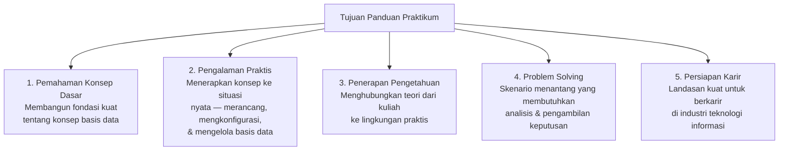
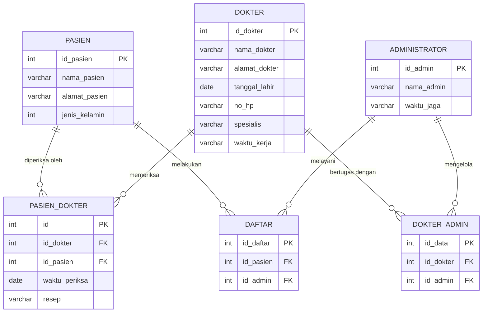
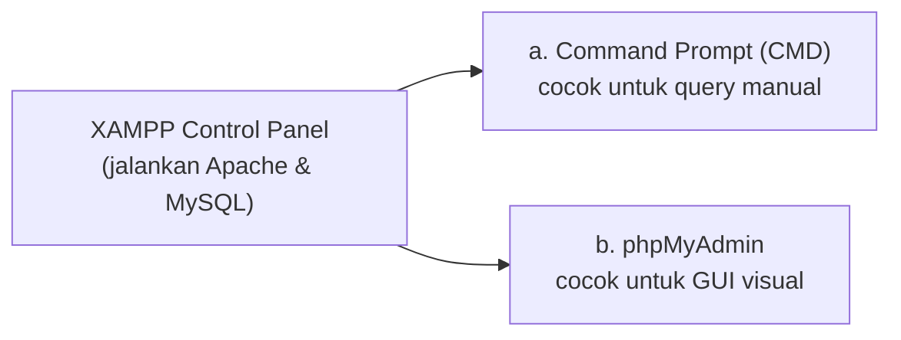
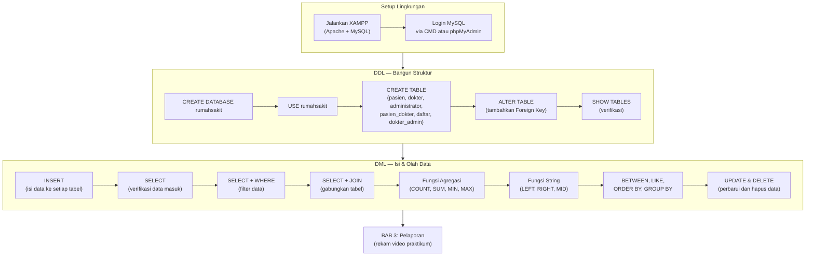

# Sesi 8 — Panduan Praktikum SQL

**STSI4105 Basis Data**
Program Studi Sistem Informasi — Universitas Terbuka

> Catatan: dokumen ini merupakan ekstraksi sekaligus elaborasi dari *Panduan Praktikum SQL (MSIM4206P Edisi 1)* — Penulis: Andri Suryadi, S.Kom., M.Kom.; Penelaah: Unggul Utan Sufandi, S.Kom., M.Si. Panduan ini bersifat hands-on — setiap perintah SQL disertai contoh nyata dari studi kasus Basis Data Rumah Sakit. File `rumahsakit.sql` di folder ini berisi dump lengkap yang bisa langsung diimport.

---

## BAB 1 — Pendahuluan

### Latar Belakang

Panduan praktikum ini dirancang khusus untuk para mahasiswa dengan tujuan memberikan pemahaman mendalam dan pengalaman praktis dalam bidang basis data. Di dalamnya terdapat:
- Petunjuk langkah demi langkah yang mudah dipahami
- Penjelasan teknis yang jelas
- Contoh kasus nyata implementasi basis data dalam kehidupan sehari-hari

### Tujuan Praktikum



### Ruang Lingkup

| Praktik | Topik |
|---|---|
| **Praktik 1** | Pembuatan Entity Relationship Diagram (ERD) |
| **Praktik 2** | SQL dan Data Manipulation Language (DML) |
| **Praktik 3** | Virtual Box, Transaksi dan Basis Data Terdistribusi |

> Panduan sesi ini fokus pada **Praktik 2: SQL dan DML** menggunakan studi kasus Basis Data Rumah Sakit.

---

## BAB 2 — Prosedur Pelaksanaan Praktikum

### A. Pengantar SQL

Sebelum praktikum, perlu mereview dua kelompok perintah SQL utama:

#### A.1 Data Definition Language (DDL)

DDL adalah kumpulan perintah SQL yang berfungsi untuk melakukan perubahan, membuat dan menghapus struktur objek-objek pada basis data. Objek yang dimaksud adalah: **Table, View, Index, Procedure (*Stored Procedure*), Function, dan Trigger**.

| No | Perintah DDL | Keterangan |
|---|---|---|
| 1 | `CREATE` | Membuat basis data dan tabel |
| 2 | `ALTER` | Mengubah struktur tabel — menambah, mengganti nama, atau menghapus *field* |
| 3 | `DROP` | Menghapus nama tabel atau basis data |

#### A.2 Data Manipulation Language (DML)

DML adalah kumpulan perintah SQL yang berfungsi untuk proses pengolahan data dalam setiap tabel basis data.

| No | Perintah DML | Keterangan |
|---|---|---|
| 1 | `INSERT` | Memasukkan data ke dalam basis data |
| 2 | `UPDATE` | Melakukan perubahan data dalam basis data |
| 3 | `DELETE` | Menghapus data dalam basis data |
| 4 | `SELECT` | Mengambil data dari basis data |
| 5 | `BETWEEN` | Mengambil data tertentu antara nilai 1 dengan nilai 2 |
| 6 | `LIKE` | Mengambil data tertentu dengan sebuah karakter |
| 7 | `ORDER BY` | Mengurutkan data (ASC: menaik / DESC: menurun) |
| 8 | `GROUP BY` | Mengelompokkan data |
| 9 | **Fungsi Statistika** | `COUNT` (jumlah baris), `SUM` (total), `MIN` (terendah), `MAX` (tertinggi) |
| 10 | **Fungsi String** | `Left(x,n)` (dari kiri), `Right(x,n)` (dari kanan), `Mid(x,n,z)` (dari tengah) |

---

### B. Pelaksanaan — Studi Kasus Basis Data Rumah Sakit

#### Gambaran Sistem

Basis data `rumahsakit` memiliki **6 tabel** yang dimodelkan dari ERD berikut:



| Tabel | Peran |
|---|---|
| `pasien` | Data master pasien |
| `dokter` | Data master dokter beserta spesialisasi |
| `administrator` | Data admin/petugas rumah sakit |
| `pasien_dokter` | Riwayat pemeriksaan pasien oleh dokter (junction table) |
| `daftar` | Catatan pendaftaran pasien yang dilayani admin |
| `dokter_admin` | Relasi dokter dengan administrator yang bertugas bersama |

---

### B.1 Masuk ke MySQL/MariaDB

Terdapat **dua cara** mengakses basis data MySQL/MariaDB. Langkah pertama untuk keduanya: jalankan service MySQL dan Apache melalui **XAMPP Control Panel** (pastikan background text berwarna hijau = aktif).



**a. Akses via Command Prompt (CMD)**:

```bash
# 1. Buka CMD: Win+R → ketik cmd → OK
# 2. Arahkan ke folder MySQL
cd xampp\mysql\bin

# 3. Login ke MySQL sebagai root
Mysql -u root

# 4. Tampilkan semua database yang ada
show databases;
```

**b. Akses via phpMyAdmin**:

Buka browser, masuk ke: `http://localhost/phpmyadmin`

> Kedua cara menghasilkan output yang sama — pilih sesuai preferensi. CMD lebih cocok untuk latihan menulis SQL secara manual; phpMyAdmin lebih cocok untuk inspeksi visual.

---

### B.2 DDL — Membangun Struktur Database

#### a. Membuat Basis Data

```sql
CREATE DATABASE rumahsakit;

-- Aktifkan database yang baru dibuat
USE rumahsakit;

-- Verifikasi
SHOW DATABASES;
```

#### b. Menghapus Basis Data

```sql
DROP DATABASE rumahsakit;
```

> **Peringatan**: `DROP DATABASE` menghapus database beserta **seluruh tabelnya** secara permanen. Tidak ada konfirmasi — eksekusi langsung terjadi.

#### c. Membuat Tabel

Syntax umum:

```sql
CREATE TABLE nama_tabel (
    field_1  type(length)  PRIMARY KEY [AUTO_INCREMENT],
    field_2  type(length),
    field_3  type(length),
    ...
);
```

**Tabel 1 — `pasien`**:

```sql
CREATE TABLE pasien (
    id_pasien     int(3)        PRIMARY KEY AUTO_INCREMENT,
    nama_pasien   varchar(30),
    alamat_pasien varchar(100),
    jenis_kelamin int(1)
);
```

**Tabel 2 — `administrator`**:

```sql
CREATE TABLE administrator (
    id_admin    int(3)        PRIMARY KEY AUTO_INCREMENT,
    nama_admin  varchar(30),
    waktu_jaga  varchar(100)
);
```

**Tabel 3 — `dokter`**:

```sql
CREATE TABLE dokter (
    id_dokter     int(3)        PRIMARY KEY AUTO_INCREMENT,
    nama_dokter   varchar(30),
    alamat_dokter varchar(100),
    tanggal_lahir date,
    no_hp         varchar(15),
    spesialis     varchar(15),
    waktu_kerja   varchar(100)
);
```

**Tabel 4 — `dokter_admin`** (junction table):

```sql
CREATE TABLE dokter_admin (
    id_data   int(3)  PRIMARY KEY AUTO_INCREMENT,
    id_dokter int(3),
    id_admin  int(3)
);
```

**Tabel 5 — `pasien_dokter`** (junction table):

```sql
CREATE TABLE pasien_dokter (
    id            int(3)        PRIMARY KEY AUTO_INCREMENT,
    id_dokter     int(3),
    id_pasien     int(3),
    waktu_periksa date,
    resep         varchar(100)
);
```

**Tabel 6 — `daftar`**:

```sql
CREATE TABLE daftar (
    id_daftar int(3)  PRIMARY KEY AUTO_INCREMENT,
    id_pasien int(3),
    id_admin  int(3)
);
```

Verifikasi semua tabel sudah terbuat:

```sql
SHOW TABLES;
-- Output: administrator, daftar, dokter, dokter_admin, pasien, pasien_dokter
```

#### d. Membuat Relasi (Foreign Key)

Setelah semua tabel dibuat, tetapkan *foreign key* untuk menjaga integritas referensial. Berikut tabel-tabel yang memerlukan FK:

| Tabel | Foreign Key | Referensi ke |
|---|---|---|
| `dokter_admin` | `id_dokter` | `dokter(id_dokter)` |
| `dokter_admin` | `id_admin` | `administrator(id_admin)` |
| `daftar` | `id_pasien` | `pasien(id_pasien)` |
| `daftar` | `id_admin` | `administrator(id_admin)` |
| `pasien_dokter` | `id_dokter` | `dokter(id_dokter)` |
| `pasien_dokter` | `id_pasien` | `pasien(id_pasien)` |

Cara menambahkan FK via SQL:

```sql
-- FK pada tabel pasien_dokter
ALTER TABLE pasien_dokter
    ADD CONSTRAINT fk_pd_dokter
        FOREIGN KEY (id_dokter) REFERENCES dokter(id_dokter)
        ON DELETE CASCADE ON UPDATE CASCADE,
    ADD CONSTRAINT fk_pd_pasien
        FOREIGN KEY (id_pasien) REFERENCES pasien(id_pasien)
        ON DELETE CASCADE ON UPDATE CASCADE;

-- FK pada tabel daftar
ALTER TABLE daftar
    ADD CONSTRAINT fk_df_pasien
        FOREIGN KEY (id_pasien) REFERENCES pasien(id_pasien)
        ON DELETE CASCADE ON UPDATE CASCADE,
    ADD CONSTRAINT fk_df_admin
        FOREIGN KEY (id_admin) REFERENCES administrator(id_admin)
        ON DELETE CASCADE ON UPDATE CASCADE;

-- FK pada tabel dokter_admin
ALTER TABLE dokter_admin
    ADD CONSTRAINT fk_da_dokter
        FOREIGN KEY (id_dokter) REFERENCES dokter(id_dokter)
        ON DELETE CASCADE ON UPDATE CASCADE,
    ADD CONSTRAINT fk_da_admin
        FOREIGN KEY (id_admin) REFERENCES administrator(id_admin)
        ON DELETE CASCADE ON UPDATE CASCADE;
```

> **`ON DELETE CASCADE` dan `ON UPDATE CASCADE`**: ketika baris di tabel induk dihapus/diperbarui, semua baris anak yang mereferensinya otomatis ikut dihapus/diperbarui — menjaga konsistensi data secara otomatis.

---

### B.3 DML — Mengisi dan Mengolah Data

#### Data Sampel

Tabel pasien yang digunakan sebagai contoh utama:

| id_pasien | nama_pasien | alamat_pasien | jenis_kelamin |
|---|---|---|---|
| 1 | Joko Widodo | Jalan Pakis haji no 35 Jakarta | 1 (Pria) |
| 2 | Susilo | Jl Pungkur no 4 Jakarta | 1 (Pria) |
| 3 | Popi | Jl Mawar no. 1 Bekasi | 2 (Wanita) |
| 4 | Bunga | Jl. Merdeka Jakarta | 2 (Wanita) |
| 5 | Mirna | Jl. Jakarta no 23 | 2 (Wanita) |

> Data lengkap semua tabel tersedia di file [`rumahsakit.sql`](rumahsakit.sql) — bisa langsung diimport ke MySQL.

---

#### a. INSERT — Memasukkan Data

```sql
-- Syntax
INSERT [INTO] nama_tabel [daftar_kolom] VALUES [daftar_nilai];

-- Contoh: insert satu pasien
INSERT INTO pasien (id_pasien, nama_pasien, alamat_pasien, jenis_kelamin)
VALUES (1, 'Joko Widodo', 'Jalan Pakis haji no 35 Jakarta', 1);

-- Insert banyak baris sekaligus
INSERT INTO pasien (id_pasien, nama_pasien, alamat_pasien, jenis_kelamin) VALUES
    (2, 'Susilo', 'Jl Pungkur no 4 Jakarta', 1),
    (3, 'Popi', 'Jl Mawar no. 1 Bekasi', 2),
    (4, 'Bunga', 'Jl. Merdeka Jakarta', 2),
    (5, 'Mirna', 'Jl. Jakarta no 23', 2);
```

---

#### b. SELECT — Mengambil Data

**b.1 — Semua kolom dan baris**:

```sql
-- Syntax
SELECT [Field] FROM [Nama_Tabel];

-- Ambil semua kolom (wildcard *)
SELECT * FROM pasien;
```

Hasil:

| id_pasien | nama_pasien | alamat_pasien | jenis_kelamin |
|---|---|---|---|
| 1 | Joko Widodo | Jalan Pakis haji no 35 Jakarta | 1 |
| 2 | Susilo | Jl Pungkur no 4 Jakarta | 1 |
| 3 | Popi | Jl Mawar no. 1 Bekasi | 2 |
| 4 | Bunga | Jl. Merdeka Jakarta | 2 |
| 5 | Mirna | Jl. Jakarta no 23 | 2 |

**b.2 — Kolom tertentu saja**:

```sql
SELECT nama_pasien, jenis_kelamin FROM pasien;
```

---

#### c. SELECT Bersyarat (WHERE)

```sql
-- Syntax
SELECT [Field]
FROM [Nama_Tabel]
WHERE Field = [nilai field];

-- Contoh: tampilkan pasien dengan jenis_kelamin = 1 (pria)
SELECT nama_pasien, jenis_kelamin
FROM pasien
WHERE jenis_kelamin = '1';
```

Hasil: hanya Joko Widodo dan Susilo yang muncul.

---

#### d. SELECT JOIN Antar Tabel

SELECT JOIN berfungsi untuk mengambil dan menampilkan data dari **beberapa tabel sekaligus** berdasarkan relasi kolom yang sama.

```sql
-- Syntax
SELECT table_n.field
FROM table1
JOIN table2 ON table1.field = table2.field;
```

**Contoh**: tampilkan nama pasien, waktu periksa, resep, dan nama dokter yang menanganinya — melibatkan 3 tabel (`pasien`, `pasien_dokter`, `dokter`):

```sql
SELECT   p.nama_pasien, pd.waktu_periksa, pd.resep, d.nama_dokter
FROM     pasien p
JOIN     pasien_dokter pd ON p.id_pasien = pd.id_pasien
JOIN     dokter d         ON pd.id_dokter = d.id_dokter;
```

Hasil:

| nama_pasien | waktu_periksa | resep | nama_dokter |
|---|---|---|---|
| Joko Widodo | 2025-09-01 | Amoxicillin 500mg 3x1 | Budi Harmoko |
| Bunga | 2025-09-02 | Antasida 2x1 | Budi Harmoko |
| Susilo | 2025-09-18 | Paracetamol 500mg 3x1 | Budi Harmoko |

**JOIN + WHERE**: tampilkan hanya pasien yang ditangani dokter dengan id_dokter = 1 (Budi Harmoko):

```sql
SELECT   p.nama_pasien, pd.waktu_periksa, pd.resep, d.nama_dokter
FROM     pasien p
JOIN     pasien_dokter pd ON p.id_pasien = pd.id_pasien
JOIN     dokter d         ON pd.id_dokter = d.id_dokter
WHERE    d.id_dokter = '1';
```

---

#### e. Fungsi Matematika (Agregasi)

| Fungsi | Keterangan | Contoh |
|---|---|---|
| `COUNT(kolom)` | Menghitung banyaknya baris | `COUNT(id_pasien)` |
| `SUM(kolom)` | Menghitung total jumlah | `SUM(gaji)` |
| `MIN(kolom)` | Mencari nilai terendah | `MIN(harga)` |
| `MAX(kolom)` | Mencari nilai tertinggi | `MAX(harga)` |

Syntax umum:

```sql
SELECT [fungsi_matematika](Nama_Field)
FROM [Nama_Tabel];
```

Contoh — hitung jumlah pasien yang terdaftar:

```sql
SELECT count(id_pasien) FROM pasien;
-- Hasil: 5
```

---

#### f. Fungsi String

Fungsi string mengambil sebagian nilai teks berdasarkan posisi karakter.

| Fungsi | Parameter | Keterangan |
|---|---|---|
| `Left(x, n)` | x = nama kolom, n = jumlah karakter | Ambil n karakter dari **kiri** |
| `Right(x, n)` | x = nama kolom, n = jumlah karakter | Ambil n karakter dari **kanan** |
| `Mid(x, n, z)` | x = kolom, n = posisi mulai, z = jumlah karakter | Ambil z karakter mulai posisi n |

Syntax umum:

```sql
SELECT [Nama_Field] FROM [Nama_Tabel]
WHERE [FUNGSI_STRING] = "karakter_string";
```

Contoh — cari pasien yang alamatnya berawalan "Jl" (2 karakter dari kiri):

```sql
SELECT * FROM pasien
WHERE left(alamat_pasien, 2) = 'Jl';
```

Hasil: Susilo, Popi, Bunga, Mirna (4 baris — Joko Widodo tidak masuk karena diawali "Jalan").

---

#### g. SELECT BETWEEN

BETWEEN digunakan untuk mengambil data dalam **rentang nilai** tertentu.

```sql
-- Syntax
SELECT * FROM [Nama_Tabel]
WHERE [Nama_Field] BETWEEN [nilai1] AND [nilai2];

-- Contoh: tampilkan pasien dengan id_pasien antara 3 sampai 5
SELECT * FROM pasien
WHERE id_pasien BETWEEN 3 AND 5;
```

Hasil: Popi (3), Bunga (4), Mirna (5).

---

#### h. SELECT LIKE

LIKE digunakan untuk mencari data berdasarkan **pola karakter** tertentu. Tanda `%` berarti "karakter apapun sejumlah apapun".

```sql
-- Syntax
SELECT * FROM [Nama_Tabel]
WHERE [Nama_Field] LIKE '%karakter_dicari%';

-- Contoh: cari pasien yang alamatnya mengandung kata "Jakarta"
SELECT * FROM pasien
WHERE alamat_pasien LIKE '%Jakarta%';
```

Hasil: Joko Widodo, Susilo, Bunga, Mirna (4 pasien — semua yang alamatnya mengandung "Jakarta").

| Pola LIKE | Artinya |
|---|---|
| `'%Jakarta%'` | Mengandung "Jakarta" di mana saja |
| `'Jakarta%'` | Dimulai dengan "Jakarta" |
| `'%Jakarta'` | Diakhiri dengan "Jakarta" |
| `'J_k_'` | Pola eksak: J + 1 huruf + k + 1 huruf |

---

#### i. SELECT ORDER BY

ORDER BY mengurutkan hasil query berdasarkan kolom tertentu.

```sql
-- Syntax
SELECT * FROM [Nama_Tabel]
ORDER BY [Nama_Kolom] ASC|DESC;

-- Contoh: tampilkan pasien diurutkan id_pasien dari besar ke kecil (DESC)
SELECT * FROM pasien
ORDER BY id_pasien DESC;
```

Hasil: Mirna (5), Bunga (4), Popi (3), Susilo (2), Joko Widodo (1).

---

#### j. SELECT GROUP BY

GROUP BY mengelompokkan baris-baris yang memiliki nilai sama pada kolom tertentu — secara efektif menghilangkan duplikasi dalam pengelompokan.

```sql
-- Syntax
SELECT * FROM [Nama_Tabel]
GROUP BY [Nama_Kolom];

-- Contoh: kelompokkan pasien berdasarkan jenis_kelamin
SELECT * FROM pasien
GROUP BY jenis_kelamin;
```

Hasil: hanya 2 baris — satu perwakilan jenis_kelamin=1 dan satu perwakilan jenis_kelamin=2.

> GROUP BY sering dikombinasikan dengan fungsi agregasi:
> ```sql
> SELECT jenis_kelamin, COUNT(*) AS jumlah
> FROM pasien
> GROUP BY jenis_kelamin;
> -- Hasil: 1→2 orang pria, 2→3 orang wanita
> ```

---

#### k. UPDATE — Mengubah Data

```sql
-- Syntax
UPDATE [Nama_Tabel]
SET [field] = [nilai_baru]
WHERE [kode_unik] = [nilai_kode_unik];

-- Contoh: ubah nama pasien id=5 dari 'Mirna' menjadi 'Mirna Maryati'
UPDATE pasien
SET nama_pasien = 'Mirna Maryati'
WHERE id_pasien = 5;

-- Verifikasi perubahan
SELECT * FROM pasien;
```

> **Wajib gunakan `WHERE`!** Tanpa `WHERE`, semua baris di tabel akan diubah. Selalu tentukan kondisi spesifik agar hanya baris yang dimaksud yang terpengaruh.

---

#### l. DELETE — Menghapus Data

```sql
-- Syntax
DELETE FROM [Nama_Tabel]
WHERE [Nama_Field_Unik] = [nilai];

-- Contoh: hapus pasien dengan id_pasien = 5
DELETE FROM pasien
WHERE id_pasien = 5;
```

> **Perbedaan penting**:
> - `DELETE FROM pasien WHERE id_pasien=5` → hapus **satu baris**; tabel tetap ada
> - `DELETE FROM pasien` → hapus **semua baris**; tabel tetap ada (kosong)
> - `DROP TABLE pasien` → hapus **tabel beserta semua datanya**; tabel hilang

---

## Alur Praktikum Lengkap



---

## BAB 3 — Pelaporan dan Penilaian

Setelah melakukan praktikum DDL dan/atau DML, mahasiswa wajib menyusun laporan sebagai dasar penilaian.

**Format Pelaporan**: upload link rekaman video yang menampilkan:

| | Konten Video |
|---|---|
| a | Perkenalan identitas mahasiswa |
| b | Langkah-langkah praktik yang dilakukan, disertai aktivitas kegiatan mahasiswa |
| c | Hasil praktik yang telah dilakukan |
| d | Kata-kata penutup dari mahasiswa |

---

## Referensi Cepat — Semua Perintah SQL yang Dipelajari

```mermaid
flowchart TD
    SQL["SQL\nBasis Data Rumah Sakit"] --> DDL3["DDL\n(Struktur)"]
    SQL --> DML3["DML\n(Data)"]
    DDL3 --> C1["CREATE DATABASE\nbuat database baru"]
    DDL3 --> C2["CREATE TABLE\nbuat tabel + kolom + tipe data"]
    DDL3 --> C3["ALTER TABLE ADD CONSTRAINT FK\ntambahkan foreign key"]
    DDL3 --> C4["DROP DATABASE / DROP TABLE\nhapus database atau tabel"]
    DML3 --> M1["INSERT INTO ... VALUES\nmasukkan data baru"]
    DML3 --> M2["SELECT * FROM ...\nambil semua data"]
    DML3 --> M3["SELECT ... WHERE\nfilter dengan kondisi"]
    DML3 --> M4["SELECT ... JOIN ... ON\ngabungkan banyak tabel"]
    DML3 --> M5["SELECT COUNT/SUM/MIN/MAX\nfungsi agregasi statistika"]
    DML3 --> M6["SELECT ... WHERE LEFT/RIGHT/MID\nfungsi string"]
    DML3 --> M7["SELECT ... WHERE BETWEEN\nrentang nilai"]
    DML3 --> M8["SELECT ... WHERE LIKE '%...%'\npola karakter"]
    DML3 --> M9["SELECT ... ORDER BY ASC/DESC\nurutan naik/turun"]
    DML3 --> M10["SELECT ... GROUP BY\nkelompokkan data"]
    DML3 --> M11["UPDATE ... SET ... WHERE\nubah data"]
    DML3 --> M12["DELETE FROM ... WHERE\nhapus data"]
```



> File `rumahsakit.sql` di folder ini berisi dump lengkap (struktur + data) yang bisa langsung diimport: `mysql -u root -p rumahsakit < rumahsakit.sql`

---

*Selamat Belajar...*
