# Sesi 9 — Manajemen Transaksi

**STSI4105 Basis Data**
Program Studi Sistem Informasi — Universitas Terbuka

> Catatan: dokumen ini merupakan ekstraksi sekaligus elaborasi dari materi *Aktivitas 9 — Manajemen Transaksi*. Setiap konsep dijelaskan lebih dalam dengan analogi, diagram state machine, skenario konflik, dan perintah SQL transaksi. Diagram dari slide digambarkan ulang menggunakan mermaid.

---

## 1. Pengertian Transaksi

> **Transaksi** adalah eksekusi program oleh pengguna di dalam sebuah DBMS sebagai rangkaian membaca dan menulis.

> **Transaksi** merupakan serangkaian proses tindakan atau daftar tindakan dalam sebuah basis data *(Gehrke, n.d.)*. Tindakan tersebut meliputi **membaca (*read*)** dan **menulis (*write*)** pada sebuah basis data.

Karena adanya proses membaca dan menulis secara bersamaan, maka diperlukan **konsistensi basis data** berkaitan dengan integritas data.

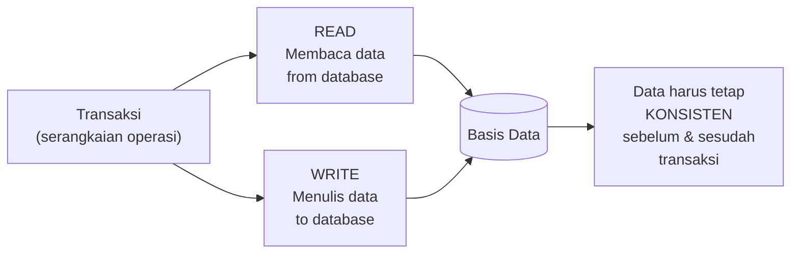

### Contoh Nyata: Transfer Rekening Bank

Bayangkan transaksi transfer saldo Rp 1.000.000 dari rekening A ke rekening B:

```sql
-- Transaksi transfer: harus berhasil SEMUA atau GAGAL SEMUA
START TRANSACTION;
    UPDATE rekening SET saldo = saldo - 1000000 WHERE id = 'A';  -- kurangi A
    UPDATE rekening SET saldo = saldo + 1000000 WHERE id = 'B';  -- tambah B
COMMIT;  -- simpan permanen jika keduanya berhasil
```

Jika langkah pertama berhasil (kurangi A) tetapi langkah kedua gagal (listrik mati), uang "hilang" dari A tetapi tidak masuk ke B. Transaksi memastikan ini **tidak terjadi** — jika salah satu gagal, semuanya dibatalkan (*rollback*).

### Kegunaan Transaksi

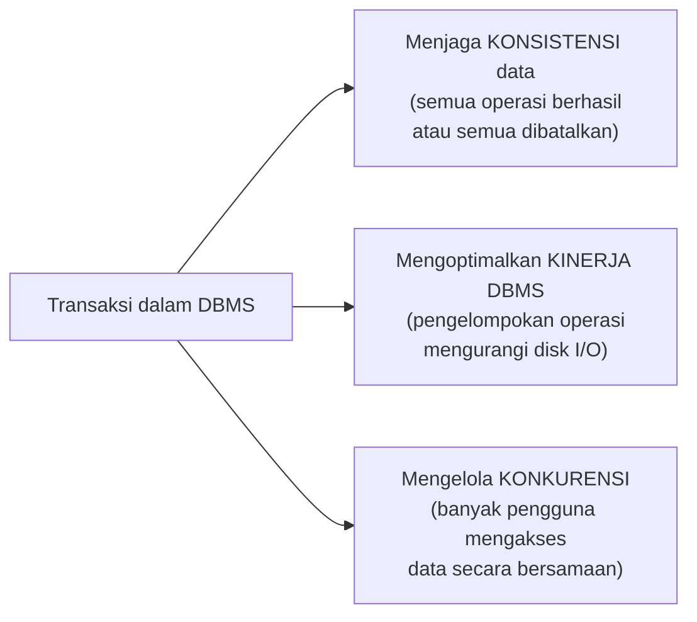

---

## 2. Properti ACID

Berkaitan dengan integritas data, terdapat properti-properti yang menjamin bahwa transaksi dapat berjalan dengan baik. Properti-properti ini dikenal dengan **ACID**:

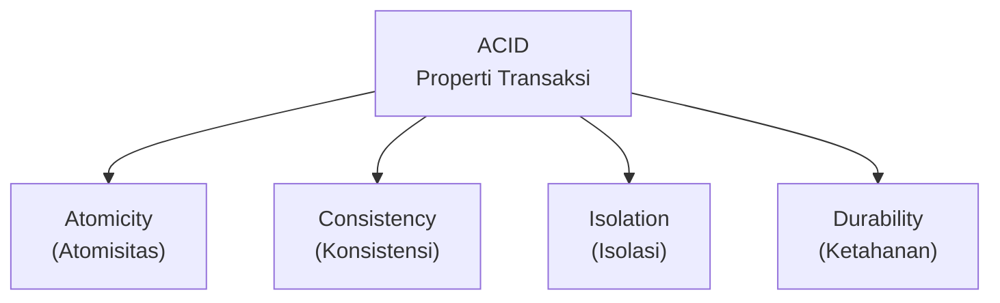

### 2.1 Atomicity (Atomisitas)

> Transaksi adalah **satu unit pekerjaan yang tidak bisa dibagi-bagi** — semua operasi berhasil (*commit*) atau semua dibatalkan (*rollback*).

Tidak ada keadaan "setengah selesai". Jika transaksi transfer bank gagal di tengah jalan, DBMS memastikan saldo A dikembalikan ke nilai semula.

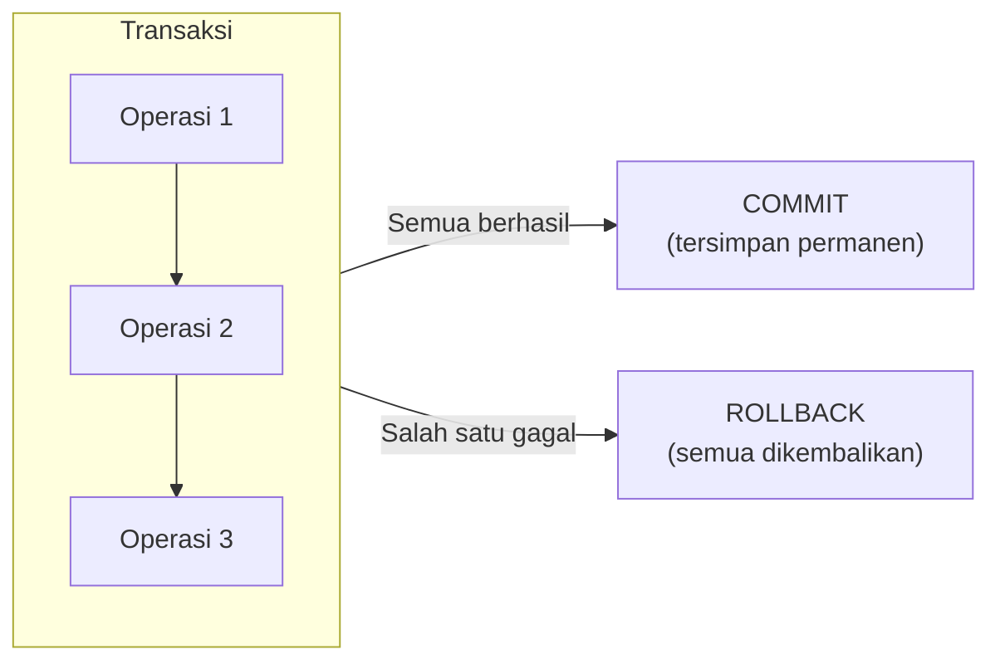

### 2.2 Consistency (Konsistensi)

> Transaksi membawa basis data dari **satu keadaan konsisten ke keadaan konsisten lainnya**. Constraint integritas (PRIMARY KEY, FOREIGN KEY, NOT NULL, CHECK) harus terpenuhi sebelum dan sesudah transaksi.

Contoh: total saldo sebelum transfer (A+B = 5jt) harus sama dengan total saldo sesudah transfer (A+B = 5jt). Nilainya berpindah, totalnya konsisten.

### 2.3 Isolation (Isolasi)

> Transaksi yang berjalan bersamaan **tidak boleh saling mengganggu**. Setiap transaksi seolah-olah berjalan sendiri, tanpa melihat perubahan yang sedang dikerjakan transaksi lain.

Contoh: jika transaksi A sedang memindahkan saldo, transaksi B yang membaca saldo pada saat bersamaan tidak boleh melihat nilai "setengah jalan" (setelah saldo A dikurangi tapi sebelum saldo B ditambah).

### 2.4 Durability (Ketahanan)

> Setelah transaksi berhasil di-*commit*, perubahan **tersimpan permanen** — bahkan jika sistem crash, listrik mati, atau terjadi kegagalan lainnya setelahnya.

DBMS menggunakan mekanisme **write-ahead log (WAL)** untuk menjamin ini: setiap perubahan dicatat ke log dulu sebelum ditulis ke disk data.

| Properti | Pertanyaan | Dijawab oleh |
|---|---|---|
| **Atomicity** | Apakah semua operasi selesai atau tidak sama sekali? | Recovery Manager |
| **Consistency** | Apakah data tetap valid sesuai aturan? | Programmer + DBMS constraint |
| **Isolation** | Apakah transaksi lain tidak mengganggu? | Concurrency Control |
| **Durability** | Apakah data aman setelah commit? | Recovery Manager + Write-Ahead Log |

---

## 3. Transaksi dan Penjadwalan

Dalam sistem dengan banyak pengguna, banyak transaksi berjalan **secara bersamaan** (*concurrent*). Penjadwalan (*scheduling*) menentukan urutan operasi dari berbagai transaksi yang dieksekusi.

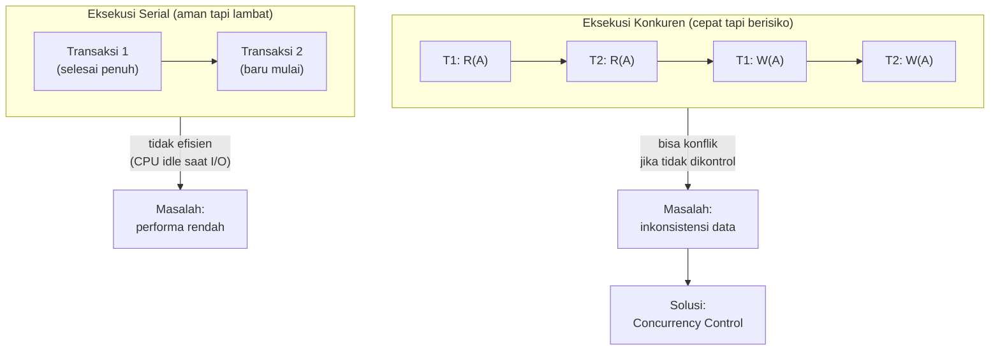

---

## 4. Transisi dalam Transaksi (State Machine)

Sebuah transaksi dapat berada di salah satu dari empat kemungkinan keadaan (*state*):

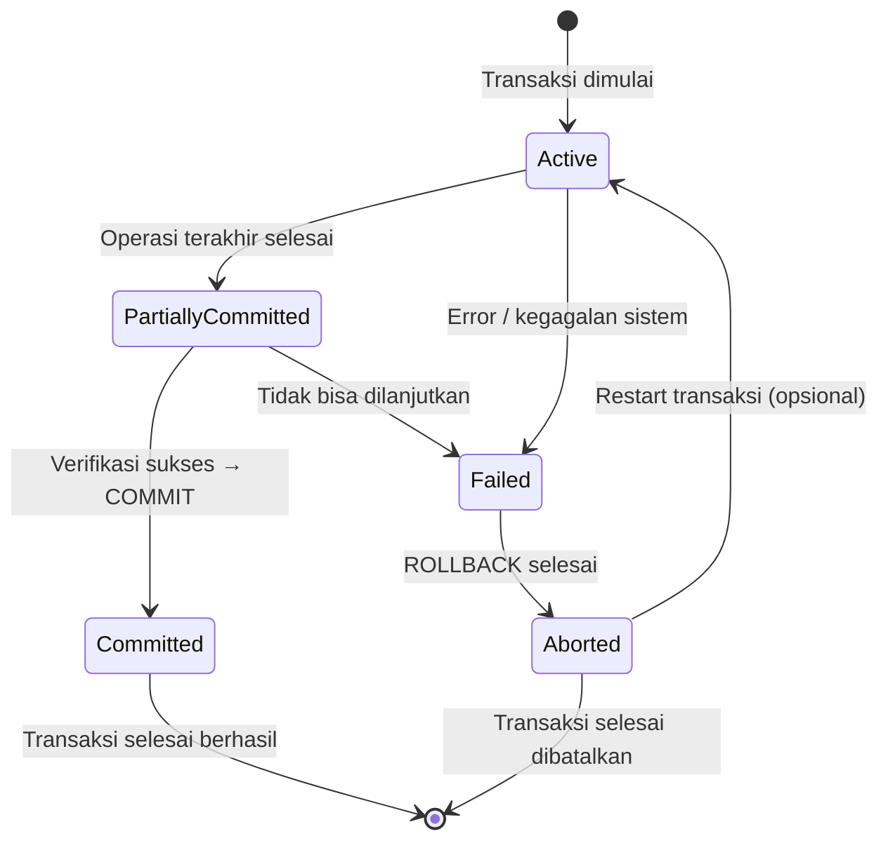

| State | Nama Indonesia | Keterangan |
|---|---|---|
| **Active** | Aktif | *Initial state* — transaksi masih dilaksanakan (operasi READ/WRITE berjalan) |
| **Partially Committed** | Berhasil Sebagian | Dicapai tepat saat operasi terakhir selesai dikerjakan; belum final |
| **Failed** | Gagal | Transaksi gagal atau terhenti; belum selesai; tidak bisa dilanjutkan |
| **Aborted** | Batal | Transaksi dianggap belum pernah dikerjakan; DBMS kembalikan data ke kondisi awal (*rollback*) |
| **Committed** | Berhasil | Transaksi selesai dan semua perubahan tersimpan permanen |

### Penjelasan Detail Setiap State

**Active**: Transaksi dimulai (`START TRANSACTION`) dan sedang mengeksekusi operasi-operasi (READ, WRITE). Status ini berlangsung selama operasi berjalan.

**Partially Committed**: Semua operasi dalam transaksi telah selesai dieksekusi, tetapi perubahan belum ditulis secara permanen ke disk. DBMS sedang melakukan verifikasi akhir. Dari sini bisa menuju *Committed* (verifikasi sukses) atau *Failed* (ada masalah saat verifikasi).

**Failed**: Eksekusi tidak bisa dilanjutkan — bisa karena error logika, kegagalan hardware, atau deadlock. Transaksi harus di-*rollback*.

**Aborted**: DBMS telah selesai melakukan *rollback* — semua perubahan yang dibuat transaksi ini sudah dikembalikan ke kondisi sebelum transaksi. Ini adalah tanggung jawab penuh DBMS. Setelah *aborted*, transaksi bisa di-restart (jika error bersifat sementara) atau dihentikan permanen (jika error bersifat logis).

---

## 5. Perintah SQL untuk Transaksi

Dalam MySQL/MariaDB, manajemen transaksi dikendalikan dengan perintah berikut:

```sql
-- Mulai transaksi
START TRANSACTION;
-- atau
BEGIN;

-- Simpan permanen semua perubahan dalam transaksi ini
COMMIT;

-- Batalkan semua perubahan dan kembalikan ke kondisi sebelum transaksi
ROLLBACK;

-- Buat titik simpan (checkpoint) di dalam transaksi
SAVEPOINT nama_savepoint;

-- Rollback ke titik simpan tertentu (bukan ke awal transaksi)
ROLLBACK TO SAVEPOINT nama_savepoint;
```

### Contoh Lengkap: Transfer Bank

```sql
START TRANSACTION;

    -- Kurangi saldo rekening pengirim
    UPDATE rekening SET saldo = saldo - 1000000 WHERE id_rekening = 'A001';

    -- Periksa apakah saldo mencukupi (validasi)
    -- Jika saldo rekening A sekarang negatif, rollback!
    -- (logika ini biasanya di lapisan aplikasi)

    -- Tambah saldo rekening penerima
    UPDATE rekening SET saldo = saldo + 1000000 WHERE id_rekening = 'B002';

    -- Catat ke log transaksi
    INSERT INTO log_transfer (dari, ke, jumlah, waktu)
    VALUES ('A001', 'B002', 1000000, NOW());

COMMIT;  -- jika semua berhasil, simpan permanen

-- Jika ada error di tengah jalan:
-- ROLLBACK;  -- kembalikan semua ke kondisi semula
```

---

## 6. Kontrol Konkurensi (*Concurrency Control*)

> ***Concurrency control*** merupakan sebuah aturan yang mengatur operasi pada sebuah transaksi tanpa mengganggu transaksi lain sehingga data menjadi konsisten *(Connolly & Begg, n.d.)*.

### Mengapa Concurrency Control Diperlukan?

Tanpa kontrol, eksekusi konkuren dapat menimbulkan tiga masalah utama:

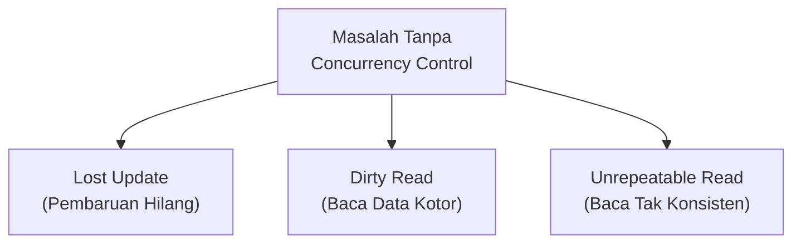

**Lost Update (Pembaruan Hilang)**: dua transaksi membaca nilai yang sama, keduanya melakukan perhitungan, lalu keduanya menulis — pembaruan transaksi pertama ditimpa oleh transaksi kedua.

| Waktu | Transaksi T1 | Transaksi T2 | Saldo |
|---|---|---|---|
| t1 | READ(saldo) = 1000 | | 1000 |
| t2 | | READ(saldo) = 1000 | 1000 |
| t3 | saldo = 1000 - 100 = 900; WRITE | | 900 |
| t4 | | saldo = 1000 - 200 = 800; WRITE | 800 |
| t5 | — | — | **800** (seharusnya 700!) |

Pembaruan T1 (-100) hilang karena T2 membaca sebelum T1 menulis.

**Dirty Read (Baca Data Kotor)**: T2 membaca data yang sedang dimodifikasi T1 tetapi T1 kemudian di-*rollback* — T2 membaca data yang tidak pernah benar-benar tersimpan.

**Unrepeatable Read**: T1 membaca nilai X, T2 mengubah X dan commit, T1 membaca X lagi dan mendapat nilai berbeda — dalam satu transaksi yang sama, nilai yang dibaca berubah.

### Komponen Concurrency Control

*Concurrency control* meliputi:

1. **Schedule / Penjadwalan** — urutan eksekusi operasi dari transaksi-transaksi yang berjalan bersamaan
2. **Serializability** — sebuah *schedule* disebut *serializable* jika hasilnya ekuivalen dengan eksekusi serial (berurutan satu per satu) — ini adalah standar kebenaran untuk concurrency control

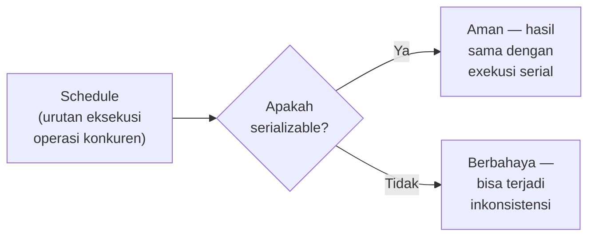

---

## 7. Teknik *Concurrency Control*

Dalam *concurrency control*, terdapat **2 teknik/metode** utama:

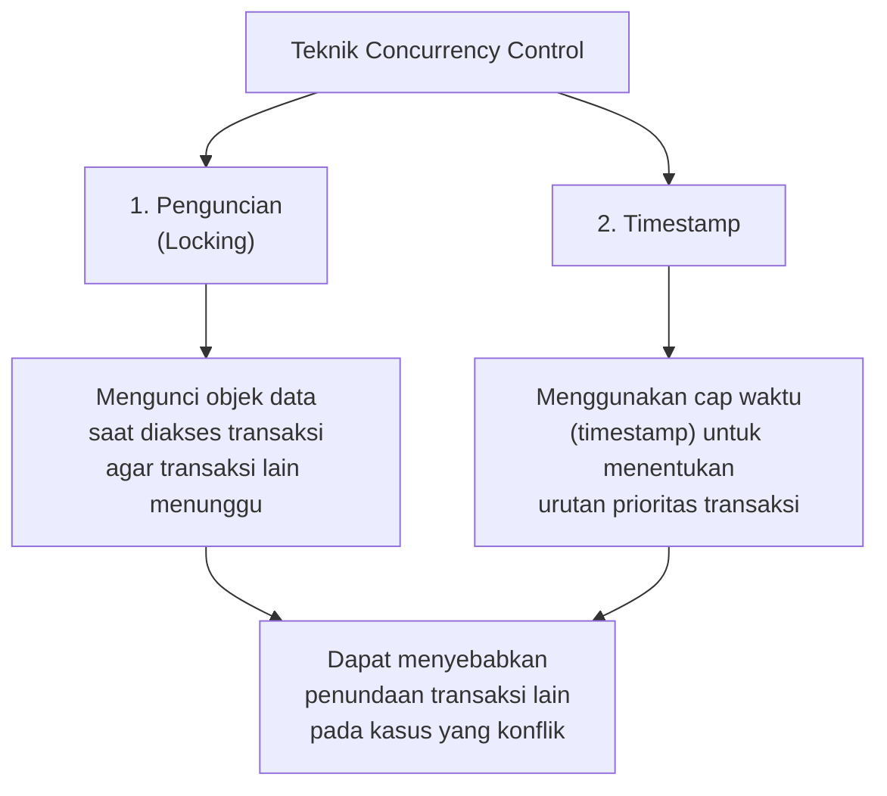

### 7.1 Penguncian (*Locking*)

Locking mengunci objek data (baris atau tabel) selama transaksi menggunakannya, sehingga transaksi lain harus menunggu sampai kunci dilepas.

Terdapat dua jenis kunci:

| Jenis Kunci | Simbol | Deskripsi | Kompatibel dengan |
|---|---|---|---|
| **Shared Lock** (S) | *read lock* | Boleh digunakan untuk membaca; banyak transaksi bisa memegang shared lock bersamaan | Shared Lock lain |
| **Exclusive Lock** (X) | *write lock* | Digunakan untuk menulis; hanya satu transaksi yang boleh memegang pada satu waktu | Tidak ada |

**Matriks Kompatibilitas Kunci**:

| | Shared (S) | Exclusive (X) |
|---|---|---|
| **Shared (S)** | Kompatibel ✓ | Tidak kompatibel ✗ |
| **Exclusive (X)** | Tidak kompatibel ✗ | Tidak kompatibel ✗ |

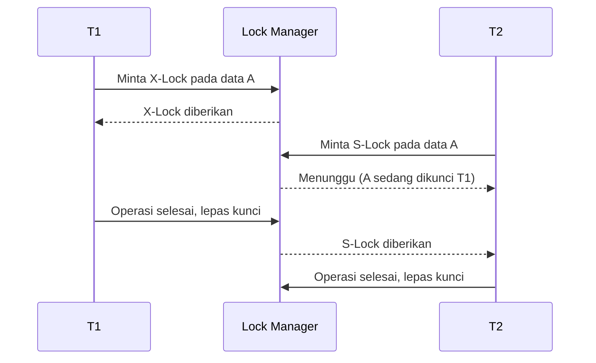

### 7.2 Timestamp

Setiap transaksi diberi **cap waktu (*timestamp*)** saat dimulai — biasanya berdasarkan waktu sistem atau counter monoton. Timestamp ini menentukan **urutan prioritas** transaksi.

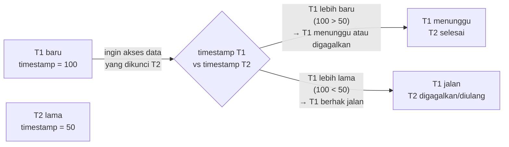

---

## 8. *Deadlock*

> ***Deadlock*** merupakan kebuntuan yang mungkin terjadi ketika dua (atau lebih) transaksi masing-masing menunggu kunci untuk dilepaskan yang dipegang oleh yang lain.

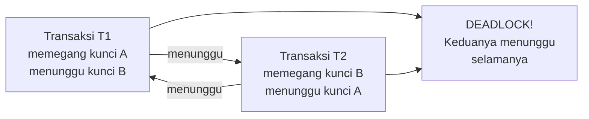

### Skenario Deadlock

| Waktu | T1 | T2 |
|---|---|---|
| t1 | X-Lock(A) → dapat | |
| t2 | | X-Lock(B) → dapat |
| t3 | Minta X-Lock(B) → **tunggu T2** | |
| t4 | | Minta X-Lock(A) → **tunggu T1** |
| t5 | **DEADLOCK** | **DEADLOCK** |

T1 menunggu T2 melepas B, T2 menunggu T1 melepas A — siklus tak berujung.

### Teknik Mengatasi Deadlock

Terdapat **3 teknik** untuk mengatasi deadlock:

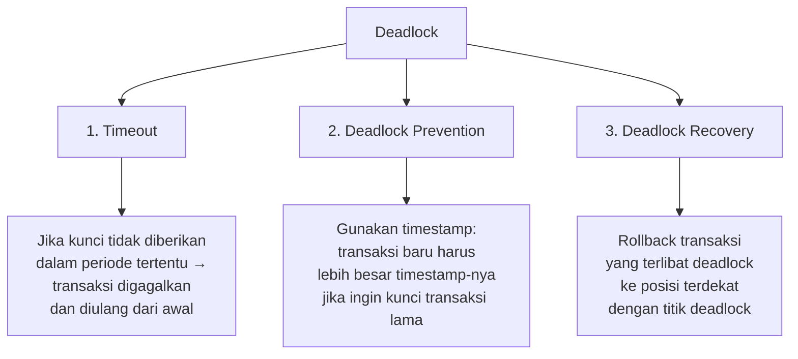

#### Teknik 1 — Timeout

*Timeout* adalah suatu kondisi di mana kunci belum diberikan pada periode tertentu, sehingga akan kehabisan waktu tunggu. Jika sebuah transaksi berada pada posisi *timeout*, maka DBMS harus:
1. Menggagalkan transaksi tersebut
2. Secara otomatis mengulang dari awal transaksi

```sql
-- Contoh set timeout di MySQL
SET innodb_lock_wait_timeout = 50;  -- tunggu maksimal 50 detik
-- Jika melebihi 50 detik, transaksi otomatis digagalkan
```

#### Teknik 2 — Deadlock Prevention

Salah satu pencegahan adalah dengan cara **transaksi timestamp**:

- Transaksi **baru** harus memiliki *timestamp* **lebih kecil** dibandingkan transaksi **lama** (agar transaksi lama prioritas lebih tinggi)
- Jika transaksi **baru** menginginkan kunci dari transaksi **lama**, maka *timestamp* transaksi baru harus **lebih besar** dari transaksi lama
- Jika kedua kondisi tersebut tidak terpenuhi → transaksi akan **digagalkan** (untuk mencegah potensi deadlock)

Dua protokol populer:
- **Wait-Die**: transaksi lama menunggu transaksi baru; transaksi baru "mati" (digagalkan) jika menginginkan data yang dikunci transaksi lama
- **Wound-Wait**: transaksi lama "melukai" (menggagalkan) transaksi baru; transaksi baru menunggu jika transaksi lama yang membutuhkan

#### Teknik 3 — Deadlock Recovery

Ketika *deadlock* terjadi, DBMS menjalankan *rollback* pada transaksi yang mengalami *deadlock* tersebut:

1. Deteksi deadlock — DBMS membangun **Wait-for Graph**: jika ada siklus dalam graf, deadlock terdeteksi
2. Pilih transaksi "korban" (*victim*) — biasanya yang paling mudah di-rollback (yang sudah paling sedikit mengerjakan operasi)
3. Tentukan posisi *rollback* — apakah dari awal transaksi atau dari posisi paling dekat dengan deadlock (*partial rollback*)
4. Jalankan *rollback* dan lepaskan kunci — transaksi lain yang menunggu bisa melanjutkan

> **Penting**: pengembalian kegagalan transaksi (*rollback*) harus benar-benar diperhatikan karena berdampak pada sifat transaksi yaitu **ACID** — terutama Atomicity (harus rollback semua), Consistency (data harus kembali konsisten), dan Isolation (transaksi lain tidak boleh melihat state yang di-rollback).

---

## Ringkasan Keterkaitan Antar Konsep

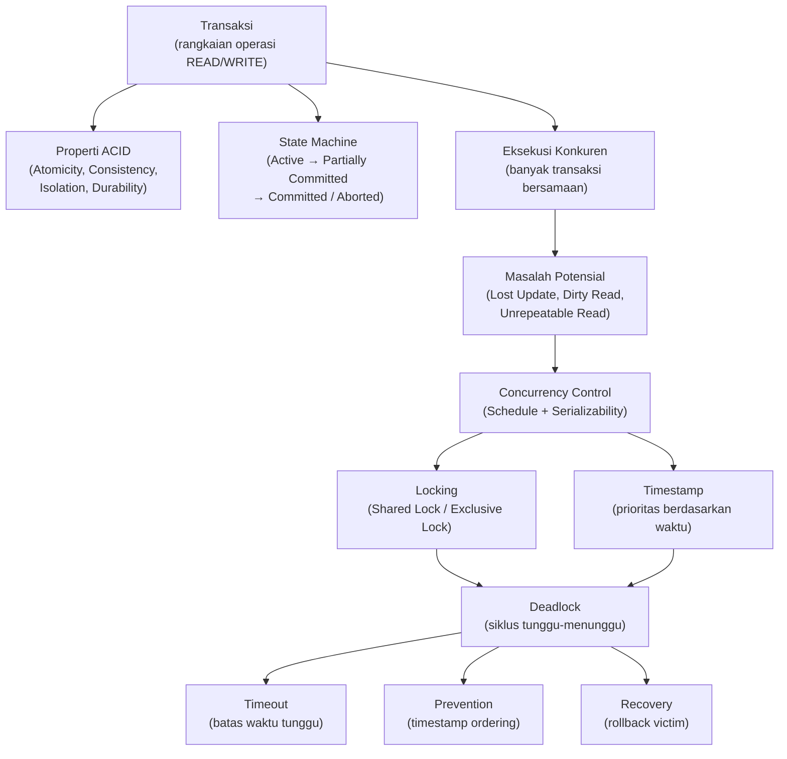

Inti dari sesi ini: **manajemen transaksi adalah mekanisme yang menjamin basis data tetap dalam keadaan benar dan konsisten meski ada banyak pengguna mengakses secara bersamaan dan meski terjadi kegagalan sistem**. Properti ACID adalah jaminan formalnya. State machine transaksi (Active → Partially Committed → Committed/Aborted) adalah siklus hidupnya. Concurrency control (Locking dan Timestamp) adalah alat untuk menjaga Isolation. Dan ketika Locking menciptakan siklus tunggu yang tidak bisa diselesaikan sendiri — itulah *deadlock* — yang bisa diatasi dengan Timeout, Prevention, atau Recovery.

---

*Selamat Belajar...*
