# Pertemuan 10 — Konsep Basis Data Terdistribusi

**Mata Kuliah:** STSI4105 / Basis Data  
**Program Studi:** S1 Sistem Informasi — Universitas Terbuka  
**Topik:** Distributed Database — Konsep, Opsi, dan Strategi

---

## Daftar Isi

1. [Apa Itu Basis Data Terdistribusi?](#1-apa-itu-basis-data-terdistribusi)
2. [Alasan Penerapan](#2-alasan-penerapan)
3. [Opsi Distribusi Data](#3-opsi-distribusi-data)
4. [Strategi Basis Data Terdistribusi](#4-strategi-basis-data-terdistribusi)
5. [Perbandingan Terpusat vs Terdistribusi](#5-perbandingan-terpusat-vs-terdistribusi)
6. [CAP Theorem](#6-cap-theorem)
7. [Contoh Penerapan Nyata](#7-contoh-penerapan-nyata)
8. [Ringkasan](#8-ringkasan)

---

## 1. Apa Itu Basis Data Terdistribusi?

> **Basis data terdistribusi** adalah sebuah basis data tunggal yang tersebar secara fisik di seluruh komputer di beberapa lokasi yang dihubungkan oleh jaringan komunikasi data.

### Analogi: Perpustakaan dengan Banyak Cabang

Bayangkan sebuah kota besar memiliki **satu sistem perpustakaan** dengan 5 cabang di berbagai kecamatan. Meski buku-buku tersebar di 5 lokasi berbeda, katalog pencarian tetap satu — pengguna bisa mencari buku di manapun dan sistem tahu buku itu ada di cabang mana.

Itulah esensi basis data terdistribusi: **satu logika, banyak lokasi fisik**.

```
┌─────────────────────────────────────────────────────┐
│              SATU BASIS DATA LOGIS                   │
│                                                     │
│   ┌──────────┐    Jaringan    ┌──────────────────┐  │
│   │ Server A │◄──────────────►│    Server B      │  │
│   │ (Jakarta)│                │   (Surabaya)     │  │
│   └──────────┘                └──────────────────┘  │
│        │                              │             │
│        │           ┌──────────┐       │             │
│        └──────────►│ Server C │◄──────┘             │
│                    │ (Medan)  │                     │
│                    └──────────┘                     │
└─────────────────────────────────────────────────────┘
```

### Terpusat vs Terdistribusi

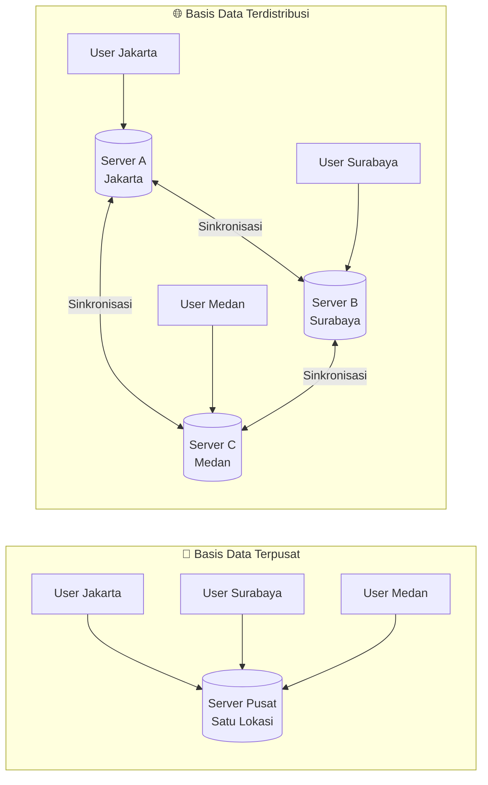

---

## 2. Alasan Penerapan

Ada 6 alasan utama mengapa organisasi memilih basis data terdistribusi:

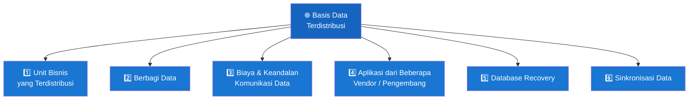

### Penjelasan Setiap Alasan

| # | Alasan | Penjelasan | Contoh |
|---|--------|-----------|--------|
| 1 | **Unit Bisnis yang Terdistribusi** | Ketika perusahaan memiliki kantor/cabang di banyak kota, menyimpan data dekat lokasi penggunaan lebih efisien | Perusahaan retail nasional dengan gudang di 10 kota |
| 2 | **Berbagi Data** | Departemen/divisi yang berbeda perlu mengakses data yang sama secara bersamaan | HRD dan Keuangan perlu data gaji karyawan secara real-time |
| 3 | **Biaya & Keandalan Komunikasi** | Menyimpan data secara lokal mengurangi biaya transmisi dan menghindari bottleneck jaringan | Data transaksi toko diolah lokal, ringkasan dikirim ke pusat |
| 4 | **Multi-Vendor Application** | Aplikasi dari berbagai vendor dapat mengakses data dari sistem yang berbeda-beda | ERP SAP + CRM Salesforce + aplikasi custom terintegrasi |
| 5 | **Database Recovery** | Jika satu server rusak, data masih tersedia di server lain — high availability | Satu server crash → server lain otomatis mengambil alih |
| 6 | **Sinkronisasi Data** | Perubahan data di satu lokasi secara otomatis diperbarui ke lokasi lain | Update harga produk di HQ langsung terrefleksi di semua cabang |

---

## 3. Opsi Distribusi Data

Ada 4 teknik utama dalam mendistribusikan data:

### 3.1 Replikasi Data (Data Replication)

> Data yang **sama disalin sepenuhnya** ke beberapa server di lokasi berbeda.

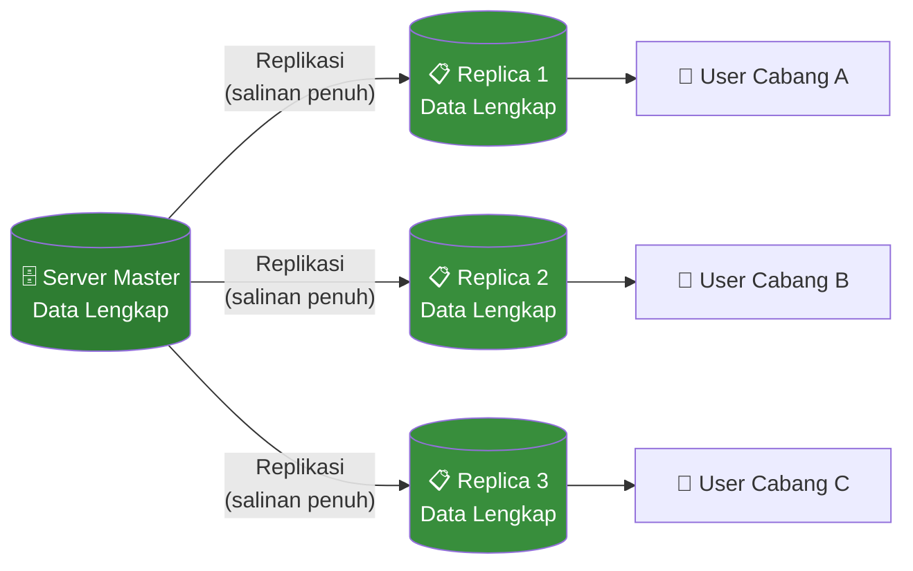

**Keuntungan:**
- Query cepat — data ada secara lokal
- Toleran terhadap kegagalan server
- Tidak ada single point of failure

**Kerugian:**
- Sinkronisasi bisa kompleks
- Memerlukan storage lebih besar
- Update harus dipropagasi ke semua replika

---

### 3.2 Partisi Horizontal (Horizontal Partitioning)

> Tabel dipecah berdasarkan **baris (row)** — tiap server menyimpan sebagian baris data.

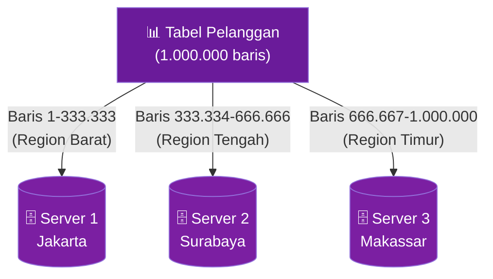

**Contoh nyata:**

| Server | Lokasi | Data yang Disimpan |
|--------|--------|-------------------|
| Server 1 | Jakarta | Pelanggan dengan kode_wilayah = 'BARAT' |
| Server 2 | Surabaya | Pelanggan dengan kode_wilayah = 'TENGAH' |
| Server 3 | Makassar | Pelanggan dengan kode_wilayah = 'TIMUR' |

**Keuntungan:**
- Query lokal sangat cepat (sebagian besar query bersifat regional)
- Tiap server menyimpan lebih sedikit data
- Mudah ditambah node baru

**Kerugian:**
- Query lintas server (cross-partition join) lambat
- Distribusi beban harus seimbang

---

### 3.3 Partisi Vertikal (Vertical Partitioning)

> Tabel dipecah berdasarkan **kolom (column)** — tiap server menyimpan kolom-kolom tertentu.

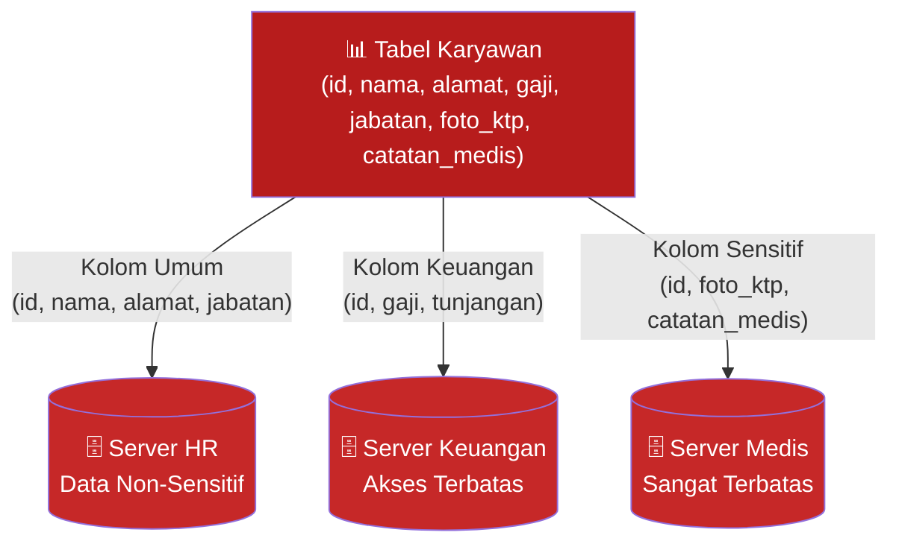

**Keuntungan:**
- Kontrol akses lebih granular (data sensitif terisolasi)
- Query yang hanya butuh beberapa kolom lebih efisien
- Cocok untuk kepatuhan regulasi (GDPR, dll.)

**Kerugian:**
- Butuh JOIN lintas server untuk rekonstruksi baris lengkap
- Konsistensi lebih kompleks

---

### 3.4 Kombinasi (Combinations)

> **Menggabungkan** replikasi dan partisi untuk mendapatkan manfaat keduanya.

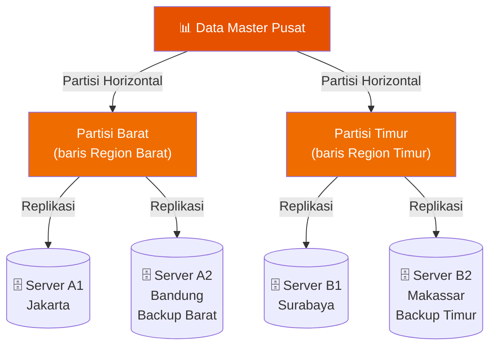

**Kapan digunakan:** Sistem skala besar yang butuh keduanya — performa lokal (partisi) dan ketahanan gangguan (replikasi).

---

### Perbandingan 4 Opsi

| Opsi | Cara | Redundansi | Kompleksitas | Cocok Untuk |
|------|------|------------|-------------|-------------|
| **Replikasi** | Salin seluruh data | Tinggi | Sedang | High availability, read-heavy |
| **Partisi Horizontal** | Pecah per baris | Rendah | Rendah-Sedang | Data regional, sharding |
| **Partisi Vertikal** | Pecah per kolom | Rendah | Sedang | Data sensitif, akses terpisah |
| **Kombinasi** | Gabungan | Sedang-Tinggi | Tinggi | Sistem enterprise besar |

---

## 4. Strategi Basis Data Terdistribusi

Ada 5 strategi utama berdasarkan perbandingan 5 dimensi:

### Tabel Perbandingan Strategi

| Strategi | Keandalan | Ekspandabilitas | Overhead Komunikasi | Manageability | Konsistensi Data |
|----------|-----------|-----------------|--------------------|-----------|----|
| **Terpusat (Centralized)** | ❌ BURUK — sangat bergantung pada server pusat | ❌ BURUK — skalabilitas terbatas | ❌ SANGAT TINGGI — semua traffic ke 1 titik | ✅ SANGAT BAIK — satu titik, koordinasi minimal | ✅ SEMPURNA — semua user lihat data sama |
| **Replikasi dengan Snapshot** | ✅ BAIK — redundansi ada, tapi ada delay | ✅✅ SANGAT BAIK — salinan bisa lebih murah dari linear | ✅ RENDAH-SEDANG — tidak konstan, snapshot periodik bisa menyebabkan burst traffic | ✅ SANGAT BAIK — tiap salinan identik | ⚠️ SEDANG — oke jika delay bisa ditolerir bisnis |
| **Replikasi Tersinkronisasi** | ✅✅ SEMPURNA — redundansi + minimal delay | ✅✅ SANGAT BAIK — sync work linear | ⚠️ SEDANG — pesan konstan, ada delay yang ditolerir | ⚠️ SEDANG — collision menambah kompleksitas | ✅✅ SEDANG-SANGAT BAIK — mendekati konsistensi presisi |
| **Partisi Terintegrasi** | ✅✅ SANGAT BAIK — partisi + redundansi efektif | ✅✅ SANGAT BAIK — node baru hanya dapat data yang dibutuhkan | ✅ RENDAH-SEDANG — query lokal baik, lintas site bisa berat | ❌ SULIT — query lintas partisi harus terkoordinasi ketat | ❌ SANGAT BURUK — inkonsistensi sulit dihindari |
| **Desentralisasi Independen** | ✅ BAIK — bergantung ketersediaan lokal | ✅ BAIK — node baru independen | ✅✅ RENDAH — sedikit/tidak ada traffic lintas jaringan | ✅ SANGAT BAIK — tiap site mudah dikelola sendiri | ❌ RENDAH — tidak ada jaminan konsistensi antar site |

### Visualisasi Perbandingan

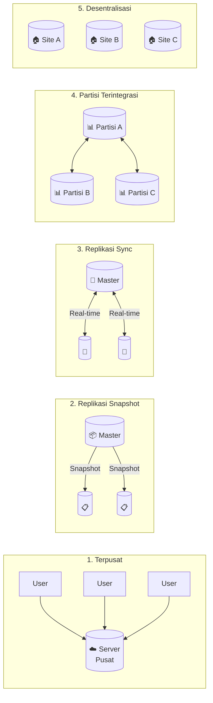

### Detail Setiap Strategi

#### 1. Terpusat (Centralized)
Semua data ada di satu server pusat. Ini bukan distributed database sejati, tapi menjadi baseline perbandingan.

```
Kelebihan: Konsistensi sempurna, mudah dikelola
Kekurangan: Single point of failure, bottleneck jaringan, tidak skalabel
Cocok untuk: Organisasi kecil, data yang sangat sensitif dan perlu kontrol ketat
```

#### 2. Replikasi dengan Snapshot
Master database secara periodik membuat salinan (snapshot) ke server-server lain.

```
Kelebihan: High availability, query lokal cepat
Kekurangan: Data mungkin stale (ketinggalan dari master)
Cocok untuk: Data laporan, analitik, data yang tidak perlu real-time
```

**Contoh SQL Snapshot:**
```sql
-- Di MySQL, membuat replica dengan binary log
-- Server Master: aktifkan binary logging
[mysqld]
log-bin=mysql-bin
server-id=1

-- Server Replica: set sebagai slave
CHANGE MASTER TO
  MASTER_HOST='192.168.1.1',
  MASTER_USER='replicator',
  MASTER_PASSWORD='password',
  MASTER_LOG_FILE='mysql-bin.000001';
START SLAVE;
```

#### 3. Replikasi Tersinkronisasi (Synchronized Replication)
Setiap perubahan di master langsung direplikasi ke semua server secara real-time sebelum transaksi dianggap selesai.

```
Kelebihan: Konsistensi hampir sempurna, tidak ada data stale
Kekurangan: Setiap write harus tunggu konfirmasi semua replika → latensi write tinggi
Cocok untuk: Perbankan, sistem keuangan, e-commerce dengan stok real-time
```

#### 4. Partisi Terintegrasi (Integrated Partitions)
Data dibagi ke beberapa server berdasarkan partisi, dengan koordinasi pusat untuk query lintas partisi.

```
Kelebihan: Skalabilitas horizontal sangat baik, storage efisien
Kekurangan: Query lintas partisi kompleks, konsistensi sulit dijaga
Cocok untuk: Big data, sistem dengan data regional yang jelas
```

#### 5. Desentralisasi dengan Partisi Independen
Tiap site benar-benar independen — tidak ada koordinasi antar site.

```
Kelebihan: Performa lokal sempurna, tidak bergantung jaringan
Kekurangan: Tidak ada konsistensi global, data antar site bisa berbeda
Cocok untuk: Organisasi dengan cabang benar-benar independen, tidak perlu sinkronisasi
```

---

## 5. Perbandingan Terpusat vs Terdistribusi

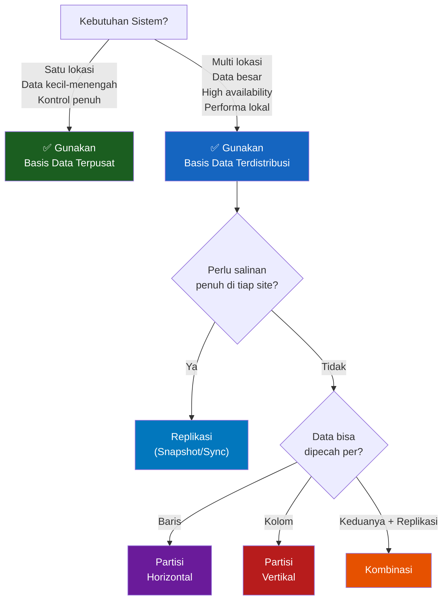

### Kapan Pilih Terpusat?

- Organisasi kecil dengan satu kantor
- Data sangat sensitif yang tidak boleh tersebar
- Tim IT terbatas, ingin manajemen sederhana
- Budget terbatas

### Kapan Pilih Terdistribusi?

- Kantor/cabang di banyak kota/negara
- Kebutuhan high availability (99.99% uptime)
- Volume data sangat besar
- Pengguna tersebar geografis dan perlu akses cepat

---

## 6. CAP Theorem

Setiap sistem basis data terdistribusi harus menghadapi trade-off yang dikenal sebagai **CAP Theorem** (Teorema CAP):

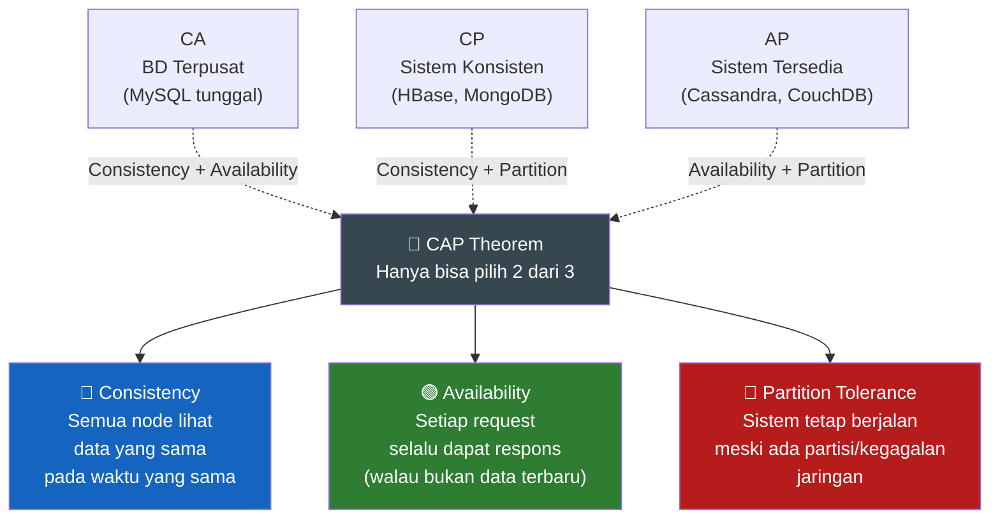

| Pilihan | Yang Dikorbankan | Contoh Sistem | Cocok Untuk |
|---------|-----------------|---------------|-------------|
| **CA** (Consistency + Availability) | Partition Tolerance | MySQL tunggal, PostgreSQL tunggal | Sistem kecil, satu lokasi |
| **CP** (Consistency + Partition) | Availability | HBase, MongoDB, ZooKeeper | Perbankan, sistem keuangan |
| **AP** (Availability + Partition) | Consistency | Cassandra, CouchDB, DynamoDB | Media sosial, e-commerce, IoT |

> **Catatan:** Dalam praktik, sistem terdistribusi selalu butuh *Partition Tolerance* (P), sehingga pilihan nyata adalah **CP vs AP**.

---

## 7. Contoh Penerapan Nyata

### Studi Kasus: Jaringan Minimarket Nasional

Sebuah jaringan minimarket memiliki 1.000 gerai di seluruh Indonesia dan kantor pusat di Jakarta.

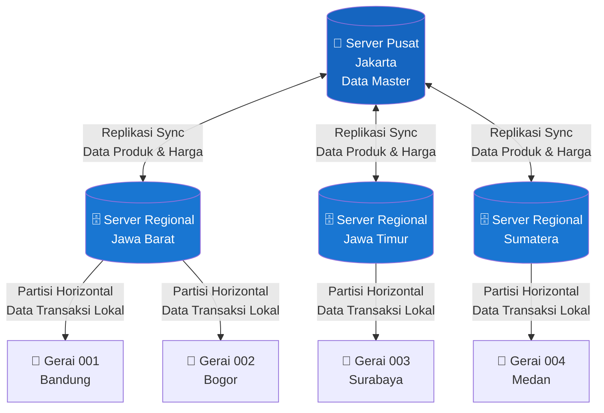

**Strategi yang digunakan:**
- **Replikasi Tersinkronisasi** untuk data master (produk, harga) → semua gerai lihat harga yang sama
- **Partisi Horizontal** untuk data transaksi → setiap gerai simpan transaksinya sendiri secara lokal
- **Kombinasi** di level regional → backup antar regional

### Strategi yang Tepat per Jenis Data

| Jenis Data | Karakteristik | Strategi Terbaik |
|-----------|--------------|-----------------|
| Data Produk & Harga | Dibaca banyak, jarang update | Replikasi Snapshot |
| Data Transaksi Penjualan | Tulis lokal, laporan ke pusat | Partisi Horizontal |
| Data Karyawan Sensitif | Akses terbatas per divisi | Partisi Vertikal |
| Data Stok Real-time | Harus konsisten lintas gerai | Replikasi Tersinkronisasi |

---

## 8. Ringkasan

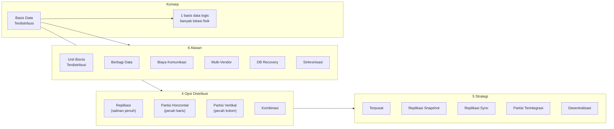

### Poin Kunci

| Konsep | Inti Pemahaman |
|--------|---------------|
| **Basis Data Terdistribusi** | Satu BD logis, tersebar di banyak lokasi fisik lewat jaringan |
| **Replikasi** | Salinan penuh data di banyak server → high availability, query cepat |
| **Partisi Horizontal** | Pecah berdasarkan baris (contoh: data regional berbeda server) |
| **Partisi Vertikal** | Pecah berdasarkan kolom (contoh: data sensitif dipisah) |
| **Kombinasi** | Gabungkan replikasi + partisi untuk manfaat optimal |
| **CAP Theorem** | Sistem distributed harus trade-off antara Consistency, Availability, dan Partition Tolerance |
| **Strategi Terpusat** | Konsistensi sempurna, tapi tidak skalabel dan rawan single point of failure |
| **Replikasi Tersinkronisasi** | Konsistensi terbaik di antara strategi terdistribusi, tapi overhead tinggi |

---

> **Catatan Belajar:** Basis data terdistribusi hadir sebagai solusi untuk tantangan nyata — bisnis yang tersebar geografis, kebutuhan high availability, dan volume data yang besar. Pemilihan strategi bergantung pada trade-off antara konsistensi, ketersediaan, dan kompleksitas manajemen. Tidak ada strategi yang sempurna; selalu ada pertimbangan sesuai kebutuhan spesifik organisasi.
