# Pertemuan 11 — Panduan Praktikum Instalasi Virtual Box

**Mata Kuliah:** STSI4105 / Basis Data (MSIM4206P)  
**Program Studi:** S1 Sistem Informasi — Universitas Terbuka  
**Topik:** Instalasi VirtualBox & Ubuntu Linux untuk Simulasi Basis Data Terdistribusi  
**Penulis:** Andri Suryadi, S.Kom., M.Kom. | **Penelaah:** Unggul Utan Sufandi, S.Kom., M.Si.

> Catatan: dokumen ini merupakan ekstraksi sekaligus elaborasi dari *Panduan Praktikum Instalasi Virtual Box — Edisi 1*. Setiap langkah dijelaskan dengan konteks dan penjelasan teknis tambahan agar mudah dipahami secara utuh.

---

## Daftar Isi

1. [BAB 1 — Pendahuluan](#bab-1--pendahuluan)
2. [BAB 2 — Prosedur Pelaksanaan Praktikum](#bab-2--prosedur-pelaksanaan-praktikum)
   - [A. Pengantar Virtual Box](#a-pengantar-virtual-box)
   - [B. Instalasi VirtualBox](#b-instalasi-virtualbox)
   - [C. Instalasi Sistem Operasi Linux Ubuntu](#c-instalasi-sistem-operasi-linux-ubuntu)
   - [D. Pengecekan Koneksi Jaringan](#d-pengecekan-koneksi-jaringan)
3. [BAB 3 — Pelaporan dan Penilaian](#bab-3--pelaporan-dan-penilaian)
4. [Ringkasan dan Troubleshooting](#ringkasan-dan-troubleshooting)

---

## BAB 1 — Pendahuluan

### A. Latar Belakang

Mata kuliah Basis Data merupakan fondasi penting bagi mahasiswa Sistem Informasi. Panduan praktikum ini dirancang untuk mendampingi kegiatan belajar mahasiswa dalam memahami konsep-konsep basis data secara **praktis dan langsung**, bukan hanya teoritis.

Dalam konteks pertemuan ini, praktikum berfokus pada **instalasi VirtualBox** — alat yang memungkinkan kita mensimulasikan jaringan komputer dengan beberapa sistem operasi dalam satu mesin fisik. Kemampuan ini esensial untuk mempraktikkan konsep **basis data terdistribusi** yang telah dipelajari secara teori di pertemuan sebelumnya.

### B. Tujuan

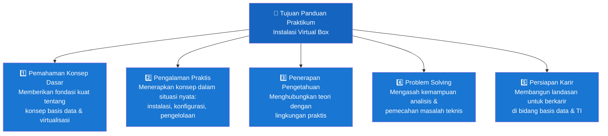

| # | Tujuan | Penjelasan |
|---|--------|-----------|
| 1 | **Pemahaman Konsep Dasar** | Fondasi kuat tentang konsep virtualisasi dan hubungannya dengan basis data terdistribusi |
| 2 | **Pengalaman Praktis** | Keterampilan nyata dalam merancang, mengonfigurasi, dan mengelola mesin virtual |
| 3 | **Penerapan Pengetahuan** | Menghubungkan teori (pertemuan 10: BDT) dengan implementasi nyata |
| 4 | **Problem Solving** | Kemampuan menganalisis dan menyelesaikan masalah teknis yang muncul saat instalasi |
| 5 | **Persiapan Karir** | Landasan profesional untuk bekerja di industri TI dalam peran pengelolaan basis data |

### C. Ruang Lingkup

Panduan praktikum ini merupakan bagian dari 3 seri praktikum mata kuliah:

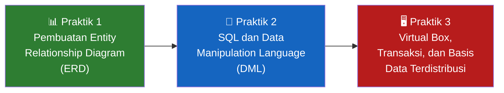

Panduan ini membahas **Praktik 3** — instalasi dan konfigurasi VirtualBox sebagai landasan untuk simulasi basis data terdistribusi.

---

## BAB 2 — Prosedur Pelaksanaan Praktikum

### A. Pengantar Virtual Box

#### Apa itu VirtualBox?

**VirtualBox** adalah perangkat lunak virtualisasi dari Oracle yang memungkinkan satu komputer fisik menjalankan **lebih dari satu sistem operasi secara bersamaan**. Sistem operasi yang berjalan di dalam VirtualBox disebut **Guest OS**, sedangkan sistem operasi utama komputer disebut **Host OS**.

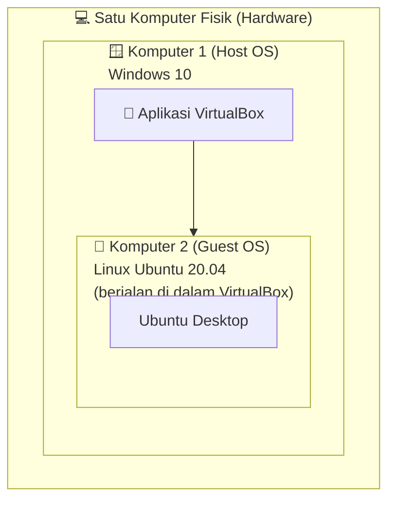

#### Mengapa VirtualBox untuk Basis Data Terdistribusi?

Basis data terdistribusi membutuhkan **minimal 2 komputer** yang saling terhubung lewat jaringan. Tanpa VirtualBox, kita perlu 2 komputer fisik terpisah. Dengan VirtualBox, satu komputer bisa mensimulasikan 2 komputer sekaligus.

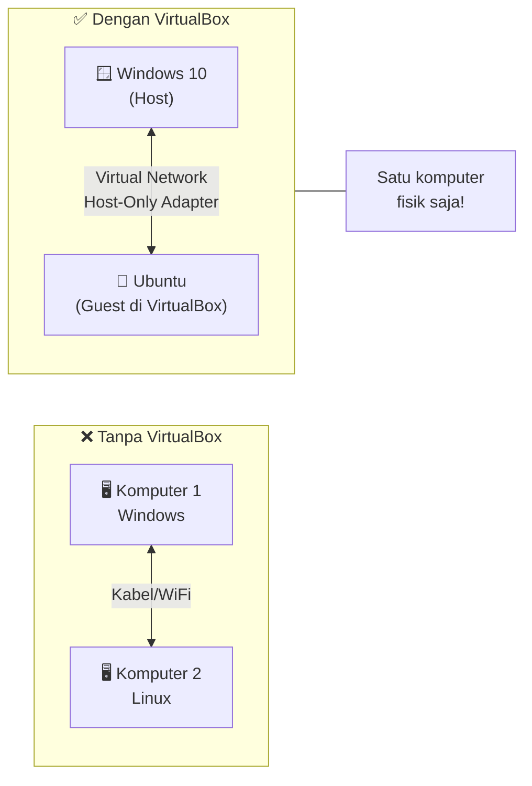

**Skenario praktikum:**
- **Komputer 1 (Host):** Windows 10 + XAMPP (MySQL)
- **Komputer 2 (Guest):** Ubuntu Linux (berjalan via VirtualBox)
- Kedua "komputer" terhubung via jaringan virtual Host-Only Adapter

---

### B. Instalasi VirtualBox

#### Gambaran Umum Proses

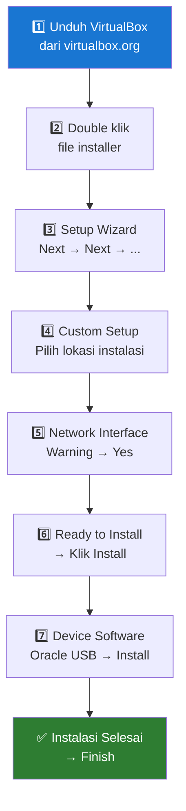

#### Langkah 1 — Unduh Aplikasi VirtualBox

VirtualBox adalah **aplikasi gratis** dari Oracle. Cara mengunduh:

```
URL: https://www.virtualbox.org/
→ Klik tombol "Download VirtualBox 6.1"
→ Pilih sesuai OS host (Windows hosts)
→ Simpan file (contoh: VirtualBox-6.1.14-140239-Win.exe, ±105 MB)
```

#### Langkah 2 — Mulai Proses Pemasangan

Setelah unduhan selesai, **double klik** file installer untuk memulai Setup Wizard.

#### Langkah 3 — Setup Wizard (Langkah demi Langkah)

| Layar | Tindakan | Keterangan |
|-------|----------|-----------|
| **Welcome** | Klik `Next` | Layar selamat datang wizard |
| **Custom Setup** | Klik `Next` | Lokasi default: `C:\Program Files\Oracle\VirtualBox\` (bisa diubah dengan Browse) |
| **Shortcut Options** | Klik `Next` | Biarkan semua centang (Start menu, Desktop shortcut, Quick Launch, file associations) |
| **Warning Network Interfaces** | Klik `Yes` | VirtualBox akan reset koneksi jaringan sementara saat instalasi — ini normal |
| **Ready to Install** | Klik `Install` | Mulai proses pemasangan sebenarnya |
| **Windows Security — USB** | Klik `Install` | Izinkan driver USB Oracle untuk diinstal |
| **Installation Complete** | Klik `Finish` | Selesai! VirtualBox akan langsung terbuka |

> **Catatan:** Peringatan Network Interfaces muncul karena VirtualBox perlu menginstal driver jaringan virtual. Koneksi internet akan terputus sesaat lalu kembali normal. Ini bukan error.

---

### C. Instalasi Sistem Operasi Linux Ubuntu

#### Gambaran Alur Instalasi Ubuntu di VirtualBox

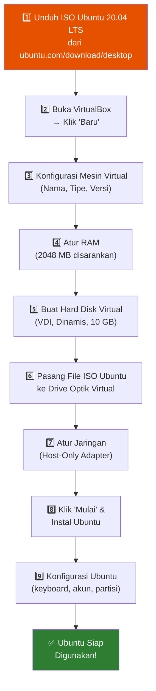

#### Langkah 1 — Unduh File ISO Ubuntu

Ubuntu 20.04.1 LTS adalah versi **Long Term Support** yang stabil. Kebutuhan minimal:

| Komponen | Minimum | Disarankan |
|----------|---------|-----------|
| Prosesor | 1 GHz dual-core | 2 GHz+ dual-core |
| RAM | 2 GB | 4 GB |
| Penyimpanan | 25 GB | 30 GB+ |

```
URL: https://ubuntu.com/download/desktop
→ Klik Download Ubuntu 20.04.1 LTS
→ File: ubuntu-20.04.1-desktop-amd64.iso (±2.59 GB)
→ Simpan di komputer Anda
```

#### Langkah 2 — Buat Mesin Virtual Baru

Buka VirtualBox → Klik **Baru** → Atur parameter berikut:

| No | Menu | Pengaturan | Keterangan |
|----|------|-----------|-----------|
| 1 | **Nama** | `ubuntu` | Nama bebas sesuai keinginan |
| 2 | **Folder Mesin** | `D:\My Documents 2\ubuntu` | Lokasi penyimpanan mesin virtual |
| 3 | **Tipe** | `Linux` | Jenis OS yang akan dipasang |
| 4 | **Versi** | `Ubuntu (64-bit)` | Versi spesifik Ubuntu |

Klik **Lanjut** untuk ke tahap berikutnya.

#### Langkah 3 — Atur Ukuran Memori (RAM)

```
Total RAM komputer: misalnya 8192 MB
Alokasikan untuk Ubuntu: 2048 MB (2 GB)
Sisa untuk Host (Windows): 6144 MB

Aturan umum: jangan alokasikan lebih dari 50% RAM host
```

> Semakin besar RAM yang dialokasikan, semakin cepat Ubuntu berjalan — tapi jangan sampai Windows host kekurangan memori.

#### Langkah 4 — Buat Hard Disk Virtual

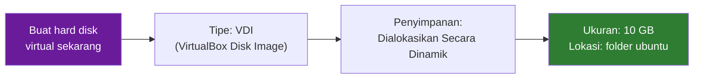

| Opsi | Pilihan | Alasan |
|------|---------|--------|
| **Tipe Berkas** | VDI (VirtualBox Disk Image) | Format native VirtualBox, tidak perlu diubah |
| **Penyimpanan Fisik** | Dialokasikan secara dinamik | File VDI tumbuh sesuai kebutuhan — hemat ruang disk host |
| **Ukuran** | 10 GB | Cukup untuk Ubuntu + MySQL untuk praktikum |

> **VDI vs Ukuran Tetap:** Dinamik artinya file `.vdi` di komputer host tidak langsung 10 GB — hanya akan membesar seiring penggunaan. Ukuran tetap lebih cepat tapi langsung mengambil 10 GB dari disk host.

#### Langkah 5 — Pasang File ISO Ubuntu ke Drive Optik

Setelah mesin virtual dibuat:
1. Klik **Pengaturan** → menu **Penyimpanan**
2. Di bawah Pengendali IDE, klik ikon disk kosong (CD/DVD Live)
3. Klik **Pilih sebuah berkas disk...**
4. Cari dan pilih file `ubuntu-20.04.1-desktop-amd64.iso`
5. Klik **OK**

#### Langkah 6 — Atur Jaringan (Host-Only Adapter)

Ini adalah pengaturan paling kritis untuk menghubungkan dua "komputer":

1. Klik **Pengaturan** → menu **Jaringan**
2. Adaptor 1: centang **Fungsikan Adaptor Jaringan**
3. Terpasang pada: **Adaptor Hanya-host**
4. Klik **Tingkat Lanjut** → klik tombol refresh (lingkaran biru) untuk **Refresh MAC Address**

> **Kenapa Host-Only?** Mode ini membuat Ubuntu dan Windows bisa saling berkomunikasi lewat jaringan privat yang hanya ada di dalam komputer. Tidak ada koneksi ke internet melalui jaringan ini, tapi koneksi antar VM ↔ Host lancar.

> **Tips:** Jika Ubuntu tidak bisa ping Windows (atau sebaliknya), lakukan refresh MAC Address — ini antisipasi terhadap konflik alamat jaringan.

#### Langkah 7 — Mulai & Instal Ubuntu

Klik **Mulai** pada mesin virtual ubuntu. Pilih disk awal: `ubuntu-20.04.1-desktop-amd64.iso` → Klik **Mulai**.

**Proses Instalasi Ubuntu (dalam VirtualBox):**

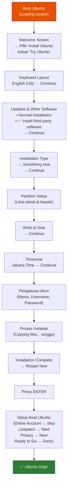

#### Detail Pengaturan Partisi Hard Disk

Pilih **"Something else"** untuk konfigurasi partisi manual. Buat **2 partisi**:

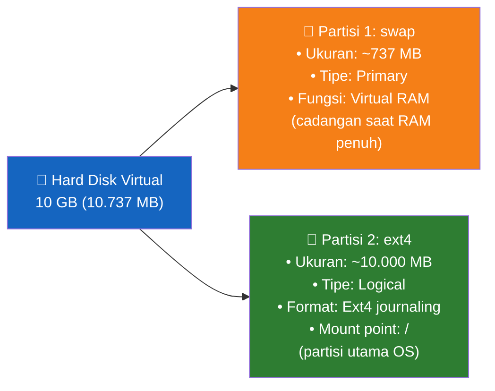

| Partisi | Ukuran | Tipe | Digunakan Sebagai | Mount Point | Fungsi |
|---------|--------|------|------------------|-------------|--------|
| **sda1** | ~737 MB | Primary | swap area | — | Virtual RAM: digunakan saat RAM fisik habis |
| **sda5** | ~10.000 MB | Logical | Ext4 journaling filesystem | `/` | Partisi utama — seluruh sistem Ubuntu |

> **Mengapa 2 partisi?** Partisi `swap` adalah "RAM cadangan" dari disk. Saat Ubuntu kehabisan RAM (misal buka banyak aplikasi), data dipindah sementara ke swap. Partisi `/` (root) adalah tempat Ubuntu dan semua file terinstal.

#### Pengaturan Akun Ubuntu

Saat diminta mengisi identitas, isi seperti berikut (bisa disesuaikan):

| Field | Contoh | Keterangan |
|-------|--------|-----------|
| **Your name** | `prodisi` | Nama tampilan |
| **Computer's name** | `prodisi-VirtualBox` | Hostname (otomatis terisi) |
| **Username** | `prodisi` | Username untuk login |
| **Password** | `••••••••` | Gunakan password yang mudah diingat |
| **Login mode** | `Log in automatically` | Agar tidak perlu ketik password tiap boot |

Setelah klik Continue, Ubuntu akan mulai menyalin file (proses ini 10–30 menit tergantung kecepatan komputer).

#### Langkah Akhir Setelah Restart

Setelah restart dan tekan ENTER, Ubuntu akan menampilkan beberapa layar setup awal:

| Layar | Tindakan |
|-------|----------|
| Online Accounts | Klik **Skip** (tidak perlu akun online) |
| Livepatch | Klik **Next** di pojok kanan atas |
| Help Improve Ubuntu | Klik **Next** |
| Privacy (Location Services) | Klik **Next** |
| Ready to Go | Klik **Done** |

**Ubuntu berhasil terpasang dan siap digunakan!**

---

### D. Pengecekan Koneksi Jaringan

Setelah Ubuntu berhasil dipasang, langkah penting berikutnya adalah memastikan **Komputer 1 (Windows) dan Komputer 2 (Ubuntu) bisa saling berkomunikasi** melalui jaringan virtual.

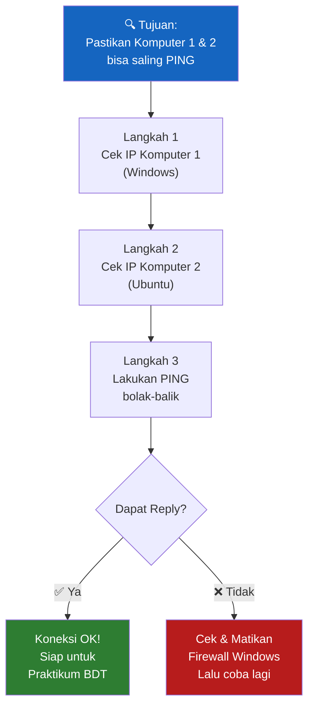

#### Langkah 1 — Cek IP Address Komputer 1 (Windows 10)

1. Tekan `Win + R` → ketik `cmd` → tekan Enter
2. Di Command Prompt, ketik:

```cmd
ipconfig
```

3. Cari bagian **"Ethernet adapter VirtualBox Host-Only Network"**:

```
Ethernet adapter VirtualBox Host-Only Network:
   IPv4 Address. . . . . . . . . . : 192.168.56.1
   Subnet Mask . . . . . . . . . . : 255.255.255.0
   Default Gateway . . . . . . . . :
```

> **IP Komputer 1 (Windows) = 192.168.56.1** — catat ini!

#### Langkah 2 — Cek IP Address Komputer 2 (Ubuntu)

1. Di Ubuntu, klik ikon jaringan di pojok kanan atas
2. Klik **Wired Settings** → klik ikon pengaturan (gear/roda gigi)
3. Tab **Details** akan menampilkan:

```
IPv4 Address: 192.168.56.104
IPv6 Address: fe80::b61b:b08d:7998:1bb
Hardware Address: 08:00:27:E1:3C:13
```

> **IP Komputer 2 (Ubuntu) = 192.168.56.104** (bisa berbeda di komputer Anda) — catat ini!

#### Langkah 3 — Uji Koneksi dengan PING

**Dari Ubuntu → ping ke Windows:**

Buka Terminal di Ubuntu (klik menu pojok kiri bawah → cari "Terminal"):

```bash
ping 192.168.56.1
```

Hasil yang benar:
```
64 bytes from 192.168.56.1: icmp_seq=1 ttl=128 time=0.258 ms
64 bytes from 192.168.56.1: icmp_seq=2 ttl=128 time=0.800 ms
64 bytes from 192.168.56.1: icmp_seq=3 ttl=128 time=0.892 ms
--- 192.168.56.1 ping statistics ---
5 packets transmitted, 5 received, 0% packet loss
```

**Dari Windows → ping ke Ubuntu:**

Di Command Prompt Windows:

```cmd
ping 192.168.56.104
```

Hasil yang benar:
```
Reply from 192.168.56.104: bytes=32 time<1ms TTL=64
Reply from 192.168.56.104: bytes=32 time<1ms TTL=64
Reply from 192.168.56.104: bytes=32 time<1ms TTL=64
```

> Jika kedua ping menghasilkan **Reply** → koneksi berhasil! Kedua komputer dapat berkomunikasi dan siap digunakan untuk praktikum basis data terdistribusi.

#### Diagram Jaringan Akhir

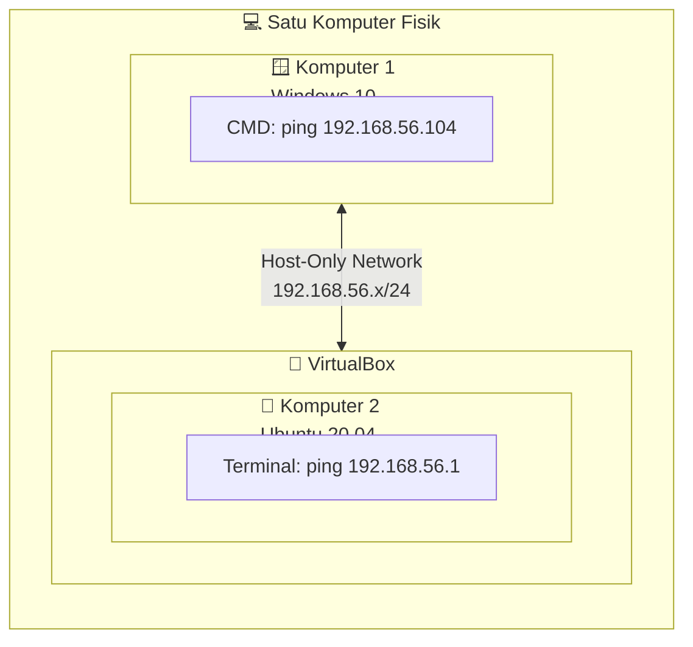

---

## BAB 3 — Pelaporan dan Penilaian

Setelah berhasil menyelesaikan praktikum instalasi VirtualBox, mahasiswa **wajib membuat laporan** dalam bentuk video sebagai dasar penilaian.

### Tahap Pelaporan dan Penilaian

Upload **rekaman video** ke platform yang ditentukan dosen, yang menampilkan:

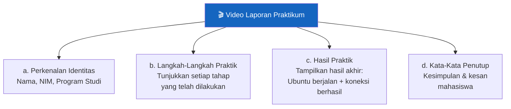

| Komponen | Isi | Tips |
|----------|-----|------|
| **Perkenalan Identitas** | Nama lengkap, NIM, mata kuliah | Tunjukkan KTM atau ucapkan identitas jelas |
| **Langkah-Langkah Praktik** | Rekam layar saat melakukan instalasi | Gunakan software screen recorder (OBS, Camtasia, atau fitur bawaan Windows/Ubuntu) |
| **Hasil Praktik** | Ubuntu berjalan di VirtualBox + hasil ping sukses | Pastikan CMD Windows dan Terminal Ubuntu terlihat jelas saat ping |
| **Kata-Kata Penutup** | Kesimpulan apa yang dipelajari | Bisa sampaikan hambatan yang dialami dan cara mengatasinya |

---

## Ringkasan dan Troubleshooting

### Ringkasan Alur Keseluruhan

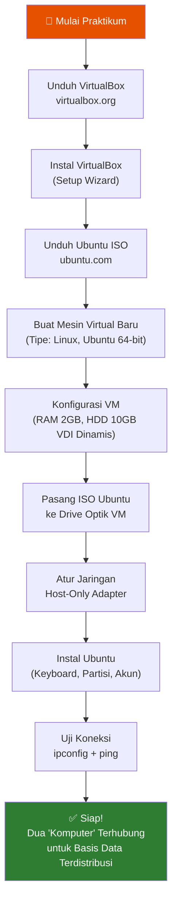

### Tabel Troubleshooting

| Masalah | Penyebab | Solusi |
|---------|----------|--------|
| **Ubuntu tidak bisa ping Windows** | Firewall Windows aktif | Matikan Windows Firewall sementara selama praktikum |
| **Windows tidak bisa ping Ubuntu** | Adapter jaringan salah | Pastikan Adaptor 1 Ubuntu = "Adaptor Hanya-host" |
| **Ubuntu berjalan sangat lambat** | RAM kurang | Naikkan alokasi RAM ke 2048 MB atau lebih |
| **VirtualBox tidak bisa dibuka** | Virtualisasi di BIOS dimatikan | Masuk BIOS → aktifkan Intel VT-x atau AMD-V |
| **Hard disk virtual tidak cukup** | Ukuran 10 GB terlalu kecil | Buat ulang dengan ukuran lebih besar (15–20 GB) |
| **Guest tidak dapat refresh MAC Address** | Konflik MAC | Klik simbol refresh (lingkaran biru) di pengaturan jaringan |
| **Proses instalasi sangat lama** | Normal | Proses copy file Ubuntu bisa 15–45 menit — bersabar |

### Spesifikasi Sistem yang Digunakan dalam Panduan

| Komponen | Spesifikasi |
|----------|------------|
| **Host OS** | Windows 10 |
| **VirtualBox** | Oracle VM VirtualBox 6.1.14 |
| **Guest OS** | Ubuntu 20.04.1 LTS (Desktop, 64-bit) |
| **RAM Guest** | 2048 MB |
| **Hard Disk Guest** | 10 GB (VDI, Dinamis) |
| **Partisi Swap** | ~737 MB |
| **Partisi Root** | ~10.000 MB (Ext4, mount `/`) |
| **Tipe Jaringan** | Host-Only Adapter |
| **IP Komputer 1** | 192.168.56.1 (Windows) |
| **IP Komputer 2** | 192.168.56.104 (Ubuntu) |

---

> **Catatan Belajar:** Praktikum ini bukan sekadar instalasi software — ini adalah simulasi nyata infrastruktur basis data terdistribusi. Dengan dua "komputer" yang terhubung, kita bisa mempraktikkan replikasi MySQL, transfer data antar server, dan konsep-konsep basis data terdistribusi yang telah dipelajari secara teori di pertemuan 10. Keterampilan virtualisasi ini juga sangat relevan di dunia kerja, di mana administrator basis data sering mengelola server virtual di lingkungan cloud seperti AWS, GCP, atau Azure.
