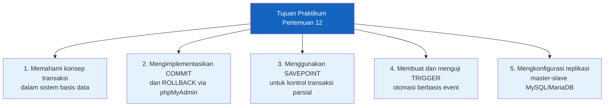
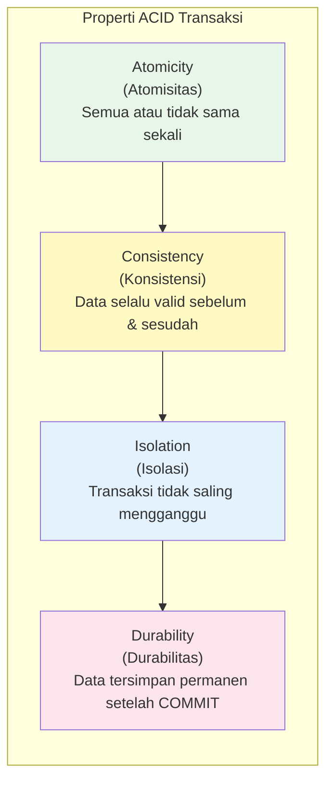
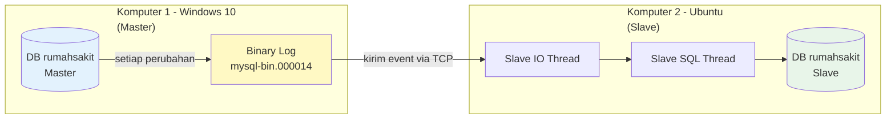
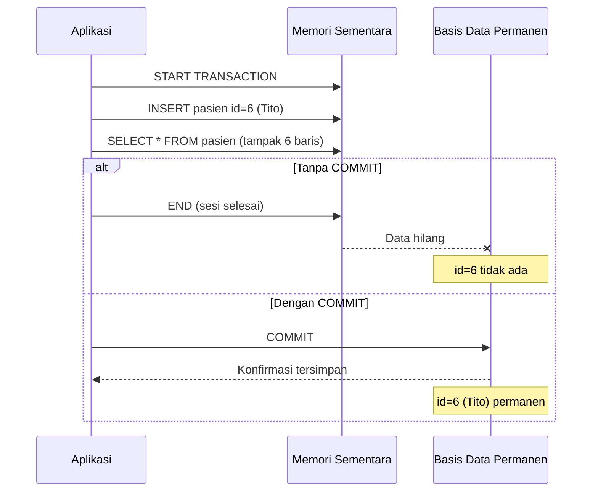
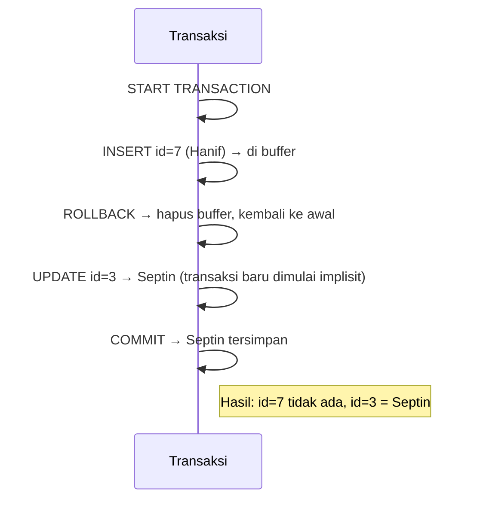
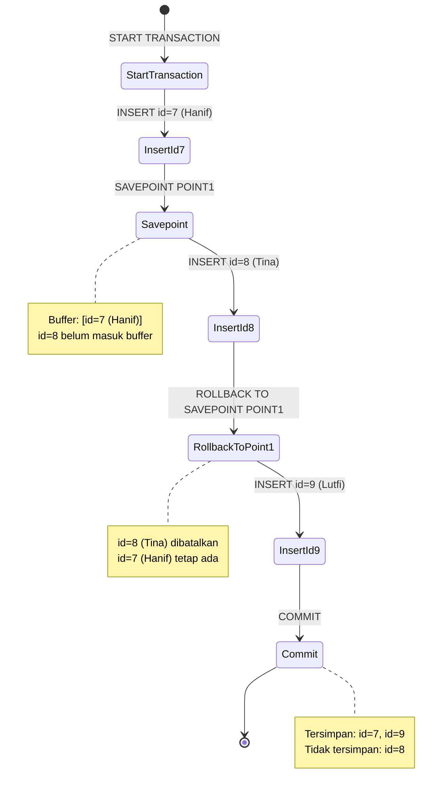
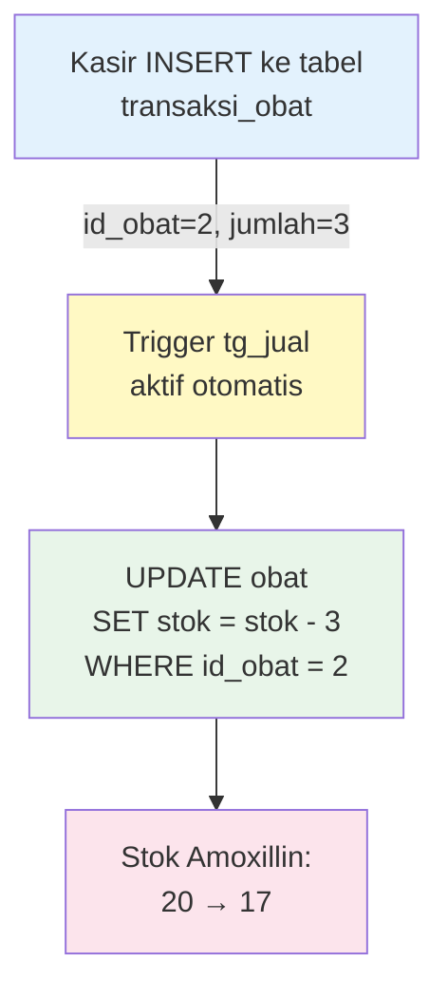
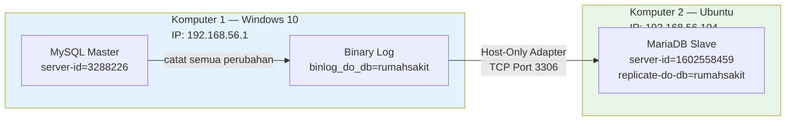
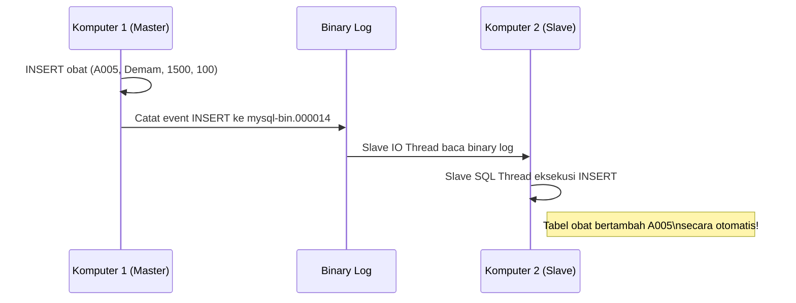

# Pertemuan 12 — Praktikum Transaksi dan Basis Data Terdistribusi

> **Mata Kuliah**: MSIM4206P — Praktikum Sistem Basis Data  
> **Edisi**: 1  
> **Topik**: Transaksi MySQL (COMMIT, ROLLBACK, SAVEPOINT, TRIGGER) + Replikasi Master-Slave

---

## Daftar Isi

1. [BAB 1 — Pendahuluan](#bab-1--pendahuluan)
2. [BAB 2A — Konsep Transaksi dan BDT](#bab-2a--konsep-transaksi-dan-bdt)
3. [BAB 2B.1 — Praktikum Transaksi](#bab-2b1--praktikum-transaksi)
   - [COMMIT](#1-commit)
   - [ROLLBACK](#2-rollback)
   - [SAVEPOINT / Checkpoint](#3-savepoint--checkpoint)
   - [TRIGGER](#4-trigger)
4. [BAB 2B.2 — Praktikum Replikasi](#bab-2b2--praktikum-replikasi)
   - [Konfigurasi Komputer 1 (Master — Windows 10)](#konfigurasi-komputer-1-master--windows-10)
   - [Konfigurasi Komputer 2 (Slave — Ubuntu)](#konfigurasi-komputer-2-slave--ubuntu)
   - [Pengujian Replikasi](#pengujian-replikasi)
5. [BAB 3 — Pelaporan dan Penilaian](#bab-3--pelaporan-dan-penilaian)
6. [Ringkasan Perintah](#ringkasan-perintah)
7. [Troubleshooting](#troubleshooting)

---

## BAB 1 — Pendahuluan

### Tujuan Praktikum

Setelah menyelesaikan praktikum ini, mahasiswa mampu:



### Ruang Lingkup

| No | Ruang Lingkup | Detail |
|----|---------------|--------|
| 1 | **Manajemen Transaksi** | COMMIT, ROLLBACK, SAVEPOINT via Store Procedures phpMyAdmin |
| 2 | **Trigger** | BEFORE/AFTER INSERT/UPDATE/DELETE untuk otomasi logika bisnis |
| 3 | **Replikasi Basis Data** | Konfigurasi Master (Windows 10) → Slave (Ubuntu VirtualBox) |

### Lingkungan Praktikum

| Komponen | Komputer 1 (Master) | Komputer 2 (Slave) |
|----------|--------------------|--------------------|
| OS | Windows 10 | Ubuntu 20.04 LTS (VirtualBox) |
| Perangkat Lunak | XAMPP (MySQL + phpMyAdmin) | XAMPP for Linux |
| IP Address | 192.168.56.1 | 192.168.56.104 |
| Peran | Master (sumber data) | Slave (penerima replikasi) |

---

## BAB 2A — Konsep Transaksi dan BDT

### Apa itu Transaksi?

**Transaksi** adalah satu unit kerja logis yang terdiri dari serangkaian operasi basis data (INSERT, UPDATE, DELETE) yang harus dieksekusi secara **atomik** — artinya semua berhasil, atau semua dibatalkan.

Analogi sederhana: transfer uang bank. Jika proses "kurangi saldo A" berhasil tapi "tambah saldo B" gagal, maka uang hilang begitu saja. Transaksi memastikan keduanya berhasil atau keduanya tidak jadi.

### Properti ACID



| Properti | Arti | Contoh |
|----------|------|--------|
| **Atomicity** | Semua operasi berhasil atau semua gagal | Transfer gagal di tengah jalan → uang kembali |
| **Consistency** | Basis data selalu berada dalam kondisi valid | Stok obat tidak boleh negatif |
| **Isolation** | Transaksi paralel tidak saling mengganggu | Dua kasir tidak double-book kursi yang sama |
| **Durability** | Data yang di-COMMIT tidak hilang meski server crash | Log tertulis ke disk sebelum konfirmasi |

### Konsep Basis Data Terdistribusi (Review)

Replikasi yang dipraktikkan di modul ini adalah salah satu **strategi distribusi data** — tepatnya **Replikasi Snapshot** (data master dicopy ke slave secara sinkron). Komputer 1 berperan sebagai **master** (sumber perubahan), dan komputer 2 sebagai **slave** (penerima perubahan secara otomatis).



---

## BAB 2B.1 — Praktikum Transaksi

Praktikum transaksi dilakukan melalui fitur **Store Procedures** di phpMyAdmin (`http://localhost/phpmyadmin`). Caranya: pilih database → klik tab **Routines** → **Add Routine** → isi nama dan body SQL → **Go**.

> **Mengapa Store Procedures?** Di phpMyAdmin, kita tidak bisa menjalankan `BEGIN...END` blok secara langsung di tab SQL. Store Procedures menjadi wadah untuk menjalankan urutan perintah transaksi sebagai satu kesatuan.

### Struktur Tabel Latihan

Praktikum transaksi menggunakan tabel `pasien` dalam database `rumahsakit`:

```sql
-- Tabel pasien (sudah ada di database rumahsakit)
CREATE TABLE pasien (
  id_pasien       INT PRIMARY KEY,
  nama_pasien     VARCHAR(50),
  alamat_pasien   VARCHAR(100),
  jenis_kelamin   CHAR(1)   -- '1' = Laki-laki, '2' = Perempuan
);
```

---

### 1. COMMIT

**COMMIT** adalah perintah untuk menyimpan semua perubahan dalam transaksi secara permanen ke basis data. Tanpa COMMIT, perubahan hanya ada di memori sementara dan akan hilang saat sesi berakhir.

#### Percobaan 1 — Transaksi TANPA COMMIT (data tidak tersimpan)

```sql
BEGIN
  START TRANSACTION;
  INSERT INTO `pasien` (`id_pasien`, `nama_pasien`, `alamat_pasien`, `jenis_kelamin`)
  VALUES (6, 'Tito', 'Jl.Pakis Haji no 23', '1');
  SELECT * FROM pasien;
END
```

**Hasil**: Data id=6 (Tito) tampak saat `SELECT` di dalam transaksi, tapi setelah prosedur selesai dan dicek ulang, **data tidak ada** karena tidak di-COMMIT.

#### Percobaan 2 — Transaksi DENGAN COMMIT (data tersimpan)

```sql
BEGIN
  START TRANSACTION;
  INSERT INTO `pasien` (`id_pasien`, `nama_pasien`, `alamat_pasien`, `jenis_kelamin`)
  VALUES (6, 'Tito', 'Jl.Pakis Haji no 23', '1');
  SELECT * FROM pasien;
  COMMIT;
END
```

**Hasil**: Data id=6 (Tito) tersimpan permanen. Setelah prosedur selesai, `SELECT * FROM pasien` menampilkan Tito.



---

### 2. ROLLBACK

**ROLLBACK** membatalkan semua atau sebagian perubahan dalam transaksi yang belum di-COMMIT, mengembalikan data ke kondisi sebelumnya.

#### Percobaan 3 — ROLLBACK semua perubahan

```sql
BEGIN
  START TRANSACTION;
  UPDATE pasien SET nama_pasien='Danar' WHERE id_pasien='3';
  ROLLBACK;
  COMMIT;
  SELECT * FROM pasien;
END
```

**Hasil**: Nama pasien id=3 **tidak berubah** menjadi Danar. ROLLBACK membatalkan UPDATE sebelum sempat di-COMMIT.

#### Percobaan 4 — ROLLBACK INSERT, UPDATE tetap ter-COMMIT

```sql
BEGIN
  START TRANSACTION;
  INSERT INTO `pasien` (`id_pasien`, `nama_pasien`, `alamat_pasien`, `jenis_kelamin`)
  VALUES (7, 'Hanif', 'Jl.Babakan loa no 22', '1');
  ROLLBACK;
  UPDATE pasien SET nama_pasien='Septin' WHERE id_pasien='3';
  COMMIT;
  SELECT * FROM pasien;
END
```

**Hasil**:
- id=7 (Hanif) **tidak masuk** → di-ROLLBACK sebelum COMMIT
- id=3 berubah menjadi **Septin** → UPDATE setelah ROLLBACK, lalu di-COMMIT



> **Catatan penting**: Setelah ROLLBACK, MySQL secara implisit memulai transaksi baru. Perintah UPDATE setelah ROLLBACK berjalan dalam konteks autocommit atau transaksi baru, sehingga COMMIT berikutnya menyimpannya.

---

### 3. SAVEPOINT / Checkpoint

**SAVEPOINT** membuat titik simpan di dalam transaksi. Kita bisa melakukan `ROLLBACK TO SAVEPOINT` untuk kembali ke titik tertentu **tanpa membatalkan seluruh transaksi**.

Analogi: seperti menyimpan progres game di tengah level. Jika mati, bisa kembali ke titik save tersebut, bukan dari awal.

#### Percobaan 5 — SAVEPOINT dengan 3 INSERT

```sql
BEGIN
  START TRANSACTION;
  
  -- INSERT pertama
  INSERT INTO `pasien` (`id_pasien`, `nama_pasien`, `alamat_pasien`, `jenis_kelamin`)
  VALUES (7, 'Hanif', 'Jl.Babakan loa no 22', '1');
  
  SAVEPOINT POINT1;  -- Tandai titik simpan setelah id=7 masuk
  
  -- INSERT kedua
  INSERT INTO `pasien` (`id_pasien`, `nama_pasien`, `alamat_pasien`, `jenis_kelamin`)
  VALUES (8, 'Tina', 'Jl.Sangkuriang no 45', '2');
  
  ROLLBACK TO SAVEPOINT POINT1;  -- Kembali ke titik setelah id=7, hapus id=8
  
  -- INSERT ketiga
  INSERT INTO `pasien` (`id_pasien`, `nama_pasien`, `alamat_pasien`, `jenis_kelamin`)
  VALUES (9, 'Lutfi', 'Jl.Dipenogoro 24', '1');
  
  COMMIT;
  SELECT * FROM pasien;
END
```

**Hasil**:
| id | nama | Keterangan |
|----|------|-----------|
| 7 | Hanif | ✅ Tersimpan — sebelum SAVEPOINT |
| 8 | Tina | ❌ Tidak tersimpan — di-rollback ke POINT1 |
| 9 | Lutfi | ✅ Tersimpan — INSERT setelah ROLLBACK, lalu COMMIT |



---

### 4. TRIGGER

**TRIGGER** adalah prosedur yang otomatis dijalankan oleh MySQL sebagai respons terhadap event tertentu pada sebuah tabel. Berbeda dengan Store Procedure yang harus dipanggil manual, Trigger berjalan otomatis.

#### Jenis-Jenis Trigger

| Event | BEFORE | AFTER |
|-------|--------|-------|
| **INSERT** | Sebelum data baru masuk | Setelah data baru masuk |
| **UPDATE** | Sebelum data diubah | Setelah data diubah |
| **DELETE** | Sebelum data dihapus | Setelah data dihapus |

- **`NEW`**: merujuk ke baris baru (INSERT/UPDATE)
- **`OLD`**: merujuk ke baris lama sebelum diubah/dihapus (UPDATE/DELETE)

#### Tabel yang Digunakan untuk Trigger

```sql
-- Tabel stok obat
CREATE TABLE obat (
  id_obat    INT(6) AUTO_INCREMENT PRIMARY KEY,
  kode_obat  VARCHAR(5),
  nama_obat  VARCHAR(30),
  harga      INTEGER(10),
  stok       INTEGER(5)
);

-- Tabel transaksi pembelian obat
CREATE TABLE transaksi_obat (
  id_transaksi  INT(3)  AUTO_INCREMENT PRIMARY KEY,
  id_pasien     INT(3),
  id_obat       INT(3),
  jumlah        INT(10),
  total_harga   INT(10)
);
```

#### Contoh: Trigger `tg_jual` — Otomatis Kurangi Stok

**Kasus**: Saat kasir memasukkan transaksi penjualan obat, stok obat harus berkurang otomatis.

```sql
DELIMITER $
CREATE TRIGGER tg_jual AFTER INSERT
ON transaksi_obat
FOR EACH ROW
BEGIN
    UPDATE obat 
    SET stok = stok - new.jumlah
    WHERE id_obat = new.id_obat;
END $
DELIMITER ;
```

**Cara membuat di phpMyAdmin**: Database → Routines tidak digunakan untuk Trigger. Gunakan tab **SQL** langsung, atau menu **Triggers** di dalam tabel `transaksi_obat`.



**Simulasi efek trigger**:

| Kondisi | id_obat | nama_obat | stok sebelum | jumlah transaksi | stok sesudah |
|---------|---------|-----------|-------------|-----------------|-------------|
| Sebelum | 1 | Amikacin | 10 | — | 10 |
| INSERT transaksi_obat id_obat=1, jumlah=3 | — | — | — | 3 | — |
| Sesudah | 1 | Amikacin | — | — | **7** |

---

## BAB 2B.2 — Praktikum Replikasi

Replikasi **master-slave** memungkinkan setiap perubahan pada komputer 1 (master) secara otomatis tersinkronisasi ke komputer 2 (slave). Ini adalah implementasi nyata dari konsep Basis Data Terdistribusi yang dipelajari di pertemuan 10.



### Alur Konfigurasi Keseluruhan

```mermaid
flowchart TD
    A["Mulai"] --> B["Komputer 1: Aktifkan XAMPP"]
    B --> C["Komputer 1: phpMyAdmin → Replication → Master → Configure"]
    C --> D["Komputer 1: Tambahkan 4 baris ke my.ini"]
    D --> E["Komputer 1: Restart MySQL"]
    E --> F["Komputer 1: Cek Show Master Status\n(catat File & Position)"]
    F --> G["Komputer 1: Buat user replication\n(prodisi@192.168.56.104)"]
    G --> H["Komputer 1: Export DB rumahsakit → .sql"]
    H --> I["Komputer 2: Import .sql ke Ubuntu phpMyAdmin"]
    I --> J["Komputer 2: phpMyAdmin → Replication → Slave → Configure"]
    J --> K["Komputer 2: Copy server-id, edit my.cnf"]
    K --> L["Komputer 2: chmod a+rwx my.cnf\nlalu save + restart"]
    L --> M["Komputer 2: Klik Go di slave config"]
    M --> N{Error\nAllowArbitraryServer?}
    N -->|Ya| O["Edit config.default.php\nubah false → true\nrestart"]
    O --> P["Komputer 2: Cek master status lagi\ndi Komputer 1"]
    N -->|Tidak| P
    P --> Q["Komputer 2: terminal → CHANGE MASTER TO\n+ start slave"]
    Q --> R["Cek Slave_IO_Running: Yes\nSlave_SQL_Running: Yes"]
    R --> S["Pengujian: INSERT di Master\nCek otomatis di Slave"]
    S --> T["Selesai ✓"]
```



---

### Konfigurasi Komputer 1 (Master — Windows 10)

#### Langkah 1 — Aktifkan XAMPP

Buka XAMPP Control Panel, jalankan **Apache** dan **MySQL**.

#### Langkah 2 — Konfigurasi Master via phpMyAdmin

1. Buka `http://localhost/phpmyadmin`
2. Klik menu **Replication** (jika tidak tampil, klik tanda `>` di toolbar)
3. Pada bagian **Master replication** → klik **Configure it**
4. Pilih database **rumahsakit** sebagai database yang akan direplikasi
5. Akan muncul 4 baris konfigurasi yang harus disalin ke `my.ini`

#### Langkah 3 — Edit my.ini (MySQL Windows)

Tambahkan baris berikut ke bagian `[mysqld]` pada file `my.ini` MySQL XAMPP:

```ini
server-id=3288226
log-bin=mysql-bin
log_error=mysql-bin.err
binlog_do_db=rumahsakit
```

| Parameter | Penjelasan |
|-----------|-----------|
| `server-id` | ID unik server MySQL (berbeda dari slave) |
| `log-bin` | Aktifkan binary logging dengan prefix nama file |
| `log_error` | File untuk menyimpan error log replikasi |
| `binlog_do_db` | Database yang akan direplikasi (hanya rumahsakit) |

#### Langkah 4 — Restart MySQL

Restart MySQL via XAMPP Control Panel.

#### Langkah 5 — Lihat Status Master

Di phpMyAdmin → Replication → **Show master status**:

| Variabel | Nilai |
|----------|-------|
| File | `mysql-bin.000011` |
| Position | `1522` |
| Binlog_Do_DB | `rumahsakit` |

> **Catat nilai File dan Position!** Nilai ini akan berubah setiap kali ada operasi write. Catat nilai terbaru **sesaat sebelum** mengkonfigurasi slave.

#### Langkah 6 — Buat User Replikasi

Di phpMyAdmin → Replication → **Add slave replication user**:

| Field | Nilai |
|-------|-------|
| Username | `prodisi` |
| Hostname | `192.168.56.104` (IP Ubuntu) |
| Password | `prodisi` |
| Privileges | ✅ REPLICATION SLAVE, ✅ REPLICATION CLIENT |

Setara dengan SQL berikut:
```sql
CREATE USER 'prodisi'@'192.168.56.104' IDENTIFIED BY 'prodisi';
GRANT REPLICATION SLAVE, REPLICATION CLIENT 
  ON *.* TO 'prodisi'@'192.168.56.104';
FLUSH PRIVILEGES;
```

#### Langkah 7 — Export Database

Ekspor database **rumahsakit** ke file `.sql` via phpMyAdmin → Export → Go. Salin file ini ke Komputer 2 (Ubuntu) via USB/flashdisk atau shared folder VirtualBox.

---

### Konfigurasi Komputer 2 (Slave — Ubuntu)

#### Langkah 1 — Jalankan XAMPP di Ubuntu

```bash
cd /opt/lampp
sudo ./manager-linux-x64.run
```

Jalankan **Apache** dan **MySQL** via GUI XAMPP Manager.

#### Langkah 2 — Import Database via phpMyAdmin

1. Buka `http://localhost/phpmyadmin` di browser Ubuntu
2. Buat database baru bernama **rumahsakit**
3. Masuk ke database rumahsakit → klik **Import** → pilih file `.sql` dari flashdisk → **Go**

#### Langkah 3 — Konfigurasi Slave via phpMyAdmin

1. phpMyAdmin → klik menu **Replication** (klik `>` jika tidak tampil)
2. Pada bagian **Slave replication** → klik **configure it**
3. Isi form konfigurasi slave:

**Tabel 5 — Konfigurasi Slave**

| No | Konfigurasi | Nilai | Penjelasan |
|----|-------------|-------|-----------|
| 1 | Server-id | `1602558459` | ID unik server komputer 2 (Ubuntu), berbeda dari master |
| 2 | User name | `prodisi` | Username yang telah dibuat pada komputer 1 |
| 3 | Password | `prodisi` | Password yang telah dibuat pada komputer 1 |
| 4 | Host | `192.168.56.1` | IP address komputer 1 (Windows 10 Master) |
| 5 | Port | `3306` | Port default MySQL |

> ⚠️ **JANGAN klik Go terlebih dahulu!** Salin server-id yang ditampilkan, lalu edit my.cnf dulu.

#### Langkah 4 — Edit my.cnf (MySQL Ubuntu)

**Buka my.cnf via XAMPP:**
- XAMPP Manager → pilih **MySQL Database** → klik **Configure** → **Open Conf File** → **Yes**

**Atau edit langsung via terminal** (setelah ubah permission):

```bash
# Ubah ke folder konfigurasi
cd /opt/lampp/etc

# Lihat isi folder
ls
# extra  freetds.conf  httpd.conf  httpd.conf.bak  locales.conf
# magic  mine.types  my.cnf  openldap  php.ini-pre1.7.2  ...

# Ubah hak akses my.cnf agar bisa diedit
sudo chmod a+rwx my.cnf
```

**Modifikasi my.cnf** — cari bagian `[mysqld]`, hapus tanda `#` di depan `server-id`, lalu tambahkan:

```ini
[mysqld]
server-id       = 1602558459
replicate-do-db = rumahsakit
```

| Parameter | Penjelasan |
|-----------|-----------|
| `server-id` | ID unik slave, harus berbeda dari master (3288226) |
| `replicate-do-db` | Database yang akan direplikasi dari master |

Setelah edit, **simpan file** (Ctrl+S atau klik Save di text editor).

#### Langkah 5 — Restart Services

Kembali ke XAMPP Manager → klik **Restart** untuk MySQL dan Apache.

#### Langkah 6 — Klik Go di Slave Configuration

Kembali ke halaman phpMyAdmin Slave Configuration → klik **Go**.

#### Langkah 7 — Atasi Error AllowArbitraryServer (jika muncul)

Jika muncul pesan error: *"Connection to server is disabled, please enable `$cfg['AllowArbitraryServer']` in phpMyAdmin configuration"*:

```bash
# Masuk ke folder libraries phpMyAdmin
cd /opt/lampp/phpmyadmin/libraries

# Lihat isi folder (pastikan ada config.default.php)
ls

# Ubah hak akses
sudo chmod a+rwx config.default.php
```

Buka file `config.default.php` dengan text editor, cari baris:

```php
$cfg['AllowArbitraryServer'] = false;
```

Ubah menjadi:

```php
$cfg['AllowArbitraryServer'] = true;
```

(sekitar baris 828 pada file tersebut)

Simpan file, lalu **restart services** Apache dan MySQL di XAMPP.

#### Langkah 8 — Cek Status Master Terbaru

Sebelum menjalankan CHANGE MASTER TO, cek ulang status master di **Komputer 1 (Windows)**:

phpMyAdmin → Replication → **Show master status** → catat nilai **File** dan **Position** terbaru.

#### Langkah 9 — CHANGE MASTER TO via Terminal

Di **Komputer 2 (Ubuntu)**, buka terminal:

```bash
# Masuk ke folder bin XAMPP
cd /opt/lampp/bin

# Login ke MySQL/MariaDB sebagai root
sudo ./mysql -u root
```

Setelah masuk ke prompt `MariaDB [(none)]>`:

```sql
-- Cek status slave dulu (harus tidak aktif / error)
show status slave;
-- Jika slave aktif (Slave_IO_Running: Yes), hentikan dulu:
-- stop slave;

-- Konfigurasi master slave
CHANGE MASTER TO
MASTER_HOST='192.168.56.1',
MASTER_USER='prodisi',
MASTER_PASSWORD='prodisi',
MASTER_LOG_FILE='mysql-bin.000014',
MASTER_LOG_POS=2926;

-- Mulai slave
start slave;
```

**Tabel 6 — Parameter CHANGE MASTER TO**

| No | Parameter | Nilai | Penjelasan |
|----|-----------|-------|-----------|
| 1 | `CHANGE MASTER TO` | — | Perintah awal untuk mengubah master slave |
| 2 | `MASTER_HOST` | `'192.168.56.1'` | IP address komputer 1 (Master/Windows 10) |
| 3 | `MASTER_USER` | `'prodisi'` | User replikasi yang dibuat di komputer 1 |
| 4 | `MASTER_PASSWORD` | `'prodisi'` | Password user replikasi |
| 5 | `MASTER_LOG_FILE` | `'mysql-bin.000014'` | Nama file binary log dari Show Master Status |
| 6 | `MASTER_LOG_POS` | `2926` | Posisi/offset binary log dari Show Master Status |

#### Langkah 10 — Verifikasi Status Slave

Di phpMyAdmin Ubuntu → Replication → **See slave status table**:

| Variabel | Nilai yang Diharapkan |
|----------|----------------------|
| Slave_IO_State | Waiting for master to send event |
| Master_Host | 192.168.56.1 |
| Master_User | prodisi |
| Master_Port | 3306 |
| Read_Master_Log_Pos | 1522 |
| **Slave_IO_Running** | **Yes** ✅ |
| **Slave_SQL_Running** | **Yes** ✅ |

> **Jika salah satu bernilai No**: periksa kembali konfigurasi dari awal, terutama nilai `MASTER_LOG_FILE` dan `MASTER_LOG_POS` yang harus sesuai dengan Show Master Status terbaru.

---

### Pengujian Replikasi

Setelah slave berjalan (`Slave_IO_Running: Yes` dan `Slave_SQL_Running: Yes`), uji replikasi:

#### Langkah Pengujian

**Di Komputer 1 (Windows 10 — Master):**

1. Buka phpMyAdmin → database **rumahsakit** → tabel **obat**
2. Data awal (3 baris): Amikacin, Amoxilin, Betadine

| id_obat | kode_obat | nama_obat | harga | stok |
|---------|-----------|-----------|-------|------|
| 1 | A001 | Amikacin | 20000 | 10 |
| 2 | A002 | Amoxillin | 15000 | 15 |
| 3 | A003 | Betadine | 7000 | 5 |
| 4 | A004 | Itu | 2000 | 10 |

3. Insert data baru: **A005, Demam, harga 1500, stok 100**
4. Setelah insert, tabel obat memiliki 5 baris.

**Di Komputer 2 (Ubuntu — Slave):**

1. Buka phpMyAdmin → database **rumahsakit** → tabel **obat**
2. Tanpa perlu tindakan apapun, data A005 (Demam) sudah muncul otomatis!



**Jika hasilnya sama**: replikasi berhasil! ✅  
**Jika belum sama**: ulangi konfigurasi dari langkah awal, pastikan `Slave_IO_Running` dan `Slave_SQL_Running` keduanya `Yes`.

---

## BAB 3 — Pelaporan dan Penilaian

Setelah menyelesaikan praktikum, mahasiswa **wajib menyusun laporan** berupa rekaman video yang diunggah secara online.

### Isi Video Laporan

| Bagian | Konten |
|--------|--------|
| **a. Perkenalan** | Identitas mahasiswa (nama, NIM, program studi) |
| **b. Langkah Praktik** | Dokumentasi langkah-langkah yang dilakukan + aktivitas kegiatan |
| **c. Hasil Praktik** | Tampilkan bukti hasil (screenshot atau live demo transaksi + replikasi) |
| **d. Penutup** | Kata-kata penutup dari mahasiswa |

### Checklist Laporan

- [ ] Praktikum transaksi selesai (COMMIT, ROLLBACK, SAVEPOINT, TRIGGER)
- [ ] Store Procedure berhasil dibuat di phpMyAdmin
- [ ] Trigger `tg_jual` berjalan otomatis mengurangi stok
- [ ] Replikasi Master (Windows) → Slave (Ubuntu) berjalan
- [ ] `Slave_IO_Running: Yes` dan `Slave_SQL_Running: Yes`
- [ ] Data yang diinsert di Master otomatis muncul di Slave
- [ ] Video laporan direkam mencakup seluruh langkah
- [ ] Video diupload dan link dikirimkan

---

## Ringkasan Perintah

### Perintah Transaksi MySQL

```sql
-- Memulai transaksi eksplisit
START TRANSACTION;

-- Simpan semua perubahan secara permanen
COMMIT;

-- Batalkan semua perubahan sejak START TRANSACTION
ROLLBACK;

-- Buat titik simpan di tengah transaksi
SAVEPOINT nama_titik;

-- Kembali ke titik simpan (tanpa batalkan seluruh transaksi)
ROLLBACK TO SAVEPOINT nama_titik;

-- Hapus savepoint
RELEASE SAVEPOINT nama_titik;
```

### Perintah Slave di Ubuntu Terminal

```bash
# Masuk ke MySQL/MariaDB
cd /opt/lampp/bin
sudo ./mysql -u root

# Ubah hak akses my.cnf (jika perlu)
cd /opt/lampp/etc
sudo chmod a+rwx my.cnf

# Ubah hak akses config.default.php (jika perlu)
cd /opt/lampp/phpmyadmin/libraries
sudo chmod a+rwx config.default.php
```

```sql
-- Cek status slave
SHOW SLAVE STATUS\G

-- Hentikan slave
STOP SLAVE;

-- Konfigurasi master
CHANGE MASTER TO
  MASTER_HOST='192.168.56.1',
  MASTER_USER='prodisi',
  MASTER_PASSWORD='prodisi',
  MASTER_LOG_FILE='mysql-bin.000014',
  MASTER_LOG_POS=2926;

-- Mulai slave
START SLAVE;
```

---

## Troubleshooting

| Masalah | Kemungkinan Penyebab | Solusi |
|---------|---------------------|--------|
| Data tidak tersimpan setelah transaksi | Lupa COMMIT | Tambahkan `COMMIT;` di akhir transaksi |
| `Slave_IO_Running: No` | Nilai MASTER_LOG_FILE/POS salah | Cek ulang `SHOW MASTER STATUS` di master, ulangi `CHANGE MASTER TO` |
| `Slave_SQL_Running: No` | SQL error saat eksekusi event | Jalankan `SHOW SLAVE STATUS\G`, lihat `Last_SQL_Error` |
| Error "Connection to server disabled" | `AllowArbitraryServer = false` | Edit `/opt/lampp/phpmyadmin/libraries/config.default.php`, ubah `false` → `true`, restart |
| my.cnf read-only, tidak bisa disimpan | Hak akses file terbatas | `sudo chmod a+rwx /opt/lampp/etc/my.cnf` |
| config.default.php read-only | Hak akses file terbatas | `sudo chmod a+rwx /opt/lampp/phpmyadmin/libraries/config.default.php` |
| Menu Replication tidak muncul di phpMyAdmin | Toolbar terpotong | Klik tanda `>` di ujung kanan toolbar phpMyAdmin |
| Trigger tidak berjalan | Delimiter salah saat CREATE | Pastikan gunakan `DELIMITER $` dan `$` sebagai terminator |
| Slave sudah aktif saat CHANGE MASTER TO | Slave running sebelumnya | Jalankan `STOP SLAVE;` terlebih dahulu |

---

> **Catatan Tambahan**: Setup Docker untuk lingkungan pengembangan lokal tersedia di folder ini (`docker-compose.yml`, `setup-replication.sh`). File tersebut memungkinkan simulasi praktikum tanpa perlu VirtualBox — cukup dengan Docker Desktop.
