# Aktivitas 13 — Aplikasi Basis Data

**MSIM4206 / Basis Data**  
Program Studi Sistem Informasi — Universitas Terbuka

> Catatan: dokumen ini merupakan ekstraksi sekaligus elaborasi dari materi *Aktivitas 13 — Aplikasi Basis Data*. Setiap poin dijelaskan lebih dalam dengan konteks historis, perbandingan fitur, dan contoh penggunaan agar lebih mudah dipahami secara utuh. Diagram konseptual digambarkan ulang menggunakan mermaid.

---

## 1. Pengertian DBMS

### Definisi dari Para Ahli

**Database Management System (DBMS)** adalah perangkat lunak yang menjadi jembatan antara pengguna/aplikasi dan data yang tersimpan di dalam basis data.

| Tokoh | Definisi |
|-------|---------|
| **C.J. Date** | DBMS adalah sebuah aplikasi yang dapat menangani akses pengguna kepada basis data. |
| **Gordon C. Everest** | DBMS adalah sebuah aplikasi manajemen sumber daya data. |
| **Kesimpulan** | DBMS adalah sebuah aplikasi untuk menangani data dan akses pengguna supaya data terpelihara dengan baik. |

### Mengapa DBMS Diperlukan?

Sebelum era DBMS, data disimpan dalam file-file terpisah yang dikelola langsung oleh setiap program. Pendekatan ini menimbulkan masalah serius:

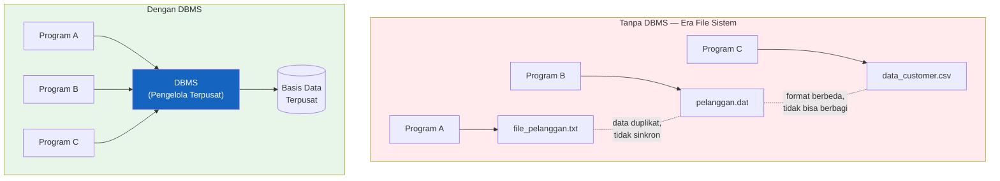

| Masalah tanpa DBMS | Solusi dengan DBMS |
|--------------------|--------------------|
| Redundansi data (duplikasi di banyak file) | Satu sumber kebenaran (*single source of truth*) |
| Inkonsistensi (update satu file, lupa yang lain) | Perubahan terpusat, konsisten di semua akses |
| Sulit berbagi data antar program | Multi-user, multi-aplikasi secara bersamaan |
| Keamanan sulit dikontrol | Hak akses per pengguna/tabel/kolom |
| Tidak ada mekanisme pemulihan dari kegagalan | Backup, recovery, dan transaksi ACID |

---

## 2. Fungsi Basis Data (DBMS)

DBMS tidak hanya "menyimpan data" — ia menjalankan **9 fungsi kritis** yang membuat pengelolaan data menjadi andal dan efisien:

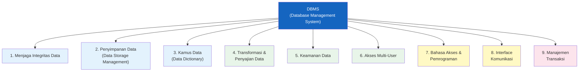

### Penjelasan Tiap Fungsi

| No | Fungsi | Penjelasan Detail | Contoh Nyata |
|----|--------|-------------------|-------------|
| **1** | **Menjaga Integritas Data** | Memastikan data selalu akurat, lengkap, dan konsisten melalui aturan (constraints): PRIMARY KEY, FOREIGN KEY, NOT NULL, UNIQUE, CHECK | Stok obat tidak bisa bernilai negatif (`CHECK (stok >= 0)`) |
| **2** | **Penyimpanan Data** | Mengelola bagaimana data disimpan secara fisik di disk — termasuk struktur file, indexing, buffering, dan caching untuk kecepatan akses | Index pada kolom `nama_pasien` mempercepat pencarian |
| **3** | **Kamus Data** | Menyimpan metadata — informasi tentang struktur data itu sendiri: nama tabel, kolom, tipe data, relasi, constraint | `INFORMATION_SCHEMA` di MySQL menyimpan semua metadata ini |
| **4** | **Transformasi & Penyajian Data** | Mengkonversi data mentah menjadi informasi yang bermakna melalui query, JOIN, agregasi, dan view | `SELECT nama, SUM(total) FROM transaksi GROUP BY nama` |
| **5** | **Keamanan Data** | Mengontrol siapa boleh mengakses, mengubah, atau menghapus data — melalui autentikasi pengguna dan hak akses (GRANT/REVOKE) | `GRANT SELECT ON pasien TO 'perawat'@'localhost'` |
| **6** | **Akses Multi-User** | Memungkinkan banyak pengguna mengakses basis data secara bersamaan tanpa konflik — menggunakan mekanisme *locking* dan *concurrency control* | 100 kasir bisa input transaksi secara bersamaan |
| **7** | **Bahasa Akses & Pemrograman** | Menyediakan bahasa standar (SQL) dan API/driver untuk berinteraksi dengan basis data dari berbagai bahasa pemrograman | PHP + PDO, Python + psycopg2, Java + JDBC |
| **8** | **Interface Komunikasi** | Menyediakan antarmuka untuk berbagai jenis pengguna: GUI (phpMyAdmin), CLI (mysql terminal), API (REST), dan laporan (query builder) | phpMyAdmin, DBeaver, pgAdmin, SQL Server Management Studio |
| **9** | **Manajemen Transaksi** | Menjamin properti ACID (Atomicity, Consistency, Isolation, Durability) — memastikan setiap transaksi selesai sempurna atau dibatalkan seluruhnya | Transfer bank: debit A dan kredit B harus keduanya berhasil |

> **Catatan**: Fungsi ke-9 (Manajemen Transaksi) adalah yang paling kritis dalam aplikasi bisnis. Tanpanya, data bisa rusak saat terjadi kegagalan sistem di tengah proses.

---

## 3. Contoh Aplikasi DBMS

Terdapat banyak implementasi DBMS di dunia nyata. Aktivitas ini membahas 5 DBMS paling relevan yang perlu diketahui:

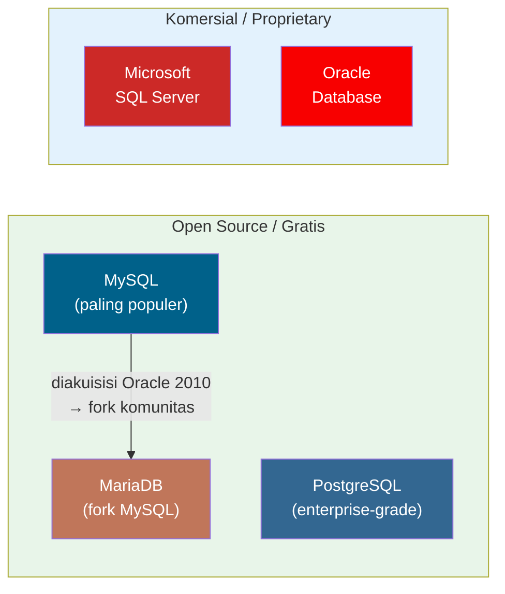

---

### 3.1 MySQL

> **MySQL** merupakan *Database Management System* yang bersifat **gratis**, dan dapat digunakan untuk keperluan pribadi serta komersil. Basis data MySQL merupakan basis data yang **paling populer** dibandingkan dengan basis data lainnya.

**Sejarah Singkat MySQL:**

MySQL dikembangkan oleh Michael Widenius ("Monty") dan David Axmark di Swedia pada tahun **1995**, dengan nama berasal dari putri Widenius yang bernama *My*. MySQL kemudian diakuisisi oleh Sun Microsystems (2008), dan selanjutnya oleh **Oracle Corporation** (2010). Kekhawatiran komunitas terhadap masa depan MySQL di bawah Oracle mendorong lahirnya MariaDB.

**Keunggulan MySQL:**

- **Gratis** untuk penggunaan personal dan komersial (lisensi GPL)
- **Kecepatan tinggi** — dioptimalkan untuk operasi *read-heavy* (SELECT)
- **Ekosistem besar** — dokumentasi melimpah, komunitas aktif, banyak hosting support
- **Terintegrasi baik** dengan PHP dan XAMPP — standar de facto pengembangan web LAMP/WAMP
- **Ringan** — bisa berjalan di VPS kecil sekalipun

**Contoh koneksi MySQL dari PHP:**
```php
$pdo = new PDO('mysql:host=localhost;dbname=rumahsakit', 'root', '');
$stmt = $pdo->query('SELECT * FROM pasien');
```

**Digunakan oleh**: Facebook (dulu), Twitter, YouTube, Wikipedia, Airbnb, dan jutaan website lainnya.

---

### 3.2 MariaDB

> **MariaDB** merupakan versi pengembangan terpisah (*fork*) dari MySQL karena MySQL telah diakuisisi oleh Oracle.

**Latar Belakang Lahirnya MariaDB:**

Ketika Oracle mengakuisisi MySQL pada 2010, komunitas open source khawatir MySQL akan "dikomersialisasi" dan lisensinya berubah. **Michael Widenius** (pencipta MySQL asli) kemudian membuat *fork* resmi bernama **MariaDB** — diambil dari nama putri bungsunya, Maria.

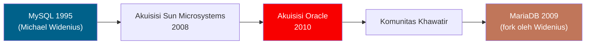

**Perbedaan MariaDB vs MySQL:**

| Aspek | MySQL | MariaDB |
|-------|-------|---------|
| Kepemilikan | Oracle Corporation | MariaDB Foundation (komunitas) |
| Lisensi | GPL + komersial | GPL (lebih terbuka) |
| Kompatibilitas | — | Drop-in replacement untuk MySQL (90%+ kompatibel) |
| Storage engine | InnoDB (default) | Aria, InnoDB, XtraDB |
| Performa | Baik | Sedikit lebih cepat pada beberapa skenario |
| Transparansi | Tertutup sebagian | Open penuh |

> **Catatan praktis**: XAMPP untuk Linux menggunakan **MariaDB**, bukan MySQL murni. Itulah mengapa di pertemuan 12, prompt terminal menampilkan `MariaDB [(none)]>` bukan `mysql>`. Meski tampak berbeda, perintah SQL-nya hampir identik.

---

### 3.3 Microsoft SQL Server

> **Microsoft SQL Server** merupakan DBMS yang dikembangkan oleh Microsoft. Salah satu fitur unggulannya adalah kemampuan dalam *mirroring* dan *clustering* basis data.

**Penjelasan Fitur Utama:**

| Fitur | Definisi | Analogi |
|-------|----------|---------|
| **Mirroring** | Duplikasi basis data ke server/tempat lain secara otomatis | Seperti mencerminkan seluruh isi lemari arsip ke kantor cabang — jika kantor pusat terbakar, cabang tetap punya salinannya |
| **Clustering** | Pengelompokan data dan server untuk ketersediaan tinggi (*high availability*) | Seperti memiliki beberapa kasir di supermarket — jika satu kasir absen, yang lain tetap melayani |

**Ekosistem SQL Server:**

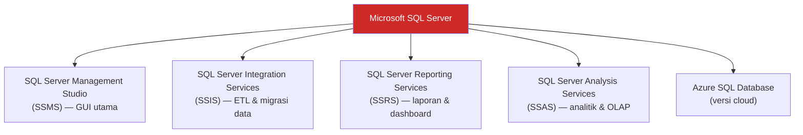

**Karakteristik SQL Server:**
- Berbayar (ada versi gratis *Express* dengan batasan)
- Terintegrasi sempurna dengan ekosistem Microsoft (.NET, Azure, Windows Server)
- Bahasa ekstensi SQL: **T-SQL** (Transact-SQL) — memiliki fitur lebih dari SQL standar
- Unggul dalam lingkungan enterprise Windows

---

### 3.4 Oracle Database

> **Oracle** merupakan sebuah aplikasi basis data yang dikembangkan oleh perusahaan *Oracle Corporation*. Oracle pertama kali dikembangkan oleh **Larry Ellison, Bob Miner, dan Ed Oates** melalui perusahaan konsultansinya bernama *Software Development Laboratories* (SDL), pada tahun **1977**. Pada tahun **1983**, SDL berubah nama menjadi *Oracle Corporation* sampai sekarang.

**Lini Masa Oracle:**

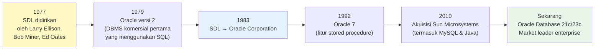

**Keistimewaan Oracle Database:**

| Keistimewaan | Penjelasan |
|-------------|-----------|
| **Arsitektur Client-Server Terpisah** | Oracle memisahkan proses antara basis data *client* dan aplikasi *server* — meningkatkan skalabilitas dan keamanan |
| **Skala Enterprise** | Ukuran basis data dapat mencakup proses bisnis yang sangat besar (terabyte hingga petabyte) |
| **Konkurensi Tinggi** | Dapat melayani ribuan pengguna secara bersamaan tanpa degradasi performa signifikan |
| **Multi-Platform** | Dapat menggunakan berbagai sistem operasi dalam satu jaringan (Windows, Linux, Solaris) |
| **Manajemen Transaksi Optimal** | Mengatur transaksi agar basis data berjalan optimal dengan mekanisme MVCC (*Multi-Version Concurrency Control*) |

**Bahasa ekstensi SQL Oracle**: **PL/SQL** (Procedural Language/SQL) — memungkinkan logika prosedural di dalam basis data.

**Digunakan oleh**: Bank besar, institusi pemerintah, perusahaan Fortune 500, airline reservation system, dan sistem inti korporasi berskala raksasa.

> Oracle adalah pilihan enterprise kelas berat — sangat powerful tetapi mahal (lisensi bisa ratusan ribu dolar per tahun). Tidak cocok untuk startup atau proyek kecil.

---

### 3.5 PostgreSQL

> **PostgreSQL** merupakan salah satu aplikasi basis data yang terkenal **kuat dan handal** dalam urusan relasi, integritas data, dan akurasi data.

**Sejarah PostgreSQL:**

PostgreSQL bermula dari proyek riset **INGRES** di University of California, Berkeley pada 1970-an. Kemudian berkembang menjadi **POSTGRES** (1986), dan akhirnya menjadi **PostgreSQL** (1996) — nama yang menambahkan dukungan SQL standar.

**Keunggulan PostgreSQL:**

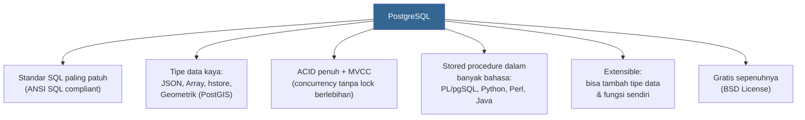

**Perusahaan pengguna PostgreSQL:**

| Perusahaan | Penggunaan |
|-----------|-----------|
| **Yahoo** | Data warehouse skala besar |
| **MySpace** | Platform media sosial |
| **OpenStreetMap** | Peta dunia open source (dengan ekstensi PostGIS untuk data geospasial) |
| **Sony Online Entertainment** | Multiplayer online game |
| **Skype** | Sistem VoIP — data pengguna dan riwayat panggilan |
| **BASF** | Perusahaan kimia terbesar dunia — data riset |
| **Instagram** | (sebelum migrasi sebagian ke Cassandra) |

> PostgreSQL sering disebut sebagai "the world's most advanced open source relational database." Ia menggabungkan keandalan enterprise (seperti Oracle) dengan lisensi open source penuh (seperti MySQL). Pilihan terbaik untuk aplikasi yang butuh integritas data tinggi.

---

## 4. Perbandingan Kelima DBMS

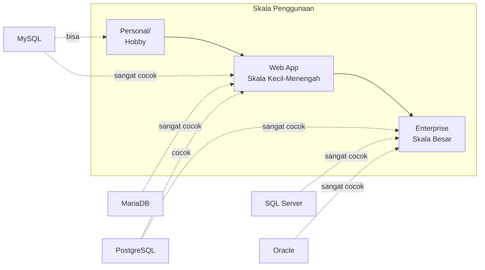

### Tabel Perbandingan Lengkap

| Aspek | MySQL | MariaDB | SQL Server | Oracle | PostgreSQL |
|-------|-------|---------|-----------|--------|-----------|
| **Lisensi** | GPL / Komersial | GPL | Komersial (ada Express gratis) | Komersial (sangat mahal) | BSD (bebas) |
| **Harga** | Gratis | Gratis | Berbayar | Sangat mahal | Gratis |
| **Platform** | Linux, Windows, Mac | Linux, Windows, Mac | Windows (utama), Linux | Linux, Windows, Solaris | Linux, Windows, Mac |
| **Bahasa SQL** | SQL + ekstensi MySQL | SQL + ekstensi MariaDB | T-SQL | PL/SQL | PL/pgSQL |
| **Performa Read** | ⭐⭐⭐⭐⭐ | ⭐⭐⭐⭐⭐ | ⭐⭐⭐⭐ | ⭐⭐⭐⭐⭐ | ⭐⭐⭐⭐ |
| **Kompleksitas Query** | ⭐⭐⭐ | ⭐⭐⭐ | ⭐⭐⭐⭐ | ⭐⭐⭐⭐⭐ | ⭐⭐⭐⭐⭐ |
| **Skalabilitas** | ⭐⭐⭐ | ⭐⭐⭐ | ⭐⭐⭐⭐ | ⭐⭐⭐⭐⭐ | ⭐⭐⭐⭐ |
| **Komunitas** | Sangat besar | Besar | Besar | Besar | Besar dan aktif |
| **Cocok untuk** | Web app, startup | Web app, Linux server | Ekosistem Microsoft | Enterprise korporasi | Aplikasi kompleks, data geospasial |

### Perbedaan Sintaks SQL Antar DBMS

Meski SQL adalah standar universal, setiap DBMS memiliki "dialek" tersendiri. Berikut contoh perbedaan kecil namun penting:

```sql
-- Mengambil 5 baris pertama

-- MySQL / MariaDB
SELECT * FROM pasien LIMIT 5;

-- PostgreSQL
SELECT * FROM pasien LIMIT 5;       -- sama dengan MySQL

-- SQL Server
SELECT TOP 5 * FROM pasien;         -- sintaks berbeda!

-- Oracle
SELECT * FROM pasien WHERE ROWNUM <= 5;  -- cara Oracle klasik
-- Oracle 12c+: SELECT * FROM pasien FETCH FIRST 5 ROWS ONLY;
```

---

## 5. Posisi DBMS dalam Arsitektur Sistem Informasi

DBMS bukan berdiri sendiri — ia adalah komponen inti dalam arsitektur sistem informasi modern:

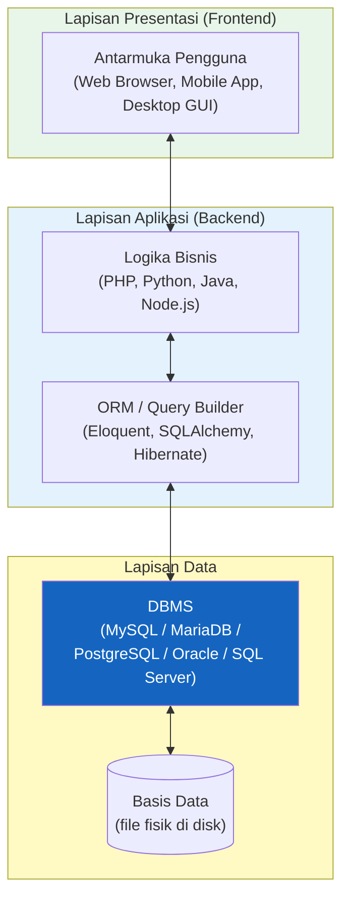

Analogi: DBMS seperti **perpustakaan beserta pustakawannya** — basis data adalah koleksi bukunya, dan DBMS adalah sistem katalog + pustakawan yang mengatur siapa boleh meminjam buku apa, memastikan buku dikembalikan, dan mencatat semua aktivitas.

---

## 6. Panduan Memilih DBMS

Memilih DBMS yang tepat bergantung pada kebutuhan proyek:

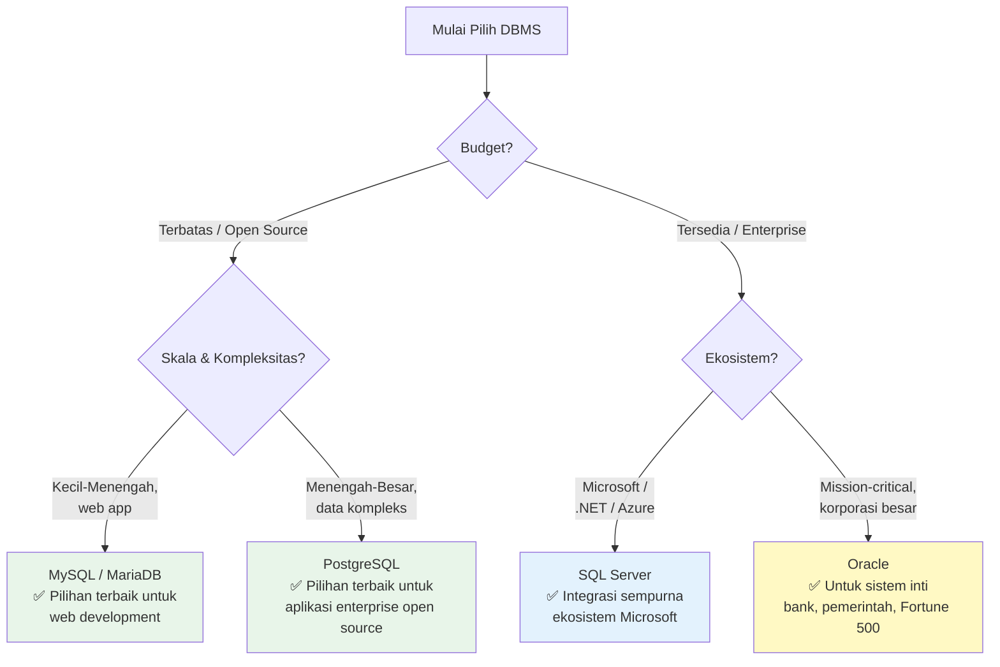

---

## Ringkasan

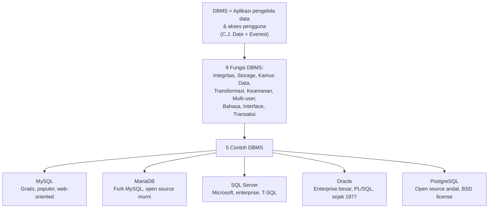

Inti dari aktivitas ini: **DBMS adalah fondasi dari seluruh aplikasi berbasis data**. Tanpa DBMS yang andal, data hanya sekumpulan file tidak terstruktur yang sulit dikelola, tidak aman, dan tidak bisa diakses secara bersamaan. Pemilihan DBMS yang tepat — sesuai skala, budget, dan ekosistem — adalah keputusan arsitektur yang akan mempengaruhi seluruh siklus hidup sistem informasi.

---

*Selamat Belajar — Program Studi Sistem Informasi (S1), Fakultas Sains dan Teknologi, Universitas Terbuka*
