# Aktivitas 14 — Dasar-dasar Organisasi Berkas dan Pengembangan Aplikasi Sistem Basis Data

**MSIM4206 / Basis Data**  
Program Studi Sistem Informasi — Universitas Terbuka

> Catatan: dokumen ini merupakan ekstraksi sekaligus elaborasi dari materi *Aktivitas 14 — Dasar-dasar Organisasi Berkas dan Pengembangan Aplikasi Sistem Basis Data*. Setiap poin dijelaskan lebih dalam dengan analogi, diagram, dan contoh agar lebih mudah dipahami secara utuh. Diagram konseptual digambarkan ulang menggunakan mermaid.

---

## Daftar Isi

1. [Aplikasi DBMS](#1-aplikasi-dbms)
2. [Cara Kerja Database dan DBMS](#2-cara-kerja-database-dan-dbms)
3. [Kriteria DBMS yang Baik](#3-kriteria-dbms-yang-baik)
4. [Kapan Diperlukan DBMS?](#4-kapan-diperlukan-dbms)
5. [Konsep Berkas dan Organisasi Berkas](#5-konsep-berkas-dan-organisasi-berkas)
6. [Tujuan Organisasi Berkas](#6-tujuan-organisasi-berkas)
7. [Tahapan Pengembangan Aplikasi Basis Data](#7-tahapan-pengembangan-aplikasi-basis-data)
8. [Ringkasan](#8-ringkasan)

---

## 1. Aplikasi DBMS

> *Database Management System* (DBMS) merupakan **perangkat lunak / software** untuk pengelolaan basis data. Perangkat lunak DBMS memberikan layanan tentang **definisi basis data** dan **manipulasi basis data**. Cara kerja suatu DBMS dipengaruhi oleh **metode penyimpanan** dan **metode akses**.

### Dua Layanan Utama DBMS

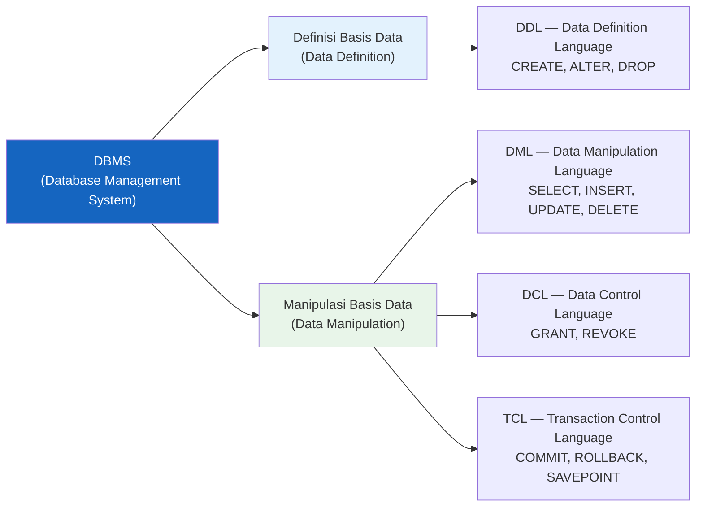

### Dua Faktor yang Mempengaruhi Cara Kerja DBMS

| Faktor | Penjelasan | Contoh |
|--------|-----------|--------|
| **Metode Penyimpanan** | Cara data disusun dan disimpan secara fisik di media penyimpanan (disk, SSD) | Sequential, heap file, hash file, B-tree index |
| **Metode Akses** | Cara data ditemukan dan diambil kembali dari media penyimpanan | Full table scan, index lookup, binary search |

> **Analogi**: Metode penyimpanan seperti cara buku disusun di rak perpustakaan (berurutan alphabet, per genre, per tahun), sedangkan metode akses seperti cara menemukan buku tersebut (lewat katalog, cari langsung di rak, minta bantuan pustakawan). Cara penyusunan dan cara pencarian saling memengaruhi kecepatan keseluruhan.

---

## 2. Cara Kerja Database dan DBMS

Ketika program aplikasi melakukan akses suatu *record* pada suatu DBMS, terjadi **11 langkah urutan proses** yang terjadi di balik layar. Inilah yang membuat DBMS jauh lebih kompleks dari sekadar membaca file biasa.

### Konsep Schema dan Subschema

Sebelum memahami alurnya, penting untuk memahami dua konsep kunci:

| Istilah | Penjelasan |
|---------|-----------|
| **Schema** | Deskripsi keseluruhan struktur basis data — semua tabel, kolom, tipe data, dan relasinya. Seperti "cetak biru" seluruh basis data. |
| **Subschema** | Pandangan parsial dari schema — bagian basis data yang relevan untuk program aplikasi tertentu. Program kasir hanya melihat subschema transaksi, bukan seluruh schema rumah sakit. |
| **Buffer System** | Area memori sementara (RAM) tempat data transit antara disk dan program aplikasi. Jauh lebih cepat dari disk, tapi tidak permanen. |
| **Area Kerja** | Ruang memori yang dialokasikan khusus untuk program aplikasi yang sedang berjalan. |

### 11 Langkah Proses Akses Record

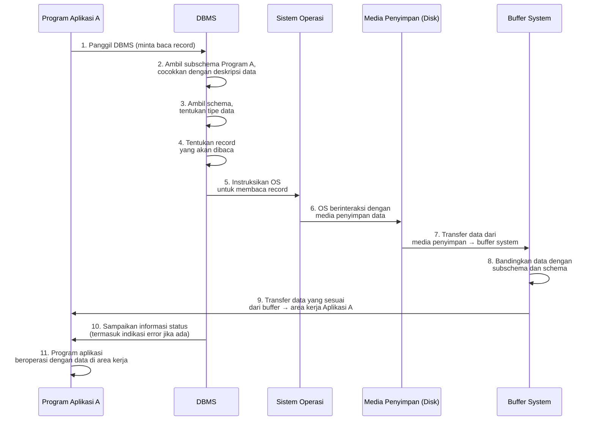

### Penjelasan Per Langkah

| Langkah | Proses | Mengapa Penting |
|---------|--------|-----------------|
| **1** | Program aplikasi memanggil DBMS | Aplikasi tidak langsung ke disk — selalu lewat DBMS sebagai perantara |
| **2** | DBMS ambil subschema & cocokkan deskripsi data | Memastikan program hanya bisa akses data yang diizinkan (keamanan) |
| **3** | DBMS ambil schema & tentukan tipe data | Mengetahui format data: integer, varchar, datetime, dll. |
| **4** | DBMS tentukan record yang akan dibaca | Menghitung lokasi fisik record di disk berdasarkan index atau scan |
| **5** | DBMS instruksikan sistem operasi | DBMS tidak langsung ke hardware — mendelegasikan ke OS |
| **6** | OS berinteraksi dengan media penyimpan | OS yang tahu cara membaca sektor disk atau blok SSD |
| **7** | Data pindah dari disk ke buffer | Transfer data dari penyimpanan permanen (lambat) ke memori sementara (cepat) |
| **8** | Data di buffer dibandingkan schema & subschema | Filter: hanya data yang relevan dan sesuai format yang diteruskan |
| **9** | Data dipindah dari buffer ke area kerja aplikasi | Data "dikirimkan" ke ruang kerja program yang memintanya |
| **10** | DBMS kirim informasi status & error | Program tahu apakah operasi berhasil, data tidak ditemukan, atau ada kesalahan |
| **11** | Program aplikasi beroperasi dengan data | Barulah logika bisnis aplikasi bisa menggunakan data tersebut |

> **Mengapa perlu 11 langkah?** Karena DBMS harus memastikan **keamanan** (langkah 2), **konsistensi tipe data** (langkah 3), **efisiensi akses** (langkah 4), dan **transparansi perangkat keras** (langkah 5-7) sebelum data sampai ke tangan aplikasi. Tanpa DBMS, program harus mengurus semua ini sendiri — itulah mengapa DBMS menyederhanakan pengembangan aplikasi secara signifikan.

---

## 3. Kriteria DBMS yang Baik

Tidak semua perangkat lunak yang mengklaim sebagai DBMS memenuhi standar yang baik. Terdapat **9 kriteria** yang harus dipenuhi oleh sebuah DBMS yang handal:

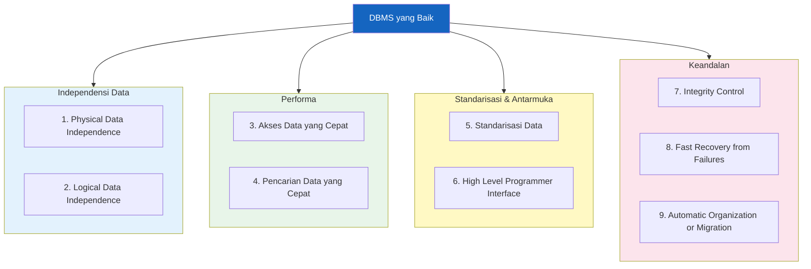

### Penjelasan Tiap Kriteria

#### Kelompok Independensi Data

| Kriteria | Penjelasan | Contoh Nyata |
|----------|-----------|-------------|
| **1. Physical Data Independence** | Perubahan cara data disimpan secara fisik (migrasi ke SSD, ganti format file) **tidak** mempengaruhi program aplikasi | Pindahkan data dari HDD ke SSD → aplikasi tetap jalan tanpa diubah |
| **2. Logical Data Independence** | Perubahan struktur logis basis data (tambah kolom, ubah relasi) **tidak** mempengaruhi program aplikasi yang sudah ada | Tambah kolom `email` ke tabel `pasien` → program kasir yang lama tetap bekerja |

> Kedua independensi ini adalah alasan utama mengapa DBMS sangat bernilai. Tanpanya, setiap perubahan infrastruktur atau skema harus diikuti oleh pembaruan seluruh kode program.

#### Kelompok Performa

| Kriteria | Penjelasan | Mekanisme |
|----------|-----------|-----------|
| **3. Akses Data yang Cepat** | Data dapat diambil dengan cepat dari penyimpanan | Buffering, caching, optimasi I/O disk |
| **4. Pencarian Data yang Cepat** | Query pencarian data berjalan efisien meski data bervolume besar | Index B-tree, hash index, query optimizer |

```sql
-- Contoh: pencarian lambat tanpa index (full table scan)
SELECT * FROM pasien WHERE nama_pasien = 'Budi';  -- cek 1 per 1 semua baris

-- Pencarian cepat dengan index
CREATE INDEX idx_nama ON pasien(nama_pasien);
SELECT * FROM pasien WHERE nama_pasien = 'Budi';  -- langsung ke lokasi lewat index
```

#### Kelompok Standarisasi & Antarmuka

| Kriteria | Penjelasan | Contoh |
|----------|-----------|--------|
| **5. Standarisasi Data** | Format data, konvensi penamaan, dan representasi data seragam di seluruh basis data | Tanggal selalu `DATETIME`, telepon selalu `VARCHAR(15)`, semua tabel pakai PK integer |
| **6. High Level Programmer Interface** | Programmer tidak perlu tahu detail fisik penyimpanan — cukup gunakan SQL atau API tingkat tinggi | `SELECT * FROM pasien` tanpa perlu tahu data ada di sektor disk mana |

#### Kelompok Keandalan

| Kriteria | Penjelasan | Mekanisme |
|----------|-----------|-----------|
| **7. Integrity Control** | Data selalu akurat dan konsisten — aturan integritas dijalankan otomatis | PRIMARY KEY, FOREIGN KEY, CHECK, NOT NULL, UNIQUE |
| **8. Fast Recovery from Failures** | Saat terjadi kegagalan (mati listrik, crash), data dapat dipulihkan dengan cepat ke kondisi konsisten | Write-Ahead Log (WAL), binary log, checkpoint, backup otomatis |
| **9. Automatic Organization or Migration** | Data secara otomatis diatur ulang atau dipindahkan untuk menjaga efisiensi, tanpa intervensi manual | Auto-reorganize index, auto-vacuum di PostgreSQL, auto-partitioning |

---

## 4. Kapan Diperlukan DBMS?

Tidak semua sistem memerlukan DBMS. Untuk sistem yang sangat sederhana, file biasa (CSV, JSON, XML) mungkin sudah cukup. DBMS diperlukan ketika sistem memenuhi setidaknya satu dari kondisi berikut:

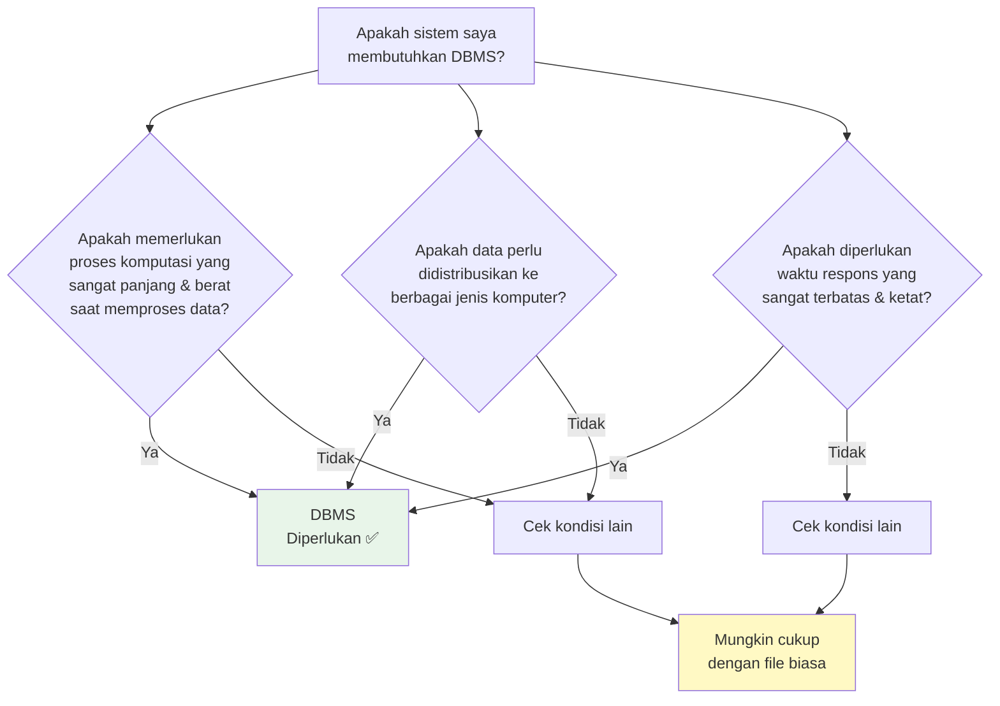

### Tiga Kondisi yang Mensyaratkan DBMS

| No | Kondisi | Penjelasan | Contoh Sistem |
|----|---------|-----------|---------------|
| **1** | **Proses komputasi sangat panjang dan berat** | Jika setiap operasi membutuhkan kalkulasi rumit terhadap banyak data, DBMS menyediakan optimasi query, parallel processing, dan indexing | Sistem laporan keuangan yang mengagregasi jutaan transaksi |
| **2** | **Data didistribusikan ke berbagai jenis komputer** | Ketika data perlu diakses dari banyak mesin berbeda, DBMS menyediakan lapisan abstraksi yang konsisten (koneksi TCP/IP, driver standar) | Sistem perbankan dengan ratusan cabang di seluruh Indonesia |
| **3** | **Waktu respons sangat terbatas dan ketat** | Jika aplikasi harus memberikan jawaban dalam milidetik (bahkan saat hasilnya disimpan dalam berkas), DBMS menyediakan caching, indexing, dan buffer pool | Sistem reservasi tiket online, trading saham, ATM |

> **Catatan penting tentang kondisi ke-3**: Kalimat "sekalipun hasilnya disimpan dalam berkas" mengandung makna penting — bahkan jika output akhirnya hanya sebuah file CSV atau laporan PDF, proses *komputasinya* tetap membutuhkan kecepatan DBMS. Artinya, keputusan menggunakan DBMS tidak hanya soal "apakah data disimpan permanen di database", melainkan soal **kebutuhan performa selama proses berlangsung**.

---

## 5. Konsep Berkas dan Organisasi Berkas

### Apa itu Berkas?

> **Berkas** dalam konteks ini diartikan sebagai **sekumpulan data yang sejenis secara relasi** — sama dengan istilah basis data.

Istilah "berkas" (*file*) di sini bukan sekadar file dokumen di komputer, melainkan **unit penyimpanan data terstruktur** — sekumpulan record yang memiliki struktur yang sama (seperti satu tabel dalam basis data relasional).

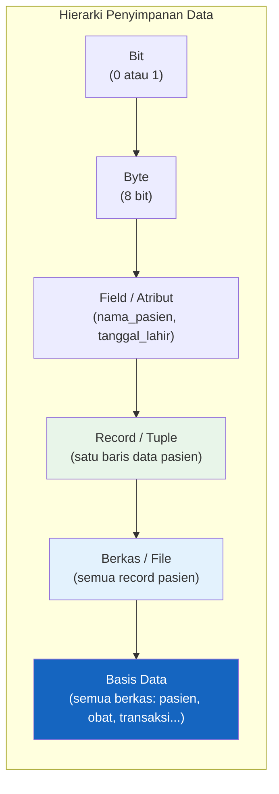

### Tiga Konsep yang Saling Terkait

| Istilah | Definisi | Hubungan |
|---------|---------|---------|
| **Berkas** | Sekumpulan data yang sejenis secara relasi | = Basis data (dalam pengertian umum) |
| **Organisasi Berkas** | Metode penyimpanan dan metode akses pada media penyimpanan terhadap suatu berkas atau basis data | = Organisasi Basis Data |
| **Sistem Basis Data** | Berkas + program pengolah (DBMS) | Berkas yang dikelola oleh DBMS |

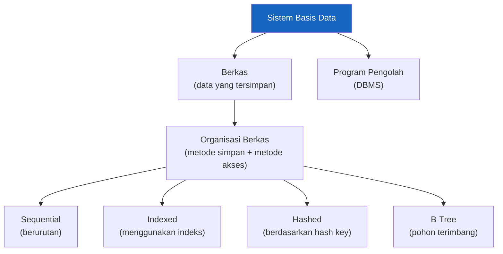

### Metode Organisasi Berkas (Elaborasi)

Cara data disusun secara fisik di dalam berkas sangat menentukan kecepatan akses:

| Metode | Cara Kerja | Cocok Untuk | Kelemahan |
|--------|-----------|-------------|-----------|
| **Sequential** | Data disimpan berurutan satu per satu | Laporan batch, arsip log | Pencarian lambat (O(n)) |
| **Indexed** | Ada file indeks terpisah yang menunjuk ke lokasi data | Pencarian berdasarkan kunci tertentu | Membutuhkan ruang tambahan untuk indeks |
| **Hashed** | Kunci record di-hash untuk menentukan lokasi fisik | Pencarian tepat berdasarkan kunci utama (O(1)) | Tidak efisien untuk range query |
| **B-Tree** | Data disusun dalam pohon seimbang | Keseimbangan antara pencarian dan range query | Kompleks, overhead saat insert/delete |

---

## 6. Tujuan Organisasi Berkas

Organisasi berkas memiliki dua tujuan yang saling melengkapi:

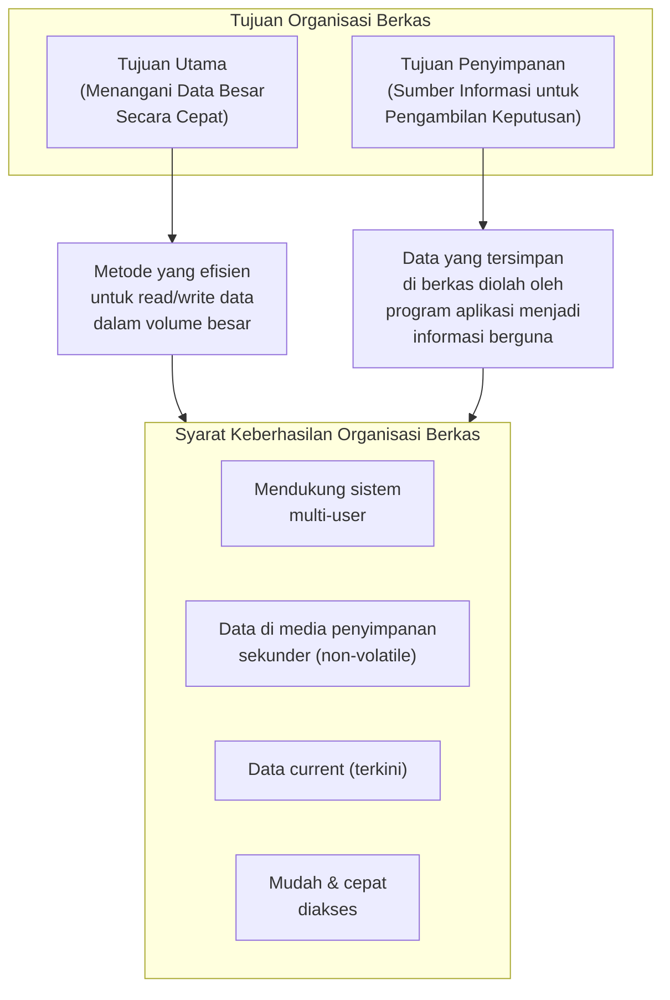

### Penjelasan Tujuan

**Tujuan Utama Organisasi Berkas:**
> Mengembangkan suatu metode yang dapat menangani data dalam jumlah besar secara cepat.

Ketika data sudah mencapai jutaan hingga miliaran record, tidak cukup hanya "menyimpan" data — cara penyimpanannya harus dirancang agar akses tetap cepat. Inilah alasan mengapa struktur data seperti B-Tree index digunakan secara luas dalam DBMS modern.

**Tujuan Penyimpanan Berkas:**
> Menyediakan data sebagai sumber informasi untuk pengambilan keputusan.

Data yang tersimpan dalam berkas tidak bernilai jika tidak bisa diolah menjadi informasi. Program aplikasi yang dikodekan bertugas mengolah data mentah ini menjadi laporan, dashboard, atau analitik yang mendukung keputusan bisnis.

**Empat Syarat yang Harus Dipenuhi:**

| Syarat | Penjelasan |
|--------|-----------|
| **Multi-user** | Banyak pengguna bisa mengakses data bersamaan tanpa konflik (concurrency control) |
| **Media penyimpanan sekunder** | Data disimpan di disk/SSD yang tidak hilang saat listrik mati (non-volatile, persisten) |
| **Current / terkini** | Data yang tersimpan selalu mencerminkan kondisi terkini (update tepat waktu) |
| **Mudah dan cepat diakses** | Waktu respons yang dapat diterima pengguna — tidak perlu menunggu lama |

---

## 7. Tahapan Pengembangan Aplikasi Basis Data

Membangun aplikasi basis data bukan hanya soal menulis kode SQL — ada proses terstruktur yang harus diikuti agar sistem yang dihasilkan berkualitas dan tepat sasaran.

### Dua Model Tahapan

Terdapat **2 pendekatan** yang umum digunakan:

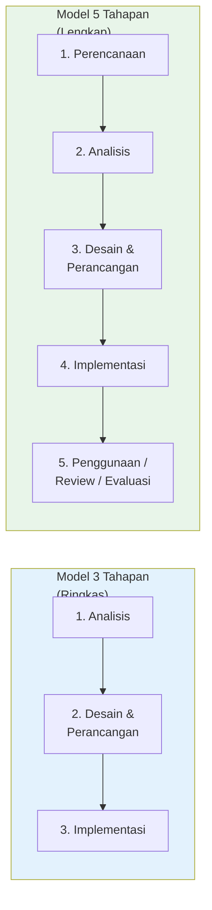

### Model 3 Tahapan

Model yang lebih ringkas, cocok untuk proyek kecil-menengah:

| Tahap | Nama | Kegiatan |
|-------|------|---------|
| **1** | **Analisis** | Mengumpulkan kebutuhan pengguna, mengidentifikasi entitas dan relasi, memahami proses bisnis yang akan didukung |
| **2** | **Desain & Perancangan** | Merancang skema basis data (ERD), menentukan tabel, kolom, tipe data, relasi, dan constraint |
| **3** | **Implementasi** | Menulis DDL untuk membuat skema, mengisi data awal, membangun antarmuka aplikasi |

### Model 5 Tahapan

Model yang lebih lengkap, standar untuk proyek enterprise:

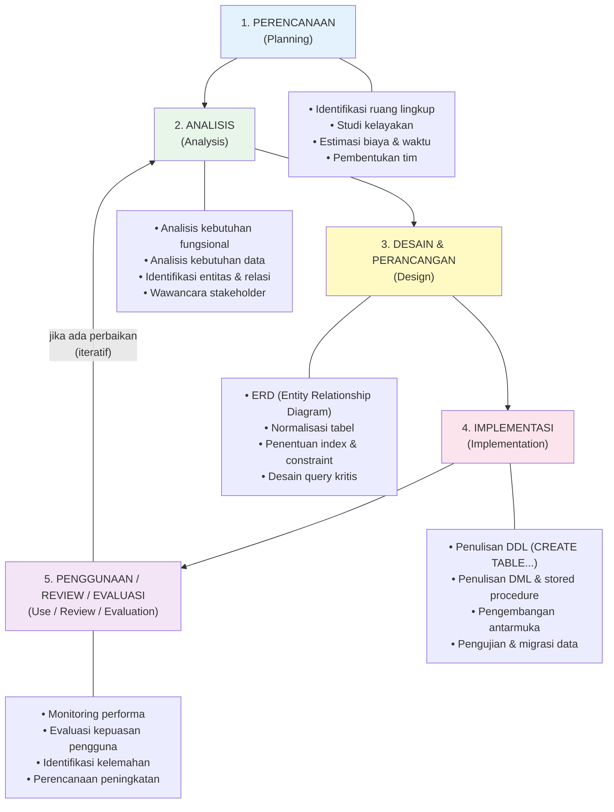

### Tiga Pertimbangan Tambahan dalam Pengembangan

Selain mengikuti tahapan, pengembang juga harus memperhitungkan:

| Pertimbangan | Penjelasan | Pertanyaan yang Harus Dijawab |
|-------------|-----------|-------------------------------|
| **Analisis Kelayakan Pengembangan Basis Data** | Apakah proyek ini layak secara teknis, finansial, dan organisasional? | Apakah infrastruktur tersedia? Apakah SDM cukup? Apakah ada ROI yang jelas? |
| **Analisis Biaya-Manfaat** | Membandingkan biaya alternatif desain dengan manfaat yang diperoleh | MySQL vs Oracle — selisih biaya lisensi vs fitur enterprise yang didapat, apakah sepadan? |
| **Kelemahan Pendekatan Sistem Basis Data** | Mengenali keterbatasan dan risiko solusi basis data yang dipilih | Apakah DBMS terpilih mendukung volume data yang diproyeksikan 5 tahun ke depan? |

#### Kelemahan Umum Pendekatan Sistem Basis Data

Meski DBMS sangat powerful, ada kelemahan yang harus dipertimbangkan:

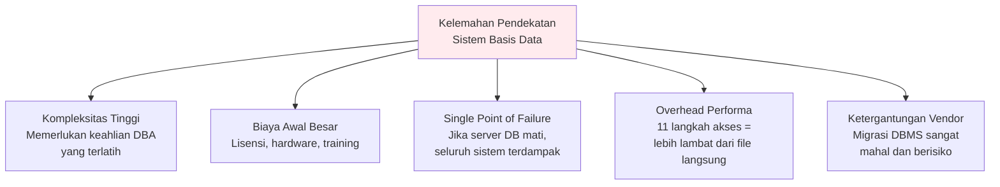

---

## 8. Ringkasan

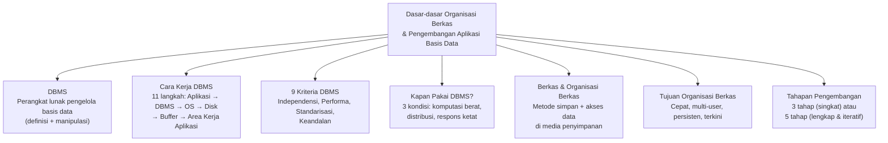

Inti dari aktivitas ini: **DBMS bukan sekedar tempat menyimpan data** — ia adalah sistem kompleks yang mengatur bagaimana data didefinisikan, disimpan secara fisik, diakses, diamankan, dan dipulihkan. Memahami cara kerja 11 langkah akses record membantu kita menghargai abstraksi yang diberikan DBMS kepada developer. Organisasi berkas adalah fondasi teknis di balik kecepatan dan keandalan DBMS. Dan pengembangan aplikasi basis data yang baik harus mengikuti tahapan yang terstruktur — dari perencanaan hingga evaluasi — sambil mempertimbangkan kelayakan, biaya-manfaat, dan kelemahan yang ada.

---

*Selamat Belajar — Program Studi Sistem Informasi (S1), Fakultas Sains dan Teknologi, Universitas Terbuka*
