# Pertemuan 15 — Pengembangan Aplikasi Sistem Basis Data

> **Mata Kuliah:** MSIM4206P — Praktikum Basis Data  
> **Program:** S1 Sistem Informasi — Universitas Terbuka  
> **Materi:** Modul 8 Inisiasi — Membangun Aplikasi Perpustakaan dengan MySQL & Microsoft Access  

---

## Daftar Isi

1. [Gambaran Umum](#1-gambaran-umum)
2. [Studi Kasus Perpustakaan](#2-studi-kasus-perpustakaan)
3. [Implementasi Database MySQL](#3-implementasi-database-mysql)
4. [Persiapan Aplikasi](#4-persiapan-aplikasi)
5. [Koneksi MySQL ke Microsoft Access via ODBC](#5-koneksi-mysql-ke-microsoft-access-via-odbc)
6. [Membuat Form Input Data](#6-membuat-form-input-data)
7. [Navigasi dan Event pada Tombol](#7-navigasi-dan-event-pada-tombol)
8. [Membuat Query](#8-membuat-query)
9. [Membuat Report (Laporan)](#9-membuat-report-laporan)
10. [Membuat Switchboard (Menu Utama)](#10-membuat-switchboard-menu-utama)
11. [Mengatur Aplikasi](#11-mengatur-aplikasi)
12. [Arsitektur Keseluruhan Aplikasi](#12-arsitektur-keseluruhan-aplikasi)

---

## 1. Gambaran Umum

Pada praktikum ini kita membangun sebuah **aplikasi sistem basis data perpustakaan** secara lengkap, mulai dari perancangan skema database, implementasi di MySQL, hingga pembuatan antarmuka pengguna menggunakan **Microsoft Access 365** yang terhubung ke MySQL melalui **ODBC (Open Database Connectivity)**.

Pendekatan ini merupakan arsitektur **two-tier** yang umum digunakan:

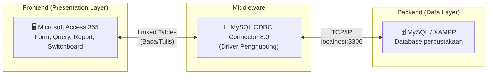

**Mengapa pakai Access + MySQL?**

| Aspek | Hanya MySQL | Access + MySQL |
|---|---|---|
| Antarmuka | Terminal / phpMyAdmin | Form GUI yang ramah pengguna |
| Laporan | Query manual | Report wizard otomatis |
| Target pengguna | Teknisi | Staf non-teknis |
| Data tersimpan | MySQL (terpusat) | MySQL (terpusat) |

---

## 2. Studi Kasus Perpustakaan

### 2.1 Narasi Bisnis

Sebuah perpustakaan fakultas memiliki proses sederhana:

1. **Mahasiswa mendaftar** sebagai anggota perpustakaan (id_anggota, NIM, nama, alamat)
2. **Anggota meminjam buku** yang tersimpan di perpustakaan (tanggal pinjam, tanggal kembali)
3. **Buku disimpan** di rak/tempat tertentu (nama tempat)

### 2.2 Diagram ER (Entity Relationship)

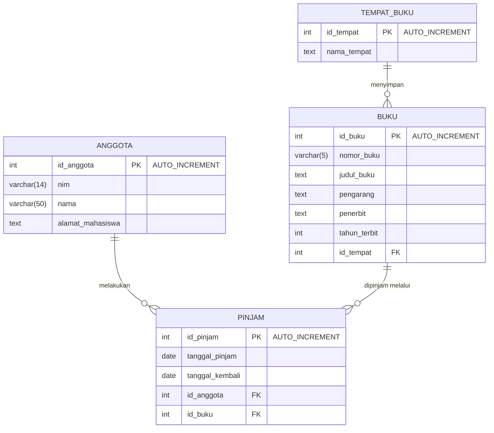

### 2.3 Analisis Relasi

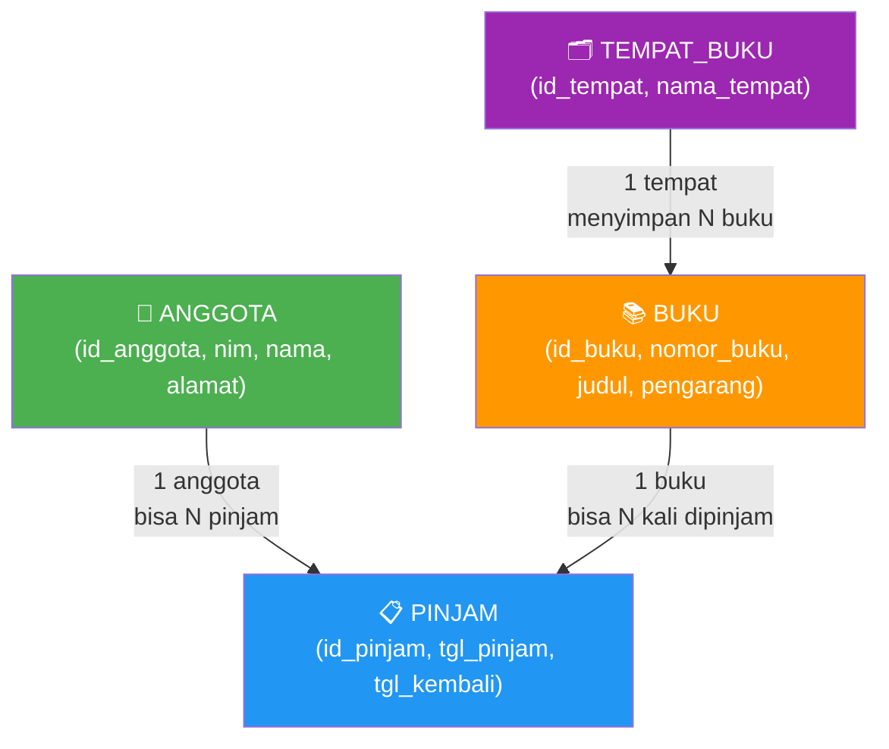

**Catatan relasi:**
- `ANGGOTA` ↔ `PINJAM`: Many-to-Many (direalisasikan via tabel PINJAM sebagai junction)
- `BUKU` ↔ `TEMPAT_BUKU`: Many-to-One (banyak buku di satu tempat)
- Foreign Key `id_anggota` dan `id_buku` di tabel PINJAM: `ON DELETE CASCADE ON UPDATE CASCADE`

---

## 3. Implementasi Database MySQL

### 3.1 Membuat Database di phpMyAdmin

Langkah:
1. Buka `http://localhost/phpmyadmin`
2. Klik **New** → masukkan nama database: `perpustakaan`
3. Collation: `utf8mb4_general_ci` → klik **Create**

### 3.2 SQL Pembuatan Tabel

Urutan pembuatan tabel penting — tabel yang dirujuk (parent) harus dibuat lebih dulu.

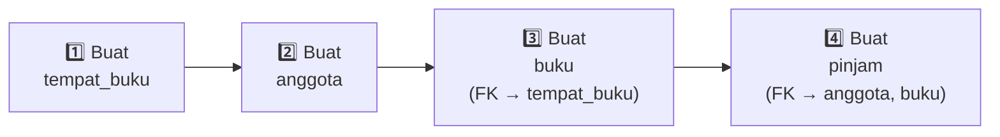

#### Tabel `anggota`

```sql
START TRANSACTION;
CREATE TABLE anggota (
  id_anggota  int(11)     NOT NULL,
  nim         varchar(14) NOT NULL,
  nama        varchar(50) NOT NULL,
  alamat_mahasiswa text   NOT NULL
) ENGINE=InnoDB DEFAULT CHARSET=utf8mb4;

ALTER TABLE anggota ADD PRIMARY KEY (id_anggota);
ALTER TABLE anggota MODIFY id_anggota int(11) NOT NULL AUTO_INCREMENT;
COMMIT;
```

#### Tabel `tempat_buku`

```sql
START TRANSACTION;
CREATE TABLE tempat_buku (
  id_tempat  int(3) NOT NULL,
  nama_tempat text  NOT NULL
) ENGINE=InnoDB DEFAULT CHARSET=utf8mb4;

ALTER TABLE tempat_buku ADD PRIMARY KEY (id_tempat);
ALTER TABLE tempat_buku MODIFY id_tempat int(3) NOT NULL AUTO_INCREMENT;
COMMIT;
```

#### Tabel `buku` (dengan Foreign Key ke `tempat_buku`)

```sql
START TRANSACTION;
CREATE TABLE buku (
  id_buku      int(3)      NOT NULL,
  nomor_buku   varchar(5)  NOT NULL,
  judul_buku   text        NOT NULL,
  pengarang    text        NOT NULL,
  penerbit     text        NOT NULL,
  tahun_terbit int(4)      NOT NULL,
  id_tempat    int(3)      NOT NULL
) ENGINE=InnoDB DEFAULT CHARSET=utf8mb4;

ALTER TABLE buku ADD PRIMARY KEY (id_buku), ADD KEY id_tempat (id_tempat);
ALTER TABLE buku MODIFY id_buku int(3) NOT NULL AUTO_INCREMENT;

ALTER TABLE buku
  ADD CONSTRAINT buku_ibfk_1
  FOREIGN KEY (id_tempat)
  REFERENCES tempat_buku (id_tempat)
  ON DELETE CASCADE ON UPDATE CASCADE;
COMMIT;
```

#### Tabel `pinjam` (dengan Foreign Key ke `anggota` dan `buku`)

```sql
START TRANSACTION;
CREATE TABLE pinjam (
  id_pinjam       int(5) NOT NULL,
  tanggal_pinjam  date   NOT NULL,
  tanggal_kembali date   NOT NULL,
  id_anggota      int(11) NOT NULL,
  id_buku         int(3)  NOT NULL
) ENGINE=InnoDB DEFAULT CHARSET=utf8mb4;

ALTER TABLE pinjam
  ADD PRIMARY KEY (id_pinjam),
  ADD KEY id_anggota (id_anggota),
  ADD KEY id_buku (id_buku);
ALTER TABLE pinjam MODIFY id_pinjam int(5) NOT NULL AUTO_INCREMENT;

ALTER TABLE pinjam
  ADD CONSTRAINT pinjam_ibfk_1
  FOREIGN KEY (id_anggota) REFERENCES anggota (id_anggota)
  ON DELETE CASCADE ON UPDATE CASCADE,
  ADD CONSTRAINT pinjam_ibfk_2
  FOREIGN KEY (id_buku) REFERENCES buku (id_buku)
  ON DELETE CASCADE ON UPDATE CASCADE;
COMMIT;
```

### 3.3 Efek CASCADE

Penjelasan `ON DELETE CASCADE ON UPDATE CASCADE`:

| Aksi di Tabel Parent | Efek di Tabel Child |
|---|---|
| Hapus anggota (id=1) | Semua pinjaman anggota 1 ikut terhapus |
| Update id_buku (3→5) | id_buku di tabel pinjam ikut berubah jadi 5 |
| Hapus buku (id=2) | Semua record pinjam yang meminjam buku 2 ikut terhapus |

---

## 4. Persiapan Aplikasi

Empat perangkat lunak yang dibutuhkan:

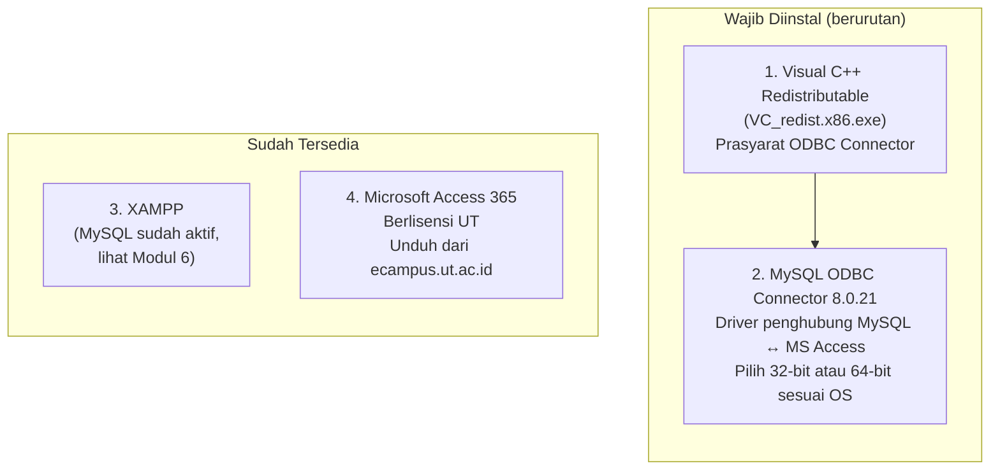

**Cara cek 32-bit atau 64-bit:**
- Tekan `Win + R` → ketik `dxdiag` → lihat "Operating System"
- Jika ada tulisan "64-bit": unduh versi 64-bit
- Jika "32-bit": unduh versi 32-bit (x86)

### 4.1 Langkah Instalasi Visual C++

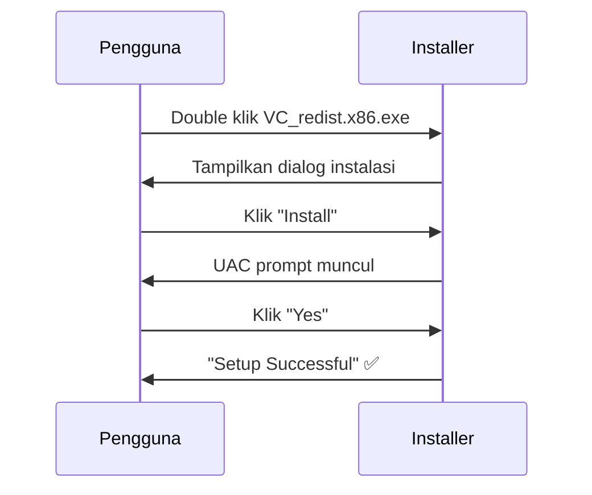

### 4.2 Langkah Instalasi MySQL ODBC Connector 8.0.21

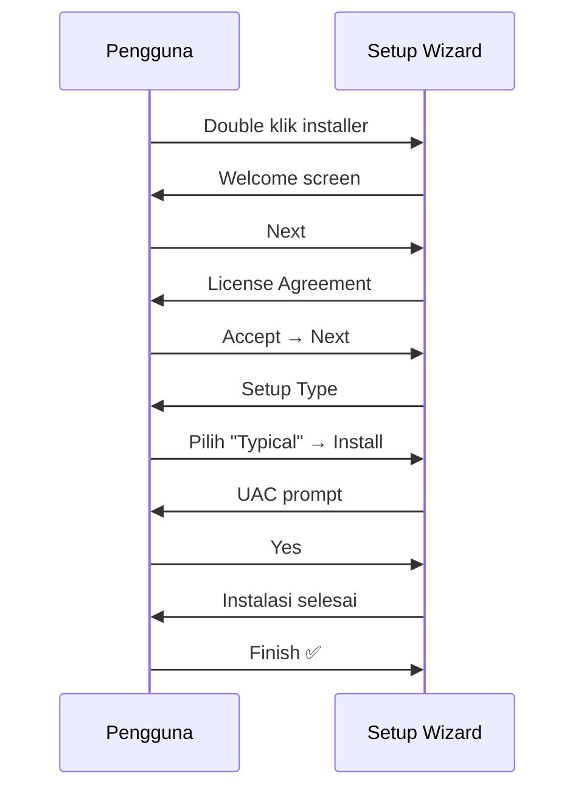

---

## 5. Koneksi MySQL ke Microsoft Access via ODBC

ODBC (Open Database Connectivity) adalah standar antarmuka pemrograman yang memungkinkan aplikasi (MS Access) berkomunikasi dengan berbagai sistem database (MySQL) secara transparan.

### 5.1 Membuat File Database Access Baru

1. Buka **Microsoft Access 365**
2. Pilih **Blank database**
3. Nama file: `perpustakaan` → klik **Create**
4. Tutup `Table1` yang muncul otomatis (klik tanda ×)

### 5.2 Menghubungkan Access ke MySQL via ODBC

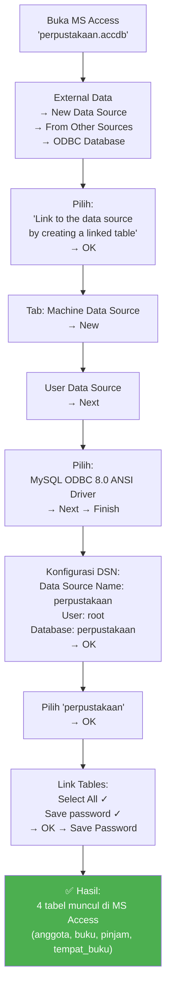

**Catatan penting:**
- Driver yang digunakan: `MySQL ODBC 8.0 ANSI Driver` (bukan Unicode Driver, untuk kompatibilitas)
- Setelah linked, perubahan data di MS Access akan langsung tersimpan ke MySQL
- Icon tabel linked berbeda: ada panah kecil di pojok ikon

---

## 6. Membuat Form Input Data

Form adalah antarmuka pengguna (GUI) untuk input, edit, dan hapus data. MS Access menyediakan **Form Wizard** yang secara otomatis menghasilkan form dari tabel yang dipilih.

### 6.1 Alur Pembuatan Setiap Form

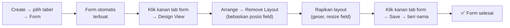

### 6.2 Form Anggota

**Field:** `id_anggota`, `nim`, `nama`, `alamat_mahasiswa`

Langkah:
1. `Create` → klik tabel **anggota** di panel kiri → klik **Form**
2. Klik kanan tab form → **Design View**
3. `Arrange` → **Remove Layout** → rapikan field
4. Klik kanan tab → **Save** → nama: `anggota`
5. Coba masukkan 2 data anggota untuk uji coba

### 6.3 Form Tempat Buku

**Field:** `id_tempat`, `nama_tempat`

Langkah:
1. `Create` → klik tabel **tempat_buku** → klik **Form**
2. Design View → Remove Layout → rapikan
3. Save → nama: `tempat_buku`
4. Masukkan 2 data contoh: `Rak01`, `Rak02`

### 6.4 Form Buku (dengan Combo Box)

Form buku memiliki field `id_tempat` yang nilainya harus diambil dari tabel `tempat_buku`. Agar pengguna tidak perlu menghafal angka ID, kita ubah field ini menjadi **Combo Box** (dropdown).

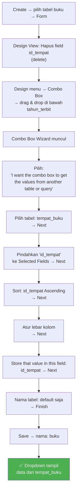

**Contoh data buku:**

| Field | Nilai |
|---|---|
| nomor_buku | A100 |
| judul_buku | Basis Data |
| pengarang | Fathansyah |
| penerbit | Informatika |
| tahun_terbit | 2019 |
| tempat | 1 (pilih dari dropdown) |

### 6.5 Form Pinjam (dengan 2 Combo Box)

Form pinjam memiliki 2 foreign key: `id_anggota` dan `id_buku`. Keduanya diubah menjadi combo box.

| Combo Box | Tabel Sumber | Field yang Disimpan |
|---|---|---|
| id_anggota | anggota | id_anggota |
| id_buku | buku | id_buku |

Langkah pembuatan identik dengan combo box pada form buku, namun dilakukan dua kali untuk dua field berbeda.

**Contoh data pinjam:**

| Field | Nilai |
|---|---|
| tanggal_pinjam | 20/11/2020 |
| tanggal_kembali | 30/11/2020 |
| anggota | 14021001 (pilih dari dropdown) |
| buku | A100 (pilih dari dropdown) |

### 6.6 Ringkasan 4 Form

| Form | Tabel | Combo Box | Field |
|---|---|---|---|
| anggota | anggota | — | id_anggota, nim, nama, alamat_mahasiswa |
| tempat_buku | tempat_buku | — | id_tempat, nama_tempat |
| buku | buku | id_tempat → tempat_buku | id_buku, nomor_buku, judul_buku, pengarang, penerbit, tahun_terbit, tempat |
| pinjam | pinjam | id_anggota → anggota, id_buku → buku | id_pinjam, tanggal_pinjam, tanggal_kembali, anggota, buku |

---

## 7. Navigasi dan Event pada Tombol

### 7.1 Tombol Navigasi (5 Tombol)

Setiap form dilengkapi 5 tombol untuk manipulasi data. Contoh: form anggota.

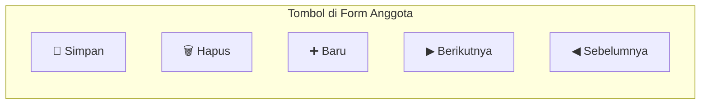

**Tabel 8.4 — Cara Membuat Setiap Tombol:**

| No | Tombol | Langkah |
|---|---|---|
| 1 | **Simpan** | Design → Button → Record Operation → **Save Record** → Text: "Simpan" → Finish |
| 2 | **Hapus** | Design → Button → Record Operation → **Delete Record** → Text: "Hapus" → Finish |
| 3 | **Baru** | Design → Button → Record Operation → **Add New Record** → Text: "Baru" → Finish |
| 4 | **Berikutnya** | Design → Button → Record Navigation → **Go to Next Record** → Picture → Finish |
| 5 | **Sebelumnya** | Design → Button → Record Navigation → **Go to Previous Record** → Picture → Finish |

**Cara membuat tombol:**
```
Design View → menu Design → klik "Button" → drag & drop ke form
→ Command Button Wizard muncul → ikuti langkah di tabel
```

### 7.2 Event pada Tombol Simpan

Agar setelah data disimpan field dikosongkan dan muncul notifikasi, kita tambahkan **Event** pada tombol Simpan.

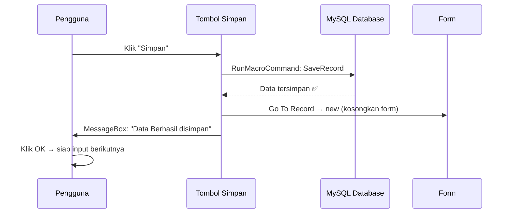

**Cara menambahkan event:**

1. Design View → klik tombol **Simpan**
2. Menu **Design** → **Property Sheet** (panel muncul di kanan)
3. Tab **Event** → klik baris **On Click**
4. Klik tombol `...` (tiga titik) di ujung baris
5. Script Action editor terbuka → tambahkan:
   - **Go To Record** → `Record: new`
   - **Message Box** → Message: `Data Berhasil disimpan`
6. Klik kanan tab → **Save**

> Lakukan hal yang sama pada form buku, pinjam, dan tempat_buku sesuai kebutuhan.

---

## 8. Membuat Query

Query mengambil data dari satu atau beberapa tabel dan mengolahnya menjadi informasi yang lebih bermakna. MS Access menggunakan bahasa SQL di balik layar, tetapi menyediakan **Query Wizard** yang visual.

### 8.1 Query Sederhana (Anggota, Buku, Tempat Buku)

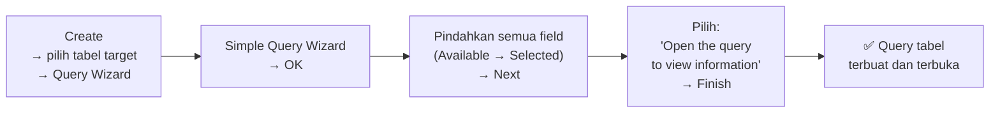

Ulangi untuk: `anggota`, `buku`, dan `tempat_buku`.

### 8.2 Query Pinjam (dengan Modifikasi)

Query pinjam lebih kompleks — menggabungkan 3 tabel dan menambahkan kolom kalkulasi **waktu pinjam** (durasi peminjaman dalam hari).

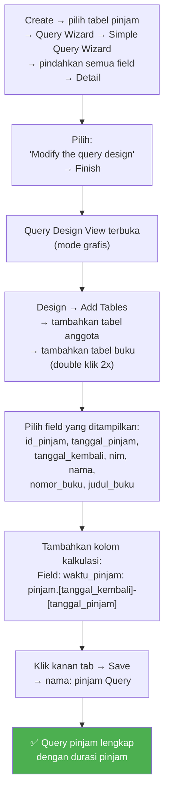

**Ekspresi kalkulasi waktu pinjam:**

```sql
-- Dalam query design Access (bukan SQL murni):
waktu_pinjam: pinjam.[tanggal_kembali]-[tanggal_pinjam]
```

Hasil: kolom `waktu_pinjam` berisi selisih hari antara tanggal kembali dan tanggal pinjam.

**Contoh hasil query pinjam:**

| pinjam | tanggal_pinjam | tanggal_kembali | nim | nama | nomor_buku | judul_buku | waktu_pinjam |
|---|---|---|---|---|---|---|---|
| 1 | 26/11/2020 | 30/11/2020 | 14021001 | Andri Suryadi | A100 | Basis Data | 4 |
| 2 | 01/12/2020 | 05/12/2020 | 14021002 | Ana | A100 | Basis Data | 4 |
| 3 | 01/12/2020 | 09/12/2020 | 14021001 | Andri Suryadi | A101 | Jaringan Komputer | 8 |

### 8.3 Ringkasan 4 Query

| Query | Tabel Sumber | Keterangan |
|---|---|---|
| anggota Query | anggota | Semua field anggota |
| buku Query | buku | Semua field buku |
| tempat_buku Query | tempat_buku | Semua field tempat |
| pinjam Query | pinjam + anggota + buku | Join 3 tabel + kalkulasi waktu pinjam |

---

## 9. Membuat Report (Laporan)

Report adalah output cetak atau tampilan yang terstruktur dari data query. Report berguna untuk pelaporan manajemen.

### 9.1 Alur Membuat Report

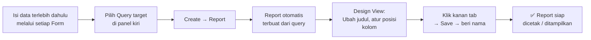

### 9.2 Report Anggota

1. Pilih **anggota Query** di panel kiri
2. `Create` → **Report**
3. Hasilnya: laporan dengan judul otomatis, tanggal, nomor halaman
4. Ubah judul menjadi "**Daftar Anggota**"
5. Simpan: klik kanan → Save → nama: `report anggota`

**Contoh tampilan Report Anggota:**

```
                    Daftar Anggota
                    Selasa, 01 Desember 2020
                                                06.23.17
id_anggota   nim          nama             alamat_mahasiswa
─────────────────────────────────────────────────────────
1            14021001     Andri Suryadi    Bandung
2            14021002     Ana              Jakarta
4            14021003     Surya            Solo

                                              Page 1 of 1
```

### 9.3 Report Pinjam

1. Pilih **pinjam Query** di panel kiri
2. `Create` → **Report**
3. Ubah judul menjadi "**Data Pinjam**"
4. Simpan: nama `report pinjam`

**Contoh tampilan Report Data Pinjam:**

```
                    Data Pinjam
                    Selasa, 01 Desember 2020
                                                06.25.00
pinjam  tanggal_pinjam  tanggal_kembali  nim       nama           nomor_buku  judul_buku        waktu_pinjam
──────────────────────────────────────────────────────────────────────────────────────────────────────────────
1       26/11/2020      30/11/2020       14021001  Andri Suryadi  A100        Basis Data        4
2       01/12/2020      05/12/2020       14021002  Ana            A100        Basis Data        4
3       01/12/2020      09/12/2020       14021001  Andri Suryadi  A101        Jaringan Komputer 8
3       01/12/2020      04/12/2020       14021003  Surya          A183        Metode Numerik    3
```

### 9.4 Ringkasan 4 Report

| Report | Dari Query | Judul |
|---|---|---|
| report anggota | anggota Query | Daftar Anggota |
| report buku | buku Query | Daftar Buku |
| report tempat buku | tempat_buku Query | Daftar Tempat Buku |
| report pinjam | pinjam Query | Data Pinjam |

---

## 10. Membuat Switchboard (Menu Utama)

Switchboard adalah **form navigasi utama** yang berfungsi sebagai pintu masuk aplikasi — pengguna memilih menu tanpa perlu mengakses panel navigasi Access secara langsung.

### 10.1 Mengaktifkan Switchboard Manager

Switchboard Manager tidak ada di ribbon default, perlu ditambahkan ke Quick Access Toolbar:

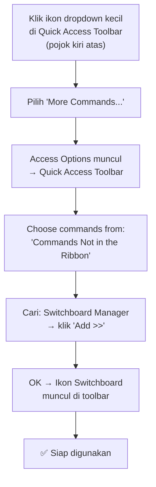

### 10.2 Membuat Struktur Switchboard

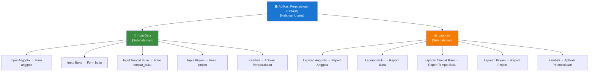

### 10.3 Langkah-langkah Membuat Switchboard

**Langkah 1 — Inisialisasi:**
```
Klik ikon Switchboard Manager → dialog: "Would you like to create one?" → Yes
```

**Langkah 2 — Beri nama halaman utama:**
```
Pilih "Aplikasi Perpustakaan (Default)" → Edit → Switchboard Name: "Aplikasi Perpustakaan" → Close
```

**Langkah 3 — Tambah halaman sub-menu:**
```
New → "Input Data" → OK
New → "Laporan" → OK
```

**Langkah 4 — Hubungkan halaman utama ke sub-menu:**

| Text | Command | Switchboard |
|---|---|---|
| Input Data | Go to Switchboard | Input Data |
| Laporan | Go to Switchboard | Laporan |

**Langkah 5 — Isi menu Input Data:**

| Text | Command | Form/Target |
|---|---|---|
| Input Anggota | Open Form In Add Mode | anggota |
| Input Buku | Open Form In Add Mode | buku |
| Input Tempat Buku | Open Form In Add Mode | tempat_buku |
| Input Pinjam | Open Form In Add Mode | pinjam |
| Kembali | Go To Switch Board | Aplikasi Perpustakaan |

**Langkah 6 — Isi menu Laporan:**

| Text | Command | Report/Target |
|---|---|---|
| Laporan Anggota | Open Report | report anggota |
| Laporan Buku | Open Report | report buku |
| Laporan Tempat Buku | Open Report | report tempat buku |
| Laporan Pinjam | Open Report | report pinjam |
| Kembali | Go To Switch Board | Aplikasi Perpustakaan |

---

## 11. Mengatur Aplikasi

Langkah terakhir: mengatur agar aplikasi terasa seperti "program jadi" yang berdiri sendiri — bukan terlihat seperti file database.

### 11.1 Pengaturan Access Option

**Cara akses:** `File` → `Options` → Access Options terbuka

**Pengaturan di tab Current Database:**

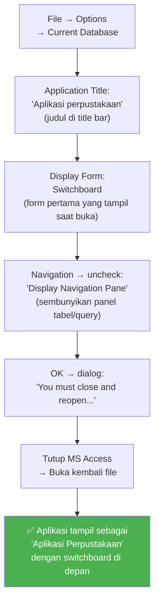

### 11.2 Perbandingan Sebelum dan Sesudah Pengaturan

| Aspek | Sebelum | Sesudah |
|---|---|---|
| Title bar | perpustakaan : Database | **Aplikasi perpustakaan** |
| Tampilan awal | Panel navigasi kosong | **Switchboard menu utama** |
| Panel kiri | Tampil (tabel, query, form, report) | **Tersembunyi** |
| Kesan | File database | **Aplikasi siap pakai** |

---

## 12. Arsitektur Keseluruhan Aplikasi

### 12.1 Struktur Objek MS Access

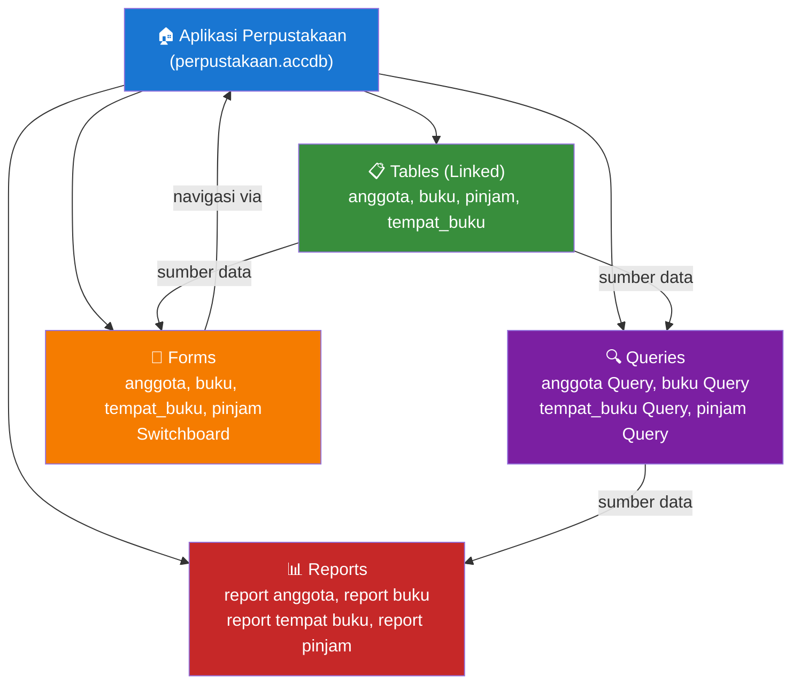

### 12.2 Alur Kerja Pengguna

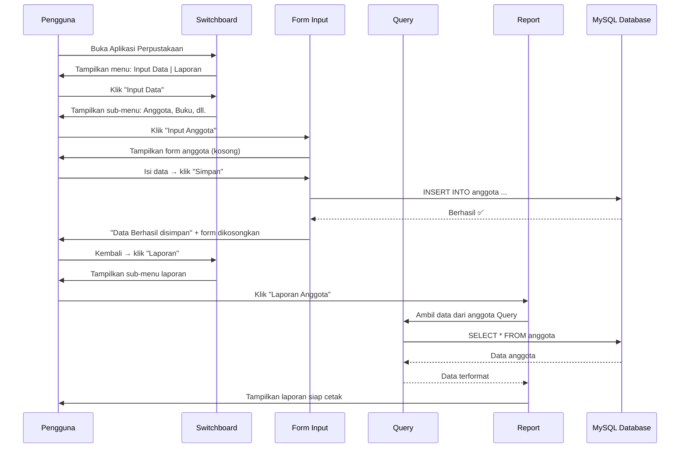

### 12.3 Ringkasan Tahapan Pembangunan Aplikasi

```mermaid
flowchart LR
    S1["1. Rancang\nERD"] --> S2
    S2["2. Implementasi\nMySQL\n(4 tabel + FK)"] --> S3
    S3["3. Install\nODBC\n+ Visual C++"] --> S4
    S4["4. Koneksi\nAccess ↔ MySQL\n(Link Tables)"] --> S5
    S5["5. Buat\n4 Form\n(+ Combo Box)"] --> S6
    S6["6. Tambah\nTombol\nNavigasi & Event"] --> S7
    S7["7. Buat\n4 Query\n(+ kalkulasi)"] --> S8
    S8["8. Buat\n4 Report\n(dari query)"] --> S9
    S9["9. Buat\nSwitchboard\n(menu utama)"] --> S10
    S10["10. Atur\nAccess Option\n(Title + Display)"] --> DONE

    DONE["✅ Aplikasi\nSiap Digunakan"]
    style DONE fill:#4CAF50,color:#fff
```

---

## Catatan Penting & Tips Praktis

### Troubleshooting Umum

| Masalah | Kemungkinan Penyebab | Solusi |
|---|---|---|
| ODBC gagal connect | MySQL XAMPP belum aktif | Start Apache & MySQL di XAMPP Control Panel |
| Error "Driver not found" | ODBC Connector belum terinstal / bitness salah | Instal ulang sesuai 32/64-bit OS |
| Combo box kosong | Data tabel sumber belum diisi | Isi data di tabel parent terlebih dahulu (misal isi `tempat_buku` sebelum isi `buku`) |
| Error FK saat hapus | ON DELETE CASCADE belum diatur | Hapus record dari tabel child dulu, atau pastikan CASCADE aktif |
| Navigation Pane tersembunyi | Access Option sudah diatur | Tekan F11 atau buka via File → Options untuk reset |
| Switchboard tidak muncul | Menu belum diaktifkan di toolbar | Ulangi langkah Customize Quick Access Toolbar |

### Konsep Kunci

> **ODBC** = jembatan universal. Seperti adapter universal yang memungkinkan kabel dari merek A (Access) colok ke stop kontak merek B (MySQL).

> **Linked Table** = bukan salinan data. Data tetap di MySQL; Access hanya menampilkan dan memanipulasinya secara real-time.

> **Switchboard** = menu navigasi berbasis form. Alternatif modern: gunakan Navigation Form (menu bawaan Access 2010+) yang lebih fleksibel.

> **Combo Box dengan Wizard** = implementasi visual dari JOIN query. Alih-alih pengguna mengetik FK secara manual, dropdown membaca data dari tabel parent secara otomatis.
