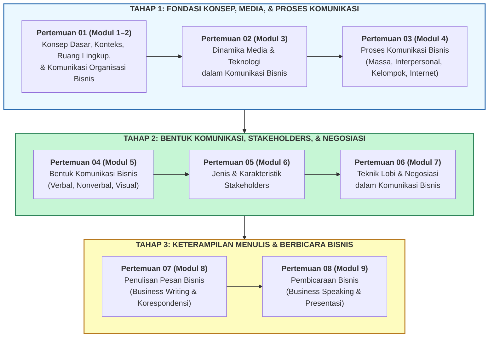

# Komunikasi Bisnis dan Teknis (STSI4308)

* **Kode & Nama Mata Kuliah:** `STSI4308` *(Kode Lama: `MSIM4306`)* — Komunikasi Bisnis dan Teknis (*Business and Technical Communication*)
* **Bobot SKS:** 2 SKS
* **Program Studi:** Sistem Informasi (Program Sarjana) — Fakultas Sains dan Teknologi, Universitas Terbuka
* **Referensi BMP Utama:** Sumartias, Suwandi. (2016). *Komunikasi Bisnis* (Edisi 3). Penerbit Universitas Terbuka.
* **Tahun Pengembangan RAT:** 2025

---

## Daftar Isi

1. [Deskripsi Mata Kuliah dan Capaian Pembelajaran (CPMK)](#1-deskripsi-mata-kuliah-dan-capaian-pembelajaran-cpmk)
2. [Peta Kompetensi dan Alur Pembelajaran Komunikasi Bisnis](#2-peta-kompetensi-dan-alur-pembelajaran-komunikasi-bisnis)
3. [Indeks Materi Pertemuan (Sesi 01 – Sesi 08)](#3-indeks-materi-pertemuan-sesi-01--sesi-08)
4. [Rincian Rancangan Aktivitas Tutorial (RAT)](#4-rincian-rancangan-aktivitas-tutorial-rat)
5. [Struktur Aktivitas, Modus Belajar, dan Jadwal Tugas Tutorial](#5-struktur-aktivitas-modus-belajar-dan-jadwal-tugas-tutorial)
6. [Daftar Pustaka Resmi](#6-daftar-pustaka-resmi)

---

## 1. Deskripsi Mata Kuliah dan Capaian Pembelajaran (CPMK)

### Deskripsi Singkat Mata Kuliah

Mata kuliah **Komunikasi Bisnis dan Teknis (`STSI4308` / `MSIM4306`)** membahas tentang konsep dasar, konteks, dan ruang lingkup komunikasi bisnis, termasuk proses, bentuk, serta dinamika media dan teknologi yang digunakan dalam komunikasi bisnis. Mahasiswa juga mempelajari komunikasi dalam organisasi, jenis dan karakteristik *stakeholders*, serta teknik lobi dan negosiasi yang efektif. Selain itu, mata kuliah ini membekali mahasiswa dengan keterampilan menulis (*business writing*) dan berbicara (*business speaking*) dalam konteks bisnis guna mendukung strategi komunikasi yang profesional dan efisien di lingkungan perusahaan.

### Capaian Pembelajaran Mata Kuliah (`CPMK`)

Setelah menempuh mata kuliah **Komunikasi Bisnis dan Teknis (`STSI4308`)**, mahasiswa diharapkan mampu:

1. Menjelaskan konsep dasar, konteks, dan ruang lingkup komunikasi bisnis serta memahami fungsinya dalam mendukung aktivitas organisasi dan perusahaan.
2. Menganalisis dinamika media dan teknologi dalam komunikasi bisnis serta dampaknya terhadap efektivitas komunikasi.
3. Memahami dan menjelaskan proses komunikasi bisnis pada berbagai tingkatan (massa, interpersonal, kelompok, dan media daring).
4. Mengidentifikasi serta membedakan jenis dan bentuk komunikasi bisnis (verbal, nonverbal, dan visual) sesuai kebutuhan organisasi.
5. Menganalisis jenis dan karakteristik *stakeholders* dalam komunikasi bisnis.
6. Menerapkan teknik lobi dan negosiasi yang efektif dalam penyelesaian kepentingan bisnis.
7. Menyusun dokumen komunikasi bisnis dan korespondensi yang profesional.
8. Menyampaikan gagasan secara lisan melalui presentasi bisnis, *briefing*, diskusi, dan wawancara kerja dengan teknik komunikasi yang efektif.

---

## 2. Peta Kompetensi dan Alur Pembelajaran Komunikasi Bisnis

Berdasarkan **Peta Kompetensi (`RAT` `STSI4308` / `MSIM4306`)**, keseluruhan materi tutorial dirancang secara berjenjang mulai dari fondasi konseptual dan teknologi komunikasi hingga keterampilan praktis menulis dan berbicara bisnis:

---

## 3. Indeks Materi Pertemuan (Sesi 01 – Sesi 08)

Berikut adalah navigasi langsung ke seluruh file catatan terstruktur untuk setiap pertemuan tutorial mata kuliah **`STSI4308`**:

| Sesi | Pokok Bahasan | File Catatan Markdown | Fokus Topik & Kerangka Utama |
| :---: | :--- | :--- | :--- |
| **01** | **Konsep-Konsep Dasar, Konteks, dan Ruang Lingkup Komunikasi Bisnis** | [`pertemuan-01/README.md`](./pertemuan-01/README.md) | Definisi bisnis & komunikasi bisnis, 6 unsur pokok, urgensi komunikasi bisnis, 7 prinsip komunikasi (`7C` Murphy & Hildebrandt), 5 konteks & 5 ruang lingkup komunikasi bisnis. |
| **02** | **Dinamika Media dan Teknologi dalam Komunikasi Bisnis** | [`pertemuan-02/README.md`](./pertemuan-02/README.md) | 7 dimensi saluran komunikasi (Rao / Blake & Haroldsen), klasifikasi saluran (cetak, elektronik, internet), peran teknologi komunikasi, 3 aktivitas bisnis utama di internet (`E-mail`, `E-commerce`, `E-PR`). |
| **03** | **Proses Komunikasi Bisnis** | [`pertemuan-03/README.md`](./pertemuan-03/README.md) | Komunikasi massa (8 karakteristik, keunggulan/kelemahan), komunikasi interpersonal (4 klasifikasi & 5 sikap efektivitas), komunikasi kelompok (8 indikator efektivitas), serta komunikasi media daring & `PR`. |
| **04** | **Bentuk Komunikasi Bisnis** | [`pertemuan-04/README.md`](./pertemuan-04/README.md) | Komunikasi verbal (lisan vs tertulis), komunikasi nonverbal (4 klasifikasi pesan: kinesik, artifaktual, proksemik, paralinguistik), dan komunikasi visual (3 fungsi utama). |
| **05** | **Jenis dan Karakteristik Stakeholders** | [`pertemuan-05/README.md`](./pertemuan-05/README.md) | Definisi *stakeholders*, klasifikasi primer vs sekunder (Clarkson), internal vs eksternal (Kasali), pemetaan karakteristik khalayak (demografis, geografis, psikodemografis), dan postur mental khalayak. |
| **06** | **Teknik Lobi dan Negosiasi dalam Komunikasi Bisnis** | [`pertemuan-06/README.md`](./pertemuan-06/README.md) | Definisi & 3 jenis lobi (tradisional, akar rumput, `PAC`), fungsi & 10 langkah teknik lobi, konsep negosiasi, 4 jenis negosiasi, serta 4 teknik negosiasi (Nazarkhan Yasin). |
| **07** | **Penulisan Pesan Bisnis** | [`pertemuan-07/README.md`](./pertemuan-07/README.md) | Karakteristik (*purposeful*, *audience-centered*, *concise*) & 3 tahap penyusunan pesan bisnis, korespondensi intern/ekstern, pesan *good news* & *goodwill*, serta *bad news* (langsung vs tidak langsung). |
| **08** | **Presentasi Bisnis** | [`pertemuan-08/README.md`](./pertemuan-08/README.md) | Definisi & fungsi presentasi bisnis, 3 keunggulan komunikasi lisan (McLuhan), 4 tujuan presentasi, strategi desain & 4 pilar persiapan presentasi, serta proporsi format (`10-20%` Pembukaan, `65-75%` Isi, `10-20%` Penutup). |

---

## 4. Rincian Rancangan Aktivitas Tutorial (RAT)

Berdasarkan dokumen resmi **Rancangan Aktivitas Tutorial (`RAT`) STSI4308**, berikut adalah rincian **Sub Pokok Bahasan** dan **Capaian Pembelajaran Khusus (`CPK`)** pada setiap sesi:

### Pra Sesi: Perkenalan
* **Sub Pokok Bahasan:** Perkenalan antara tutor dan mahasiswa serta antar sesama mahasiswa peserta tutorial.
* **Aktivitas:** Perkenalan pada Forum Pendahuluan dan peninjauan jadwal kegiatan tutorial.

### Tutorial 1: Konsep-Konsep Dasar, Konteks, dan Ruang Lingkup Komunikasi Bisnis & Komunikasi Organisasi Bisnis *(Modul 1 & 2)*
* **Sub Pokok Bahasan:**
  1. Konsep-konsep Dasar Komunikasi Bisnis
  2. Konteks Komunikasi Bisnis
  3. Ruang Lingkup Komunikasi Bisnis
  4. Bentuk Komunikasi dalam Organisasi Bisnis
  5. Fungsi Komunikasi dalam Bisnis
* **Capaian Pembelajaran Khusus:** Mahasiswa mampu menjelaskan konsep dasar, konteks, ruang lingkup, fungsi komunikasi dalam bisnis, serta bentuk komunikasi dalam organisasi bisnis.

### Tutorial 2: Dinamika Media dan Teknologi dalam Komunikasi Bisnis *(Modul 3)*
* **Sub Pokok Bahasan:**
  1. Media dalam Komunikasi Bisnis *(KB 1)*
  2. Teknologi dalam Komunikasi Bisnis *(KB 2)*
* **Capaian Pembelajaran Khusus:** Mahasiswa mampu menjelaskan peran dan karakteristik berbagai media serta pemanfaatan teknologi informasi dalam komunikasi bisnis.

### Tutorial 3: Proses Komunikasi Bisnis *(Modul 4)*
* **Sub Pokok Bahasan:**
  1. Proses Komunikasi Massa *(KB 1)*
  2. Proses Komunikasi Interpersonal *(KB 2)*
  3. Proses Komunikasi Kelompok *(KB 3)*
  4. Proses Komunikasi Media Online / Internet *(KB 4)*
* **Capaian Pembelajaran Khusus:** Mahasiswa mampu menjelaskan mekanisme dan efektivitas proses komunikasi massa, interpersonal, kelompok, dan media daring dalam konteks bisnis.

### Tutorial 4: Bentuk Komunikasi Bisnis *(Modul 5)*
* **Sub Pokok Bahasan:**
  1. Komunikasi Verbal *(KB 1)*
  2. Komunikasi Nonverbal *(KB 2)*
  3. Komunikasi Visual *(KB 3)*
* **Capaian Pembelajaran Khusus:** Mahasiswa mampu mengidentifikasi, membedakan, dan menerapkan bentuk komunikasi verbal, nonverbal, serta visual dalam aktivitas bisnis.

### Tutorial 5: Jenis dan Karakteristik Stakeholders *(Modul 6)*
* **Sub Pokok Bahasan:**
  1. Jenis-jenis *Stakeholders* *(KB 1)*
  2. Karakteristik *Stakeholders* *(KB 2)*
* **Capaian Pembelajaran Khusus:** Mahasiswa mampu mengklasifikasikan jenis-jenis *stakeholders* dan menganalisis karakteristik khalayak komunikasi bisnis.

### Tutorial 6: Teknik Lobi dan Negosiasi dalam Komunikasi Bisnis *(Modul 7)*
* **Sub Pokok Bahasan:**
  1. Peran dan Fungsi dari Lobi dan Negosiasi dalam Komunikasi Bisnis *(KB 1)*
  2. Teknik Lobi *(KB 2)*
  3. Teknik Negosiasi *(KB 3)*
* **Capaian Pembelajaran Khusus:** Mahasiswa mampu menjelaskan peran, fungsi, tahapan, serta menerapkan teknik lobi dan negosiasi yang efektif.

### Tutorial 7: Penulisan Pesan Bisnis *(Modul 8)*
* **Sub Pokok Bahasan:**
  1. Penyusunan Pesan Bisnis *(KB 1)*
  2. Korespondensi Bisnis *(KB 2)*
  3. Penulisan Korespondensi Bisnis *(KB 3)*
  4. Penulisan Surat Lamaran Kerja dan Resume *(KB 4)*
  5. Penulisan Laporan Bisnis *(KB 5)*
* **Capaian Pembelajaran Khusus:** Mahasiswa mampu menulis pesan bisnis yang efektif dan persuasif, menjelaskan etika korespondensi, menyusun berbagai bentuk surat bisnis, menulis surat lamaran kerja dan resume profesional, serta menyusun laporan bisnis yang informatif dan sistematis.

### Tutorial 8: Pembicaraan Bisnis *(Modul 9)*
* **Sub Pokok Bahasan:**
  1. Presentasi Bisnis *(KB 1)*
  2. *Briefing* dan Diskusi *(KB 2)*
  3. *Job Interview* dan *Meeting* *(KB 3)*
* **Capaian Pembelajaran Khusus:** Mahasiswa mampu menyusun dan menyampaikan presentasi bisnis yang menarik dan efektif, mengaplikasikan strategi *briefing* yang jelas serta berpartisipasi aktif dalam diskusi/rapat bisnis, dan berkomunikasi secara profesional dalam wawancara kerja (*job interview*).

---

## 5. Struktur Aktivitas, Modus Belajar, dan Jadwal Tugas Tutorial

### Aktivitas Belajar Mahasiswa

Dalam setiap sesi tutorial (`TTM`/`Tuweb` maupun `Tuton`), mahasiswa melaksanakan rangkaian aktivitas berikut:

1. Mempelajari materi pokok pada Buku Materi Pokok (`BMP`) Modul 1 hingga Modul 9.
2. Memberikan tanggapan dan berdiskusi secara aktif pada forum diskusi tutorial.
3. Mempelajari materi esensial (materi inisiasi) dan materi pengayaan tambahan pada kelas tutorial.
4. Menyelesaikan **3 Tugas Tutorial** terstruktur pada Sesi 3, Sesi 5, dan Sesi 7.

### Pemetaan Jadwal dan Cakupan Tugas Tutorial (`RAT` 2 SKS)

Berdasarkan ketentuan evaluasi pada dokumen `RAT` untuk mata kuliah berbobot **2 SKS** (`STSI4308` / `MSIM4306`), cakupan materi setiap Tugas Tutorial dipetakan sebagai berikut:

```mermaid
flowchart LR
    M12["<b>Sesi 1 – 2 (Modul 1–3)</b><br/>Konsep Dasar, Organisasi,<br/>& Media Teknologi"]
    TT1["<b>TUGAS TUTORIAL 1</b><br/><i>Dilaksanakan pada Sesi 3</i><br/>Cakupan Esensial: Modul 1–2"]
    M34["<b>Sesi 3 – 4 (Modul 4–5)</b><br/>Proses Komunikasi &<br/>Bentuk Komunikasi Bisnis"]
    TT2["<b>TUGAS TUTORIAL 2</b><br/><i>Dilaksanakan pada Sesi 5</i><br/>Cakupan Esensial: Modul 3–4"]
    M56["<b>Sesi 5 – 6 (Modul 6–7)</b><br/>Stakeholders, Teknik Lobi,<br/>& Teknik Negosiasi"]
    TT3["<b>TUGAS TUTORIAL 3</b><br/><i>Dilaksanakan pada Sesi 7</i><br/>Cakupan Esensial: Modul 5–6"]
    M78["<b>Sesi 7 – 8 (Modul 8–9)</b><br/>Penulisan Pesan Bisnis &<br/>Pembicaraan Bisnis"]

    M12 --> M34 --> TT1
    TT1 --> M56 --> TT2
    TT2 --> M78 --> TT3

    style TT1 fill:#fefcbf,stroke:#b7791f,stroke-width:2px
    style TT2 fill:#fefcbf,stroke:#b7791f,stroke-width:2px
    style TT3 fill:#fefcbf,stroke:#b7791f,stroke-width:2px
    style M12 fill:#ebf8ff,stroke:#2b6cb0
    style M34 fill:#ebf8ff,stroke:#2b6cb0
    style M56 fill:#c6f6d5,stroke:#2f855a
    style M78 fill:#c6f6d5,stroke:#2f855a
```

---

## 6. Daftar Pustaka Resmi

1. **Pustaka Utama (`RAT`):** Sumartias, Suwandi. (2016). *Komunikasi Bisnis* (Edisi 3). Penerbit Universitas Terbuka.
2. **Materi Tutorial Online:** Materi Inisiasi Sesi 1 – Sesi 8, Mata Kuliah Komunikasi Bisnis dan Teknis (`STSI4308` / `MSIM4306`), Program Studi Sistem Informasi, Universitas Terbuka.
3. **Bovée, C. L., & Thill, J. V.** *Business Communication Today*. Pearson Education.
4. **Murphy, H. A., & Hildebrandt, H. W.** (1991). *Effective Business Communications*. McGraw-Hill.