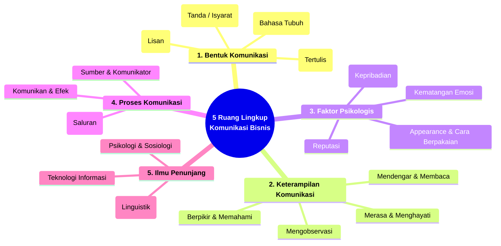

# Pertemuan 01: Konsep-Konsep Dasar, Konteks, dan Ruang Lingkup Komunikasi Bisnis

* **Mata Kuliah:** Komunikasi Bisnis dan Teknis (`STSI4308` / kode lama `MSIM4306`)
* **Program Studi:** Sistem Informasi — Fakultas Sains dan Teknologi, Universitas Terbuka
* **Topik:** Pengertian Bisnis & Komunikasi Bisnis, Enam Unsur Pokok Komunikasi Bisnis, Urgensi Komunikasi Bisnis di Perusahaan, Tujuh Prinsip Komunikasi Bisnis (*7C* Murphy & Hildebrandt), Konteks Komunikasi Bisnis, Lima Ruang Lingkup Komunikasi Bisnis, serta Manfaat Komunikasi Efektif

---

## Daftar Isi

1. [Pengertian Bisnis dan Komunikasi Bisnis](#1-pengertian-bisnis-dan-komunikasi-bisnis)
2. [Enam Unsur Pokok Komunikasi Bisnis](#2-enam-unsur-pokok-komunikasi-bisnis)
3. [Urgensi Komunikasi Bisnis bagi Perusahaan](#3-urgensi-komunikasi-bisnis-bagi-perusahaan)
4. [Tujuh Prinsip Komunikasi Bisnis (7C Murphy & Hildebrandt)](#4-tujuh-prinsip-komunikasi-bisnis-7c-murphy--hildebrandt)
5. [Konteks dan Lima Ruang Lingkup Komunikasi Bisnis](#5-konteks-dan-lima-ruang-lingkup-komunikasi-bisnis)
6. [Manfaat Komunikasi Bisnis yang Efektif](#6-manfaat-komunikasi-bisnis-yang-efektif)
7. [Referensi Resmi](#7-referensi-resmi)

---

## 1. Pengertian Bisnis dan Komunikasi Bisnis

### Definisi Bisnis dan Komunikasi Bisnis

* **Bisnis (*Business*):** Seluruh kegiatan komersial dan industri yang menghasilkan barang maupun jasa untuk meningkatkan dan mempertahankan kualitas hidup masyarakat.
* **Komunikasi Bisnis (*Business Communication*):** Menurut **Rosenblatt dkk. (1997)**, komunikasi bisnis adalah pertukaran gagasan, pendapat, informasi, instruksi, dan sebagainya yang memiliki tujuan tertentu serta disajikan secara personal maupun impersonal melalui simbol-simbol atau sinyal-sinyal untuk mencapai tujuan organisasi.

> *"Without communication, there would be no organization."* — **Raymond V. Lesikar**

---

## 2. Enam Unsur Pokok Komunikasi Bisnis

Berdasarkan definisi Rosenblatt dkk. (1997), komunikasi bisnis tersusun atas **enam unsur pokok** yang saling berkaitan dalam alur penyampaian pesan organisasi:

```mermaid
flowchart LR
    U1["<b>1. Tujuan</b><br/>Ditetapkan & sejalan<br/>dengan target organisasi"]
    U2["<b>2. Pertukaran</b><br/>Melibatkan minimal dua pihak<br/>(komunikator & komunikan)"]
    U3["<b>3. Gagasan, Opini,<br/>Informasi, Instruksi</b><br/>Isi pesan sesuai tujuan"]
    U4["<b>4. Saluran Personal<br/>atau Impersonal</b><br/>Tatap muka maupun<br/>media massa luas"]
    U5["<b>5. Simbol atau Sinyal</b><br/>Alat/metode penyampaian<br/>yang dipahami bersama"]
    U6["<b>6. Pencapaian Tujuan<br/>Organisasi</b><br/>Tujuan produktif &<br/>tujuan memelihara"]

    U1 --> U2 --> U3 --> U4 --> U5 --> U6

    style U1 fill:#ebf8ff,stroke:#2b6cb0
    style U2 fill:#ebf8ff,stroke:#2b6cb0
    style U3 fill:#c6f6d5,stroke:#2f855a
    style U4 fill:#c6f6d5,stroke:#2f855a
    style U5 fill:#fefcbf,stroke:#b7791f
    style U6 fill:#2b6cb0,color:#ffffff
```

| No. | Unsur Pokok | Penjelasan Konseptual |
| :---: | :--- | :--- |
| **1** | **Tujuan (*Goal-Oriented*)** | Komunikasi bisnis wajib memiliki tujuan yang telah dirumuskan secara jelas dan selaras dengan arah pencapaian organisasi. |
| **2** | **Pertukaran (*Exchange*)** | Melibatkan interaksi timbal balik antara sekurang-kurangnya dua pihak, yaitu pengirim pesan (**komunikator**) dan penerima pesan (**komunikan**). |
| **3** | **Gagasan, Opini, Informasi, & Instruksi** | Merupakan substansi atau isi pesan yang bentuk dan sifatnya beragam sesuai kebutuhan dan tujuan komunikasi. |
| **4** | **Saluran Personal atau Impersonal** | Media penyampaian pesan dapat bersifat langsung/tatap muka (*personal*) maupun melalui saluran media yang menjangkau khalayak luas secara bersamaan (*impersonal*). |
| **5** | **Simbol atau Sinyal** | Merupakan alat, kode bahasa, tanda, atau metode yang dapat dimengerti bersama oleh kedua belah pihak untuk mempertukarkan makna pesan. |
| **6** | **Pencapaian Tujuan Organisasi** | Muara akhir seluruh proses komunikasi bisnis, yang mencakup **tujuan produktif** (pencapaian target bisnis) maupun **tujuan memelihara** (menjaga hubungan internal dan eksternal). |

---

## 3. Urgensi Komunikasi Bisnis bagi Perusahaan

### Faktor Pendorong Kebutuhan Komunikasi Bisnis

Perusahaan modern sangat membutuhkan pengelolaan fungsi komunikasi bisnis yang profesional karena delapan faktor dinamika lingkungan bisnis berikut:

1. **Dinamika dan skala perusahaan** yang semakin besar dan kompleks.
2. **Persaingan antarorganisasi/perusahaan** yang semakin ketat.
3. **Tuntutan dan harapan publik** terhadap keterbukaan serta pemenuhan informasi yang semakin tinggi.
4. **Publik dan masyarakat yang semakin kritis** dalam menilai kebijakan perusahaan.
5. **Pesatnya perkembangan teknologi informasi dan komunikasi** yang mempercepat arus informasi.
6. **Besarnya pengaruh opini publik, citra (*image*), dan sikap masyarakat** terhadap keberlangsungan organisasi.
7. **Peran strategis media massa** dalam membentuk opini publik secara luas.
8. **Ketergantungan perusahaan pada dukungan dan kepercayaan publik**, karena organisasi tidak mungkin berdiri sendiri tanpa legitimasi sosial.

### Dampak Kegagalan Komunikasi Bisnis

Banyak kerugian finansial maupun reputasi bisnis dipicu oleh kekeliruan dalam menyampaikan pernyataan publik atau komunikasi internal, yang berdampak langsung pada:

* Munculnya **mispersepsi di kalangan investor** dan pemegang saham.
* **Lemahnya koordinasi dan komunikasi manajemen** di lingkungan internal perusahaan.
* **Lemahnya strategi pendekatan ke konsumen** serta kegagalan kampanye produk di pasar.

---

## 4. Tujuh Prinsip Komunikasi Bisnis (7C Murphy & Hildebrandt)

Untuk menjamin pesan bisnis tersampaikan secara akurat dan profesional, **Murphy dan Hildebrandt (1991)** merumuskan **tujuh prinsip utama komunikasi bisnis (`7C`)**:

| Prinsip (`7C`) | Makna Konseptual | Penerapan dalam Praktik Komunikasi Bisnis |
| :--- | :--- | :--- |
| **1. *Completeness*** *(Kelengkapan)* | Memberikan informasi selengkap mungkin kepada pihak yang membutuhkan. | Menghadirkan seluruh data dan fakta relevan guna memberikan keterangan yang utuh, membangun kepercayaan, dan menghadirkan kepastian bagi penerima. |
| **2. *Conciseness*** *(Keringkasan)* | Menyampaikan pesan melalui kata-kata yang jelas, singkat, dan padat. | Menghindari kalimat bertele-tele (*wordy*) agar hemat waktu pembaca/pendengar namun tetap memuat inti pesan secara utuh. |
| **3. *Concreteness*** *(Kekonkretan)* | Menyusun pesan secara spesifik dan berbasis fakta nyata, tidak bersifat abstrak. | Menggunakan data kuantitatif, contoh spesifik, dan pernyataan tegas sehingga tidak menimbulkan penafsiran ganda. |
| **4. *Consideration*** *(Pertimbangan)* | Menyusun pesan dengan mempertimbangkan situasi, sudut pandang, dan kebutuhan penerima (*komunikan*). | Mengedepankan empati dan pendekatan *you-attitude* agar pesan relevan dengan kondisi komunikan. |
| **5. *Clarity*** *(Kejelasan)* | Menyusun pesan dalam struktur kalimat yang lugas dan mudah dipahami oleh komunikan. | Menggunakan istilah yang tepat sasaran dan alur logika terstruktur agar maksud pengirim langsung tertangkap. |
| **6. *Courtesy*** *(Kesopanan)* | Mengedepankan sopan santun dan tata krama sebagai wujud penghargaan kepada komunikan. | Menjaga nada bicara atau tulisan yang ramah, menghormati lawan bicara, dan menghindari ungkapan yang menyinggung. |
| **7. *Correctness*** *(Ketepatan)* | Menyusun pesan secara cermat dan bebas dari kesalahan teknis maupun kebahasaan. | Pada **pesan tertulis**, memperhatikan ketepatan ejaan dan tata bahasa; pada **pesan lisan**, menyesuaikan tingkat bahasa dengan kemampuan komunikan. |

---

## 5. Konteks dan Lima Ruang Lingkup Komunikasi Bisnis

### Lima Konteks Komunikasi Bisnis

Aktivitas komunikasi dalam lingkungan bisnis berlangsung pada lima tingkatan konteks berikut:

1. **Komunikasi Antarpersona (*Interpersonal Communication*):** Interaksi tatap muka atau langsung antarindividu (misalnya negosiasi klien atau wawancara kerja).
2. **Komunikasi Kelompok (*Group Communication*):** Pertukaran informasi di dalam tim kerja, rapat divisi, atau komite proyek.
3. **Komunikasi Organisasi (*Organizational Communication*):** Arus komunikasi formal dan informal di seluruh struktur hierarki perusahaan (vertikal, horizontal, maupun diagonal).
4. **Komunikasi Massa (*Mass Communication*):** Penyampaian pesan perusahaan kepada publik luas melalui media massa, siaran pers (*press release*), dan periklanan.
5. **Komunikasi Antarbudaya (*Intercultural Communication*):** Interaksi bisnis lintas latar belakang budaya, bahasa, dan negara di era pasar global.

### Lima Ruang Lingkup Pokok Komunikasi Bisnis

Secara garis besar, ruang lingkup komunikasi bisnis mencakup lima dimensi utama yang saling menopang:

---

## 6. Manfaat Komunikasi Bisnis yang Efektif

Penerapan prinsip komunikasi bisnis yang efektif memberikan sembilan manfaat strategis bagi kelangsungan dan daya saing organisasi:

1. **Hubungan bisnis lebih kuat** dengan mitra kerja, pemasok, maupun pelanggan.
2. **Pemecahan masalah lebih cepat** karena hambatan informasi dapat segera diidentifikasi dan ditangani.
3. **Pengambilan keputusan lebih mantap** berkat dukungan aliran data dan informasi yang akurat.
4. **Produktivitas kerja lebih meningkat** di seluruh unit operasional.
5. **Arus kerja (*workflow*) lebih mantap** dan terkoordinasi antarbagian.
6. **Bahan promosi lebih jelas** dan persuasif dalam menjangkau target pasar.
7. **Citra profesional (*professional image*) lebih meningkat** di mata publik dan industri.
8. **Respons *stakeholder* lebih meningkat** secara positif terhadap kebijakan maupun produk perusahaan.
9. **Keterpaduan organisasi lebih kokoh** dalam mewujudkan visi dan misi bersama.

---

## 7. Referensi Resmi

1. **Modul Tutorial Online UT:** Materi Inisiasi Sesi 1 — *Konsep-Konsep Dasar, Konteks, dan Ruang Lingkup Komunikasi Bisnis*, Mata Kuliah Komunikasi Bisnis dan Teknis (`STSI4308` / `MSIM4306`), Universitas Terbuka.
2. **Buku Materi Pokok (BMP) UT:** *Komunikasi Bisnis dan Teknis* (`STSI4308` / `MSIM4306`), Universitas Terbuka.
3. **Murphy, H. A., & Hildebrandt, H. W.** (1991). *Effective Business Communications*. McGraw-Hill.
4. **Rosenblatt, S. B., Cheatham, T. R., & Watt, J. T.** (1997). *Communication in Business*. Prentice Hall.
5. **Lesikar, R. V., & Flatley, M. E.** *Basic Business Communication: Skills for Empowering the Internet Generation*. McGraw-Hill.