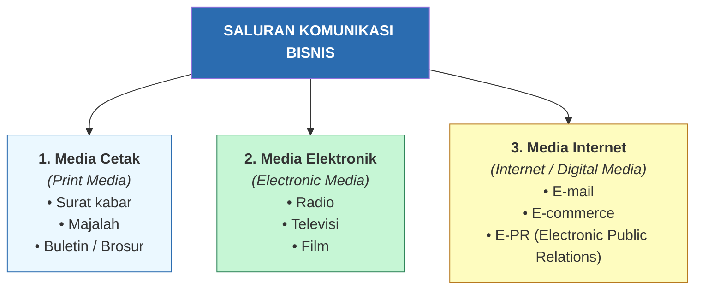
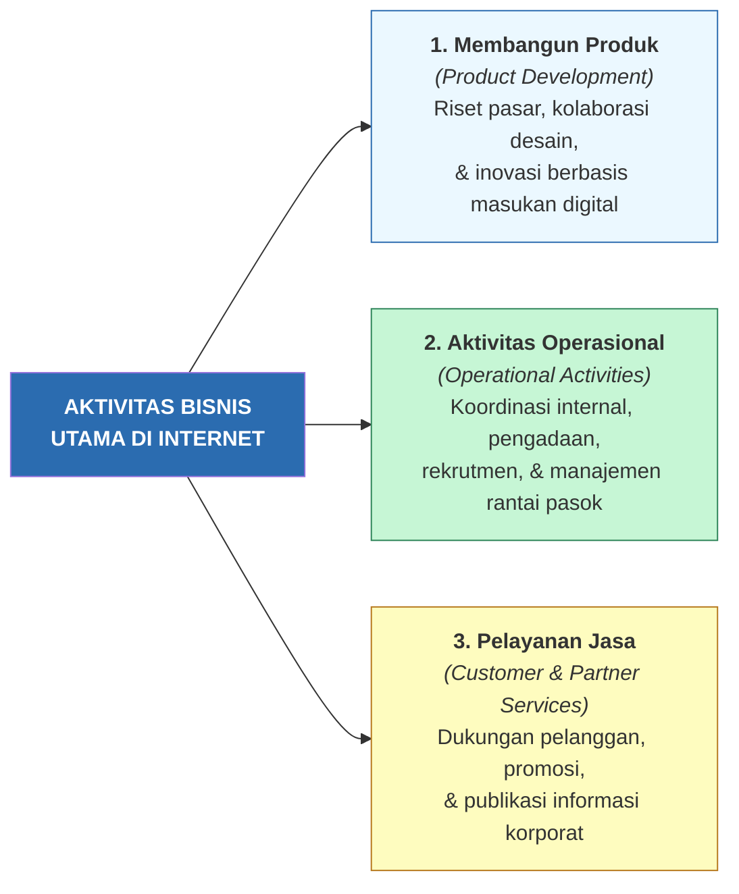

# Pertemuan 02: Dinamika Media dan Teknologi dalam Komunikasi Bisnis

* **Mata Kuliah:** Komunikasi Bisnis dan Teknis (`STSI4308` / kode lama `MSIM4306`)
* **Program Studi:** Sistem Informasi — Fakultas Sains dan Teknologi, Universitas Terbuka
* **Topik:** Tujuh Dimensi Saluran Komunikasi (Rao / Blake & Haroldsen), Klasifikasi Saluran Komunikasi (Cetak, Elektronik, Internet), Peran Strategis Teknologi dalam Komunikasi Bisnis, Tiga Aktivitas Bisnis Utama di Internet, serta Pemanfaatan Internet sebagai Media Komunikasi Bisnis (`E-mail`, `E-commerce`, `E-PR`)

---

## Daftar Isi

1. [Tujuh Dimensi Saluran Komunikasi (Rao / Blake & Haroldsen, 1979)](#1-tujuh-dimensi-saluran-komunikasi-rao--blake--haroldsen-1979)
2. [Klasifikasi Saluran Komunikasi Bisnis](#2-klasifikasi-saluran-komunikasi-bisnis)
3. [Urgensi dan Peran Strategis Teknologi dalam Komunikasi Bisnis](#3-urgensi-dan-peran-strategis-teknologi-dalam-komunikasi-bisnis)
4. [Tiga Aktivitas Bisnis Utama dan Ragam Implementasi di Internet](#4-tiga-aktivitas-bisnis-utama-dan-ragam-implementasi-di-internet)
5. [Internet sebagai Media Komunikasi Bisnis: E-mail, E-commerce, dan E-PR](#5-internet-sebagai-media-komunikasi-bisnis-e-mail-e-commerce-dan-e-pr)
6. [Referensi Resmi](#6-referensi-resmi)

---

## 1. Tujuh Dimensi Saluran Komunikasi (Rao / Blake & Haroldsen, 1979)

Untuk memilih media penyampaian pesan bisnis yang paling tepat sasaran, **Rao** (sebagaimana dikutip oleh **Blake dan Haroldsen, 1979**) merumuskan **tujuh dimensi karakteristik saluran komunikasi**:

| No. | Dimensi Saluran | Definisi dan Karakteristik Teknis | Implikasi dalam Komunikasi Bisnis |
| :---: | :--- | :--- | :--- |
| **1** | **Kredibilitas Saluran** (*Channel Credibility*) | Derajat kecanggihan dan tingkat dipercayainya suatu saluran komunikasi oleh khalayak. | Pesan resmi atau pengumuman korporasi membutuhkan saluran berkredibilitas tinggi (misalnya surat kabar resmi atau situs korporat terverifikasi). |
| **2** | **Umpan Balik Saluran** (*Channel Feedback*) | Kemampuan saluran memberikan kesempatan kepada penerima untuk merespons pesan secara segera dan maksimal. | Saluran interaktif (tatap muka, telepon, *live chat*, *e-mail*) memiliki tingkat umpan balik lebih cepat dibandingkan media satu arah. |
| **3** | **Keterlibatan Saluran** (*Channel Involvement*) | Upaya sadar yang dibutuhkan oleh seluruh pancaindra penerima agar dapat menyerap dan memahami informasi. | Media audiovisual (video/presentasi interaktif) melibatkan lebih banyak indra dibandingkan media teks semata. |
| **4** | **Ketersediaan Saluran** (*Channel Availability*) | Tingkat ketersediaan dan jangkauan infrastruktur saluran komunikasi di suatu wilayah geografis. | Pemilihan media harus menyesuaikan aksesibilitas teknologi yang dimiliki target pasar di wilayah bersangkutan. |
| **5** | **Daya Tahan Saluran** (*Channel Permanence*) | Kemampuan saluran menyimpan dan mempertahankan pesan dari waktu ke waktu untuk dibaca ulang. | **Media cetak** dan dokumen digital memiliki daya tahan jauh lebih tinggi dibandingkan siaran **radio** yang bersifat selintas. |
| **6** | **Kekuatan Multiguna Saluran** (*Channel Multiplicative Power*) | Kemampuan saluran menjangkau wilayah geografis yang luas dengan kecepatan dan ketepatan waktu tinggi. | Media massa elektronik dan jaringan internet unggul dalam menyebarkan informasi ke jutaan audiens secara serentak. |
| **7** | **Kesalingmelengkapi Saluran** (*Channel Complementarity*) | Kemampuan suatu saluran komunikasi untuk mendukung dan memperkuat efektivitas saluran lainnya. | Kampanye promosi terpadu menggabungkan media cetak, televisi, dan media sosial untuk saling melengkapi jangkauan pesan. |

---

## 2. Klasifikasi Saluran Komunikasi Bisnis

Dalam praktik organisasi modern, saluran (*channel*) penyampaian pesan bisnis dikelompokkan ke dalam **tiga kategori media utama**:

---

## 3. Urgensi dan Peran Strategis Teknologi dalam Komunikasi Bisnis

### Faktor Pendorong Adopsi Teknologi Komunikasi

Integrasi teknologi informasi dan komunikasi dalam proses bisnis didorong oleh dinamika eksternal maupun kebutuhan internal perusahaan:

1. **Publik dan Masyarakat Semakin Kritis:** Konsumen menuntut transparansi, kecepatan respons, dan akurasi informasi dari perusahaan.
2. **Pesatnya Perkembangan Teknologi Komunikasi:** Inovasi perangkat digital mengubah pola interaksi antara perusahaan, mitra, dan pelanggan.
3. **Pengaruh Kuat Media Massa terhadap Opini Publik:** Pemberitaan media membentuk persepsi dan citra (*corporate image*) perusahaan secara cepat.
4. **Ketergantungan Perusahaan pada Dukungan Publik:** Organisasi tidak dapat bertahan tanpa legitimasi, kepercayaan, dan citra positif dari pemangku kepentingan.
5. **Percepatan Dinamika Bisnis dan Persaingan:** Aktivitas bisnis saat ini bergerak jauh lebih cepat dibandingkan era sebelumnya, sehingga menuntut jangkauan komunikasi yang lebih luas dan efektif untuk memenangkan persaingan pasar.

### Lima Masalah Mendasar Bisnis yang Diatasi oleh Teknologi Komunikasi

Penggunaan teknologi komunikasi secara tepat mampu mengatasi lima kendala fundamental dalam operasional bisnis:

* **Akurasi (*Accuracy*):** Meminimalkan kesalahan pencatatan, pengiriman, dan penafsiran data.
* **Biaya (*Cost*):** Menekan biaya distribusi informasi, pencetakan dokumen, dan koordinasi jarak jauh.
* **Kecepatan (*Speed*):** Mempercepat pertukaran informasi dan pengambilan keputusan secara *real-time*.
* **Kualitas (*Quality*):** Meningkatkan mutu penyajian informasi dan layanan pelanggan.
* **Kuantitas (*Quantity*):** Memperbesar kapasitas volume data dan jangkauan audiens yang dapat dilayani secara bersamaan.

---

## 4. Tiga Aktivitas Bisnis Utama dan Ragam Implementasi di Internet

### Tiga Pilar Aktivitas Bisnis Utama di Internet

### Sembilan Aktivitas Bisnis Spesifik Melalui Internet

Secara operasional, pemanfaatan internet dalam komunikasi dan transaksi bisnis mencakup sembilan aktivitas utama:

1. **Berbagi data internal** antarunit kerja maupun kantor cabang secara cepat dan terintegrasi.
2. **Rekrutmen calon pegawai** (*e-recruitment*) melalui portal karier dan seleksi daring.
3. **Memperoleh mitra (*partner*) bisnis dan pelanggan baru** dari berbagai wilayah geografis.
4. **Menemukan informasi eksternal** terkait tren pasar, kompetitor, maupun regulasi industri dari pihak luar.
5. **Pembelian material dan peralatan** (*e-procurement*) secara efisien dari pemasok.
6. **Promosi produk dan jasa** secara interaktif dan terukur kepada segmen pasar sasaran.
7. **Fasilitas penunjang bagi pelanggan** (*customer support*, pusat bantuan, dan pelacakan pesanan).
8. **Media kolaborasi dengan *partner* bisnis** dalam pengembangan proyek dan distribusi.
9. **Publikasi perkembangan bisnis** kepada investor, media massa, dan masyarakat luas.

---

## 5. Internet sebagai Media Komunikasi Bisnis: E-mail, E-commerce, dan E-PR

Internet berfungsi sebagai tulang punggung komunikasi bisnis modern melalui tiga instrumen utama:

| Instrumen Media Internet | Pengertian Konseptual | Peran dan Fungsi dalam Komunikasi Bisnis |
| :--- | :--- | :--- |
| **`E-mail`** (*Electronic Mail*) | Sarana korespondensi elektronik untuk mengirim dan menerima pesan teks maupun lampiran berkas secara digital. | Menjadi media komunikasi formal dan semi-formal utama untuk korespondensi internal, negosiasi dengan mitra, pengiriman penawaran, serta layanan pelanggan. |
| **`E-commerce`** (*Electronic Commerce*) | Sistem perdagangan dan transaksi bisnis yang dilakukan secara elektronik melalui jaringan internet. | Memfasilitasi katalog produk digital, pemesanan, pembayaran daring, serta interaksi transaksional langsung antara perusahaan dan konsumen (`B2C`) maupun antarperusahaan (`B2B`). |
| **`E-PR`** (*Electronic Public Relations*) | Penerapan strategi hubungan masyarakat (*public relations*) dengan memanfaatkan media internet dan kanal digital. | Membangun dan memelihara citra positif perusahaan, menyebarkan siaran pers digital (*online press release*), mengelola krisis komunikasi, serta menjalin interaksi dua arah dengan publik. |

---

## 6. Referensi Resmi

1. **Modul Tutorial Online UT:** Materi Inisiasi Sesi 2 — *Dinamika Media dan Teknologi dalam Komunikasi Bisnis*, Mata Kuliah Komunikasi Bisnis dan Teknis (`STSI4308` / `MSIM4306`), Universitas Terbuka.
2. **Buku Materi Pokok (BMP) UT:** *Komunikasi Bisnis dan Teknis* (`STSI4308` / `MSIM4306`), Universitas Terbuka.
3. **Blake, R. H., & Haroldsen, E. O.** (1979). *A Taxonomy of Concepts in Communication*. Hastings House.
4. **Bovée, C. L., & Thill, J. V.** *Business Communication Today*. Pearson Education.
5. **Laudon, K. C., & Traver, C. G.** *E-Commerce: Business, Technology, Society*. Pearson Education.