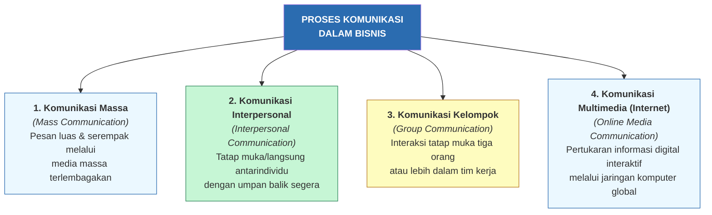
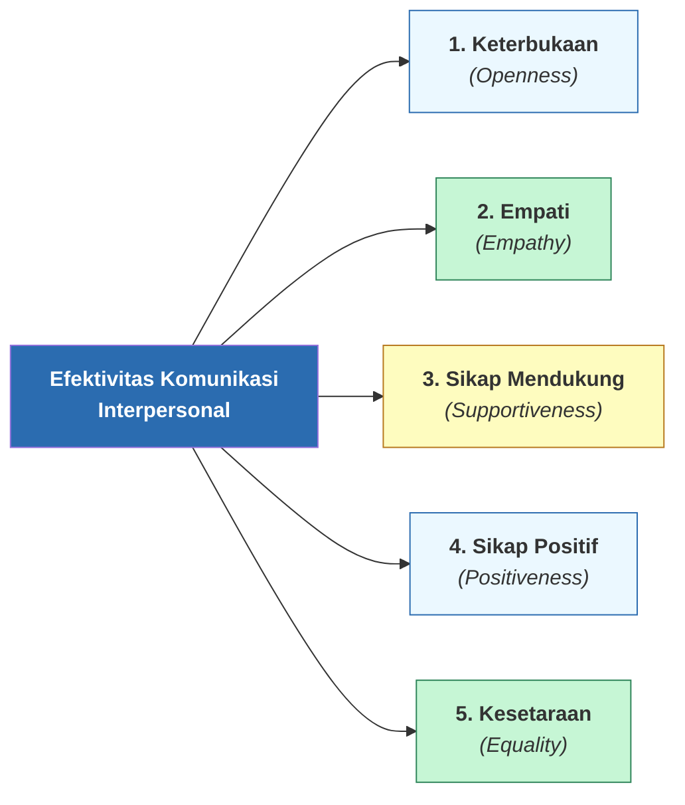

# Pertemuan 03: Proses Komunikasi Bisnis

* **Mata Kuliah:** Komunikasi Bisnis dan Teknis (`STSI4308` / kode lama `MSIM4306`)
* **Program Studi:** Sistem Informasi — Fakultas Sains dan Teknologi, Universitas Terbuka
* **Topik:** Empat Bentuk Proses Komunikasi dalam Bisnis, Komunikasi Massa (Karakteristik, Keunggulan & Kelemahan), Komunikasi Interpersonal (Klasifikasi, Tujuan & Efektivitas), Proses Komunikasi Kelompok (8 Indikator Efektivitas), serta Proses Komunikasi Media Online/Internet dan *Public Relations* (`E-PR`)

---

## Daftar Isi

1. [Empat Bentuk Proses Komunikasi dalam Bisnis](#1-empat-bentuk-proses-komunikasi-dalam-bisnis)
2. [Komunikasi Massa dalam Bisnis](#2-komunikasi-massa-dalam-bisnis)
3. [Komunikasi Interpersonal dalam Bisnis](#3-komunikasi-interpersonal-dalam-bisnis)
4. [Proses Komunikasi Kelompok](#4-proses-komunikasi-kelompok)
5. [Proses Komunikasi Media Online (Internet) dan Public Relations](#5-proses-komunikasi-media-online-internet-dan-public-relations)
6. [Referensi Resmi](#6-referensi-resmi)

---

## 1. Empat Bentuk Proses Komunikasi dalam Bisnis

Dalam aktivitas operasional dan strategis perusahaan, proses penyampaian pesan berlangsung melalui **empat bentuk komunikasi utama** yang dibedakan berdasarkan jumlah pelaku, media saluran, dan mekanisme umpan baliknya:

---

## 2. Komunikasi Massa dalam Bisnis

### Pengertian Komunikasi Massa

Menurut **George Gerbner**, **komunikasi massa** adalah produksi dan distribusi arus pesan yang kontinu serta paling luas berdasarkan teknologi dan lembaga yang dimiliki orang dalam masyarakat industri.

### Delapan Karakteristik Komunikasi Massa

1. **Komunikator Terlembagakan:** Pesan diproduksi dan disebarkan oleh organisasi atau lembaga media profesional (bukan perorangan semata).
2. **Pesan Bersifat Umum:** Materi pesan ditujukan untuk khalayak luas secara terbuka, bukan untuk individu tertentu secara eksklusif.
3. **Komunikannya Anonim dan Heterogen:** Penerima pesan tidak dikenal secara pribadi oleh komunikator dan berasal dari latar belakang demografis maupun sosial yang sangat beragam.
4. **Menimbulkan Keserempakan:** Pesan diterima oleh audiens yang tersebar di berbagai lokasi pada waktu yang bersamaan.
5. **Mengutamakan Isi daripada Hubungan:** Fokus utama terletak pada penyampaian substansi informasi secara jelas ketimbang membangun relasi personal.
6. **Bersifat Satu Arah (*One-Way*):** Aliran informasi bergerak dari komunikator menuju komunikan tanpa interaksi langsung secara seketika.
7. **Stimulasi Alat Indra Terbatas:** Pemanfaatan pancaindra bergantung pada jenis media (misalnya radio hanya menstimulasi pendengaran, surat kabar hanya penglihatan).
8. **Umpan Balik Tertunda (*Delayed*) dan Tidak Langsung (*Indirect*):** Respons audiens tidak dapat diterima secara langsung pada saat pesan disiarkan.

### Keunggulan dan Kelemahan Komunikasi Massa bagi Organisasi Bisnis

| Keunggulan Komunikasi Massa | Kelemahan Komunikasi Massa |
| :--- | :--- |
| **Jangkauan publik sangat luas**, mampu menembus batas geografis secara serempak. | **Audiens bersifat anonim**, sehingga organisasi bisnis tidak dapat mengetahui secara spesifik siapa saja yang melihat dan membaca informasi tersebut. |
| **Solusi efektif untuk publikasi produk**, sangat andal untuk menginformasikan barang dan jasa baru yang dihasilkan perusahaan kepada pasar massal. | **Bersifat satu arah (*one-way*)**, sehingga organisasi bisnis tidak dapat menerima umpan balik (*feedback*) secara cepat dan langsung dari konsumen. |

---

## 3. Komunikasi Interpersonal dalam Bisnis

### Pengertian dan Empat Klasifikasi Komunikasi Interpersonal

**Komunikasi interpersonal** adalah penyampaian pesan oleh satu orang dan penerimaan pesan oleh orang lain atau sekelompok kecil orang, dengan berbagai dampaknya serta peluang untuk memberikan **umpan balik segera (*immediate feedback*)**.

| No. | Klasifikasi | Karakteristik dan Konteks Penerapan |
| :--- | :--- | :--- |
| **1** | **Interaksi Intim** (*Intimate Interaction*) | Komunikasi di antara teman baik, anggota keluarga, dan individu yang telah memiliki ikatan emosional yang kuat. |
| **2** | **Percakapan Sosial** (*Social Conversation*) | Interaksi sederhana untuk menyenangkan atau mengakrabkan diri; tipe ini sangat penting bagi pengembangan hubungan informal yang harmonis di dalam organisasi. |
| **3** | **Interogasi atau Pemeriksaan** (*Interrogation*) | Interaksi antara pihak yang memegang kendali (*kontrol*) untuk meminta atau menuntut keterangan faktual dari pihak lain (misalnya audit internal atau investigasi pelanggaran). |
| **4** | **Wawancara** (*Interview*) | Bentuk komunikasi terstruktur di mana dua pihak terlibat dalam percakapan tanya jawab untuk tujuan tertentu (seperti rekrutmen pegawai atau penggalian kebutuhan klien). |

### Tiga Tujuan Komunikasi Interpersonal dalam Bisnis

1. **Membentuk dan Menjaga Hubungan yang Penuh Arti:** Membangun serta memelihara relasi jangka panjang yang harmonis dengan para pemangku kepentingan (*stakeholders*) organisasi bisnis.
2. **Mengubah Sikap dan Tingkah Laku:** Memengaruhi persepsi, sikap, dan tindakan komunikan, misalnya meyakinkan klien saat mengambil keputusan pembelian.
3. **Membantu Klien (*Customer Assistance*):** Memberikan solusi dan pendampingan langsung kepada klien yang menghadapi permasalahan terkait produk atau layanan organisasi bisnis.

### Lima Sikap Penentu Efektivitas Komunikasi Interpersonal

---

## 4. Proses Komunikasi Kelompok

### Konsep Komunikasi Kelompok dalam Organisasi Bisnis

Menurut **Wiryanto (2004: 44)**, **komunikasi kelompok** merupakan proses komunikasi antara **tiga orang atau lebih** yang berlangsung secara tatap muka di mana para anggotanya saling berinteraksi satu sama lain. Organisasi bisnis merupakan sebuah sistem yang di dalamnya tersusun atas kelompok-kelompok kerja atau **tim kerja** (*work teams*) yang berkolaborasi melaksanakan tugas pokok dan fungsi demi keberlangsungan operasi perusahaan.

### Delapan Indikator Efektivitas Komunikasi di dalam Kelompok

Komunikasi yang efektif di dalam suatu kelompok kerja menghasilkan sinergi dan kerja sama yang solid, yang dapat diukur melalui **delapan indikator** berikut:

| No. | Indikator Efektivitas | Makna dalam Dinamika Tim Kerja |
| :--- | :--- | :--- |
| **1** | **Suasana Kelompok** (*Atmosphere*) | Terciptanya iklim kerja yang kondusif, hangat, terbuka, dan saling menghargai antaranggota tim. |
| **2** | **Rasa Aman** (*Threat Reduction*) | Anggota merasa bebas mengemukakan gagasan atau kritik konstruktif tanpa rasa takut dicemooh atau terancam. |
| **3** | **Kepemimpinan Bergilir** (*Distributive Leadership*) | Fungsi kepemimpinan dan tanggung jawab terdistribusi secara proporsional sesuai kompetensi anggota dalam penyelesaian tugas. |
| **4** | **Perumusan Tujuan** (*Goal Formulation*) | Sasaran dan target kerja kelompok dirumuskan secara jelas dan dipahami bersama oleh seluruh anggota. |
| **5** | **Fleksibilitas** (*Flexibility*) | Kemampuan tim beradaptasi secara luwes terhadap perubahan situasi, strategi, maupun pembagian peran. |
| **6** | **Mufakat** (*Consensus*) | Pengambilan keputusan kelompok dicapai melalui kesepakatan bersama yang didukung penuh oleh seluruh anggota. |
| **7** | **Kesadaran Kelompok** (*Process Awareness*) | Kepekaan anggota terhadap dinamika interaksi dan hambatan proses kerja yang sedang berlangsung di dalam tim. |
| **8** | **Penilaian Berkesinambungan** (*Continual Evaluation*) | Kebiasaan mengevaluasi kinerja dan efektivitas komunikasi kelompok secara berkala untuk perbaikan berkelanjutan. |

---

## 5. Proses Komunikasi Media Online (Internet) dan Public Relations

### Peran Internet dalam Komunikasi Bisnis

Menurut **Ustadiyanto & Silvia (2002: 3)**, **internet** merupakan jaringan besar yang dibentuk oleh interkoneksi komputer-komputer di seluruh dunia melalui saluran telepon, satelit, dan sistem telekomunikasi lainnya. Menurut **Sitompul (2001: 23)**, keuntungan utama perusahaan menggunakan internet meliputi **kecepatan transfer data antarbagian**, **surat-menyurat elektronik (*e-mail*)**, serta **pencarian data dan informasi** yang dibutuhkan organisasi.

### Keunggulan dan Kelemahan Media Internet bagi Perusahaan

| Keunggulan Media Internet | Kelemahan / Risiko Media Internet |
| :--- | :--- |
| **Mengatasi hambatan jarak dan waktu** dalam komunikasi bisnis global. | **Potensi penurunan produktivitas pegawai**, berdasarkan survei banyak karyawan yang mengakses situs hiburan (*entertainment*) pada jam kerja sehingga berisiko merugikan perusahaan. |
| **Sumber informasi hampir tanpa batas** untuk riset pasar dan pengambilan keputusan. | Membutuhkan kebijakan pengawasan penggunaan jaringan (*acceptable use policy*) dan pengamanan data perusahaan. |
| **Memfasilitasi kerja sama dan interaksi pribadi** antarpelaku bisnis secara *real-time*. | — |
| **Penyajian informasi multimedia yang menarik** (gabungan teks, audio, gambar, dan video interaktif). | — |

### Lima Keuntungan *Public Relations* (`PR`) di Internet

Praktisi *Public Relations* (`PR`) memanfaatkan internet sebagai kanal strategis untuk membangun citra dan komunikasi korporat karena memberikan **lima keunggulan utama**:

1. **Informasi cepat sampai pada publik** tanpa tertunda siklus penerbitan media cetak maupun jadwal siaran konvensional.
2. **Sarana penyebaran informasi dan promosi** yang hemat biaya serta menjangkau segmen audiens secara luas.
3. **Aksesibilitas universal**, di mana siapa saja yang terhubung ke jaringan internet dapat mengakses informasi perusahaan.
4. **Tidak terbatas oleh ruang dan waktu**, memungkinkan publik mengakses profil, siaran pers, dan layanan perusahaan selama 24 jam sehari dari belahan dunia mana pun.
5. **Terbukanya komunikasi pemasaran secara langsung**, memungkinkan interaksi dua arah antara perusahaan dan konsumen secara cepat.

---

## 6. Referensi Resmi

1. **Modul Tutorial Online UT:** Materi Inisiasi Sesi 3 — *Proses Komunikasi Bisnis*, Mata Kuliah Komunikasi Bisnis dan Teknis (`STSI4308` / `MSIM4306`), Universitas Terbuka.
2. **Buku Materi Pokok (BMP) UT:** *Komunikasi Bisnis dan Teknis* (`STSI4308` / `MSIM4306`), Universitas Terbuka.
3. **Wiryanto.** (2004). *Pengantar Ilmu Komunikasi*. Jakarta: Grasindo.
4. **Ustadiyanto, R., & Silvia.** (2002). *Framework E-Commerce*. Yogyakarta: Andi Offset.
5. **Sitompul, A.** (2001). *Hukum Internet: Pengenalan Mengenai Masalah Hukum di Cyberspace*. Bandung: Citra Aditya Bakti.
6. **DeVito, J. A.** *The Interpersonal Communication Book*. Pearson Education.