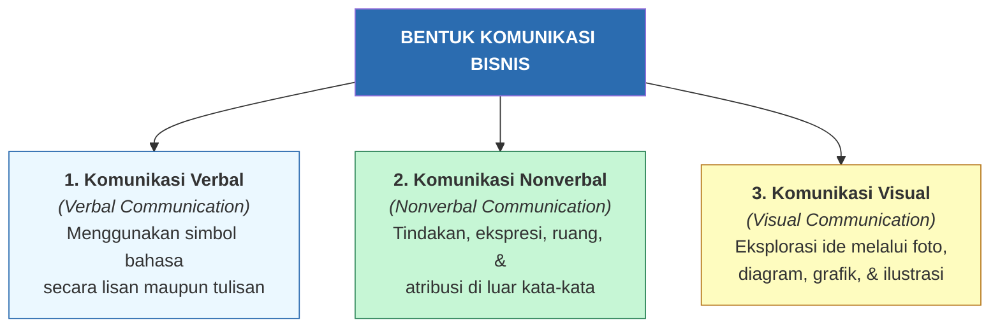
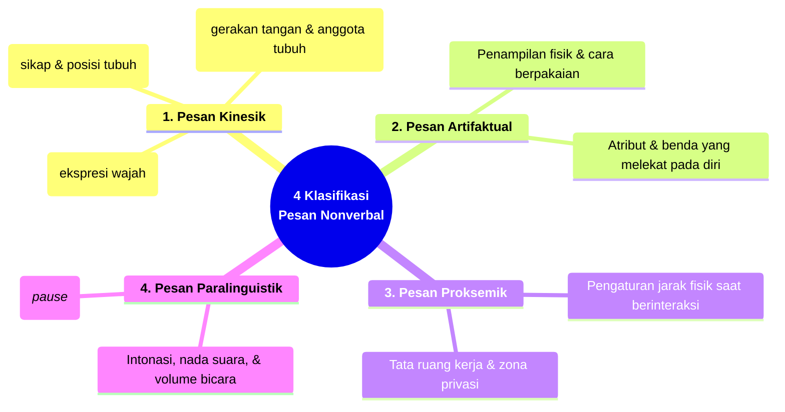

# Pertemuan 04: Bentuk Komunikasi Bisnis

* **Mata Kuliah:** Komunikasi Bisnis dan Teknis (`STSI4308` / kode lama `MSIM4306`)
* **Program Studi:** Sistem Informasi — Fakultas Sains dan Teknologi, Universitas Terbuka
* **Topik:** Tiga Bentuk Utama Komunikasi Bisnis (Komunikasi Verbal, Komunikasi Nonverbal, dan Komunikasi Visual), Ragam Komunikasi Lisan & Tertulis, Empat Klasifikasi Pesan Nonverbal (Burgoon & Saine, 1978), serta Tiga Fungsi Utama Komunikasi Visual

---

## Daftar Isi

1. [Tiga Bentuk Utama Komunikasi Bisnis](#1-tiga-bentuk-utama-komunikasi-bisnis)
2. [Komunikasi Verbal: Lisan dan Tertulis](#2-komunikasi-verbal-lisan-dan-tertulis)
3. [Komunikasi Nonverbal dan Empat Klasifikasinya](#3-komunikasi-nonverbal-dan-empat-klasifikasinya)
4. [Komunikasi Visual dan Tiga Fungsi Utamanya](#4-komunikasi-visual-dan-tiga-fungsi-utamanya)
5. [Perbandingan Komprehensif Tiga Bentuk Komunikasi Bisnis](#5-perbandingan-komprehensif-tiga-bentuk-komunikasi-bisnis)
6. [Referensi Resmi](#6-referensi-resmi)

---

## 1. Tiga Bentuk Utama Komunikasi Bisnis

Dalam praktik interaksi internal maupun eksternal organisasi, penyampaian pesan bisnis diklasifikasikan ke dalam **tiga bentuk utama** berdasarkan medium simbol dan ekspresi yang digunakan:

---

## 2. Komunikasi Verbal: Lisan dan Tertulis

### Pengertian dan Peran Komunikasi Verbal dalam Manajemen

**Komunikasi verbal** adalah komunikasi yang dilakukan dengan menggunakan simbol bahasa, baik dalam bentuk **bahasa lisan (*oral*)** maupun **bahasa tulisan (*written*)**.

> *"Tanpa komunikasi verbal, fungsi-fungsi manajemen tidak dapat dilaksanakan. Misalnya, ketika pimpinan memberikan instruksi atau arahan kerja kepada karyawan, harus dilakukan dengan komunikasi verbal agar tercipta koordinasi yang jelas dan efektif."*
> — **Modul Tutorial Online `STSI4308`** (*Universitas Terbuka*)

### Perbandingan Dua Bentuk Komunikasi Verbal

| Bentuk Komunikasi Verbal | Definisi Konseptual | Contoh Implementasi dalam Aktivitas Bisnis |
| :--- | :--- | :--- |
| **1. Komunikasi Lisan** (*Oral Communication*) | Proses penyampaian pesan atau pertukaran informasi menggunakan kata-kata yang diucapkan secara langsung maupun melalui media suara. | Percakapan telepon, diskusi tim kerja, rapat koordinasi, konferensi bisnis, seminar, presentasi lisan, dan wawancara kerja. |
| **2. Komunikasi Tertulis** (*Written Communication*) | Proses penyampaian pesan atau pertukaran informasi menggunakan kata-kata yang dituangkan dalam bentuk tulisan yang terdokumentasi. | Laporan tertulis (*business report*), surat pemberitahuan, surat peringatan (`SP`), surat keputusan (`SK`), surat undangan, surat penawaran bisnis, proposal, dan *e-mail* resmi. |

---

## 3. Komunikasi Nonverbal dan Empat Klasifikasinya

### Pengertian Komunikasi Nonverbal

Menurut **Burgoon dan Saine (1978)**, **komunikasi nonverbal** merupakan tindakan dan atribusi (lebih dari sekadar penggunaan kata-kata) yang dilakukan seseorang kepada orang lain untuk pertukaran makna, yang selalu dikirimkan dan diterima secara sadar oleh serta untuk mencapai umpan balik atau tujuan tertentu.

### Empat Klasifikasi Pesan Nonverbal

| No. | Klasifikasi Pesan Nonverbal | Komponen dan Penjelasan Teknis | Contoh dalam Lingkungan Bisnis |
| :--- | :--- | :--- | :--- |
| **1** | **Pesan Kinesik** (*Kinesics*) | Komunikasi yang disampaikan melalui gerakan anggota tubuh manusia, yang terbagi menjadi tiga subkategori: • **Pesan Fasial:** Ekspresi raut wajah dan kontak mata. • **Pesan Gestural:** Gerakan tangan, kepala, atau isyarat tubuh. • **Pesan Postural:** Sikap duduk, cara berdiri, dan postur tubuh keseluruhan. | Kontak mata yang mantap saat negosiasi menunjukkan rasa percaya diri; menganggukkan kepala menandakan persetujuan saat rapat. |
| **2** | **Pesan Artifaktual** (*Artifactual*) | Pesan yang diungkapkan melalui penampilan tubuh, gaya berpakaian, aksesori, maupun objek fisik yang digunakan atau ditata di lingkungan sekitar. | Mengenakan setelan bisnis formal (*business attire*) saat bertemu klien eksekutif untuk memancarkan citra profesional dan kredibilitas. |
| **3** | **Pesan Proksemik** (*Proxemics*) | Pesan yang disampaikan melalui pengaturan jarak fisik (*personal space*) dan pemanfaatan ruang antarindividu selama berinteraksi. | Pengaturan tata letak meja rapat bundar untuk mendorong diskusi setara, atau menjaga jarak sopan saat berbicara dengan rekan kerja. |
| **4** | **Pesan Paralinguistik** (*Paralinguistics*) | Aspek vokal di luar kata-kata yang diucapkan, mencakup tinggi-rendah nada (*pitch*), volume suara, intonasi, kecepatan bicara, dan jeda. | Nada suara yang tenang dan tegas saat menyampaikan presentasi proyek meningkatkan keyakinan pemangku kepentingan (*stakeholders*). |

---

## 4. Komunikasi Visual dan Tiga Fungsi Utamanya

### Pengertian Komunikasi Visual

**Komunikasi visual** adalah proses penyampaian dan eksplorasi ide-ide atau gagasan bisnis dengan menambahkan elemen grafis dan visual—seperti **foto, diagram, grafik, bagan, ikon, maupun ilustrasi**—agar informasi kompleks dapat dicerna dengan lebih cepat dan menarik.

### Tiga Fungsi Utama Komunikasi Visual dalam Bisnis

1. **Sarana Identifikasi (*Identification*):**
   * Menciptakan identitas visual yang khas dan mudah dikenali publik, seperti logo perusahaan, warna korporat (*corporate color*), tipografi merek, seragam kerja, dan desain kemasan produk.
2. **Sarana Informasi dan Instruksi (*Information & Instruction*):**
   * Menyederhanakan penyampaian data kompleks maupun panduan operasional melalui infografis, diagram alur kerja (*flowchart*), grafik kinerja keuangan, rambu keselamatan kerja, serta petunjuk penggunaan produk.
3. **Sarana Presentasi dan Promosi (*Presentation & Promotion*):**
   * Memperkuat daya tarik pesan persuasif dalam pemasaran dan presentasi bisnis, seperti poster iklan, katalog produk digital, dek presentasi penjualan (*pitch deck*), dan konten visual media sosial.

---

## 5. Perbandingan Komprehensif Tiga Bentuk Komunikasi Bisnis

| Dimensi Perbandingan | Komunikasi Verbal | Komunikasi Nonverbal | Komunikasi Visual |
| :--- | :--- | :--- | :--- |
| **Medium Utama** | Kata-kata terucap (lisan) dan kata-kata tertulis (teks). | Gerak tubuh, ekspresi wajah, nada suara, ruang, dan penampilan. | Gambar, foto, grafik, diagram, warna, dan tata letak grafis. |
| **Kekuatan Utama** | Mampu menyampaikan instruksi, argumen logis, dan detail teknis secara eksplisit dan terdokumentasi. | Mengungkapkan emosi, sikap, ketulusan, serta memperkuat atau memperjelas makna pesan verbal. | Menarik perhatian secara instan, menyederhanakan data kompleks, dan memperkuat daya ingat audiens. |
| **Sinergi Efektif** | Menjadi tulang punggung penyampaian substansi dan kebijakan resmi organisasi. | Menjaga keselarasan antara apa yang diucapkan dengan bahasa tubuh komunikator (*congruence*). | Menjadi alat bantu visual (*visual aids*) yang mempercepat pemahaman dalam laporan maupun presentasi. |

---

## 6. Referensi Resmi

1. **Modul Tutorial Online UT:** Materi Inisiasi Sesi 4 — *Bentuk Komunikasi Bisnis*, Mata Kuliah Komunikasi Bisnis dan Teknis (`STSI4308` / `MSIM4306`), Universitas Terbuka.
2. **Buku Materi Pokok (BMP) UT:** *Komunikasi Bisnis dan Teknis* (`STSI4308` / `MSIM4306`), Universitas Terbuka.
3. **Burgoon, J. K., & Saine, T.** (1978). *The Unspoken Dialogue: An Introduction to Nonverbal Communication*. Houghton Mifflin.
4. **Bovée, C. L., & Thill, J. V.** *Business Communication Today*. Pearson Education.
5. **Rakhmat, J.** *Psikologi Komunikasi*. Bandung: Remaja Rosdakarya.