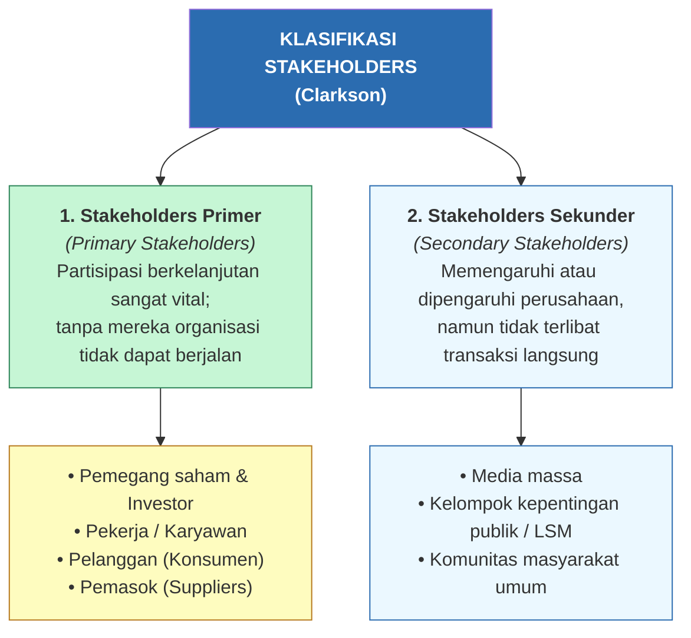
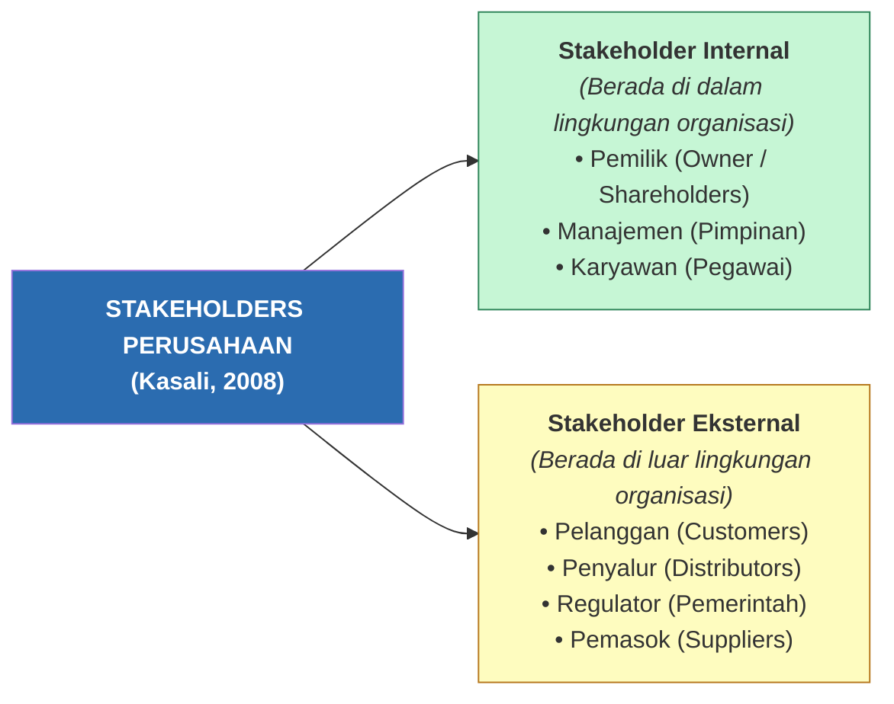
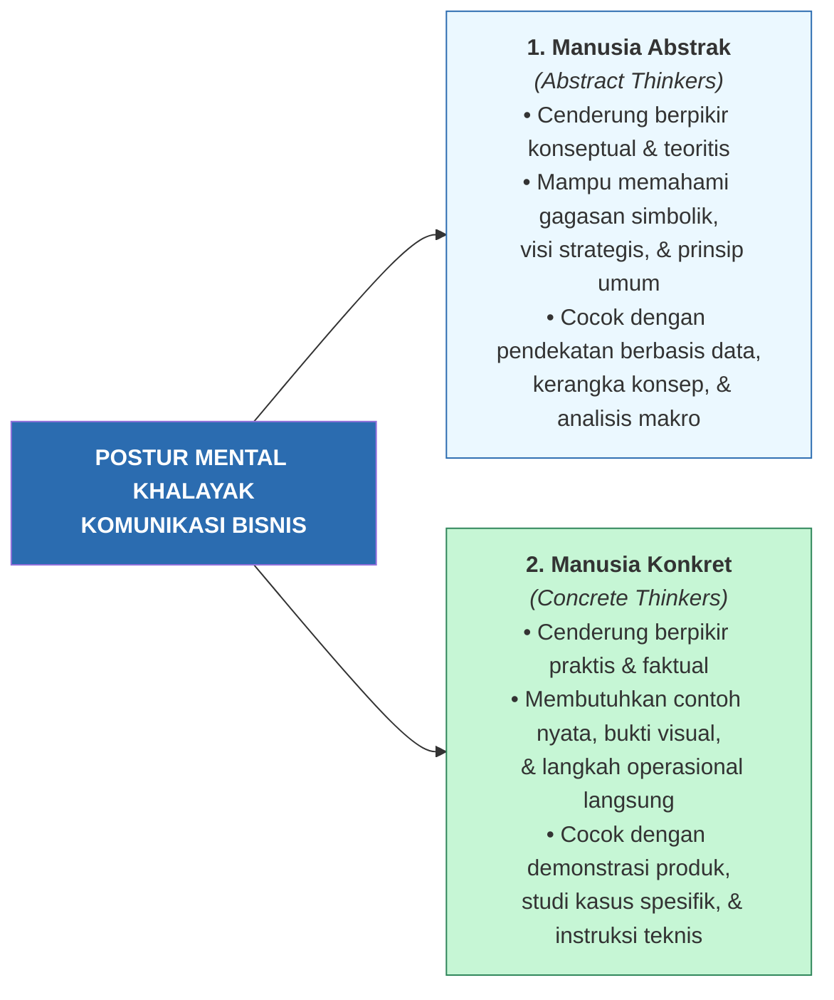

# Pertemuan 05: Jenis dan Karakteristik Stakeholders

* **Mata Kuliah:** Komunikasi Bisnis dan Teknis (`STSI4308` / kode lama `MSIM4306`)
* **Program Studi:** Sistem Informasi — Fakultas Sains dan Teknologi, Universitas Terbuka
* **Topik:** Pengertian *Stakeholders* dalam Bisnis, Klasifikasi *Stakeholders* Primer vs Sekunder (Clarkson), Klasifikasi *Stakeholders* Internal vs Eksternal (Kasali, 2008), Pemetaan Karakteristik Khalayak Komunikasi Bisnis (Demografis, Geografis, Psikodemografis), serta Pembagian Postur Mental Khalayak (Manusia Abstrak vs Manusia Konkret)

---

## Daftar Isi

1. [Pengertian Stakeholders dalam Bisnis](#1-pengertian-stakeholders-dalam-bisnis)
2. [Jenis-Jenis Stakeholders: Primer vs Sekunder (Clarkson)](#2-jenis-jenis-stakeholders-primer-vs-sekunder-clarkson)
3. [Jenis-Jenis Stakeholders: Internal vs Eksternal (Kasali, 2008)](#3-jenis-jenis-stakeholders-internal-vs-eksternal-kasali-2008)
4. [Pemetaan Karakteristik Stakeholders sebagai Khalayak Komunikasi](#4-pemetaan-karakteristik-stakeholders-sebagai-khalayak-komunikasi)
5. [Klasifikasi Khalayak Berdasarkan Postur Mental](#5-klasifikasi-khalayak-berdasarkan-postur-mental)
6. [Referensi Resmi](#6-referensi-resmi)

---

## 1. Pengertian Stakeholders dalam Bisnis

### Definisi *Stakeholders* (Pemangku Kepentingan)

**Stakeholders** (pemangku kepentingan) perusahaan adalah setiap individu, kelompok, maupun lembaga yang dapat memengaruhi atau dipengaruhi oleh keputusan, kebijakan, dan tindakan bisnis organisasi secara keseluruhan.

> *"Dalam konteks komunikasi bisnis, memahami siapa stakeholders perusahaan berarti mengenali siapa khalayak komunikasi (*communication audience*) kita, sehingga pesan yang dirancang dapat diterima secara tepat sasaran dan membangun dukungan organisasi."*
> — **Modul Tutorial Online `STSI4308`** (*Universitas Terbuka*)

---

## 2. Jenis-Jenis Stakeholders: Primer vs Sekunder (Clarkson)

**Max B. E. Clarkson** membagi *stakeholders* perusahaan ke dalam **dua kategori utama** berdasarkan tingkat ketergantungan operasional dan dampak langsung terhadap kelangsungan hidup perusahaan:

| Dimensi Perbandingan | *Stakeholders* Primer (*Primary Stakeholders*) | *Stakeholders* Sekunder (*Secondary Stakeholders*) |
| :--- | :--- | :--- |
| **Peran terhadap Kelangsungan Hidup** | Pihak yang membuat organisasi **tidak dapat berjalan** apabila tidak ada partisipasi berkelanjutan dari mereka. | Pihak yang memengaruhi atau dipengaruhi perusahaan, namun **tidak begitu menentukan** kelangsungan hidup operasional secara langsung. |
| **Keterlibatan Transaksional** | Terlibat secara langsung dalam transaksi ekonomi, kontrak kerja, atau rantai nilai utama perusahaan. | **Tidak terlibat dalam transaksi** bisnis langsung dengan perusahaan. |
| **Contoh Pihak** | Pemegang saham, investor, pekerja/karyawan, pelanggan, dan pemasok. | Media massa, asosiasi profesi, serta kelompok opini publik. |

---

## 3. Jenis-Jenis Stakeholders: Internal vs Eksternal (Kasali, 2008)

Menurut **Rhenald Kasali (2008)**, berdasarkan posisi dan batas struktural organisasinya, *stakeholders* dikelompokkan menjadi **stakeholder internal** dan **stakeholder eksternal**:

| Kategori *Stakeholder* | Elemen Pihak Terkait | Fokus Kebutuhan Komunikasi Bisnis |
| :--- | :--- | :--- |
| **Stakeholder Internal** | **Pemilik**, **Manajemen**, dan **Karyawan**. | Komunikasi instruksional, koordinasi operasional, motivasi kerja, laporan kinerja keuangan, serta penyelarasan visi dan budaya organisasi. |
| **Stakeholder Eksternal** | **Pelanggan**, **Penyalur**, **Regulator**, dan **Pemasok**. | Komunikasi pemasaran dan promosi, negosiasi rantai pasok, kepatuhan hukum/regulasi, serta hubungan masyarakat (*public relations*). |

---

## 4. Pemetaan Karakteristik Stakeholders sebagai Khalayak Komunikasi

Dalam perencanaan komunikasi bisnis, mengenali karakteristik *stakeholders* sebagai **khalayak komunikasi (*audience analysis*)** merupakan langkah krusial untuk menentukan gaya bahasa, isi pesan, dan saluran media yang efektif. Pemetaan karakteristik khalayak dilakukan berdasarkan **tiga aspek utama**:

| Aspek Pemetaan | Variabel / Indikator yang Dianalisis | Implikasi dalam Perancangan Pesan Bisnis |
| :--- | :--- | :--- |
| **1. Aspek Demografis** | Usia, jenis kelamin, tingkat pendidikan, jenis pekerjaan, tingkat pendapatan, dan status sosial. | Menentukan tingkat kompleksitas istilah, pilihan kosakata, serta format penyajian pesan (formal vs kasual). |
| **2. Aspek Lokasi Geografis** | Wilayah tempat tinggal (perkotaan vs pedesaan), zona waktu, kondisi infrastruktur jaringan, dan konteks budaya lokal. | Menentukan pemilihan saluran komunikasi yang tersedia (*channel availability*) serta penyesuaian bahasa dan kearifan lokal. |
| **3. Aspek Psikodemografis** | Gaya hidup (*lifestyle*), nilai-nilai yang dianut, sikap, minat, opini, serta perilaku konsumsi informasi. | Menentukan sudut pandang persuasi, daya tarik emosional maupun rasional, dan strategi membangun kepercayaan khalayak. |

---

## 5. Klasifikasi Khalayak Berdasarkan Postur Mental

Selain aspek demografis, geografis, dan psikodemografis, khalayak komunikasi bisnis juga dibedakan berdasarkan **postur mental (*mental posture*)** dalam menyerap dan memproses informasi menjadi **dua kelompok**:

---

## 6. Referensi Resmi

1. **Modul Tutorial Online UT:** Materi Inisiasi Sesi 5 — *Jenis dan Karakteristik Stakeholders*, Mata Kuliah Komunikasi Bisnis dan Teknis (`STSI4308` / `MSIM4306`), Universitas Terbuka.
2. **Buku Materi Pokok (BMP) UT:** *Komunikasi Bisnis dan Teknis* (`STSI4308` / `MSIM4306`), Universitas Terbuka.
3. **Clarkson, M. B. E.** (1995). *A Stakeholder Framework for Analyzing and Evaluating Corporate Social Performance*. Academy of Management Review, 20(1), 92–117.
4. **Kasali, R.** (2008). *Manajemen Public Relations: Konsep dan Aplikasinya di Indonesia*. Jakarta: Pustaka Utama Grafiti.
5. **Freeman, R. E.** *Strategic Management: A Stakeholder Approach*. Cambridge University Press.