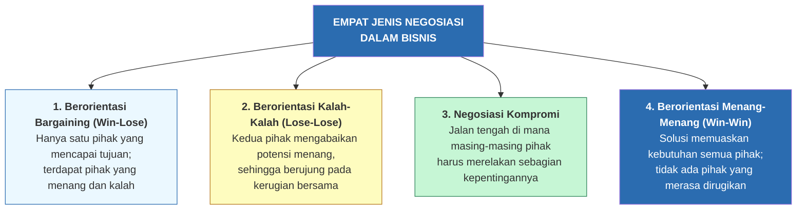

# Pertemuan 06: Teknik Lobi dan Negosiasi dalam Komunikasi Bisnis

* **Mata Kuliah:** Komunikasi Bisnis dan Teknis (`STSI4308` / kode lama `MSIM4306`)

* **Program Studi:** Sistem Informasi — Fakultas Sains dan Teknologi, Universitas Terbuka

* **Topik:** Pengertian & Tiga Jenis Lobi (Tradisional, Akar Rumput, PAC), Fungsi & Tahapan Lobi, Sepuluh Langkah Teknik Lobi, Konsep, Tujuan & Fungsi Negosiasi, Empat Jenis Negosiasi, serta Empat Teknik Negosiasi (Ir. H. Nazarkhan Yasin, 2008)

## Daftar Isi

1. [Pengertian dan Jenis-Jenis Lobi](#1-pengertian-dan-jenis-jenis-lobi)

2. [Fungsi dan Tahapan Lobi dalam Organisasi](#2-fungsi-dan-tahapan-lobi-dalam-organisasi)

3. [Sepuluh Langkah Teknik Lobi yang Efektif](#3-sepuluh-langkah-teknik-lobi-yang-efektif)

4. [Konsep Dasar, Tujuan, dan Fungsi Negosiasi](#4-konsep-dasar-tujuan-dan-fungsi-negosiasi)

5. [Empat Jenis Negosiasi dalam Praktik Bisnis](#5-empat-jenis-negosiasi-dalam-praktik-bisnis)

6. [Teknik Negosiasi (Ir. H. Nazarkhan Yasin, 2008)](#6-teknik-negosiasi-ir-h-nazarkhan-yasin-2008)

7. [Referensi Resmi](#7-referensi-resmi)

## 1. Pengertian dan Jenis-Jenis Lobi

### Definisi Lobi

Menurut **Windschuttle dan Windschuttle (1988)**, hal yang paling esensial dari kegiatan **lobi** adalah bahwa aktivitas ini mengupayakan agar segala sesuatu berjalan bukan dengan cara pemberian perintah atau koersif (*paksaan*), melainkan melalui pendekatan **persuasi**.

### Tiga Jenis Lobi dalam Praktik Korporat

```mermaid
flowchart TD
    LOB["<b>TIGA JENIS LOBI<br/>DALAM BISNIS</b>"]
    L1["<b>1. Lobi Tradisional</b><br/>Memanfaatkan figur publik, tokoh terkenal,<br/>atau mantan pejabat untuk mendekati<br/>kelompok kepentingan"]
    L2["<b>2. Lobi Akar Rumput<br/>(Grassroots Lobbying)</b><br/>Memengaruhi masyarakat umum/akar rumput<br/>agar menyampaikan aspirasi kepada<br/>pengambil keputusan secara tidak langsung"]
    L3["<b>3. Political Action Committee (PAC)</b><br/>Komite khusus perusahaan besar untuk<br/>menempatkan calon dukungan di lembaga<br/>legislatif/eksekutif agar kebijakan berpihak"]

    LOB --> L1
    LOB --> L2
    LOB --> L3

    style LOB fill:#2b6cb0,color:#ffffff
    style L1 fill:#ebf8ff,stroke:#2b6cb0
    style L2 fill:#c6f6d5,stroke:#2f855a
    style L3 fill:#fefcbf,stroke:#b7791f
```

## 2. Fungsi dan Tahapan Lobi dalam Organisasi

### Lima Fungsi Utama Lobi

1. **Memengaruhi pengambil keputusan** (pemerintah/regulator) agar kebijakan atau peraturan yang dikeluarkan tidak merugikan kepentingan organisasi bisnis.

2. **Menafsirkan opini pejabat pemerintah** yang kemudian diterjemahkan menjadi kebijakan operasional perusahaan.

3. **Memprediksikan perubahan hukum** di masa depan dan memberikan rekomendasi kepada manajemen agar perusahaan dapat segera menyesuaikan diri serta memanfaatkan ketentuan baru.

4. **Menyampaikan informasi korporat** mengenai bagaimana suatu ketentuan hukum atau kebijakan dirasakan dampaknya oleh perusahaan dan kelompok masyarakat tertentu.

5. **Meyakinkan pembuat kebijakan** bahwa pelaksanaan suatu peraturan baru membutuhkan masa transisi dan penyesuaian (*pelaziman*) bagi dunia usaha.

### Tahapan Kegiatan Lobi

Proses lobi yang sistematis melibatkan tahapan berikut:
* Pengumpulan data dan fakta yang akurat terkait isu yang dilobi.
* Interpretasi langkah dan kebijakan pemerintah.
* Interpretasi terhadap dampak langkah tersebut bagi internal perusahaan.
* Membangun posisi tawar (*positioning*).
* Melemparkan isu ke ruang publik (nasional) bila diperlukan.
* Mendukung kegiatan pemasaran dan pencitraan korporat.

## 3. Sepuluh Langkah Teknik Lobi yang Efektif

Dalam merancang strategi lobi yang sukses, seorang komunikator bisnis perlu menerapkan **sepuluh langkah teknis**:

1. **Menganalisis iklim** sosial, politik, dan ekonomi yang sedang berlangsung.
2. **Menentukan siapa lawan dan pendukung** (*allies and opponents*) dalam isu terkait.
3. **Mengidentifikasi kelompok kecil** yang paling menentukan iklim pokok masalah.
4. **Membentuk koalisi** dengan berbagai kelompok yang memiliki kesamaan pandangan dan tujuan.
5. **Menentukan tujuan** lobi secara spesifik dan terukur.
6. **Menganalisis akar penyebab** dari kasus atau permasalahan yang muncul.
7. **Menganalisis segmen-segmen khalayak** yang menjadi target pengaruh.
8. **Memperhitungkan media dan saluran komunikasi** lain yang tersedia secara optimal.
9. **Mengembangkan kasus** (*developing case*) atau argumen yang kuat dan logis.
10. **Menjaga fleksibilitas** strategi dalam menghadapi dinamika situasi di lapangan.

## 4. Konsep Dasar, Tujuan, dan Fungsi Negosiasi

### Pengertian dan Tujuan Negosiasi

**Negosiasi** secara harfiah berarti merundingkan atau membicarakan kemungkinan mengenai suatu kondisi guna mencapai kesepakatan (*tawar-menawar*). Dalam konteks formal, negosiasi adalah pertemuan antara dua pihak atau lebih untuk mencapai suatu kesepakatan bersama.

> *"Menurut Iriantara dkk. (2008), tujuan negosiasi tidak sekadar mendapatkan apa yang kita inginkan, tetapi lebih dari itu, mendapatkan apa yang kita inginkan dengan cara yang paling mudah dan baik."*

### Fungsi Negosiasi

Fungsi utama negosiasi adalah **menyelesaikan konflik kepentingan atau persoalan pelik melalui proses komunikasi** yang konstruktif.

## 5. Empat Jenis Negosiasi dalam Praktik Bisnis

## 6. Teknik Negosiasi (Ir. H. Nazarkhan Yasin, 2008)

Menurut **Ir. H. Nazarkhan Yasin (2008)**, terdapat **empat pendekatan teknik negosiasi** utama yang dapat diterapkan dalam dunia bisnis:

| Teknik Negosiasi | Karakteristik dan Fokus Pendekatan | 
| :--- | :--- | 
| **1. Teknik Negosiasi Kompetitif** | Menempatkan negosiasi sebagai ajang kompetisi di mana pihak perunding berupaya memaksimalkan keuntungan sendiri dan menekan pihak lawan (*zero-sum game*). | 
| **2. Teknik Negosiasi Kooperatif** | Mengedepankan kerja sama dan pencarian solusi bersama yang harmonis, membangun hubungan jangka panjang, serta saling menghormati kepentingan masing-masing. | 
| **3. Teknik Negosiasi Lunak dan Keras** | Kombinasi pendekatan di mana negosiator dapat bersikap lunak (*soft*) demi menjaga hubungan relasi atau bersikap keras (*hard*) untuk mempertahankan prinsip dan target mutlak. | 
| **4. Teknik Negosiasi Berbasis Kepentingan (*Interest-Based* / *Principled Negotiation*):** | Berfokus pada upaya mengidentifikasi kebutuhan dan kepentingan mendasar (*interests*) di balik posisi tawar kedua belah pihak, bukan sekadar mempertahankan tuntutan formal (*positions*). | 

## 7. Referensi Resmi

1. **Modul Tutorial Online UT:** Materi Inisiasi Sesi 6 — *Teknik Lobi dan Negosiasi dalam Komunikasi Bisnis*, Mata Kuliah Komunikasi Bisnis dan Teknis (`STSI4308` / `MSIM4306`), Universitas Terbuka.

2. **Buku Materi Pokok (BMP) UT:** *Komunikasi Bisnis dan Teknis* (`STSI4308` / `MSIM4306`), Universitas Terbuka.

3. **Windschuttle, K., & Windschuttle, E.** (1988). *The Media: A New Analysis of the Press, Television, Radio and Advertising in Australia*. Penguin Books.

4. **Iriantara, Y., dkk.** (2008). *Communication and Negotiation Skills*. Bandung: Remaja Rosdakarya.

5. **Yasin, Nazarkhan H.** (2008). *Mengenal Kontrak Konstruksi di Indonesia*. Jakarta: Gramedia Pustaka Utama.

6. **Fisher, R., Ury, W., & Patton, B.** *Getting to Yes: Negotiating Agreement Without Giving In*. Penguin Books.