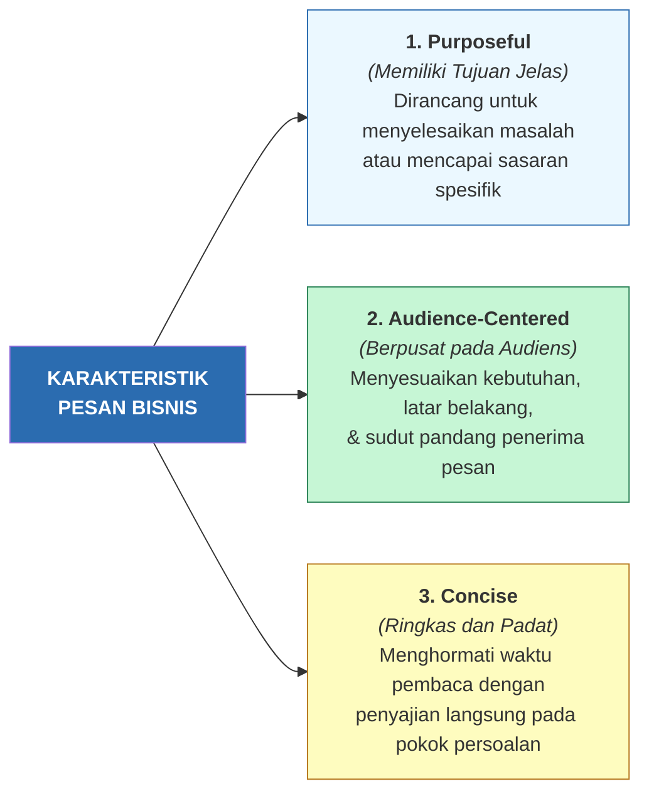
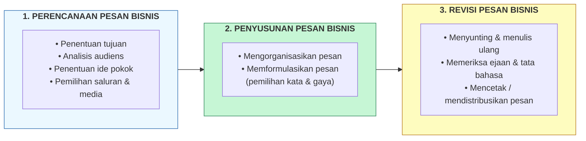

# Pertemuan 07: Penulisan Pesan Bisnis

* **Mata Kuliah:** Komunikasi Bisnis dan Teknis (`STSI4308` / kode lama `MSIM4306`)
* **Program Studi:** Sistem Informasi — Fakultas Sains dan Teknologi, Universitas Terbuka
* **Topik:** Karakteristik & Tujuan Penulisan Pesan Bisnis, Tiga Tahap Proses Penyusunan Pesan Bisnis, Korespondensi Bisnis (Intern & Ekstern, Pihak Terlibat, dan Bahasa Korespondensi), Pesan *Good News* & *Goodwill*, serta Pesan *Bad News* (Pendekatan Langsung vs Tidak Langsung)

---

## Daftar Isi

1. [Karakteristik dan Tujuan Penulisan Pesan Bisnis](#1-karakteristik-dan-tujuan-penulisan-pesan-bisnis)
2. [Tiga Tahap Proses Penyusunan Pesan Bisnis](#2-tiga-tahap-proses-penyusunan-pesan-bisnis)
3. [Korespondensi Bisnis: Klasifikasi, Pihak Terlibat, dan Bahasa](#3-korespondensi-bisnis-klasifikasi-pihak-terlibat-dan-bahasa)
4. [Pesan Good News dan Goodwill](#4-pesan-good-news-dan-goodwill)
5. [Pesan Bad News: Pendekatan Langsung vs Tidak Langsung](#5-pesan-bad-news-pendekatan-langsung-vs-tidak-langsung)
6. [Referensi Resmi](#6-referensi-resmi)

---

## 1. Karakteristik dan Tujuan Penulisan Pesan Bisnis

### Tiga Karakteristik Utama Pesan Bisnis

Pesan-pesan bisnis dapat ditujukan kepada berbagai pihak yang berhubungan langsung maupun tidak langsung dengan organisasi—seperti pelanggan, pemasok, kantor pajak, kantor akuntan, dan mitra bisnis. Agar efektif, setiap pesan bisnis wajib memiliki **tiga karakteristik utama**:

### Lima Tujuan Penulisan Pesan Bisnis

1. **Sumber Acuan di Masa Mendatang:** Menjadi arsip dan dokumen rujukan resmi apabila diperlukan penelusuran kembali di kemudian hari.
2. **Menghindari Kesalahan (*Minimizing Errors*):** Memperjelas instruksi, kesepakatan, dan rincian teknis agar tidak terjadi kesalahpahaman penafsiran.
3. **Persyaratan Hukum (*Legal Requirements*):** Memenuhi ketentuan regulasi, kontrak, perpajakan, dan pembuktian administratif yang sah secara hukum.
4. **Akses Luas:** Memungkinkan informasi didistribusikan dan dibaca oleh banyak pemangku kepentingan di berbagai lokasi secara seragam.
5. **Pengambilan Keputusan yang Efektif:** Menyediakan data dan dokumentasi terstruktur sebagai landasan manajemen dalam mengambil keputusan bisnis yang tepat.

---

## 2. Tiga Tahap Proses Penyusunan Pesan Bisnis

Penyusunan pesan bisnis yang profesional mengikuti **tiga tahapan sistematis** mulai dari perencanaan hingga penyelesaian akhir:

1. **Perencanaan Pesan Bisnis (*Planning*):** Menetapkan tujuan komunikasi, menganalisis profil dan kebutuhan audiens, merumuskan ide pokok (*main idea*), serta memilih saluran dan media penyampaian yang paling tepat.
2. **Penyusunan Pesan Bisnis (*Writing / Composing*):** Mengorganisasikan kerangka logika pesan (deduktif atau induktif) dan memformulasikan draf kalimat yang efektif serta persuasif.
3. **Revisi Pesan Bisnis (*Completing / Revising*):** Menyunting dan menulis ulang bagian yang kurang jelas, memastikan ketepatan tata bahasa serta format, lalu mencetak atau mengirimkan pesan akhir.

---

## 3. Korespondensi Bisnis: Klasifikasi, Pihak Terlibat, dan Bahasa

### Pengertian dan Klasifikasi Korespondensi Bisnis

Menurut **Dewi (2006: 81)**, **korespondensi** berasal dari kata *correspondence* (bahasa Inggris) yang berarti hubungan yang terjadi antara pihak-pihak yang terkait. Dalam dunia bisnis, hubungan tersebut umumnya bersifat resmi dan diwujudkan melalui aktivitas surat-menyurat.

| Klasifikasi Korespondensi | Cakupan dan Arah Hubungan | Contoh Penerapan |
| :--- | :--- | :--- |
| **Korespondensi Intern** | Digunakan antarunit kerja di dalam satu organisasi bisnis, termasuk komunikasi antara kantor pusat dan kantor cabang. | Memo internal, nota dinas, surat edaran manajemen, dan instruksi kerja antardivisi. |
| **Korespondensi Ekstern** | Ditujukan kepada pihak atau organisasi di luar lingkungan organisasi bisnis sendiri. | Surat penawaran harga, surat pesanan (*purchase order*), surat penagihan, dan surat pengaduan ke pemasok. |

### Pentingnya Korespondensi dalam Bisnis

* **Menciptakan surat yang baik, jelas, dan tepat** sehingga pesan korporat tersampaikan secara profesional.
* **Menciptakan kerja sama yang baik** dengan mitra, pelanggan, maupun instansi eksternal.
* **Menyebarkan kegiatan dan informasi bisnis** secara resmi dan terdokumentasi.

### Pihak-Pihak yang Terlibat dan Prinsip Bahasa Korespondensi

* **Enam Pihak yang Terlibat dalam Korespondensi:**
  1. **Koresponden:** Orang atau pejabat yang berhak dan bertanggung jawab menandatangani serta mengirimkan surat.
  2. **Redaktur:** Orang yang menyusun konsep dan menyunting redaksi isi surat.
  3. **Sekretaris:** Pihak yang membantu pengelolaan administrasi, pengarsipan, dan distribusi korespondensi pimpinan.
  4. **Juru Ketik:** Petugas yang mengetik dan merapikan format fisik maupun digital surat.
  5. **Register:** Petugas pencatat surat masuk dan surat keluar dalam buku agenda korespondensi.
  6. **Kurir:** Petugas yang mengantarkan surat secara fisik kepada penerima tujuan.
* **Tiga Prinsip Bahasa Korespondensi Bisnis:**
  1. **Jelas:** Tidak menimbulkan makna ganda (*ambiguitas*).
  2. **Lugas:** Langsung pada pokok persoalan, tidak berbelit-belit.
  3. **Menarik dan Santun:** Menggunakan pilihan kata yang sopan, hormat, dan membangkitkan simpati pembaca.

---

## 4. Pesan Good News dan Goodwill

### Pengertian dan Bentuk Penerapan

**Pesan *Good News* dan *Goodwill*** adalah pesan-pesan bisnis yang menyampaikan kabar baik, apresiasi, atau perhatian positif sehingga memberikan kesan menyenangkan kepada pihak penerima.

| Kategori Pesan Positif | Fokus dan Tujuan Pesan | Contoh Penerapan dalam Bisnis |
| :--- | :--- | :--- |
| **Pesan *Good News*** | Menyampaikan informasi positif yang berkaitan langsung dengan operasional bisnis, pekerjaan, atau penawaran produk. | • **Tentang pekerjaan:** Surat penerimaan lamaran kerja, pengumuman kenaikan gaji/jabatan, atau persetujuan kredit. • **Tentang produk:** Pengumuman peluncuran produk baru, pemberian diskon khusus, atau garansi tambahan. |
| **Pesan *Goodwill*** | Pesan bersahabat yang tidak bertujuan menjual secara langsung, melainkan memelihara hubungan emosional dan itikad baik. | • Ucapan selamat atas pencapaian/hari raya. • Surat penghargaan (*appreciation letter*) kepada mitra/pelanggan setia. • Surat pernyataan dukacita (*condolence*) atau simpati. |

---

## 5. Pesan Bad News: Pendekatan Langsung vs Tidak Langsung

### Tantangan Penyampaian Pesan *Bad News*

Dalam operasional bisnis, perusahaan kerap harus menyampaikan **kabar buruk (*bad news*)**—seperti penolakan lamaran kerja, penolakan klaim/kredit, kenaikan harga, atau tanggapan atas keluhan pelanggan. Penyampaian pesan *bad news* harus dilakukan secara hati-hati agar tetap menjaga hubungan baik (*goodwill*) dan tidak menyinggung perasaan penerima.

### Perbandingan Dua Pendekatan Penyampaian Pesan *Bad News*

```mermaid
flowchart TD
    subgraph DIR ["<b>A. PENDEKATAN LANGSUNG (Direct Approach)</b><br/><i>Cocok jika penerima lebih menyukai ketegasan<br/>atau kabar buruk tidak berdampak emosional berat</i>"]
        D1["<b>1. Pembuka</b><br/>Pernyataan langsung pada <i>Bad News</i>"]
        D2["<b>2. Alasan</b><br/>Penjelasan alasan di balik <i>Bad News</i>"]
        D3["<b>3. Penutup</b><br/>Pernyataan yang positif dan bersahabat"]
        D1 --> D2 --> D3
    end

    subgraph IND ["<b>B. PENDEKATAN TIDAK LANGSUNG (Indirect Approach)</b><br/><i>Cocok jika kabar buruk bersifat sensitif, mengecewakan,<br/>atau berpotensi memicu penolakan emosional</i>"]
        I1["<b>1. Pembuka (Buffer)</b><br/>Pernyataan netral yang relevan & ramah"]
        I2["<b>2. Alasan</b><br/>Penjelasan fakta & alasan yang logis"]
        I3["<b>3. Bad News</b><br/>Nyatakan <i>Bad News</i> secara halus & jelas"]
        I4["<b>4. Penutup</b><br/>Pernyataan positif, bersahabat, & menyenangkan"]
        I1 --> I2 --> I3 --> I4
    end

    style DIR fill:#ebf8ff,stroke:#2b6cb0
    style IND fill:#c6f6d5,stroke:#2f855a
    style D1 fill:#fefcbf,stroke:#b7791f
    style I3 fill:#fefcbf,stroke:#b7791f
```

| Tahapan Struktur Pesan | Pendekatan Langsung (*Direct Plan*) | Pendekatan Tidak Langsung (*Indirect Plan*) |
| :--- | :--- | :--- |
| **Tahap 1: Pembuka** | Menyampaikan pernyataan ***bad news*** secara langsung sejak kalimat awal. | Menyampaikan pernyataan **netral (*buffer*)** yang membangun kesepahaman tanpa langsung menolak. |
| **Tahap 2: Alasan** | Menjelaskan alasan objektif yang mendasari keputusan *bad news* tersebut. | Menyajikan **penjelasan yang logis** dan faktual sehingga pembaca memahami konteks keputusan sebelum penolakan diungkapkan. |
| **Tahap 3: Inti / Penutup** | Ditutup dengan pernyataan yang **positif dan bersahabat** untuk menjaga relasi. | Menyatakan ***bad news*** secara jelas dan diplomatis, lalu ditutup dengan kalimat **positif, bersahabat, dan menyenangkan**. |

---

## 6. Referensi Resmi

1. **Modul Tutorial Online UT:** Materi Inisiasi Sesi 7 — *Penulisan Pesan Bisnis*, Mata Kuliah Komunikasi Bisnis dan Teknis (`STSI4308` / `MSIM4306`), Universitas Terbuka.
2. **Buku Materi Pokok (BMP) UT:** *Komunikasi Bisnis dan Teknis* (`STSI4308` / `MSIM4306`), Universitas Terbuka.
3. **Dewi, Sutrisna.** (2006). *Komunikasi Bisnis*. Yogyakarta: Penerbit Andi.
4. **Bovée, C. L., & Thill, J. V.** *Business Communication Today*. Pearson Education.
5. **Purwanto, Djoko.** *Komunikasi Bisnis*. Jakarta: Penerbit Erlangga.