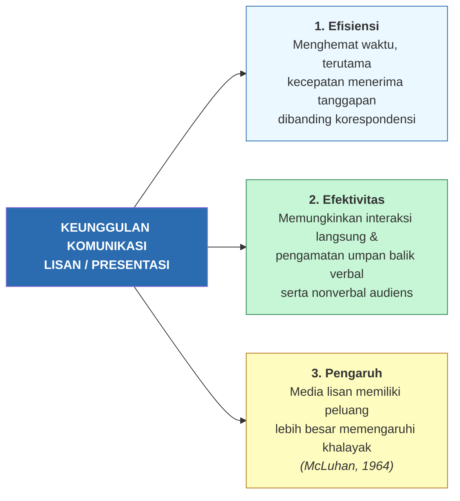
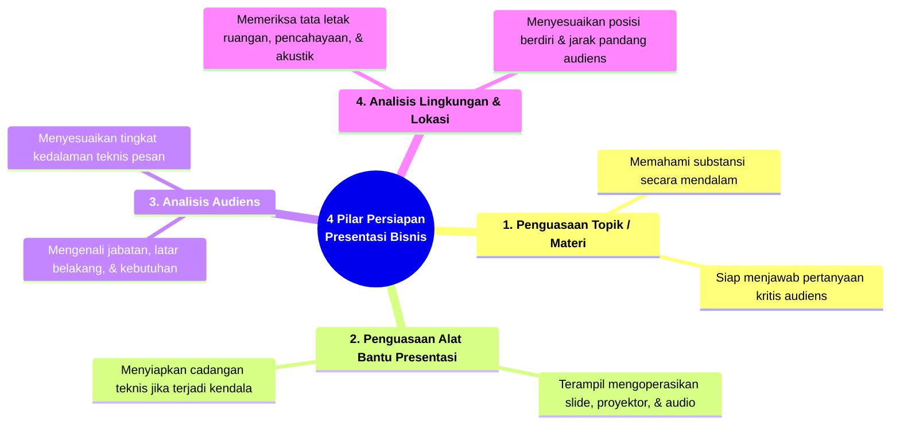
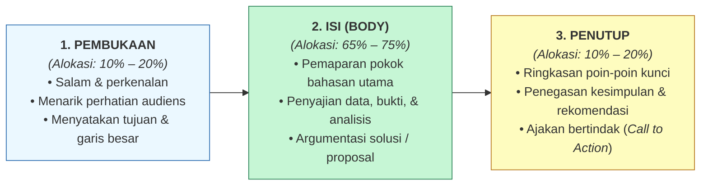

# Pertemuan 08: Presentasi Bisnis

* **Mata Kuliah:** Komunikasi Bisnis dan Teknis (`STSI4308` / kode lama `MSIM4306`)
* **Program Studi:** Sistem Informasi — Fakultas Sains dan Teknologi, Universitas Terbuka
* **Topik:** Definisi & Fungsi Presentasi Bisnis, Tiga Keunggulan Komunikasi Lisan/Presentasi (McLuhan, 1964), Empat Tujuan Presentasi Bisnis, Teknik Mendesain & Persiapan Presentasi, serta Proporsi Format Struktur Presentasi (Pembukaan, Isi, Penutup)

---

## Daftar Isi

1. [Definisi dan Fungsi Presentasi Bisnis](#1-definisi-dan-fungsi-presentasi-bisnis)
2. [Tiga Keunggulan Komunikasi Lisan dalam Presentasi](#2-tiga-keunggulan-komunikasi-lisan-dalam-presentasi)
3. [Empat Tujuan Presentasi Bisnis](#3-empat-tujuan-presentasi-bisnis)
4. [Strategi Mendesain dan Persiapan Presentasi Bisnis](#4-strategi-mendesain-dan-persiapan-presentasi-bisnis)
5. [Proporsi Format Struktur Presentasi Bisnis](#5-proporsi-format-struktur-presentasi-bisnis)
6. [Referensi Resmi](#6-referensi-resmi)

---

## 1. Definisi dan Fungsi Presentasi Bisnis

### Pengertian Presentasi Bisnis

**Presentasi bisnis** merupakan bentuk komunikasi lisan yang berorientasi pada usulan (*proposal*), yang disajikan dalam suatu lingkungan bisnis kepada khalayak yang relatif homogen dari berbagai tingkat pengambil keputusan.

### Dua Fungsi Utama Presentasi Bisnis

1. **Menyampaikan Informasi (*To Inform*):** Memaparkan data, temuan analisis, perkembangan proyek, maupun penawaran produk/solusi secara jelas dan terstruktur kepada audiens.
2. **Memengaruhi Pengambil Keputusan (*To Persuade Decision Makers*):** Meyakinkan pimpinan, klien, atau investor agar menyetujui usulan, mendanai proyek, maupun mengambil tindakan bisnis yang diharapkan.

---

## 2. Tiga Keunggulan Komunikasi Lisan dalam Presentasi

Dibandingkan dengan penyampaian pesan melalui surat-menyurat tertulis (*korespondensi*), penyajian pesan melalui komunikasi lisan dalam bentuk presentasi memiliki **tiga keunggulan strategis**:

| Dimensi Keunggulan | Penjelasan Konseptual | Dampak dalam Lingkungan Bisnis |
| :--- | :--- | :--- |
| **1. Efisiensi** (*Efficiency*) | Presentasi dapat menghemat waktu secara signifikan, terutama dalam hal kecepatan memperoleh tanggapan atau klarifikasi secara langsung dibandingkan menunggu balasan korespondensi tertulis. | Mempercepat siklus pembahasan proposal dan pengambilan keputusan manajerial. |
| **2. Efektivitas** (*Effectiveness*) | Penyaji dapat berinteraksi dua arah serta mengamati secara langsung reaksi dan umpan balik **verbal** (pertanyaan/komentar) maupun **nonverbal** (ekspresi wajah, bahasa tubuh) dari audiens. | Penyaji dapat segera menyesuaikan penekanan argumen apabila terlihat kebingungan atau keraguan dari audiens. |
| **3. Pengaruh** (*Influence*) | Menurut **Marshall McLuhan (1964)**, media lisan (*oral medium*) memiliki peluang dan daya dorong yang jauh lebih besar untuk memengaruhi sikap khalayak. | Meningkatkan daya persuasi dalam negosiasi proyek, *pitching* produk, maupun presentasi strategis. |

---

## 3. Empat Tujuan Presentasi Bisnis

Setiap presentasi bisnis dirancang untuk mencapai salah satu atau kombinasi dari **empat tujuan utama** berikut:

1. **Menginformasikan pesan-pesan bisnis kepada audiens:** Menyampaikan fakta, kebijakan baru, laporan kinerja, atau rincian teknis sistem secara akurat.
2. **Menghibur audiens (*To Entertain*):** Menciptakan suasana penyampaian yang segar, menarik, dan tidak membosankan agar perhatian audiens tetap terjaga.
3. **Menyentuh emosi audiens (*To Touch Emotions*):** Membangun empati, kepedulian, dan keterikatan emosional audiens terhadap urgensi masalah atau visi yang ditawarkan.
4. **Memotivasi audiens untuk bertindak sesuatu (*To Motivate Action*):** Mendorong audiens mengambil langkah konkret (*call to action*), seperti menyetujui anggaran, membeli produk, atau mengadopsi perubahan sistem.

---

## 4. Strategi Mendesain dan Persiapan Presentasi Bisnis

Keberhasilan sebuah presentasi bisnis ditentukan oleh perancangan gaya penyampaian dan kesiapan teknis sebelum tampil di hadapan audiens:

### A. Tiga Aspek Desain Penyampaian (*Delivery Design*)

| Aspek Desain | Pedoman Praktis Penyajian |
| :--- | :--- |
| **1. Panjang & Tempo Presentasi** | Kecepatan bicara rata-rata dalam presentasi yang ideal adalah sekitar **100 kata per menit** (*words per minute* / `WPM`), sehingga penyaji harus menyesuaikan jumlah materi dengan alokasi waktu yang tersedia. |
| **2. Gaya Bicara (*Style*)** | Gunakan gaya berbicara yang alami seperti sebuah **percakapan (*conversational style*)**, lugas, dan mudah dipahami, bukan membaca naskah secara kaku. |
| **3. Penggunaan Humor** | Sisipkan humor secara proporsional dan relevan untuk mencairkan suasana, namun pastikan penyampaiannya tidak terlihat konyol, dipaksakan, atau menampakkan kegugupan. |

### B. Empat Pilar Persiapan Presentasi (*Preparation Pillars*)

---

## 5. Proporsi Format Struktur Presentasi Bisnis

Struktur penyajian presentasi bisnis yang seimbang dibagi ke dalam **tiga bagian utama** dengan alokasi waktu dan bobot penyampaian yang proporsional:

| Bagian Struktur | Proporsi Alokasi Waktu | Fokus Aktivitas Penyaji |
| :--- | :---: | :--- |
| **Pembukaan (*Opening*)** | **10% – 20%** | Membangun kredibilitas pembicara, menarik minat audiens (*hook*), serta menyampaikan tujuan dan kerangka topik presentasi. |
| **Isi (*Main Body*)** | **65% – 75%** | Menguraikan gagasan inti secara sistematis, menyajikan data pendukung, grafik, serta argumen logis yang menjawab kebutuhan audiens. |
| **Penutup (*Closing*)** | **10% – 20%** | Merangkum kembali intisari presentasi, memberikan kesan akhir yang kuat, dan mendorong audiens mengambil keputusan atau tindakan yang diharapkan. |

---

## 6. Referensi Resmi

1. **Modul Tutorial Online UT:** Materi Inisiasi Sesi 8 — *Presentasi Bisnis*, Mata Kuliah Komunikasi Bisnis dan Teknis (`STSI4308` / `MSIM4306`), Universitas Terbuka.
2. **Buku Materi Pokok (BMP) UT:** *Komunikasi Bisnis dan Teknis* (`STSI4308` / `MSIM4306`), Universitas Terbuka.
3. **McLuhan, M.** (1964). *Understanding Media: The Extensions of Man*. McGraw-Hill.
4. **Bovée, C. L., & Thill, J. V.** *Business Communication Today*. Pearson Education.
5. **Guffey, M. E., & Loewy, D.** *Essentials of Business Communication*. Cengage Learning.