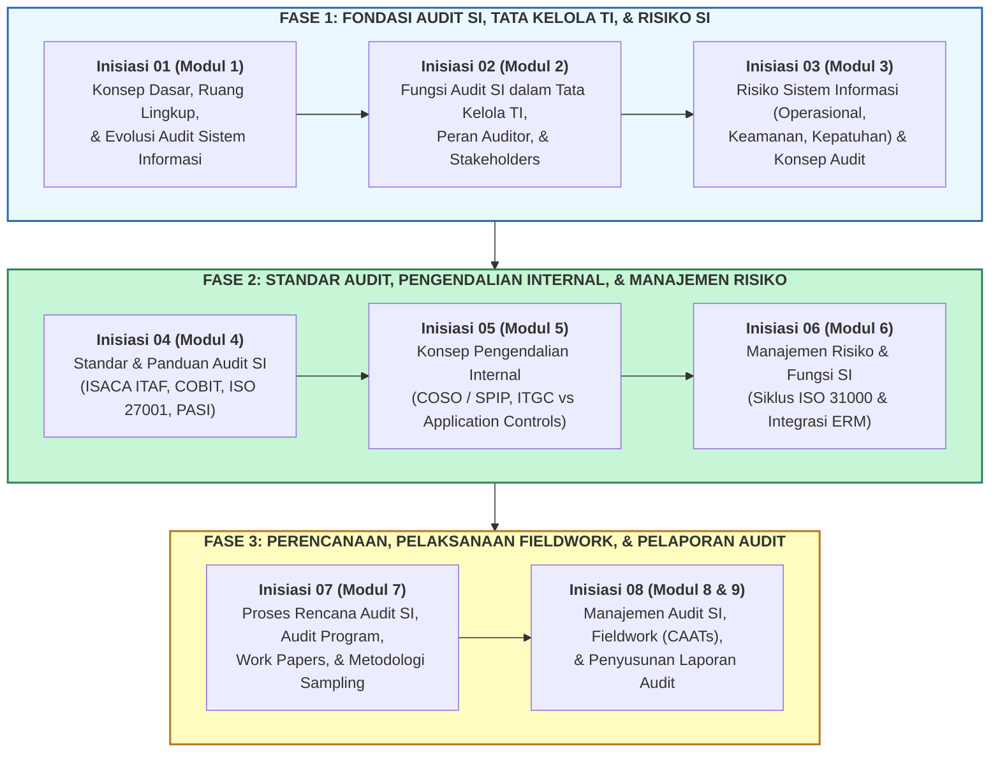

# Manajemen Risiko dan Audit Sistem Informasi (STSI4403)

* **Kode & Nama Mata Kuliah:** `STSI4403` — Manajemen Risiko dan Audit Sistem Informasi (*Information Systems Risk Management and Auditing*)
* **Program Studi:** Sistem Informasi (Program Sarjana) — Fakultas Sains dan Teknologi, Universitas Terbuka
* **Referensi BMP Utama:** Buku Materi Pokok (`BMP`) `MSIM4305` / `STSI4403` — *Manajemen Risiko dan Audit Sistem Informasi* (Modul 1 – Modul 9), Penerbit Universitas Terbuka
* **Platform Tutorial:** LMS Tutorial Online (`Tuton`) Universitas Terbuka & Digital Library UT

---

## Daftar Isi

1. [Deskripsi Mata Kuliah dan Capaian Pembelajaran (CPMK)](#1-deskripsi-mata-kuliah-dan-capaian-pembelajaran-cpmk)
2. [Peta Kompetensi dan Alur Pembelajaran Manajemen Risiko & Audit SI](#2-peta-kompetensi-dan-alur-pembelajaran-manajemen-risiko--audit-si)
3. [Indeks Materi Pertemuan (Inisiasi 01 – Inisiasi 08)](#3-indeks-materi-pertemuan-inisiasi-01--inisiasi-08)
4. [Rincian Rancangan Acara Tutorial Online (RAT STSI4403)](#4-rincian-rancangan-acara-tutorial-online-rat-stsi4403)
5. [Struktur Aktivitas, Komponen Penilaian Tuton, dan Jadwal Tugas Tutorial](#5-struktur-aktivitas-komponen-penilaian-tuton-dan-jadwal-tugas-tutorial)
6. [Daftar Pustaka dan Sumber Belajar Resmi](#6-daftar-pustaka-dan-sumber-belajar-resmi)

---

## 1. Deskripsi Mata Kuliah dan Capaian Pembelajaran (CPMK)

### Deskripsi Singkat Mata Kuliah

Mata kuliah **Manajemen Risiko dan Audit Sistem Informasi (`STSI4403`)** membekali mahasiswa dengan kerangka konseptual, standar internasional, metodologi, dan praktik teknis dalam mengevaluasi pengendalian internal, mengelola risiko teknologi informasi, serta melaksanakan audit sistem informasi secara sistematis. Cakupan pembahasan dimulai dari pengantar dan evolusi audit SI, fungsi auditor dalam tata kelola TI, klasifikasi dan penilaian risiko SI, standar internasional (`COBIT`, `ISO/IEC 27001/27002`, `ITAF` ISACA, `COSO`), pengendalian umum dan aplikasi (`ITGC` vs *Application Controls*), siklus manajemen risiko (`ISO 31000` & `ERM`), perencanaan program audit, hingga pelaksanaan *fieldwork* menggunakan `CAATs` serta penyusunan laporan audit yang efektif.

### Capaian Pembelajaran Mata Kuliah (`CPMK`)

Setelah menempuh mata kuliah **Manajemen Risiko dan Audit Sistem Informasi (`STSI4403`)**, mahasiswa diharapkan mampu:

1. Memahami konsep dasar, ruang lingkup, evolusi, dan urgensi audit sistem informasi dalam organisasi modern.
2. Menjelaskan fungsi audit sistem informasi dalam tata kelola TI, peran auditor internal maupun eksternal, serta pemangku kepentingan (*stakeholders*) audit SI.
3. Mengidentifikasi dan mengklasifikasikan berbagai jenis risiko sistem informasi (operasional, keamanan, kepatuhan, dan strategis) serta menerapkan konsep penilaian risiko dalam audit.
4. Memahami dan mengaplikasikan standar serta kerangka kerja internasional audit SI (`COBIT`, `ISO/IEC 27001/27002`, `ITAF` ISACA, dan `PASI` IASII).
5. Menganalisis komponen pengendalian internal (`COSO` / `SPIP`) serta mengevaluasi efektivitas pengendalian umum TI (`ITGC`) dan pengendalian aplikasi.
6. Memahami siklus manajemen risiko sistem informasi (`ISO 31000`) dan mengintegrasikannya dengan fungsi audit SI dalam kerangka *Enterprise Risk Management* (`ERM`).
7. Menyusun rencana audit sistem informasi (*audit planning*), menetapkan ruang lingkup (*scope*), menyusun program audit (*audit program*), serta menentukan teknik *sampling* dan metodologi audit.
8. Melaksanakan pemeriksaan lapangan (*fieldwork*), mengumpulkan bukti audit berbantuan komputer (`CAATs` / `TABK`), dan menyusun laporan audit sistem informasi yang objektif serta dapat ditindaklanjuti manajemen.

---

## 2. Peta Kompetensi dan Alur Pembelajaran Manajemen Risiko & Audit SI

Berdasarkan **Rancangan Acara Tutorial Online (`RAT` `STSI4403`)**, keseluruhan pembelajaran dibagi menjadi **tiga fase berjenjang** yang mencakup seluruh 9 Modul `BMP`:

---

## 3. Indeks Materi Pertemuan (Inisiasi 01 – Inisiasi 08)

Berikut adalah navigasi langsung ke seluruh file catatan terstruktur untuk setiap sesi tutorial mata kuliah **`STSI4403`**:

| Sesi | Pokok Bahasan | File Catatan Markdown | Fokus Topik & Kerangka Utama |
| :---: | :--- | :--- | :--- |
| **01** | **Audit Sistem Informasi** | [`pertemuan-01/README.md`](./pertemuan-01/README.md) | Definisi & urgensi audit SI, *computer abuse*, 4 tujuan utama, aspek *conformance* vs *performance*, `ITGC`, metodologi `CAAT`, tahapan audit, klasifikasi auditor (`1st/2nd/3rd party`), & prinsip etik auditor. |
| **02** | **Fungsi Audit Sistem Informasi dalam Manajemen Risiko dan Tata Kelola TI** | [`pertemuan-02/README.md`](./pertemuan-02/README.md) | Konvergensi 3 disiplin ilmu audit SI, 3 pilar keamanan (`CIA Triad`) & keseimbangannya, 5 elemen pemeriksaan audit SI, integrasi `ERM`, studi kasus RS Tasikmalaya & Bank BCA, sertifikasi (`CISA`/`CISM`/`CRISC`), & *Risk-Based Audit*. |
| **03** | **Risiko Sistem Informasi dan Konsep Audit** | [`pertemuan-03/README.md`](./pertemuan-03/README.md) | Definisi & dampak risiko SI, hubungan manajemen risiko & audit (`ISO 31000`, `COBIT`, `NIST SP 800-30`), 4 kategori risiko umum SI, framework `COBIT 4.1` (4 domain, 34 proses), studi kasus `NIST SP 800-26` & PT PUSRI, serta *continuous auditing*. |
| **04** | **Standar dan Panduan untuk Audit Sistem Informasi** | [`pertemuan-04/README.md`](./pertemuan-04/README.md) | Urgensi standar audit, Piagam & Surat Tugas Audit, 3 pilar independensi auditor, standar ISACA (`ITAF` Seri 1000/1200/1400), `PASI` (`IASII`), komparasi `COBIT`, `ITIL`, & `ISO/IEC 38500`, serta studi kasus Perusahaan XYZ. |
| **05** | **Konsep Pengendalian Internal** | [`pertemuan-05/README.md`](./pertemuan-05/README.md) | Definisi & 4 pilar pengendalian internal (Krismiaji; PP No. 60/2008), 5 unsur `SPIP` / `COSO`, peran Satuan Pengawasan Internal (`SPI`) di perguruan tinggi, implementasi kontrol pada Sistem Informasi Akademik, & tantangan era digital. |
| **06** | **Manajemen Risiko dan Fungsi Sistem Informasi** | [`pertemuan-06/README.md`](./pertemuan-06/README.md) | Sinergi manajemen risiko & audit SI, 4 tahapan proses manajemen risiko (`ISO 31000`) & 4 opsi *risk treatment*, studi kasus Sistem Informasi Akademik Universitas, peran audit mendukung manajemen risiko TI, & budaya sadar risiko. |
| **07** | **Proses Rencana Audit Sistem Informasi** | [`pertemuan-07/README.md`](./pertemuan-07/README.md) | Empat tahapan siklus rencana audit SI, studi kasus PT Bank Rakyat Indonesia (`BRI`), 8 karakteristik komputerisasi akuntansi, 3 metode EDP Audit (*Around*, *Through*, *With the Computer*), & 7 teknik pemeriksaan `TABK` / `CAATs`. |
| **08** | **Manajemen Audit Sistem Informasi dan Pelaporannya** | [`pertemuan-08/README.md`](./pertemuan-08/README.md) | Tiga pilar manajemen audit SI, 3 pengujian lanjutan (*pengendalian, transaksi, keseimbangan*), 4 komponen & 4 prinsip pelaporan audit efektif, peran manajemen, studi kasus RS Tasikmalaya, & audit ERP `COBIT 4.1` PT Erajaya Swasembada, Tbk. |

---

## 4. Rincian Rancangan Acara Tutorial Online (RAT STSI4403)

Berdasarkan dokumen resmi **Rancangan Acara Tutorial Online (`RAT`) STSI4403**, berikut adalah rincian **Tujuan Pembelajaran**, **Kegiatan Pembelajaran Online**, dan **Aktivitas Forum Diskusi** pada setiap sesi inisiasi:

### Inisiasi 1: Audit Sistem Informasi *(BMP Modul 1)*
* **Tujuan Pembelajaran:**
  1. Memahami konsep dasar audit sistem informasi.
  2. Menjelaskan pentingnya audit SI dalam organisasi.
  3. Mengidentifikasi lingkup dan karakteristik audit SI.
* **Kegiatan Pembelajaran Online:** Mempelajari definisi, ruang lingkup, evolusi audit SI, perbedaan audit tradisional vs audit SI, serta menonton video materi pengayaan.
* **Topik Forum Diskusi:** *Perkembangan teknologi dan praktik audit.*

### Inisiasi 2: Fungsi Audit Sistem Informasi *(BMP Modul 2)*
* **Tujuan Pembelajaran:**
  1. Memahami fungsi audit SI dalam organisasi.
  2. Menjelaskan peran auditor sistem informasi.
  3. Mengidentifikasi *stakeholder* dalam audit SI.
* **Kegiatan Pembelajaran Online:** Mempelajari peran audit SI dalam tata kelola TI, struktur organisasi audit SI, serta menonton video materi pengayaan.
* **Topik Forum Diskusi:** *Perbedaan auditor internal vs eksternal.*

### Inisiasi 3: Risiko Sistem Informasi dan Konsep Audit *(BMP Modul 3)*
* **Tujuan Pembelajaran:**
  1. Mengidentifikasi berbagai jenis risiko dalam SI.
  2. Memahami hubungan antara risiko dan audit SI.
  3. Menerapkan konsep penilaian risiko dalam audit.
* **Kegiatan Pembelajaran Online:** Mempelajari klasifikasi risiko SI (operasional, keamanan, kepatuhan), metodologi identifikasi dan analisis risiko, serta menonton video materi pengayaan.
* **Aktivitas & Tugas:** Forum Diskusi (*Pengalaman risiko SI di organisasi*) + **Tugas Tutorial 1** *(Deadline: 1 minggu setelah Inisiasi 3)*.

### Inisiasi 4: Standar dan Panduan untuk Audit Sistem Informasi *(BMP Modul 4)*
* **Tujuan Pembelajaran:**
  1. Memahami standar internasional audit SI.
  2. Menjelaskan *framework* dan metodologi audit.
  3. Mengaplikasikan standar dalam praktik audit.
* **Kegiatan Pembelajaran Online:** Mempelajari standar `ISO 27001/27002`, kerangka kerja `COBIT`, `COSO`, panduan `ISACA` untuk audit SI, serta menonton video materi pengayaan.
* **Topik Forum Diskusi:** *Penerapan framework audit di berbagai industri.*

### Inisiasi 5: Konsep Pengendalian Internal *(BMP Modul 5)*
* **Tujuan Pembelajaran:**
  1. Memahami konsep dan komponen pengendalian internal.
  2. Menganalisis pengendalian internal dalam lingkungan TI.
  3. Mengevaluasi efektivitas pengendalian internal.
* **Kegiatan Pembelajaran Online:** Mempelajari komponen pengendalian internal menurut `COSO`, perbandingan *General IT Controls* (`ITGC`) vs *Application Controls*, serta menonton video materi pengayaan.
* **Aktivitas & Tugas:** Forum Diskusi (*Tantangan pengendalian internal di cloud computing*) + **Tugas Tutorial 2** *(Deadline: 1 minggu setelah Inisiasi 5)*.

### Inisiasi 6: Manajemen Risiko dan Fungsi Sistem Informasi *(BMP Modul 6)*
* **Tujuan Pembelajaran:**
  1. Memahami proses manajemen risiko dalam konteks SI.
  2. Menjelaskan peran SI dalam mendukung manajemen risiko.
  3. Mengintegrasikan manajemen risiko dengan audit SI.
* **Kegiatan Pembelajaran Online:** Mempelajari siklus manajemen risiko (identifikasi, analisis, evaluasi, *treatment*), integrasi *risk management* dan fungsi audit, serta menonton video materi pengayaan.
* **Topik Forum Diskusi:** *COVID-19 dan perubahan landscape risiko SI.*

### Inisiasi 7: Proses Rencana Audit Sistem Informasi *(BMP Modul 7)*
* **Tujuan Pembelajaran:**
  1. Memahami tahapan perencanaan audit SI.
  2. Menyusun program audit yang efektif.
  3. Menentukan *sampling* dan metodologi audit.
* **Kegiatan Pembelajaran Online:** Mempelajari fase perencanaan dalam *audit lifecycle*, penyusunan *audit program* dan kertas kerja audit (*work papers*), serta menonton video materi pengayaan.
* **Aktivitas & Tugas:** Forum Diskusi (*Faktor dalam menentukan scope audit SI*) + **Tugas Tutorial 3** *(Deadline: 1 minggu setelah Inisiasi 7)*.

### Inisiasi 8: Manajemen Audit Sistem Informasi dan Pelaporan Audit *(BMP Modul 8 & 9)*
* **Tujuan Pembelajaran:**
  1. Memahami proses pelaksanaan audit SI.
  2. Menjelaskan teknik pengumpulan bukti audit.
  3. Menyusun laporan audit yang efektif.
* **Kegiatan Pembelajaran Online:** Mempelajari pelaksanaan *fieldwork* audit SI, pemanfaatan perangkat bantu `CAATs`, struktur dan komponen laporan audit, serta menonton video materi pengayaan.
* **Topik Forum Diskusi:** *Pengalaman audit findings dan komunikasi dengan management.*

---

## 5. Struktur Aktivitas, Komponen Penilaian Tuton, dan Jadwal Tugas Tutorial

### Komposisi Penilaian Tutorial Online (`30%` dari Nilai Akhir Mata Kuliah)

Nilai Tutorial Online (`Tuton`) berkontribusi sebesar **30%** terhadap nilai akhir mata kuliah (dengan syarat memenuhi ketentuan partisipasi UAS), yang terbagi ke dalam **tiga komponen evaluasi**:

| Komponen Penilaian Tuton | Bobot Kontribusi | Keterangan Pelaksanaan |
| :--- | :---: | :--- |
| **1. Kehadiran Online** | **20%** | Keaktifan mengakses materi inisiasi dan aktivitas pembelajaran pada setiap sesi di LMS UT. |
| **2. Diskusi Forum Online** | **30%** | Partisipasi aktif dan kualitas argumentasi akademis pada 8 forum diskusi (Inisiasi 1 – 8). |
| **3. Tugas Tutorial (`TT 1, 2, 3`)** | **50%** | Penyelesaian 3 tugas terstruktur pada Inisiasi 3, Inisiasi 5, dan Inisiasi 7. |

### Alur Jadwal Tugas Tutorial dan Tenggat Waktu (`Deadline`)

```mermaid
flowchart LR
    I12["<b>Inisiasi 1 – 2</b><br/>Konsep & Fungsi Audit SI<br/>(Modul 1 – 2)"]
    I3["<b>Inisiasi 3 (Modul 3)</b><br/>Risiko SI & Konsep Audit<br/><b>+ TUGAS TUTORIAL 1</b>"]
    I4["<b>Inisiasi 4 (Modul 4)</b><br/>Standar & Panduan Audit SI"]
    I5["<b>Inisiasi 5 (Modul 5)</b><br/>Pengendalian Internal<br/><b>+ TUGAS TUTORIAL 2</b>"]
    I6["<b>Inisiasi 6 (Modul 6)</b><br/>Manajemen Risiko & Fungsi SI"]
    I7["<b>Inisiasi 7 (Modul 7)</b><br/>Proses Rencana Audit SI<br/><b>+ TUGAS TUTORIAL 3</b>"]
    I8["<b>Inisiasi 8 (Modul 8 – 9)</b><br/>Pelaksanaan & Pelaporan Audit"]

    I12 --> I3 --> I4 --> I5 --> I6 --> I7 --> I8

    style I3 fill:#fefcbf,stroke:#b7791f,stroke-width:2px
    style I5 fill:#fefcbf,stroke:#b7791f,stroke-width:2px
    style I7 fill:#fefcbf,stroke:#b7791f,stroke-width:2px
    style I12 fill:#ebf8ff,stroke:#2b6cb0
    style I4 fill:#ebf8ff,stroke:#2b6cb0
    style I6 fill:#c6f6d5,stroke:#2f855a
    style I8 fill:#c6f6d5,stroke:#2f855a
```

* **Tugas Tutorial 1 (`TT 1`):** Diberikan pada **Inisiasi 3** (*Deadline*: 1 minggu setelah Inisiasi 3).
* **Tugas Tutorial 2 (`TT 2`):** Diberikan pada **Inisiasi 5** (*Deadline*: 1 minggu setelah Inisiasi 5).
* **Tugas Tutorial 3 (`TT 3`):** Diberikan pada **Inisiasi 7** (*Deadline*: 1 minggu setelah Inisiasi 7).

---

## 6. Daftar Pustaka dan Sumber Belajar Resmi

1. **Buku Materi Pokok (`BMP`) Utama:** *Manajemen Risiko dan Audit Sistem Informasi* (`MSIM4305` / `STSI4403`, Modul 1 – Modul 9), Penerbit Universitas Terbuka (tersedia melalui *Digital Library* UT).
2. **Materi Tutorial Online:** Materi Inisiasi 1 – Inisiasi 8, Video Pembelajaran, E-Book, Webinar Recording, dan Studi Kasus Jurnal Ilmiah (`STSI4403`), LMS Universitas Terbuka.
3. **Standar & Kerangka Kerja Internasional (`RAT`):**
   * **ISACA:** *COBIT Framework* & *IT Assurance Framework (`ITAF`)*.
   * **ISO/IEC:** *ISO/IEC 27001/27002 (Information Security Management)* & *ISO 31000 (Risk Management)*.
   * **COSO:** *Internal Control — Integrated Framework*.
4. **Weber, R.** *Information Systems Control and Audit*. Prentice Hall.
5. **Gondodiyoto, S.** *Audit Sistem Informasi: Pendekatan COBIT*. Jakarta: Mitra Wacana Media.