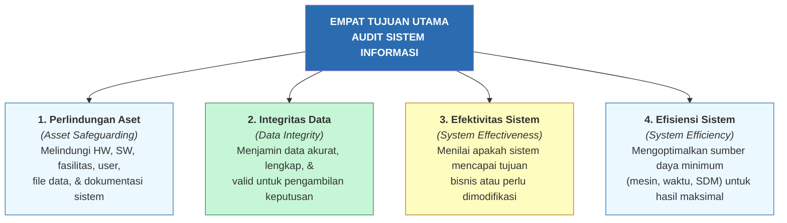
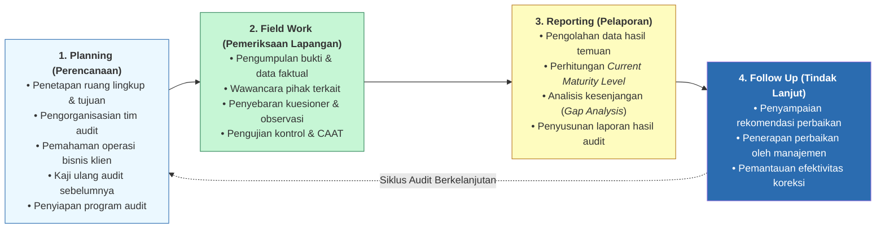
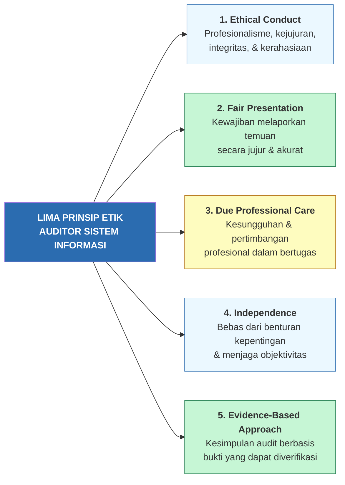

# Pertemuan 01: Pengantar Audit Sistem Informasi dan Pengendalian Internal

* **Mata Kuliah:** Manajemen Risiko dan Audit Sistem Informasi (`STSI4403`)
* **Program Studi:** Sistem Informasi — Fakultas Sains dan Teknologi, Universitas Terbuka
* **Topik:** Pengertian, Urgensi & Tujuan Audit Sistem Informasi, Aspek *Conformance* vs *Performance*, Ruang Lingkup & Jenis-Jenis Audit SI, Kontrol Utama (`ITGC`), Metodologi (`CAAT`) & Tahapan Audit SI, Klasifikasi Pihak Auditor & Auditee, serta Kompetensi dan Prinsip Etik Auditor SI

---

## Daftar Isi

1. [Pengertian dan Urgensi Audit Sistem Informasi](#1-pengertian-dan-urgensi-audit-sistem-informasi)
2. [Empat Tujuan Utama dan Dua Aspek Audit SI](#2-empat-tujuan-utama-dan-dua-aspek-audit-si)
3. [Ruang Lingkup, Jenis-Jenis Audit SI, dan Kontrol Utama (ITGC)](#3-ruang-lingkup-jenis-jenis-audit-si-dan-kontrol-utama-itgc)
4. [Metodologi (CAAT) dan Tahapan Siklus Audit SI](#4-metodologi-caat-dan-tahapan-siklus-audit-si)
5. [Pihak yang Melakukan Audit, Auditee, dan Tugas Auditor SI](#5-pihak-yang-melakukan-audit-auditee-dan-tugas-auditor-si)
6. [Kompetensi, Prinsip Etik, dan Peluang Profesi Auditor SI](#6-kompetensi-prinsip-etik-dan-peluang-profesi-auditor-si)
7. [Referensi Resmi](#7-referensi-resmi)

---

## 1. Pengertian dan Urgensi Audit Sistem Informasi

### Definisi Audit Sistem Informasi

**Audit Sistem Informasi** (*Information Systems Audit*) adalah proses sistematis dalam mengumpulkan dan mengevaluasi bukti-bukti serta fakta untuk menentukan apakah sistem komputer dan informasi yang digunakan oleh organisasi telah dapat melindungi aset organisasi, menjaga integritas data, membantu pencapaian tujuan organisasi secara efektif, serta menggunakan sumber daya secara efisien (Ron Weber; ITGI, 2007).

### Mengapa Audit Sistem Informasi Penting?

Organisasi modern membutuhkan pelaksanaan Audit SI secara berkala untuk menghindari berbagai risiko dan kerugian strategis berikut:

* **Kerugian akibat kehilangan data** (*data loss*) yang melumpuhkan operasional.
* **Kerugian akibat kesalahan pemrosesan komputer** (*processing errors*) yang berdampak pada laporan keuangan maupun transaksi.
* **Pengambilan keputusan yang salah** akibat informasi yang tidak akurat atau tidak lengkap.
* **Kerugian karena penyalahgunaan komputer (*Computer Abuse*)**, yang mencakup:
  * *Tipe Penyalahgunaan:* *Hacking*, penyebaran virus/*malware*, akses fisik ilegal (*illegal physical access*), dan penyalahgunaan hak akses (*abuse of privileges*).
  * *Jenis Dampak:* Perusakan aset (*destruction of asset*), pencurian aset (*theft of asset*), modifikasi aset (*modification of asset*), pelanggaran privasi (*privacy violation*), pengacauan operasi (*disruption of operations*), penyalahgunaan otorisasi aset (*unauthorized use of asset*), serta kejahatan fisik terhadap personel (*physical harm to personnel*).
* **Perlindungan nilai *hardware*, *software*, dan personel SI** serta **pemeliharaan kerahasiaan informasi** dan kepatuhan regulasi.

---

## 2. Empat Tujuan Utama dan Dua Aspek Audit SI

### Empat Tujuan Utama Audit SI

### Dua Aspek Evaluasi Audit SI: *Conformance* vs *Performance*

Audit SI memberikan penilaian yang jelas (*clear assessment*) kepada manajemen puncak melalui dua kelompok aspek evaluasi:

| Aspek Audit SI | Fokus Evaluasi | Indikator / Atribut Utama |
| :--- | :--- | :--- |
| **1. *Conformance* (Kesesuaian)** | Memastikan desain dan implementasi sistem telah memenuhi standar keamanan, kebijakan internal, serta regulasi yang berlaku. | • ***Confidentiality*** (Kerahasiaan) • ***Integrity*** (Integritas) • ***Availability*** (Ketersediaan) • ***Compliance*** (Kepatuhan) |
| **2. *Performance* (Kinerja)** | Memastikan sistem informasi berjalan secara optimal dalam mendukung proses bisnis dan pencapaian target organisasi. | • ***Effectiveness*** (Efektivitas) • ***Efficiency*** (Efisiensi) • ***Reliability*** (Keandalan) |

---

## 3. Ruang Lingkup, Jenis-Jenis Audit SI, dan Kontrol Utama (ITGC)

### Ruang Lingkup Audit Sistem Informasi

1. Mengidentifikasi sistem informasi yang ada di dalam organisasi.
2. Memahami seberapa besar sistem informasi mendukung kebutuhan strategis dan operasional organisasi.
3. Mengetahui bidang, fungsi, kegiatan, atau proses bisnis (*business processes*) yang didukung oleh sistem informasi.
4. Menganalisis tingkat kepentingan data/informasi yang dihasilkan sistem bagi para pemakainya.
5. Mengetahui keterkaitan antara data, sistem pengolahan, dan alur transfer informasi.
6. Mengidentifikasi kesenjangan (*gap*) antara kapabilitas sistem saat ini dengan kebutuhan bisnis.
7. Menyusun peta aliran informasi (*map of information flows*) yang berjalan.

### Empat Jenis Audit Sistem Informasi

* **Audit Pengembangan (*Development Audit*):** Mengevaluasi kontrol dan fitur keamanan yang dibangun sejak tahap awal pengembangan aplikasi baru.
* **Audit Operasi (*Operational Audit*):** Menilai pengendalian dalam lingkungan operasional TI sehari-hari, termasuk proses, prosedur, dan performa sistem.
* **Audit Manajemen (*Management Audit*):** Mengevaluasi praktik manajemen TI, pengawasan pengendalian, dan tata kelola TI (*IT Governance*) secara keseluruhan.
* **Audit Teknologi (*Technical / Technology Audit*):** Berfokus pada teknologi spesifik yang digunakan (seperti basis data, jaringan, atau sistem operasi) untuk mengidentifikasi kerentanan.

### Lima Kontrol Utama dalam Audit SI (*IT General Controls* / `ITGC`)

1. **Keamanan Fisik & Lingkungan:** Pengendalian akses ruang *data center*, pengawasan suhu, serta proteksi fisik aset TI.
2. **Keamanan Logis (*Logical Security*):** Pengaturan hak akses pengguna, autentikasi multi-faktor (`MFA`), dan enkripsi data.
3. **Manajemen Perubahan (*Change Management*):** Prosedur terstruktur untuk menguji, menyetujui, dan mendokumentasikan setiap perubahan sistem.
4. ***Backup* & Pemulihan (*Disaster Recovery Plan* / `DRP`):** Strategi pencadangan data secara rutin dan rencana pemulihan pascabencana.
5. **Manajemen Insiden (*Incident Management*):** Mekanisme deteksi cepat, respons penanganan, dan pelaporan insiden keamanan maupun operasional.

---

## 4. Metodologi (CAAT) dan Tahapan Siklus Audit SI

### Metodologi Audit SI dan *Computer Aided Auditing Technique* (`CAAT`)

Dalam mengumpulkan bukti yang memadai, auditor TI menerapkan teknik survei, wawancara, observasi, dan tinjauan dokumentasi (*documentation review*). Karena bukti audit SI didominasi oleh **bukti elektronis**, auditor menerapkan **CAAT (*Computer Aided Auditing Technique*)**—yakni teknik audit berbantuan komputer untuk menganalisis volume data transaksi secara langsung (seperti data penjualan, pembelian, persediaan, dan aktivitas nasabah).

### Empat Tahapan Siklus Audit Sistem Informasi

---

## 5. Pihak yang Melakukan Audit, Auditee, dan Tugas Auditor SI

### Klasifikasi Pihak Pelaksana Audit (*First, Second, & Third Party Audit*)

| Jenis Audit | Pihak Pelaksana | Tujuan Utama Pelaksanaan |
| :--- | :--- | :--- |
| ***First-Party Audit* (Audit Internal)** | Dilakukan oleh auditor internal atau atas nama organisasi itu sendiri. | Untuk *management review*, evaluasi pengendalian internal, dan perbaikan berkelanjutan perusahaan. |
| ***Second-Party Audit*** | Dilakukan oleh pihak eksternal yang memiliki kepentingan bisnis langsung terhadap perusahaan (misal: klien atau mitra). | Memastikan vendor/mitra memenuhi standar keamanan dan persyaratan kontrak kerja sama. |
| ***Third-Party Audit*** | Dilakukan oleh lembaga audit independen di luar perusahaan. | Untuk tujuan sertifikasi standar internasional (seperti `ISO/IEC 27001`, `ISO 9001`, atau `BS7799`) dan kepatuhan regulasi. |

### Pihak yang Diaudit (*Auditee*) — Studi Kasus Sistem Informasi Akademik UT

* **Manajemen (*Management*):** Rektor, Wakil Rektor, Dekan (pada skala perusahaan: Direksi/Manajemen Puncak).
* **Manajer TI (*IT Manager*):** Kepala UPT TIK (bertanggung jawab atas tata kelola layanan TI).
* **Spesialis TI (*IT Specialist*):** *Network administrator*, *database administrator*, *system analyst*, dan *programmer*.
* **Pengguna (*User*):** Dosen, mahasiswa, dan staf pengguna sistem di unit kerja.

### Tugas Utama dan Output Laporan Auditor SI

* **Tugas Pokok Auditor SI:** Memastikan setiap sisi penerapan TI memiliki kontrol yang diperlukan serta memastikan kontrol tersebut berjalan efektif sesuai harapan melalui tahapan persiapan, *review* dokumen, *on-site audit*, distribusi laporan, dan *follow-up audit*.
* **Komponen Output Laporan Audit:** Mencakup **ruang lingkup audit**, **metodologi**, **temuan-temuan**, **rincian ketidaksesuaian** (sifat, bukti pendukung, syarat yang tidak dipenuhi, lokasi, dan tingkat ketidaksesuaian), serta **kesimpulan dan rekomendasi**.

---

## 6. Kompetensi, Prinsip Etik, dan Peluang Profesi Auditor SI

### Tiga Pilar Kompetensi Auditor SI

1. ***Audit Skills*:** Kemampuan teknis audit meliputi teknik *sampling*, komunikasi efektif, wawancara (*interview*), penyusunan pertanyaan kritis, dan pencatatan bukti.
2. ***Generic Knowledge*:** Pengetahuan umum mengenai prinsip-prinsip audit, prosedur dan teknik evaluasi, sistem manajemen, dokumen referensi, tata kelola organisasi, serta regulasi yang berlaku.
3. ***Specific Knowledge*:** Latar belakang keilmuan IT/IS, pemahaman proses bisnis, keahlian teknis spesialis (*database*, jaringan, keamanan), serta pengalaman audit sistem manajemen dan perundangan TI.

### Lima Prinsip Etik Seorang Auditor SI

### Peluang Profesi Auditor SI
Ketergantungan organisasi terhadap sistem informasi yang semakin tinggi mendorong meningkatnya kebutuhan akan auditor SI profesional—terutama mengingat banyaknya permasalahan bisnis dalam pengelolaan TI serta masih banyaknya auditor saat ini yang belum memiliki latar belakang teknis IT/IS yang memadai.

---

## 7. Referensi Resmi

1. **Modul Tutorial Online UT:** Materi Inisiasi 1 — *Audit Sistem Informasi*, Mata Kuliah Manajemen Risiko dan Audit Sistem Informasi (`STSI4403`), Universitas Terbuka.
2. **Materi Pengayaan UT:** *Kontrol Audit Sistem Informasi: Menjaga Keamanan dan Integritas Data*, Program Studi Sistem Informasi, Universitas Terbuka.
3. **IT Governance Institute (ITGI).** (2007). *IT Assurance Guide: Using COBIT*. Rolling Meadows, IL: ITGI.
4. **Weber, R.** *Information Systems Control and Audit*. Prentice Hall.
5. **Buku Fraud & Auditing.** (2014).