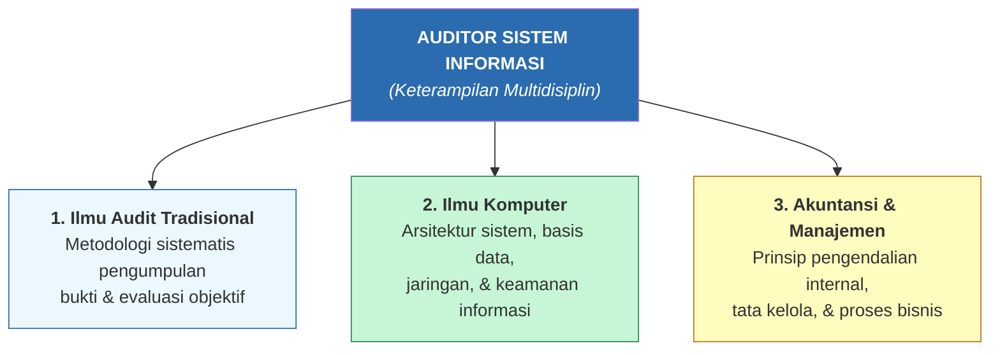
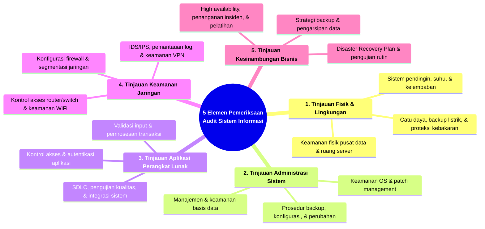
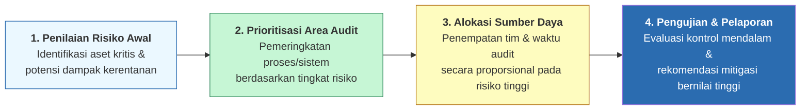

# Pertemuan 02: Fungsi Audit Sistem Informasi dalam Manajemen Risiko dan Tata Kelola TI

* **Mata Kuliah:** Manajemen Risiko dan Audit Sistem Informasi (`STSI4403`)
* **Program Studi:** Sistem Informasi — Fakultas Sains dan Teknologi, Universitas Terbuka
* **Topik:** Konvergensi Disiplin Ilmu Audit SI, Empat Tujuan Utama & Tiga Pilar Keamanan (`CIA Triad`), Lima Elemen Pemeriksaan Audit SI, Integrasi Audit SI dengan *Enterprise Risk Management* (`ERM`), Manfaat Strategis & Studi Kasus Implementasi, serta Tantangan, Sertifikasi, dan Pendekatan Audit Berbasis Risiko (*Risk-Based Audit*)

---

## Daftar Isi

1. [Konsep Multidisiplin dan Empat Tujuan Utama Audit Sistem Informasi](#1-konsep-multidisiplin-dan-empat-tujuan-utama-audit-sistem-informasi)
2. [Tiga Pilar Keamanan dalam Audit SI (CIA Triad) dan Keseimbangannya](#2-tiga-pilar-keamanan-dalam-audit-si-cia-triad-dan-keseimbangannya)
3. [Lima Elemen Utama Pemeriksaan Audit Sistem Informasi](#3-lima-elemen-utama-pemeriksaan-audit-sistem-informasi)
4. [Peran Audit SI dalam Manajemen Risiko dan Integrasi ERM](#4-peran-audit-si-dalam-manajemen-risiko-dan-integrasi-erm)
5. [Manfaat Audit SI dan Studi Kasus Implementasi Organisasi](#5-manfaat-audit-si-dan-studi-kasus-implementasi-organisasi)
6. [Tantangan Modern, Sertifikasi Profesi, dan Audit Berbasis Risiko](#6-tantangan-modern-sertifikasi-profesi-dan-audit-berbasis-risiko)
7. [Referensi Resmi](#7-referensi-resmi)

---

## 1. Konsep Multidisiplin dan Empat Tujuan Utama Audit Sistem Informasi

### Konvergensi Disiplin Ilmu pada Audit Sistem Informasi

Menurut **Ron Weber (2010)**, **Audit Sistem Informasi** adalah proses sistematis pengumpulan dan evaluasi bukti untuk memastikan sistem komputer melindungi aset, menjaga integritas data, dan mendukung tujuan organisasi secara efektif. Bidang ini merupakan perpaduan kompleks dari **tiga disiplin ilmu utama** yang dipicu oleh meningkatnya ketergantungan pada TI serta kewajiban regulasi seperti **`SOX` (*Sarbanes-Oxley Act*)**, **`GDPR`**, dan standar **`ISO/IEC 27001`**:

### Empat Tujuan Utama Audit Sistem Informasi

| Tujuan Utama | Fokus Perlindungan dan Evaluasi | Indikator Keberhasilan |
| :--- | :--- | :--- |
| **1. Mengamankan Aset Perusahaan** | Melindungi aset TI organisasi yang meliputi *hardware* (peladen, komputer, perangkat jaringan), *software* (aplikasi, sistem operasi, utilitas), data (pelanggan, keuangan), serta sumber daya manusia (kapabilitas staf TI). | Aset fisik maupun digital terlindungi dari kerusakan, pencurian, dan akses ilegal. |
| **2. Menjaga Integritas Data** | Memastikan keandalan data organisasi sebagai landasan keputusan bisnis yang akurat. | Data bersifat **lengkap** (tidak terpotong), **akurat** (mencerminkan realitas transaksi), **konsisten** (bebas kontradiksi), dan **dapat dipercaya** (bebas manipulasi). |
| **3. Meningkatkan Efektivitas Sistem** | Memastikan sistem informasi memenuhi kebutuhan pengguna dan selaras dengan tujuan strategis bisnis. | Sistem menghasilkan informasi relevan untuk pengambilan keputusan dan menyediakan fungsionalitas tepat waktu. |
| **4. Meningkatkan Efisiensi Sistem** | Memastikan penggunaan sumber daya TI secara optimal dengan biaya minimal. | Penghilangan redundansi dan pemborosan proses, optimalisasi waktu respons sistem, serta efisiensi biaya operasional TI. |

---

## 2. Tiga Pilar Keamanan dalam Audit SI (CIA Triad) dan Keseimbangannya

Auditor sistem informasi mengevaluasi efektivitas kontrol berdasarkan tiga pilar fundamental keamanan informasi (**`CIA Triad`**) yang menjadi dasar standar **`ISO 27001`** dan kerangka kerja **`COBIT`**:

1. ***Confidentiality* (Kerahasiaan):** Memastikan informasi sensitif hanya diakses oleh pihak yang berwenang melalui kebijakan kontrol akses ketat, enkripsi data saat disimpan (*at rest*) maupun ditransmisikan (*in transit*), serta pencegahan kebocoran informasi.
2. ***Integrity* (Integritas):** Menjamin data tetap akurat, andal, dan terjaga keasliannya melalui kontrol validasi *input* dan pemrosesan, pencatatan jejak audit (*audit trail*) yang komprehensif, serta pemeriksaan konsistensi data secara berkala.
3. ***Availability* (Ketersediaan):** Memastikan sistem informasi selalu siap dan dapat diakses saat dibutuhkan operasional bisnis dengan tingkat *uptime* tinggi, perlindungan terhadap gangguan layanan, serta rencana pemulihan bencana (*Disaster Recovery Plan*) yang komprehensif.

> **Prinsip Keseimbangan `CIA Triad`:** Keseimbangan di antara ketiga pilar ini sangat krusial. Fokus berlebihan pada satu aspek dapat melemahkan aspek lainnya—sebagai contoh, penerapan kontrol akses kerahasiaan (*confidentiality*) yang terlalu kaku dan berlapis dapat menghambat ketersediaan (*availability*) akses sistem bagi pengguna sah saat keadaan darurat.

---

## 3. Lima Elemen Utama Pemeriksaan Audit Sistem Informasi

Pemeriksaan menyeluruh dalam audit sistem informasi mencakup **lima elemen infrastruktur dan tata kelola TI** berikut:

---

## 4. Peran Audit SI dalam Manajemen Risiko dan Integrasi ERM

### Tiga Fungsi Audit SI dalam Manajemen Risiko

Audit sistem informasi terintegrasi langsung dengan kerangka **Enterprise Risk Management (`ERM`)** organisasi sebagai sistem peringatan dini (*early warning system*) melalui tiga fungsi utama:

1. **Identifikasi Risiko (*Risk Identification*):** Mengungkap berbagai kerentanan dan ancaman terhadap aset TI, pilar `CIA` data, kepatuhan regulasi, maupun kelangsungan operasional bisnis (seperti kerentanan aplikasi, akses tidak sah, *downtime* layanan, dan kehilangan data).
2. **Penilaian Efektivitas Kontrol (*Control Effectiveness Assessment*):** Mengevaluasi sejauh mana pengendalian yang terpasang mampu mencegah risiko, mendeteksi pelanggaran keamanan, memitigasi dampak insiden, dan mempercepat pemulihan layanan.
3. **Dukungan Pengambilan Keputusan (*Decision Support*):** Memberikan basis data objektif kepada manajemen puncak untuk mengalokasikan anggaran keamanan berdasarkan tingkat risiko, menentukan investasi teknologi tepat sasaran, dan menyusun strategi perbaikan tata kelola TI.

---

## 5. Manfaat Audit SI dan Studi Kasus Implementasi Organisasi

### Empat Manfaat Strategis Audit SI

* **Meningkatkan Kepercayaan terhadap Sistem Informasi:** Memberikan jaminan independen bahwa sistem bekerja sesuai spesifikasi dan data dapat diandalkan.
* **Memastikan Kepatuhan Regulasi dan Standar:** Memenuhi ketentuan hukum seperti **`UU ITE`**, regulasi sektoral, sertifikasi **`ISO 27001`**, serta praktik terbaik **`COBIT`** dan **`ITIL`** guna menghindari denda maupun sanksi.
* **Mengurangi Risiko *Fraud* dan Kesalahan Operasional:** Mendeteksi aktivitas mencurigakan lebih awal, mencegah penyalahgunaan internal/eksternal, serta meminimalkan kesalahan transaksi.
* **Mendukung Kelangsungan Bisnis dan Pengambilan Keputusan:** Meningkatkan ketahanan operasional, kualitas analitik bisnis, dan efisiensi investasi TI.

### Studi Kasus Nyata Dampak Audit Sistem Informasi

| Studi Kasus Organisasi | Permasalahan & Temuan Audit | Rekomendasi & Dampak Terukur |
| :--- | :--- | :--- |
| **Sistem Informasi Rumah Sakit Tasikmalaya** | Sistem lambat saat jam sibuk, antrean pasien panjang, tagihan tidak akurat, minim dokumentasi `SOP`, pelatihan kurang, *backup* tidak teruji, perangkat keras usang, dan kontrol akses data pasien lemah. | *Upgrade* perangkat keras, penyusunan `SOP`, pelatihan rutin, integrasi aplikasi antardepartemen, kontrol akses berlapis, dan uji *backup* berkala. **Hasil:** Kecepatan sistem meningkat **60%**, antrean berkurang **75%**, dan akurasi data tagihan naik hingga **90%**. |
| **Bank BCA** | Kebutuhan penguatan pertahanan layanan perbankan digital terhadap ancaman keamanan siber yang terus berkembang. | Implementasi rekomendasi hasil audit sistem informasi tahunan secara konsisten. **Hasil:** Insiden keamanan berkurang **45%** dan kepuasan pelanggan layanan digital meningkat **30%** dalam dua tahun terakhir. |

---

## 6. Tantangan Modern, Sertifikasi Profesi, dan Audit Berbasis Risiko

### Tiga Tantangan Audit SI Modern dan Keterampilan Auditor

* **Tantangan Utama:**
  1. **Kompleksitas Sistem:** Arsitektur *hybrid cloud*, *Internet of Things* (`IoT`), dan integrasi lintas platform yang luas.
  2. **Kecepatan Perubahan:** Evolusi teknologi dan ancaman siber baru menuntut metodologi audit yang adaptif.
  3. **Volume Data:** Pertumbuhan data eksponensial (*Big Data*) menyulitkan pengujian populasi secara manual.
* **Keterampilan & Sertifikasi Profesional:** Auditor SI wajib menjaga independensi, objektivitas, serta memadukan **keterampilan teknis**, **keterampilan audit**, dan **keterampilan bisnis**. Standar kompetensi profesi global diakui melalui sertifikasi seperti **`CISA`** (*Certified Information Systems Auditor*), **`CISM`** (*Certified Information Security Manager*), dan **`CRISC`** (*Certified in Risk and Information Systems Control*).

### Pendekatan Audit Berbasis Risiko (*Risk-Based Audit*)

Untuk mengatasi keterbatasan waktu dan sumber daya di tengah kompleksitas infrastruktur modern, auditor menerapkan **Audit Berbasis Risiko (*Risk-Based Audit*)** dengan memfokuskan pemeriksaan pada area berisiko tertinggi:

---

## 7. Referensi Resmi

1. **Modul Tutorial Online UT:** Materi Inisiasi 2 — *Fungsi Audit Sistem Informasi dalam Manajemen Risiko dan Audit Sistem Informasi*, Mata Kuliah Manajemen Risiko dan Audit Sistem Informasi (`STSI4403`), Universitas Terbuka.
2. **Buku Materi Pokok (BMP) UT:** *Manajemen Risiko dan Audit Sistem Informasi* (`STSI4403`), Program Studi Sistem Informasi, Universitas Terbuka.
3. **Weber, R.** (2010). *Information Systems Control and Audit*. Prentice Hall.
4. **ISACA.** *COBIT Framework & CISA Review Manual*. Information Systems Audit and Control Association.
5. **ISO/IEC 27001.** *Information Security Management Systems — Requirements*. International Organization for Standardization.