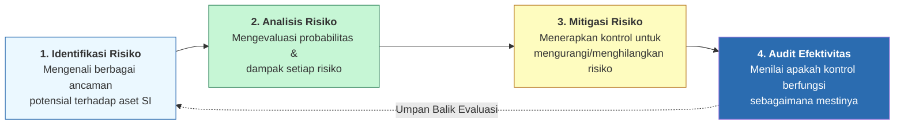
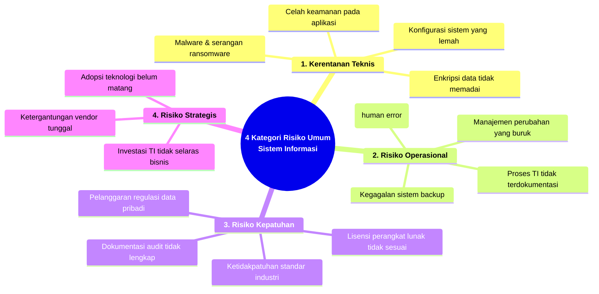
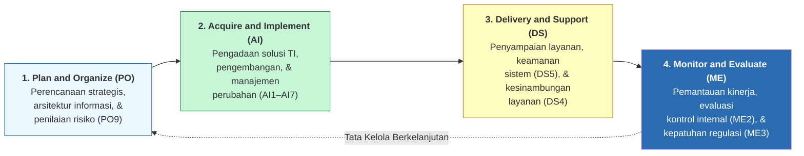

# Pertemuan 03: Risiko Sistem Informasi dan Manajemen Audit Menggunakan Kerangka Kerja COBIT

* **Mata Kuliah:** Manajemen Risiko dan Audit Sistem Informasi (`STSI4403`)
* **Program Studi:** Sistem Informasi — Fakultas Sains dan Teknologi, Universitas Terbuka
* **Topik:** Definisi, Contoh & Dampak Risiko Sistem Informasi, Siklus Hubungan Manajemen Risiko & Audit SI (`ISO 31000`, `COBIT`, `NIST SP 800-30`), Empat Kategori Risiko Umum dalam SI, Kerangka Kerja Tata Kelola TI `COBIT 4.1` & Ancaman Internal vs Eksternal, Studi Kasus Audit Keamanan (`NIST SP 800-26`) & Tata Kelola Risiko (`COBIT 4.1`), serta Peran dan Tantangan Era *Continuous Auditing*

---

## Daftar Isi

1. [Konsep, Contoh, dan Dampak Risiko Sistem Informasi](#1-konsep-contoh-dan-dampak-risiko-sistem-informasi)
2. [Hubungan Manajemen Risiko, Kerangka Kerja Standar, dan Tahapan Audit SI](#2-hubungan-manajemen-risiko-kerangka-kerja-standar-dan-tahapan-audit-si)
3. [Empat Kategori Risiko Umum dalam Sistem Informasi](#3-empat-kategori-risiko-umum-dalam-sistem-informasi)
4. [Manajemen Audit dan Tata Kelola Risiko dengan Framework COBIT 4.1](#4-manajemen-audit-dan-tata-kelola-risiko-dengan-framework-cobit-41)
5. [Studi Kasus Evaluasi: NIST SP 800-26 dan COBIT 4.1 (PT Pupuk Sriwidjaja)](#5-studi-kasus-evaluasi-nist-sp-800-26-dan-cobit-41-pt-pupuk-sriwidjaja)
6. [Peran Kompetensi GRC dan Paradigma Continuous Auditing di Era Digital](#6-peran-kompetensi-grc-dan-paradigma-continuous-auditing-di-era-digital)
7. [Referensi Resmi](#7-referensi-resmi)

---

## 1. Konsep, Contoh, dan Dampak Risiko Sistem Informasi

### Definisi Risiko Sistem Informasi

**Risiko Sistem Informasi (*Information Systems Risk*)** adalah setiap ancaman potensial yang dapat mengeksploitasi kerentanan sehingga mengganggu **integritas**, **kerahasiaan**, dan **ketersediaan** (`CIA`) data serta layanan teknologi informasi di dalam suatu organisasi.

| Dimensi Risiko SI | Rincian Manifestasi di Lingkungan Organisasi |
| :--- | :--- |
| **Contoh Sumber Risiko SI** | • **Serangan Siber:** *Ransomware*, *phishing*, dan eksploitasi *malware*. • **Kegagalan Infrastruktur Sistem:** Kerusakan perangkat keras peladen, jaringan terputus, atau kegagalan daya. • **Kesalahan Manusia (*Human Error*):** Kelalaian konfigurasi maupun kesalahan input operasional. • **Kebocoran Data Sensitif:** Eksposur data pelanggan, finansial, maupun kekayaan intelektual. |
| **Dampak Kerugian Risiko SI** | • **Kerugian finansial yang signifikan** akibat biaya pemulihan, denda, dan hilangnya pendapatan. • **Penurunan reputasi dan kredibilitas organisasi** di mata pelanggan serta mitra bisnis. • **Gangguan operasional berkelanjutan** (*business disruption*) yang melumpuhkan layanan utama. • **Pelanggaran kepatuhan regulasi** yang berujung pada sanksi hukum. |

---

## 2. Hubungan Manajemen Risiko, Kerangka Kerja Standar, dan Tahapan Audit SI

### Siklus Integrasi Manajemen Risiko dan Audit Sistem Informasi

Audit SI berfungsi memvalidasi apakah proses manajemen risiko telah berjalan secara efektif. Ketiga standar rujukan utamanya meliputi **`ISO 31000`** (manajemen risiko umum), **`COBIT`** (tata kelola dan pengendalian TI), serta **`NIST SP 800-30`** (panduan penilaian risiko keamanan informasi).

### Empat Tahapan Pelaksanaan Audit Risiko Sistem Informasi

1. **Perencanaan Audit (*Audit Planning*):** Menentukan ruang lingkup dan tujuan audit, mengidentifikasi sumber daya yang dibutuhkan, serta menyusun jadwal dan metodologi pemeriksaan.
2. **Pengumpulan Bukti (*Evidence Collection*):** Melakukan wawancara dengan personel TI, observasi langsung terhadap operasional sistem, serta pengujian kontrol teknis maupun manual.
3. **Evaluasi Risiko (*Risk Evaluation*):** Menganalisis kerentanan yang ditemukan, menilai potensi dampak bisnisnya, dan memprioritaskan temuan berdasarkan tingkat risiko (*risk rating*).
4. **Pelaporan & Tindak Lanjut (*Reporting & Follow-Up*):** Menyusun laporan temuan beserta rekomendasi mitigasi, mempresentasikan hasil kepada manajemen, dan memantau implementasi perbaikan.

---

## 3. Empat Kategori Risiko Umum dalam Sistem Informasi

Dalam praktik audit sistem informasi, temuan risiko yang sering dijumpai dikelompokkan ke dalam **empat kategori utama**:

---

## 4. Manajemen Audit dan Tata Kelola Risiko dengan Framework COBIT 4.1

### Konsep dan Empat Domain Utama `COBIT 4.1`

**COBIT (*Control Objectives for Information and Related Technology*)** adalah kerangka kerja tata kelola TI yang dikembangkan oleh **ISACA** dan **IT Governance Institute (`ITGI`, 2007)** untuk menjembatani kebutuhan bisnis perusahaan dengan pengendalian teknis TI. **`COBIT 4.1`** membagi pengelolaan TI secara *end-to-end* ke dalam **4 domain utama**, **34 proses TI**, dan **210 *detailed control objectives***:

### Karakteristik Ancaman Keamanan Informasi: Internal vs Eksternal

Berdasarkan kajian literatur keamanan sistem informasi dalam jurnal studi kasus `COBIT 4.1`:

* **Ancaman Internal:** Berasal dari pegawai tetap, pegawai sementara, konsultan, kontraktor, maupun mitra bisnis. Survei menunjukkan sekitar **49% kejadian yang membahayakan keamanan informasi dilakukan oleh pengguna sah**, dan diperkirakan **81% kejahatan komputer dilakukan oleh pegawai internal**. Ancaman internal jauh lebih berbahaya karena pelaku memiliki pengetahuan mendalam mengenai arsitektur dan celah sistem di dalam perusahaan, sehingga kontrol internal harus dirancang bersifat **prediktif dan preventif**.
* **Ancaman Eksternal:** Berasal dari pihak luar organisasi; kontrol pengamanan terhadap ancaman eksternal umumnya baru aktif bekerja secara reaktif ketika upaya serangan terdeteksi di perimeter jaringan.

---

## 5. Studi Kasus Evaluasi: NIST SP 800-26 dan COBIT 4.1 (PT Pupuk Sriwidjaja)

### Studi Kasus 1: Audit Keamanan SI Akademik (`NIST SP 800-26`)

Penerapan kerangka **`NIST SP 800-26`** pada audit keamanan Sistem Informasi Akademik di Universitas Sangga Buana YPKP Bandung menghasilkan temuan kuantitatif sebagai berikut:

* **Skor Keamanan Keseluruhan:** **`72,43%`** (menunjukkan kontrol prosedural telah berjalan cukup baik, namun masih menyisakan celah signifikan).
* **Total Kerentanan Teridentifikasi:** Ditemukan kerentanan lintas tingkat keparahan, termasuk **4 kerentanan tingkat tinggi (*high risk*)** dan **40 kerentanan tingkat sedang (*medium risk*)** yang memerlukan mitigasi segera.
* **Tiga Area Fokus Perbaikan:** Penguatan pada **kontrol manajemen**, **kontrol teknis**, dan **kontrol operasional**.

### Studi Kasus 2: Evaluasi Tata Kelola Manajemen Risiko (`COBIT 4.1` di PT Pupuk Sriwidjaja)

Penelitian audit tata kelola TI bagian manajemen risiko di **PT Pupuk Sriwidjaja (PT PUSRI)** menggunakan kuesioner, wawancara, dan perhitungan tingkat kematangan (*Maturity Level* skala $0$–$5$) pada proses pendukung primer dan sekunder menghasilkan capaian **rata-rata keseluruhan sebesar $2,8$** (*Defined Process* — prosedur sudah terdokumentasi dan dilaksanakan):

| Kelompok Proses | Domain `COBIT 4.1` | Proses TI yang Dievaluasi | Nilai *Maturity Level* | Interpretasi Kondisi Tata Kelola |
| :--- | :--- | :--- | :---: | :--- |
| **Proses Pendukung Primer** | **Plan and Organize (`PO`)** | `PO4`, `PO6`, `PO9` | **$3,3$** | Baik; prosedur manajemen risiko dan komunikasi kebijakan telah tersedia dan dijalankan. |
| **Proses Pendukung Primer** | **Delivery and Support (`DS`)** | `DS2`, `DS4`, `DS5`, `DS11`, `DS12` | **$2,5$** | Cukup baik; prosedur tersedia namun belum sepenuhnya dilaksanakan secara konsisten (terutama `DS2` pada nilai $1,0$). |
| **Proses Pendukung Primer** | **Monitor and Evaluate (`ME`)** | `ME2`, `ME3`, `ME4` | **$4,0$** | Ideal (*Managed and Measurable*); prosedur berjalan efektif disertai pengawasan aktif manajemen. |
| **Proses Pendukung Sekunder** | **Plan and Organize (`PO`)** | `PO1`, `PO2`, `PO3`, `PO7`, `PO8`, `PO10` | **$3,0$** | Baik; perencanaan strategis dan pengelolaan proyek TI sudah terstandarisasi. |
| **Proses Pendukung Sekunder** | **Acquire and Implement (`AI`)** | `AI1`, `AI2`, `AI4`, `AI7` | **$2,8$** | Baik; prosedur pengadaan, implementasi solusi, dan manajemen perubahan telah berjalan. |
| **Proses Pendukung Sekunder** | **Delivery and Support (`DS`)** | `DS3`, `DS7`, `DS9`, `DS10` | **$3,0$** | Baik; pengelolaan kapasitas, konfigurasi, dan penanganan insiden sudah dilaksanakan. |
| **Proses Pendukung Sekunder** | **Monitor and Evaluate (`ME`)** | `ME1` | **$3,3$** | Baik; pemantauan dan evaluasi kinerja proses TI telah berjalan teratur. |

---

## 6. Peran Kompetensi GRC dan Paradigma Continuous Auditing di Era Digital

### Empat Pilar Kompetensi Mahasiswa SI di Bidang *Governance, Risk, and Compliance* (`GRC`)

1. **Pemahaman Konseptual:** Menguasai teori dasar audit SI, pengendalian internal, dan kerangka manajemen risiko.
2. **Keterampilan Teknis:** Mampu melakukan identifikasi risiko, pengujian kontrol, dan pemanfaatan perangkat lunak audit maupun analisis kerentanan.
3. **Kontribusi Organisasional:** Berperan aktif dalam perumusan kebijakan keamanan informasi, `SOP` tata kelola TI, dan implementasi standar audit.
4. **Pengembangan Profesional:** Mempersiapkan kualifikasi sertifikasi profesi global seperti **`CISA`** (*Certified Information Systems Auditor*) maupun **`CRISC`** (*Certified in Risk and Information Systems Control*).

### Tantangan Kontemporer dan Transisi Menuju *Continuous Auditing*

Perkembangan teknologi baru seperti ***cloud computing***, ***Internet of Things* (`IoT`)**, dan **kecerdasan buatan (`AI`)** menghadirkan kompleksitas ancaman siber serta perubahan regulasi privasi data yang sangat cepat. Untuk menjawab keterbatasan audit konvensional yang bersifat periodik, era digital mendorong inovasi:

* **Implementasi Audit Berbasis Risiko (*Risk-Based Auditing*)** yang adaptif terhadap perubahan profil ancaman.
* **Pemanfaatan Teknologi Audit Otomatis dan Analitik Data** untuk menguji seluruh populasi transaksi.
* **Integrasi Keamanan dalam Siklus Pengembangan (*DevSecOps*)** dan penerapan paradigma ***Continuous Auditing*** guna mendeteksi serta memitigasi risiko secara *real-time*.

---

## 7. Referensi Resmi

1. **Modul Tutorial Online UT:** Materi Inisiasi 3 — *Risiko Sistem Informasi dalam Audit*, Mata Kuliah Manajemen Risiko dan Audit Sistem Informasi (`STSI4403`), Universitas Terbuka.
2. **Studi Kasus Pengayaan UT:** Harris, I., Tarigan, M. L. A., & Mawlan, S. *Analisis Manajemen Risiko pada Implementasi Sistem Informasi Keamanan di PT. Pupuk Sriwidjaja dengan Framework COBIT 4.1*. Jurusan Sistem Informasi, STMIK GI MDP.
3. **IT Governance Institute (ITGI).** (2007). *COBIT 4.1: Framework, Control Objectives, Management Guidelines, Maturity Models*. Rolling Meadows, IL: ITGI.
4. **National Institute of Standards and Technology (NIST).** *NIST Special Publication 800-30 (Risk Management Guide)* & *NIST Special Publication 800-26 (Security Self-Assessment Guide for Information Technology Systems)*.
5. **ISO 31000.** *Risk Management — Principles and Guidelines*. International Organization for Standardization.
6. **Jogiyanto & Abdillah, W.** (2011). *Sistem Tata Kelola Teknologi Informasi*. Yogyakarta: Penerbit Andi.