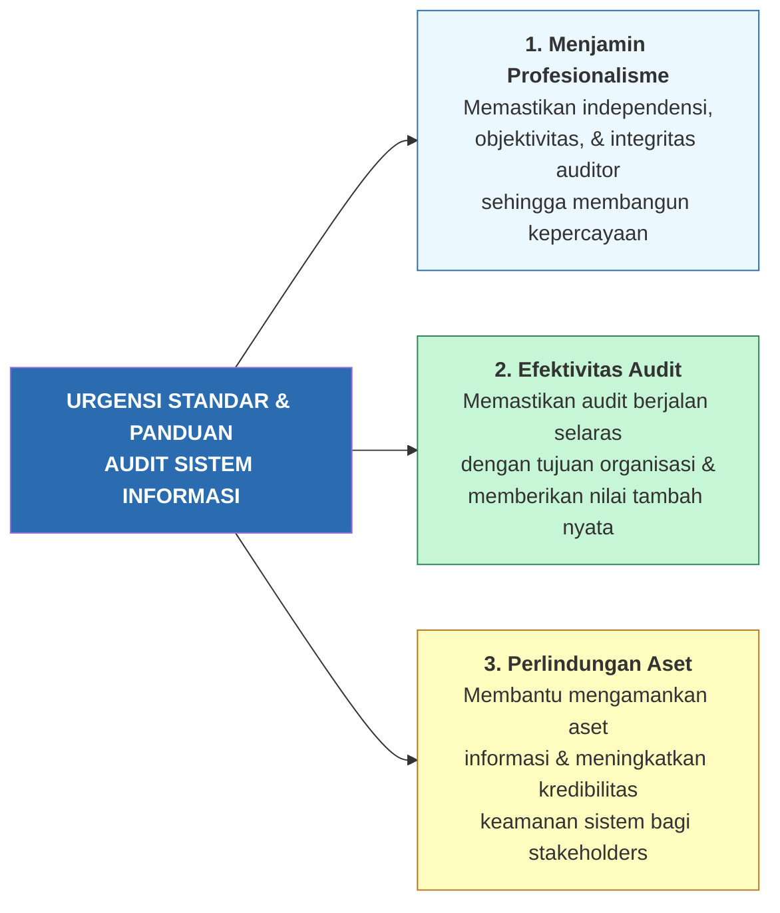
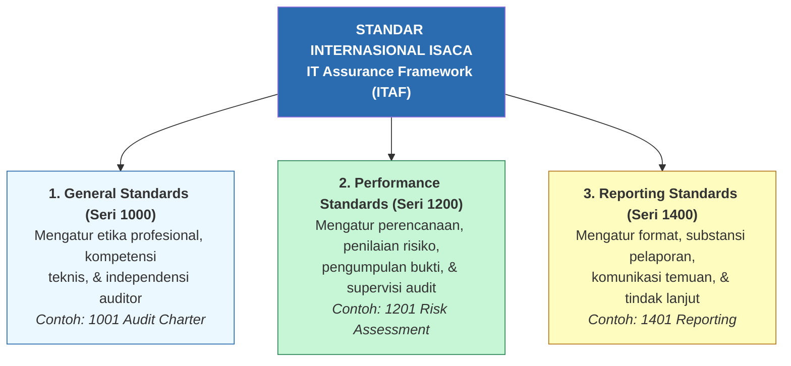
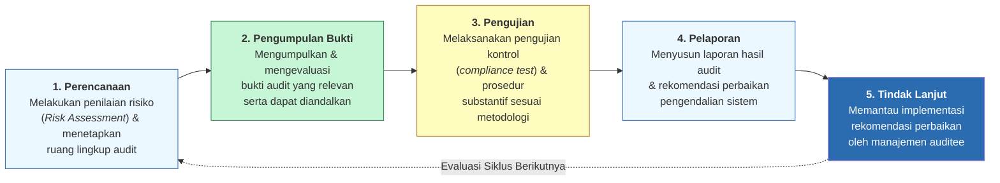

# Pertemuan 04: Standar dan Panduan untuk Audit Sistem Informasi

* **Mata Kuliah:** Manajemen Risiko dan Audit Sistem Informasi (`STSI4403`)

* **Program Studi:** Sistem Informasi — Fakultas Sains dan Teknologi, Universitas Terbuka

* **Topik:** Urgensi Standar & Panduan Audit SI, Piagam & Surat Tugas Audit (*Audit Charter & Engagement Letter*), Prinsip Independensi & Objektivitas Auditor, Standar Internasional ISACA (`ITAF`), Pedoman Audit Sistem Informasi Indonesia (`PASI` - `IASII`), Perbandingan Kerangka Kerja (`COBIT`, `ITIL`, `ISO/IEC 38500`), Proses Audit Berbasis Standar, serta Studi Kasus Implementasi di Perusahaan XYZ

## Daftar Isi

1. [Urgensi Standar dan Panduan dalam Audit Sistem Informasi](#1-urgensi-standar-dan-panduan-dalam-audit-sistem-informasi)

2. [Piagam Audit, Surat Tugas, dan Prinsip Independensi Auditor](#2-piagam-audit-surat-tugas-dan-prinsip-independensi-auditor)

3. [Standar Internasional ISACA (ITAF) dan Standar Nasional Indonesia (PASI - IASII)](#3-standar-internasional-isaca-itaf-dan-standar-nasional-indonesia-pasi---iasii)

4. [Perbandingan Standar dan Kerangka Kerja Audit SI Populer](#4-perbandingan-standar-dan-kerangka-kerja-audit-si-populer)

5. [Proses Audit Sistem Informasi Berdasarkan Standar](#5-proses-audit-sistem-informasi-berdasarkan-standar)

6. [Studi Kasus: Implementasi Standar ISACA di Perusahaan XYZ](#6-studi-kasus-implementasi-standar-isaca-di-perusahaan-xyz)

7. [Referensi Resmi](#7-referensi-resmi)

## 1. Urgensi Standar dan Panduan dalam Audit Sistem Informasi

Penerapan standar dan panduan audit merupakan fondasi utama yang memastikan pelaksanaan pemeriksaan sistem informasi berjalan terukur, andal, dan diakui kredibilitasnya oleh seluruh pemangku kepentingan (*stakeholders*) melalui tiga pilar manfaat utama:

## 2. Piagam Audit, Surat Tugas, dan Prinsip Independensi Auditor

### Piagam Audit (*Audit Charter*) dan Surat Tugas (*Engagement Letter*)

Sebelum pemeriksaan dimulai, auditor dan pemberi tugas wajib menyepakati dokumen resmi berupa **Piagam Audit Internal (*Internal Audit Charter*)** (untuk auditor internal) atau **Surat Perintah Kerja / Surat Tugas** (untuk auditor eksternal) yang dikeluarkan oleh manajemen senior:

* **Penetapan Mandat:** Menetapkan tujuan, ruang lingkup (*scope*), tanggung jawab, dan wewenang tim audit secara eksplisit.

* **Komitmen Bersama:** Disetujui secara formal oleh pihak auditor dan pemberi tugas sebagai wujud komitmen tata kelola.

* **Landasan Hukum & Operasional:** Menjadi dasar legalitas bagi auditor untuk mengakses sistem, dokumen, dan personel yang relevan.

* **Pembatasan Area Audit:** Memberikan batasan ruang lingkup yang tegas mengenai sistem atau unit kerja yang diaudit.

### Tiga Pilar Independensi dan Objektivitas Auditor

> *"Independensi auditor adalah fondasi utama dari kredibilitas seluruh hasil audit."*
> — **Modul Tutorial Online `STSI4403`** (*Universitas Terbuka*)

1. **Pernyataan Independensi:** Setiap auditor wajib membuat dan menandatangani surat pernyataan independensi sebelum memulai penugasan audit sistem informasi.

2. **Menghindari Konflik Kepentingan:** Auditor harus bebas dari hubungan struktural, profesional, pribadi, maupun finansial dengan unit/pihak yang diaudit yang berpotensi mengganggu objektivitas penilaian.

3. **Transparansi Pengungkapan:** Auditor wajib mengungkapkan secara terbuka setiap potensi benturan kepentingan (*conflict of interest*) di dalam laporan audit demi menjaga integritas hasil pemeriksaan.

## 3. Standar Internasional ISACA (ITAF) dan Standar Nasional Indonesia (PASI - IASII)

### A. Standar Internasional ISACA: *IT Assurance Framework* (`ITAF`)

**ISACA** (*Information Systems Audit and Control Association*) menerbitkan kerangka standar global **`ITAF` (*Information Technology Assurance Framework*)** yang terbagi menjadi **tiga kategori standar utama**:

### B. Standar Audit Sistem Informasi di Indonesia (`PASI` — `IASII`)

Di tingkat nasional, **Ikatan Auditor Sistem Informasi Indonesia (`IASII`)** merupakan lembaga profesi resmi yang mengembangkan **Pedoman Audit Sistem Informasi (`PASI`)**. `PASI` memberikan penekanan khusus pada **lima prinsip utama**:

1. **Independensi Auditor** sebagai prinsip mutlak dalam seluruh proses audit.

2. **Profesionalisme** dalam perencanaan, pengujian, dan pelaksanaan setiap tahapan audit.

3. **Formalitas Penugasan Audit** yang wajib dituangkan dalam dokumen Piagam Audit dan Surat Tugas resmi.

4. **Kewajiban Menjaga Kerahasiaan** atas seluruh data dan informasi sensitif organisasi yang diakses selama pemeriksaan.

5. **Objektivitas Penilaian** yang konsisten dan berbasis bukti sepanjang proses audit berlangsung.

## 4. Perbandingan Standar dan Kerangka Kerja Audit SI Populer

Dalam praktik tata kelola dan audit teknologi informasi global, auditor kerap memadukan beberapa kerangka kerja utama sesuai kebutuhan organisasi:

| Standar / Kerangka Kerja | Fokus Utama | Kelebihan Utama | Keterbatasan / Kekurangan | 
| ----- | ----- | ----- | ----- | 
| **`COBIT`** (*Control Objectives for Information and Related Technologies*) | Tata kelola TI (*IT Governance*) dan pengendalian internal. | Memiliki fokus yang sangat kuat pada struktur kendali (*control objectives*), manajemen risiko, dan proteksi data. | Tidak menyediakan panduan langkah-langkah implementasi operasional teknis yang terperinci. | 
| **`ITIL`** (*Information Technology Infrastructure Library*) | Manajemen layanan TI (*IT Service Management* / `ITSM`). | Menyediakan kumpulan praktik terbaik (*best practices*) operasional layanan TI yang sangat komprehensif dan terstruktur. | Biaya pelatihan, adopsi proses, dan sertifikasi personel relatif tinggi. | 
| **`ISO/IEC 38500`** | Tata kelola korporat atas TI (*Corporate Governance of IT*). | Memberikan panduan prinsipil yang ringkas bagi jajaran direksi dan pimpinan puncak dalam mengarahkan penggunaan TI. | Bersifat konseptual tingkat strategis sehingga tidak cocok digunakan sebagai kerangka manajemen operasional TI sehari-hari. | 

## 5. Proses Audit Sistem Informasi Berdasarkan Standar

Pelaksanaan audit sistem informasi berdasarkan standar profesional dijalankan melalui **lima tahapan berurutan** yang saling terhubung:

## 6. Studi Kasus: Implementasi Standar ISACA di Perusahaan XYZ

Penerapan standar audit profesional **`ITAF` (ISACA)** memberikan dampak peningkatan keamanan yang terukur sebagaimana ditunjukkan pada studi kasus implementasi di **Perusahaan XYZ**:

| Tahapan Implementasi | Aktivitas Berbasis Standar ISACA (`ITAF`) | Dampak dan Hasil Terukur | 
| ----- | ----- | ----- | 
| **1. Persiapan & Perencanaan** | • Auditor internal menyusun **Piagam Audit** dan **Surat Tugas** resmi yang disetujui oleh Direksi (`ITAF 1001`). • Penilaian risiko dilakukan berbasis standar **`1201` dan `1202` ITAF** dengan mempertimbangkan kompleksitas arsitektur sistem. | Seluruh area sistem kritis terpetakan secara objektif sesuai tingkat eksposur risikonya. | 
| **2. Pelaksanaan & Pelaporan** | • Tim audit menjaga independensi melalui penandatanganan surat pernyataan formal dan transparansi potensi konflik kepentingan. • Laporan audit disusun mengikuti standar **`1401` ITAF** dengan rekomendasi perbaikan yang konkret dan dapat ditindaklanjuti. | Ditemukan **12 kelemahan kontrol keamanan** yang seluruhnya berhasil diperbaiki dalam waktu **3 bulan**, sehingga meningkatkan **skor keamanan sistem sebesar 40%**. | 

## 7. Referensi Resmi

1. **Modul Tutorial Online UT:** Materi Inisiasi 4 — *Standar dan Panduan untuk Audit Sistem Informasi*, Mata Kuliah Manajemen Risiko dan Audit Sistem Informasi (`STSI4403`), Universitas Terbuka.

2. **Buku Materi Pokok (BMP) UT:** *Manajemen Risiko dan Audit Sistem Informasi* (`STSI4403`), Program Studi Sistem Informasi, Universitas Terbuka.

3. **ISACA.** *ITAF™ (Information Technology Assurance Framework): A Professional Practices Framework for IS Audit/Assurance*. Information Systems Audit and Control Association.

4. **Ikatan Auditor Sistem Informasi Indonesia (IASII).** *Pedoman Audit Sistem Informasi (PASI)*. Jakarta: IASII.

5. **ISO/IEC 38500.** *Information Technology — Governance of IT for the Organization*. International Organization for Standardization.