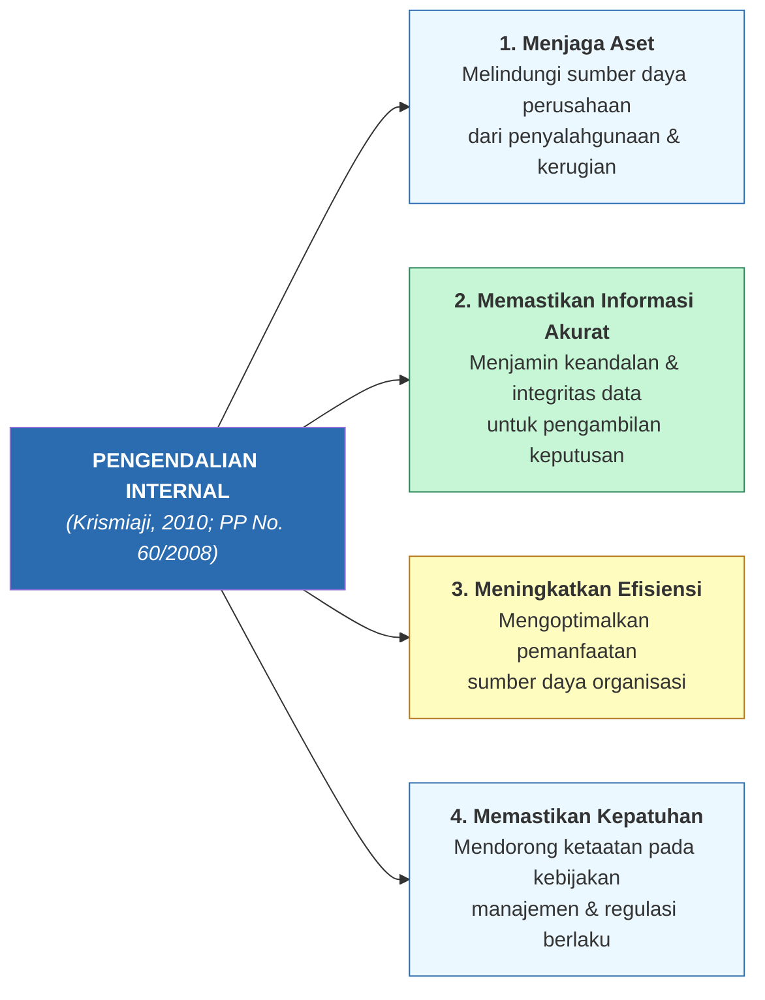
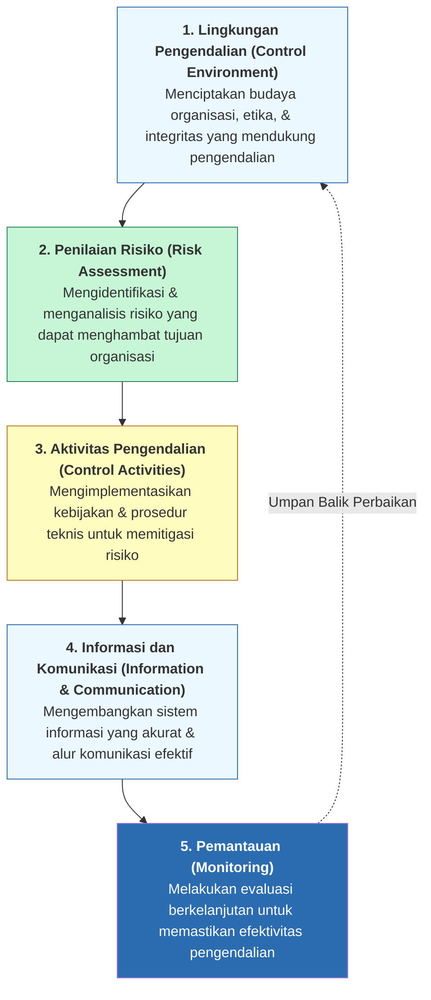
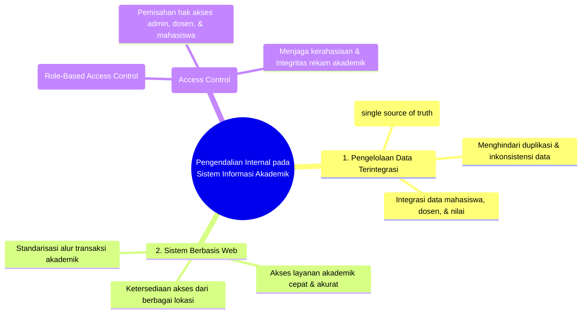

# Pertemuan 05: Konsep Pengendalian Internal

* **Mata Kuliah:** Manajemen Risiko dan Audit Sistem Informasi (`STSI4403`)
* **Program Studi:** Sistem Informasi — Fakultas Sains dan Teknologi, Universitas Terbuka
* **Topik:** Definisi & Empat Pilar Pengendalian Internal (Krismiaji, 2010; PP No. 60 Tahun 2008), Empat Tujuan Utama Pengendalian Internal, Lima Unsur Sistem Pengendalian Intern Pemerintah (`SPIP` / `COSO`), Implementasi Pengendalian Internal & Peran Satuan Pengawasan Internal (`SPI`) di Perguruan Tinggi (Studi Kasus Diskominfo Kab. Semarang & Sistem Informasi Akademik), serta Manfaat dan Tantangan Era Digital

---

## Daftar Isi

1. [Definisi dan Empat Pilar Pengendalian Internal](#1-definisi-dan-empat-pilar-pengendalian-internal)
2. [Empat Tujuan Utama Pengendalian Internal](#2-empat-tujuan-utama-pengendalian-internal)
3. [Lima Unsur Pengendalian Internal (SPIP — PP No. 60 Tahun 2008)](#3-lima-unsur-pengendalian-internal-spip--pp-no-60-tahun-2008)
4. [Implementasi Pengendalian Internal dan Peran SPI di Perguruan Tinggi](#4-implementasi-pengendalian-internal-dan-peran-spi-di-perguruan-tinggi)
5. [Contoh Implementasi pada Sistem Informasi Akademik](#5-contoh-implementasi-pada-sistem-informasi-akademik)
6. [Manfaat, Tantangan, dan Peluang Pengendalian Internal di Era Digital](#6-manfaat-tantangan-dan-peluang-pengendalian-internal-di-era-digital)
7. [Referensi Resmi](#7-referensi-resmi)

---

## 1. Definisi dan Empat Pilar Pengendalian Internal

### Pengertian Pengendalian Internal

Berdasarkan **Krismiaji (2010)** dan **Peraturan Pemerintah No. 60 Tahun 2008** tentang *Sistem Pengendalian Intern Pemerintah (`SPIP`)*, **pengendalian internal** (*internal control*) adalah serangkaian rencana organisasi, kebijakan, dan metode yang dirancang serta dijalankan untuk memberikan keyakinan memadai atas tercapainya **empat pilar fungsi utama**:

---

## 2. Empat Tujuan Utama Pengendalian Internal

Penerapan pengendalian internal yang menyeluruh dalam tata kelola organisasi dan sistem informasi bertujuan untuk mewujudkan:

| No. | Tujuan Pengendalian Internal | Penjelasan Konseptual dan Dampak Organisasional |
| :--- | :--- | :--- |
| **1** | **Pencapaian Tujuan** | Memastikan seluruh kegiatan dan proses bisnis organisasi berjalan secara **efektif**, **efisien**, dan **ekonomis** sesuai rencana strategis. |
| **2** | **Akuntabilitas & Transparansi** | Meningkatkan keterbukaan dalam proses pengambilan keputusan serta pertanggungjawaban kinerja kepada pimpinan dan publik. |
| **3** | **Keandalan Laporan** | Menjamin keakuratan, kelengkapan, dan keandalan laporan keuangan maupun pencatatan kegiatan operasional berbasis sistem informasi. |
| **4** | **Pencegahan Penyimpangan** | Meminimalkan risiko kecurangan (*fraud*), penyalahgunaan wewenang, dan kesalahan operasional guna meningkatkan kepercayaan publik. |

---

## 3. Lima Unsur Pengendalian Internal (SPIP — PP No. 60 Tahun 2008)

Menurut kerangka **Sistem Pengendalian Intern Pemerintah (`SPIP`)** yang selaras dengan kerangka **`COSO` (*Committee of Sponsoring Organizations of the Treadway Commission*)**, sistem pengendalian internal tersusun atas **lima unsur saling berkaitan**:

| Unsur Pengendalian Internal | Fokus Implementasi dalam Tata Kelola SI |
| :--- | :--- |
| **1. Lingkungan Pengendalian** | Penegakan kode etik TI, komitmen integritas pimpinan, kejelasan struktur organisasi, dan pembagian tugas (*segregation of duties*). |
| **2. Penilaian Risiko** | Penetapan sasaran sistem, identifikasi ancaman siber/operasional, serta analisis dampak dan probabilitas risiko TI. |
| **3. Aktivitas Pengendalian** | Otorisasi transaksi, verifikasi input, kontrol akses fisik/logis, rekonsiliasi data, dan dokumentasi prosedur operasional standar (`SOP`). |
| **4. Informasi dan Komunikasi** | Penyediaan sistem informasi yang menghasilkan laporan tepat waktu dan relevan, serta saluran komunikasi internal/eksternal yang terbuka. |
| **5. Pemantauan** | Pemantauan berkelanjutan (*ongoing monitoring*), audit internal berkala oleh unit pengawas, serta tindak lanjut temuan evaluasi. |

---

## 4. Implementasi Pengendalian Internal dan Peran SPI di Perguruan Tinggi

### Studi Kasus Implementasi `SPIP`
**Dinas Komunikasi dan Informatika (Diskominfo) Kabupaten Semarang** telah mengimplementasikan kerangka `SPIP` sesuai **PP No. 60 Tahun 2008**, yang memberikan hasil signifikan terhadap peningkatan transparansi, akuntabilitas, dan efektivitas tata kelola pemerintahan berbasis teknologi informasi.

### Peran Satuan Pengawasan Internal (`SPI`) dalam *Good University Governance*

Di lingkungan perguruan tinggi, **Satuan Pengawasan Internal (`SPI`)** memegang peranan strategis dalam mewujudkan tata kelola perguruan tinggi yang baik (*Good University Governance*) melalui empat kontribusi utama:

1. **Pengelolaan Keuangan:** Menjamin pengelolaan keuangan institusi berjalan tertib, efisien, dan transparan sesuai standar akuntansi yang berlaku.
2. **Pencapaian Kinerja:** Membantu unit kerja perguruan tinggi mencapai target kinerja akademik maupun serapan anggaran yang telah ditetapkan.
3. **Kepatuhan Regulasi:** Meningkatkan ketaatan seluruh sivitas akademika dan unit operasional terhadap peraturan perundang-undangan serta kebijakan internal.
4. **Kepercayaan *Stakeholder*:** Mencegah penyimpangan administratif maupun finansial sehingga meningkatkan kepercayaan mahasiswa, orang tua, mitra, dan pemerintah.

### Tantangan Implementasi Pengendalian Internal di Institusi
* **Keterbatasan Sumber Daya Manusia (`SDM`)** yang memiliki kompetensi teknis audit dan pengendalian sistem informasi.
* **Fasilitas penyimpanan dokumen** fisik maupun arsip digital yang belum terstandarisasi dan kurang memadai.
* **Sistem pengawasan** yang belum terintegrasi secara menyeluruh sehingga belum berjalan optimal.

---

## 5. Contoh Implementasi pada Sistem Informasi Akademik

Penerapan prinsip pengendalian internal dalam operasional **Sistem Informasi Akademik** diwujudkan melalui tiga mekanisme teknis utama:

---

## 6. Manfaat, Tantangan, dan Peluang Pengendalian Internal di Era Digital

### Tiga Manfaat Penguasaan Pengendalian Internal bagi Mahasiswa Sistem Informasi

1. **Pemahaman Komprehensif:** Memahami urgensi mekanisme pengendalian dalam membangun dan mengelola sistem informasi yang aman serta andal.
2. **Keterampilan Perancangan (*Control by Design*):** Mampu merancang dan mengimplementasikan kontrol teknis dalam proyek pengembangan perangkat lunak, meliputi fitur keamanan aplikasi yang kuat serta pencatatan **jejak audit (*audit trail*)** yang lengkap.
3. **Dukungan Proses Audit:** Memiliki kapabilitas untuk mendukung pelaksanaan audit sistem informasi yang komprehensif dan berkelanjutan.

### Perbandingan Tantangan dan Peluang Pengendalian Internal di Era Digital

| Tantangan Pengendalian Internal Modern | Peluang Inovasi Pengendalian Digital |
| :--- | :--- |
| **Risiko Keamanan Siber:** Meningkatnya intensitas serangan siber (*ransomware*, peretasan) dan potensi kebocoran data sensitif. | **Digitalisasi Pengendalian:** Meningkatkan efisiensi, akurasi, dan transparansi melalui otomatisasi kontrol aplikasi (*automated application controls*). |
| **Adaptasi Teknologi Baru:** Kebutuhan menyesuaikan kerangka kontrol terhadap arsitektur *cloud computing*, kecerdasan buatan (`AI`), dan *Internet of Things* (`IoT`). | **Pemantauan *Real-Time*:** Kemampuan melakukan pemantauan berkelanjutan (*continuous monitoring*) untuk deteksi dini anomali dan penyimpangan. |

---

## 7. Referensi Resmi

1. **Modul Tutorial Online UT:** Materi Inisiasi 5 — *Konsep Pengendalian Internal*, Mata Kuliah Manajemen Risiko dan Audit Sistem Informasi (`STSI4403`), Universitas Terbuka.
2. **Buku Materi Pokok (BMP) UT:** *Manajemen Risiko dan Audit Sistem Informasi* (`STSI4403`), Program Studi Sistem Informasi, Universitas Terbuka.
3. **Republik Indonesia.** *Peraturan Pemerintah Nomor 60 Tahun 2008 tentang Sistem Pengendalian Intern Pemerintah (`SPIP`)*.
4. **Krismiaji.** (2010). *Sistem Informasi Akuntansi*. Yogyakarta: Unit Penerbit dan Percetakan Sekolah Tinggi Ilmu Manajemen YKPN.
5. **COSO.** *Internal Control — Integrated Framework*. Committee of Sponsoring Organizations of the Treadway Commission.