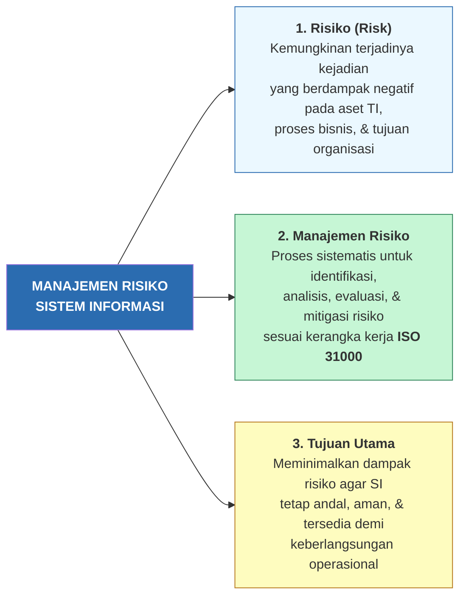
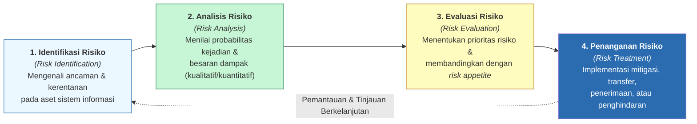
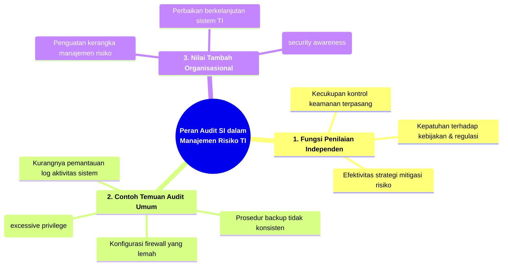

# Pertemuan 06: Manajemen Risiko dan Sistem Informasi

* **Mata Kuliah:** Manajemen Risiko dan Audit Sistem Informasi (`STSI4403`)
* **Program Studi:** Sistem Informasi — Fakultas Sains dan Teknologi, Universitas Terbuka
* **Topik:** Urgensi & Definisi Manajemen Risiko dalam Konteks TI, Sinergi Manajemen Risiko dan Audit Sistem Informasi, Empat Tahapan Proses Manajemen Risiko Sistem Informasi (`ISO 31000`), Studi Kasus Implementasi pada Sistem Informasi Akademik Universitas, Peran Audit dalam Mendukung Manajemen Risiko TI, serta Tantangan, Peluang, dan Budaya Sadar Risiko di Era Digital

---

## Daftar Isi

1. [Urgensi dan Definisi Manajemen Risiko dalam Konteks TI](#1-urgensi-dan-definisi-manajemen-risiko-dalam-konteks-ti)
2. [Sinergi antara Manajemen Risiko dan Audit Sistem Informasi](#2-sinergi-antara-manajemen-risiko-dan-audit-sistem-informasi)
3. [Empat Tahapan Proses Manajemen Risiko Sistem Informasi (ISO 31000)](#3-empat-tahapan-proses-manajemen-risiko-sistem-informasi-iso-31000)
4. [Studi Kasus: Implementasi Manajemen Risiko di Sistem Informasi Pendidikan](#4-studi-kasus-implementasi-manajemen-risiko-di-sistem-informasi-pendidikan)
5. [Peran Audit dalam Mendukung Manajemen Risiko TI](#5-peran-audit-dalam-mendukung-manajemen-risiko-ti)
6. [Tantangan, Peluang, dan Penerapan Budaya Sadar Risiko di Era Digital](#6-tantangan-peluang-dan-penerapan-budaya-sadar-risiko-di-era-digital)
7. [Referensi Resmi](#7-referensi-resmi)

---

## 1. Urgensi dan Definisi Manajemen Risiko dalam Konteks TI

### Mengapa Manajemen Risiko Penting dalam Sistem Informasi?

Di era digital, sistem informasi telah menjadi tulang punggung utama operasional organisasi. Ketergantungan tinggi terhadap teknologi informasi menghadirkan berbagai potensi ancaman yang wajib dikelola secara proaktif:

* **Ancaman Utama TI:** Gangguan layanan sistem (*service disruption*), kebocoran data sensitif (*data breach*), serangan siber yang semakin canggih, serta kesalahan manusia (*human error*) dalam pengoperasian sehari-hari.
* **Dampak Risiko Tidak Terkelola:** Kerugian finansial yang signifikan, rusaknya reputasi serta kepercayaan pemangku kepentingan, hingga terhentinya operasional bisnis secara total (*business downtime*).

### Tiga Pilar Konsep Manajemen Risiko TI

---

## 2. Sinergi antara Manajemen Risiko dan Audit Sistem Informasi

Manajemen risiko dan audit sistem informasi bukanlah dua fungsi yang terpisah, melainkan saling melengkapi dalam siklus perlindungan tata kelola TI organisasi:

| Dimensi Peran | Manajemen Risiko TI | Audit Sistem Informasi |
| :--- | :--- | :--- |
| **Fokus Utama** | Mengidentifikasi ancaman, menilai tingkat risiko, dan merancang strategi mitigasi secara berkelanjutan. | Melakukan evaluasi independen dan sistematis terhadap kecukupan kontrol dan keamanan sistem informasi. |
| **Arah Kontribusi** | Menjadi dasar penentuan prioritas dan fokus audit (*Risk-Based Audit*) pada area dengan tingkat risiko tertinggi. | Menguji efektivitas strategi mitigasi risiko yang diterapkan serta memastikan kepatuhan terhadap kebijakan dan regulasi. |
| **Hasil Sinergi** | Memberikan peta prioritas risiko yang terarah bagi tim auditor. | Memberikan umpan balik objektif dan rekomendasi perbaikan guna memperkuat postur manajemen risiko organisasi. |

---

## 3. Empat Tahapan Proses Manajemen Risiko Sistem Informasi (ISO 31000)

Berdasarkan standar internasional **`ISO 31000`**, proses manajemen risiko pada sistem informasi dijalankan melalui **empat tahapan berurutan dan berkesinambungan**:

### Rincian Aktivitas dan Opsi Penanganan Risiko

1. **Identifikasi Risiko (*Risk Identification*):** Mengenali berbagai sumber ancaman dan celah kerentanan pada infrastruktur, perangkat lunak, data, maupun SDM melalui penilaian komprehensif.
2. **Analisis Risiko (*Risk Analysis*):** Menilai tingkat kemungkinan terjadinya risiko (*likelihood*) serta besarnya dampak kerugian (*impact*) menggunakan pendekatan kualitatif maupun kuantitatif.
3. **Evaluasi Risiko (*Risk Evaluation*):** Memeringkat prioritas risiko berdasarkan tingkat keparahannya dan menyelaraskannya dengan ambang batas toleransi risiko (*risk appetite* / *risk criteria*) organisasi.
4. **Penanganan Risiko (*Risk Treatment*):** Memilih dan menerapkan strategi respons yang tepat sesuai konteks bisnis, yang terdiri atas **empat opsi utama**:
   * **Mitigasi Risiko (*Risk Mitigation / Reduction*):** Menerapkan kontrol teknis maupun prosedural untuk menekan probabilitas atau dampak risiko.
   * **Transfer Risiko (*Risk Transfer / Sharing*):** Mengalihkan sebagian konsekuensi finansial risiko kepada pihak ketiga (misalnya melalui asuransi siber atau *outsourcing* layanan *cloud*).
   * **Penerimaan Risiko (*Risk Acceptance*):** Menerima risiko secara sadar apabila tingkat risikonya berada di bawah ambang batas toleransi atau biaya mitigasinya melebihi nilai aset.
   * **Penghindaran Risiko (*Risk Avoidance*):** Menghentikan aktivitas atau membatalkan adopsi teknologi tertentu yang membawa tingkat risiko terlalu tinggi dan tidak dapat dimitigasi.

---

## 4. Studi Kasus: Implementasi Manajemen Risiko di Sistem Informasi Pendidikan

Pada pengelolaan **Sistem Informasi Akademik Universitas**, penerapan manajemen risiko secara terstruktur memetakan ancaman utama beserta kontrol mitigasinya secara langsung:

| Risiko Teridentifikasi | Potensi Dampak Akademik & Operasional | Strategi Mitigasi yang Diterapkan |
| :--- | :--- | :--- |
| **1. Kebocoran Data Pribadi Mahasiswa** | Pelanggaran privasi data sivitas akademika, sanksi regulasi pelindungan data pribadi, dan turunnya kepercayaan publik. | Penerapan **enkripsi data *end-to-end*** (baik saat penyimpanan maupun transmisi jaringan). |
| **2. Gangguan Sistem saat Puncak Pendaftaran** | Kegagalan transaksi pengisian rencana studi (`KRS`) atau pendaftaran mahasiswa baru akibat lonjakan trafik (*bottleneck*). | Implementasi **sistem *backup* otomatis dan redundansi** infrastruktur peladen (*high availability*). |
| **3. Manipulasi Nilai Akademik** | Rusaknya integritas data akademik dan kredibilitas kelulusan institusi akibat penyalahgunaan hak akses. | Penerapan pencatatan **jejak audit (*audit log*)** menyeluruh untuk setiap aktivitas sensitif serta **pelatihan keamanan wajib** bagi staf dan mahasiswa. |

---

## 5. Peran Audit dalam Mendukung Manajemen Risiko TI

Audit sistem informasi memberikan nilai tambah strategis bagi efektivitas manajemen risiko melalui siklus verifikasi independen:

---

## 6. Tantangan, Peluang, dan Penerapan Budaya Sadar Risiko di Era Digital

### Perbandingan Tantangan Kontemporer dan Peluang Inovasi

| Tantangan Kontemporer Manajemen Risiko TI | Peluang Inovasi di Era Digital |
| :--- | :--- |
| **Ancaman Siber Semakin Canggih:** Evolusi teknik serangan otomatis dan *ransomware* yang terus berubah. | **Integrasi Strategi Bisnis & TI:** Menyelaraskan pengelolaan risiko TI langsung dengan sasaran strategis perusahaan. |
| **Kompleksitas Infrastruktur TI:** Arsitektur *hybrid cloud*, *microservices*, dan integrasi pihak ketiga yang luas. | **Pemanfaatan Kecerdasan Buatan (`AI`):** Deteksi anomali, pola serangan, dan prediksi risiko secara proaktif. |
| **Regulasi Keamanan Data Semakin Ketat:** Tuntutan kepatuhan hukum perlindungan data pribadi yang dinamis. | **Sistem Pemantauan *Real-Time*:** Visibilitas berkelanjutan atas status keamanan dan kinerja sistem setiap saat. |
| **Keterbatasan Sumber Daya & Keahlian:** Kesenjangan talenta spesialis keamanan siber dan manajemen risiko TI. | **Kolaborasi Antar-Industri:** Berbagi informasi intelijen ancaman (*threat intelligence sharing*) lintas organisasi. |

### Empat Langkah Membangun Budaya Sadar Risiko (*Risk-Aware Culture*)

1. **Mulai dari Lingkungan Terdekat:** Melakukan identifikasi potensi risiko TI sejak level operasional unit kerja maupun penggunaan perangkat personal.
2. **Adopsi Standar Internasional:** Menggunakan kerangka kerja baku seperti **`ISO 31000`** sebagai pedoman implementasi manajemen risiko yang sistematis.
3. **Libatkan Proses Audit:** Memanfaatkan audit internal maupun eksternal untuk memverifikasi efektivitas kontrol mitigasi secara berkala.
4. **Kembangkan Budaya Sadar Risiko:** Menjadikan manajemen risiko sebagai bagian integral dari budaya kerja (*DNA organisasi*) demi ketangguhan transformasi digital.

---

## 7. Referensi Resmi

1. **Modul Tutorial Online UT:** Materi Inisiasi 6 — *Manajemen Risiko dan Sistem Informasi*, Mata Kuliah Manajemen Risiko dan Audit Sistem Informasi (`STSI4403`), Universitas Terbuka.
2. **Buku Materi Pokok (BMP) UT:** *Manajemen Risiko dan Audit Sistem Informasi* (`STSI4403`), Program Studi Sistem Informasi, Universitas Terbuka.
3. **ISO 31000:2018.** *Risk Management — Guidelines*. International Organization for Standardization.
4. **ISACA.** *COBIT 2019 Framework: Governance and Management Objectives* & *Risk IT Framework*. Information Systems Audit and Control Association.
5. **National Institute of Standards and Technology (NIST).** *NIST SP 800-37: Risk Management Framework for Information Systems and Organizations*.