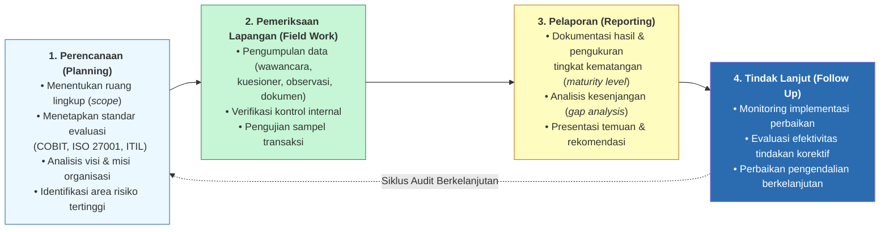
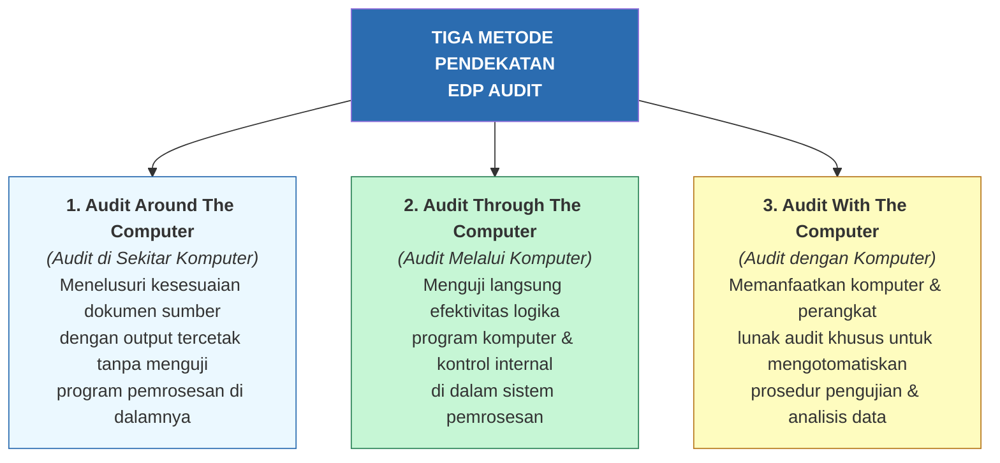

# Pertemuan 07: Proses Rencana Audit Sistem Informasi dan Teknologi Audit (`CAATs` / `TABK`)

* **Mata Kuliah:** Manajemen Risiko dan Audit Sistem Informasi (`STSI4403`)
* **Program Studi:** Sistem Informasi — Fakultas Sains dan Teknologi, Universitas Terbuka
* **Topik:** Landasan Konseptual & Empat Tujuan Audit SI (Ron Weber, 1999), Empat Tahapan Siklus Rencana & Pelaksanaan Audit SI, Empat Elemen Pemeriksaan Infrastruktur TI & Studi Kasus Audit SI di PT Bank Rakyat Indonesia (BRI), Karakteristik Sistem Informasi Komputerisasi Akuntansi, Tiga Metode EDP Audit (*Around*, *Through*, dan *With the Computer*), serta Tujuh Teknik Pemeriksaan EDP dan Teknik Audit Berbantuan Komputer (`TABK` / `CAATs`)

---

## Daftar Isi

1. [Landasan Konseptual dan Empat Tujuan Audit Sistem Informasi](#1-landasan-konseptual-dan-empat-tujuan-audit-sistem-informasi)
2. [Empat Tahapan Siklus Rencana dan Pelaksanaan Audit SI](#2-empat-tahapan-siklus-rencana-dan-pelaksanaan-audit-si)
3. [Empat Elemen Pemeriksaan Audit SI dan Studi Kasus PT Bank Rakyat Indonesia (BRI)](#3-empat-elemen-pemeriksaan-audit-si-dan-studi-kasus-pt-bank-rakyat-indonesia-bri)
4. [Karakteristik dan Dampak Lingkungan Sistem Informasi Komputerisasi Akuntansi](#4-karakteristik-dan-dampak-lingkungan-sistem-informasi-komputerisasi-akuntansi)
5. [Tiga Metode EDP Audit dan Pengendalian Intern](#5-tiga-metode-edp-audit-dan-pengendalian-intern)
6. [Teknik Audit Berbantuan Komputer (`TABK` / `CAATs`) dan Tujuh Teknik Pemeriksaan EDP](#6-teknik-audit-berbantuan-komputer-tabk--caats-dan-tujuh-teknik-pemeriksaan-edp)
7. [Referensi Resmi](#7-referensi-resmi)

---

## 1. Landasan Konseptual dan Empat Tujuan Audit Sistem Informasi

### Definisi dan Konvergensi Disiplin Ilmu Audit SI

Menurut **Ron Weber (1999)**, **Audit Sistem Informasi** adalah proses sistematis dalam mengumpulkan dan menilai bukti-bukti untuk menentukan apakah sebuah sistem komputer telah mampu mengamankan aset organisasi, menjaga integritas data, serta mendukung pencapaian tujuan organisasi secara efektif dan efisien. Disiplin ilmu ini memadukan tiga pilar keilmuan utama:

* ***Traditional Auditing*:** Metodologi pengumpulan bukti, teknik *sampling*, dan evaluasi kepatuhan berbasis standar profesional.
* ***Information Technology*:** Arsitektur perangkat keras, perangkat lunak, basis data, jaringan komputer, dan keamanan siber.
* ***Information Systems Management*:** Tata kelola TI, manajemen risiko, pengendalian internal, dan penyelarasan strategi bisnis.

### Empat Tujuan Utama Audit Sistem Informasi

1. **Mengamankan Aset TI (*Asset Safeguarding*):** Melindungi *hardware*, *software*, basis data, fasilitas jaringan, dan sumber daya manusia dari ancaman internal maupun eksternal.
2. **Menjaga Integritas Data (*Data Integrity*):** Memastikan data tetap lengkap, akurat, konsisten, dan dapat dipercaya di seluruh rangkaian proses bisnis.
3. **Efektivitas Sistem (*System Effectiveness*):** Memastikan sistem informasi beroperasi sesuai kebutuhan pengguna (*user requirements*) dan mendukung pencapaian sasaran strategis organisasi.
4. **Efisiensi Sumber Daya (*System Efficiency*):** Mengoptimalkan penggunaan sumber daya komputasi, biaya, dan waktu guna menghasilkan nilai bisnis maksimal bagi organisasi.

---

## 2. Empat Tahapan Siklus Rencana dan Pelaksanaan Audit SI

Pelaksanaan rencana audit sistem informasi dijalankan secara terstruktur melalui **empat tahapan siklus berkelanjutan** agar tidak ada celah pengendalian yang terlewatkan:

> **Urgensi Tahap Tindak Lanjut (*Follow Up*):** Tanpa proses tindak lanjut dan pemantauan implementasi yang disiplin, seluruh rangkaian proses audit menjadi kurang bermakna karena organisasi tidak memiliki jaminan bahwa kelemahan pengendalian yang ditemukan benar-benar telah diperbaiki.

---

## 3. Empat Elemen Pemeriksaan Audit SI dan Studi Kasus PT Bank Rakyat Indonesia (BRI)

### Empat Elemen Utama Pemeriksaan Infrastruktur dan Operasi TI

1. **Keamanan Fisik (*Physical Security*):** Pengendalian akses ruang peladen (*server room*), perlindungan lingkungan, catu daya cadangan, dan keamanan perangkat keras.
2. **Administrasi & Jaringan (*Administration & Network*):** Tata kelola sistem operasi, konfigurasi jaringan, *firewall*, dan pengawasan lalu lintas komunikasi data.
3. **Aplikasi & `SDLC` (*Applications & System Development Life Cycle*):** Pengendalian input, pemrosesan, output aplikasi, serta tata kelola siklus pengembangan dan perubahan perangkat lunak.
4. **Kesinambungan & `DRP` (*Business Continuity & Disaster Recovery Plan*):** Strategi pencadangan data (*backup*), redundansi sistem, dan kesiapan pemulihan operasional pascabencana.

### Studi Kasus: Audit Sistem Informasi di PT Bank Rakyat Indonesia (`BRI`)

| Dimensi Evaluasi | Hasil Observasi dan Temuan Audit di PT BRI |
| :--- | :--- |
| **Struktur Organisasi** | Ditemukan adanya pemisahan tugas (*segregation of duties*) yang jelas antara fungsi pengembangan sistem (*development*), operasional (*operation*), dan pengamanan sistem (*security*). |
| **Kebijakan Manajemen SI** | Kebijakan dan prosedur tata kelola TI telah disusun secara komprehensif untuk mendukung keandalan dan efisiensi layanan transaksi perbankan digital. |
| **Temuan Kelemahan Audit** | Teridentifikasi beberapa kelemahan minor pada aspek **kontrol akses pengguna** (*access control*) dan **manajemen perubahan** (*change management*) yang berpotensi menimbulkan risiko kerugian apabila tidak dimitigasi. |
| **Rekomendasi Perbaikan** | Diusulkan penguatan mekanisme otorisasi berlapis serta penerapan pemantauan aktivitas sistem secara *real-time* (*real-time monitoring*) guna meningkatkan ketahanan keamanan. |

---

## 4. Karakteristik dan Dampak Lingkungan Sistem Informasi Komputerisasi Akuntansi

### Delapan Karakteristik Sistem Informasi Komputerisasi Akuntansi

Berdasarkan kajian Isworo Nugroho (2009), peralihan dari pencatatan manual ke sistem informasi komputerisasi akuntansi menghadirkan delapan karakteristik khusus yang memengaruhi strategi audit:

1. **Buku Besar sebagai *Data Warehouse*:** Seluruh dokumen sumber dicatat melalui *transaction processing software* ke dalam *general ledger* berbentuk *shared database*.
2. **Akses Langsung oleh Pemakai:** Pengguna berwenang dapat mengakses dan mengolah informasi akuntansi secara langsung dari *shared database*.
3. **Laporan Keuangan Multi-Dimensi:** Kemampuan menghasilkan laporan manajerial dan finansial dalam berbagai dimensi analisis secara instan.
4. **Ketergantungan Tinggi pada Perangkat Keras & Lunak:** Keandalan proses sepenuhnya bergantung pada berfungsinya kapabilitas *hardware* dan *software*.
5. **Jejak Audit Tidak Terlihat (*Invisible Audit Trail*):** Rekaman jejak transaksi tersimpan dalam format elektronik sehingga tidak kasat mata dan rentan terhadap modifikasi tanpa izin.
6. **Pengurangan Keterlibatan Manusia:** Integrasi fungsi otomatis mengurangi intervensi manual sekaligus menghilangkan mekanisme otorisasi tanda tangan tradisional.
7. **Pergeseran Kekeliruan Acak Menjadi Kekeliruan Bersistem:** Kesalahan logika pemrograman akan berdampak secara konsisten/berulang pada seluruh transaksi sejenis serta membawa risiko kehilangan data massal.
8. **Tuntutan *Knowledge Worker*:** Menggeser pola organisasi menuju *boundaryless organization* berbasis kepercayaan (*trust-based relationship*) dan otonomi pekerja berpengetahuan.

### Perbandingan Lingkungan Sistem Komputer: *Microcomputer* vs *On-Line Computer System*

| Konfigurasi Sistem | Karakteristik Operasional | Dampak terhadap Strategi dan Prosedur Audit |
| :--- | :--- | :--- |
| **1. Lingkungan Komputer Mikro (*Personal Computer* / `PC`)** | Digunakan sebagai *stand-alone workstation* pada usaha kecil atau *intelligent terminal* dalam jaringan `LAN`/`WAN` pada perusahaan besar. | Risiko pengendalian internal relatif tinggi sehingga auditor lebih memfokuskan pada **pengujian substantif** di akhir periode, pemeriksaan fisik aktiva, ukuran sampel lebih besar, dan penggunaan `CAATs`. |
| **2. Lingkungan Sistem Komputer *On-Line*** | Memungkinkan pengguna melakukan entri transaksi, permintaan saldo, pencetakan laporan, dan pembaruan *master file* secara langsung (*real-time*) melalui terminal. | Tidak selalu tersedia dokumen sumber fisik untuk setiap transaksi masukan. Sesuai **`SPAP SA Seksi 327`**, tim audit wajib melibatkan tenaga ahli sistem *on-line*, melakukan *pre-implementation review*, serta pengujian kepatuhan bersamaan dengan pemrosesan *on-line*. |

---

## 5. Tiga Metode EDP Audit dan Pengendalian Intern

Berdasarkan **`SPAP SA Seksi 314.4`**, pengendalian internal dalam lingkungan pemrosesan data elektronik (*Electronic Data Processing* / `EDP`) terbagi menjadi **Pengendalian Umum** (*organisasi, administratif, pengembangan/pemeliharaan sistem, hardware/software, dokumentasi, dan keamanan*) serta **Pengendalian Aplikasi** (*pengendalian input, pemrosesan, dan output*). Untuk mengevaluasinya, auditor dapat memilih **tiga metode pendekatan audit**:

---

## 6. Teknik Audit Berbantuan Komputer (`TABK` / `CAATs`) dan Tujuh Teknik Pemeriksaan EDP

### Konsep, Kondisi Penggunaan, dan Dua Tipe Utama `TABK` / `CAATs`

**Teknik Audit Berbantuan Komputer (`TABK`)** atau ***Computer Assisted Audit Techniques* (`CAATs`)** diterapkan oleh auditor apabila terdapat **dua kondisi utama**: (1) tidak tersedianya dokumen masukan fisik atau hilangnya jejak audit (*audit trail*) yang kasat mata dalam sistem komputer, serta (2) kebutuhan untuk meningkatkan efektivitas dan efisiensi pengujian terhadap volume data besar.

* **Dua Tipe Utama `TABK` (`CAATs`):**
  1. **Perangkat Lunak Audit (*Audit Software*):** Program komputer yang digunakan auditor untuk membaca, menyortir, menghitung, dan menganalisis berkas data organisasi—meliputi *package programs* (seperti `ACL`, `IDEA-Y`, `Audassist`), *purpose-written programs*, dan *utility programs*.
  2. **Data Uji (*Test Data*):** Memasukkan sekumpulan data transaksi simulasi (termasuk kondisi valid maupun tidak valid) ke dalam sistem komputer entitas untuk membandingkan hasil pemrosesan aktual dengan hasil yang diharapkan (termasuk pemanfaatan *dummy unit* dalam siklus normal).

### Tujuh Teknik Pemeriksaan Berbasis Teknologi Informasi dalam EDP Audit

| No. | Teknik Pemeriksaan EDP | Mekanisme Kerja dan Tujuan Pengujian Audit |
| :---: | :--- | :--- |
| **1** | **Pengujian dengan Data Simulasi** (*Test Data Method*) | Memasukkan transaksi simulasi ke dalam program aplikasi untuk memverifikasi ketepatan logika pemrosesan dan deteksi kesalahan. |
| **2** | **Fasilitas Pengujian Terpadu** (*Integrated Test Facility* / `ITF`) | Menggabungkan transaksi simulasi (berkode khusus) ke dalam aliran pemrosesan transaksi operasional nyata secara bersamaan untuk menguji keandalan aplikasi pada lingkungan produksi. |
| **3** | **Simulasi Paralel** (*Parallel Simulation*) | Auditor membangun program simulasi independen dan memproses data aktual perusahaan, lalu membandingkan hasilnya dengan keluaran sistem operasional perusahaan. |
| **4** | **Pemasangan Modul Pemeriksaan** (*Embedded Audit Module* / `EAM`) | Menanamkan modul kode audit otomatis ke dalam sistem aplikasi untuk merekam log transaksi mencurigakan atau penyimpangan secara berkelanjutan. |
| **5** | **Perangkat Lunak Audit Khusus** (*Generalized Audit Software* / `GAS`) | Menggunakan perangkat lunak seperti **`ACL` (*Audit Command Language*)** atau **`IDEA-Y`** untuk menguji integritas berkas, mencari anomali saldo, dan mengaudit populasi data secara menyeluruh. |
| **6** | **Metode Penelusuran** (*Tracing*) | Mencetak dan menelusuri urutan instruksi kode program yang dieksekusi selama pemrosesan suatu transaksi untuk memastikan tidak ada cabang logika yang dilewati. |
| **7** | **Metode Pemetaan** (*Mapping*) | Mengidentifikasi bagian kode program yang aktif dieksekusi versus kode tidak aktif guna mendeteksi adanya sisipan kode ilegal (*backdoor* / logika kecurangan) oleh pemrogram. |

---

## 7. Referensi Resmi

1. **Modul Tutorial Online UT:** Materi Inisiasi 7 — *Proses Rencana Audit Sistem Informasi*, Mata Kuliah Manajemen Risiko dan Audit Sistem Informasi (`STSI4403`), Universitas Terbuka.
2. **Artikel Ilmiah Pengayaan UT:** Nugroho, I. (2009). *Peranan Teknologi Informasi dalam Audit Sistem Informasi Komputerisasi Akuntansi*. Dinamika Informatika, Vol. I No. 2, September 2009, hlm. 122–130. Fakultas Teknologi Informasi, Universitas Stikubank Semarang.
3. **Weber, R.** (1999). *Information Systems Control and Audit*. Upper Saddle River, NJ: Prentice Hall.
4. **Ikatan Akuntan Indonesia (IAI).** *Standar Profesional Akuntan Publik (`SPAP`) — SA Seksi 314, SA Seksi 327, dan SA Seksi 335*.
5. **Arens, A. A., & Beasley, M. S.** (2003). *Auditing and Assurance Services: An Integrated Approach*. Prentice Hall.