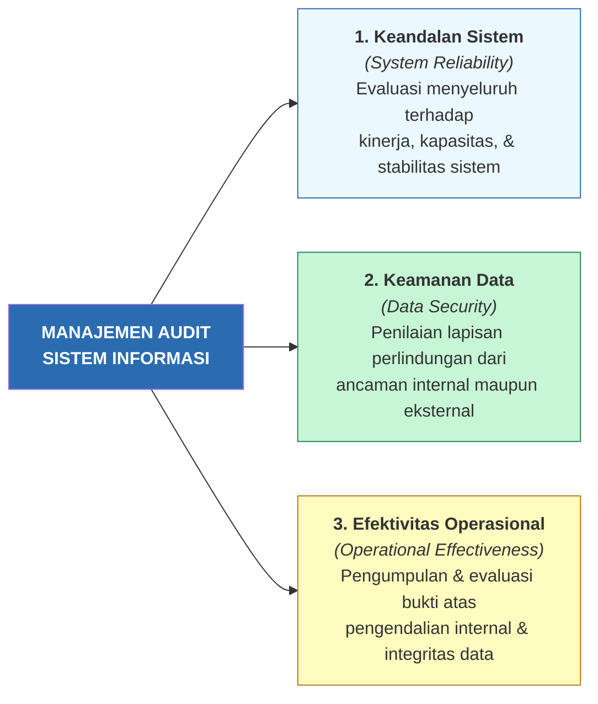
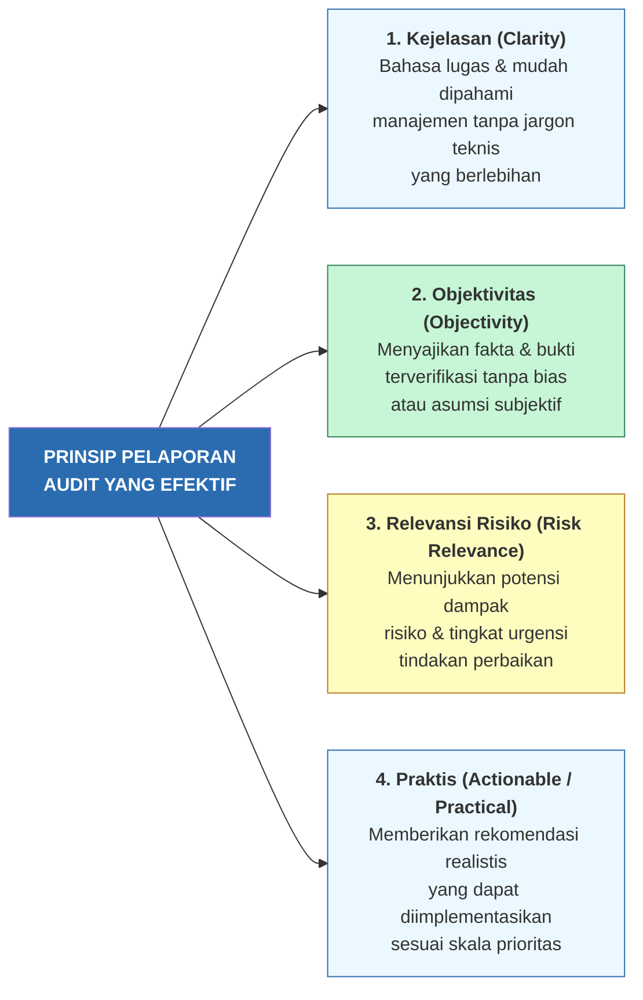

# Pertemuan 08: Manajemen Audit Sistem Informasi dan Pelaporannya

* **Mata Kuliah:** Manajemen Risiko dan Audit Sistem Informasi (`STSI4403`)
* **Program Studi:** Sistem Informasi — Fakultas Sains dan Teknologi, Universitas Terbuka
* **Topik:** Definisi & Tiga Pilar Fokus Manajemen Audit SI, Empat Tujuan Utama & Tiga Jenis Pengujian Lanjutan Audit, Komponen & Prinsip Pelaporan Audit yang Efektif, Peran Strategis Manajemen dalam Siklus Audit, Studi Kasus 1 (Audit SI Rumah Sakit Tasikmalaya), serta Studi Kasus 2 (Audit Sistem ERP Menggunakan `COBIT 4.1` dan `Maturity Model` pada PT Erajaya Swasembada, Tbk.)

---

## Daftar Isi

1. [Konsep Manajemen Audit Sistem Informasi dan Tiga Pilar Fokusnya](#1-konsep-manajemen-audit-sistem-informasi-dan-tiga-pilar-fokusnya)
2. [Tahapan Audit dan Tiga Jenis Pengujian Lanjutan](#2-tahapan-audit-dan-tiga-jenis-pengujian-lanjutan)
3. [Komponen dan Prinsip Pelaporan Audit yang Efektif](#3-komponen-dan-prinsip-pelaporan-audit-yang-efektif)
4. [Peran Strategis Manajemen dalam Siklus Audit Sistem Informasi](#4-peran-strategis-manajemen-dalam-siklus-audit-sistem-informasi)
5. [Studi Kasus 1: Audit Sistem Informasi Rumah Sakit Tasikmalaya](#5-studi-kasus-1-audit-sistem-informasi-rumah-sakit-tasikmalaya)
6. [Studi Kasus 2: Audit Sistem ERP Menggunakan `COBIT 4.1` pada PT Erajaya Swasembada, Tbk.](#6-studi-kasus-2-audit-sistem-erp-menggunakan-cobit-41-pada-pt-erajaya-swasembada-tbk)
7. [Referensi Resmi](#7-referensi-resmi)

---

## 1. Konsep Manajemen Audit Sistem Informasi dan Tiga Pilar Fokusnya

### Pengertian dan Tiga Pilar Peninjauan Audit SI

**Manajemen Audit Sistem Informasi** adalah proses peninjauan sistematis terhadap infrastruktur, pengendalian, dan tata kelola teknologi informasi yang kedudukannya sama pentingnya dengan audit keuangan dalam menjaga kelangsungan bisnis. Peninjauan ini memastikan **tiga pilar utama**:

### Empat Tujuan Utama Audit SI (Weber, 1999; Gondodiyoto, 2007)

1. **Pengamanan Aset (*Asset Safeguarding*):** Melindungi perangkat keras (*hardware*), perangkat lunak (*software*), data, fasilitas, dan sumber daya manusia (*brainware*) dari risiko penyalahgunaan maupun ancaman keamanan.
2. **Menjaga Integritas Data (*Data Integrity*):** Memastikan data bersifat lengkap, benar, akurat, dan konsisten guna mendukung pengambilan keputusan yang tepat.
3. **Meningkatkan Efektivitas Sistem (*System Effectiveness*):** Memastikan sistem informasi memenuhi kebutuhan pengguna dan mendukung pencapaian tujuan strategis organisasi.
4. **Meningkatkan Efisiensi Sistem (*System Efficiency*):** Mengoptimalkan penggunaan sumber daya teknologi agar sistem berjalan dengan biaya dan waktu minimal (selaras dengan prinsip **ekonomis / *cost-benefit***).

---

## 2. Tahapan Audit dan Tiga Jenis Pengujian Lanjutan

### Empat Tahapan Siklus Manajemen Audit SI

1. **Perencanaan (*Planning*):** Menentukan ruang lingkup audit, standar evaluasi, tingkat materialitas, serta komunikasi awal dengan manajemen untuk menyelaraskan ekspektasi dan menyusun *Audit Program*.
2. **Pemeriksaan Lapangan (*Field Work*):** Mengumpulkan bukti audit yang memadai, andal, dan relevan melalui wawancara, penyebaran kuesioner, observasi langsung, dokumentasi, dan pengujian sistem.
3. **Pelaporan (*Reporting*):** Menyusun laporan hasil audit yang mencakup evaluasi bukti, analisis tingkat kematangan (*maturity level*), dan *gap analysis* terhadap standar yang berlaku.
4. **Tindak Lanjut (*Follow Up*):** Memberikan rekomendasi perbaikan yang spesifik dan memantau implementasi tindakan korektif oleh manajemen secara berkala.

### Tiga Tahapan Pengujian Lanjutan (*Advanced Audit Testing*)

Dalam tahap pemeriksaan lapangan, auditor melaksanakan **tiga jenis pengujian teknis** untuk memvalidasi keandalan sistem:

| Jenis Pengujian | Tujuan dan Mekanisme Pemeriksaan |
| :--- | :--- |
| **1. Pengujian Pengendalian** (*Test of Controls*) | Mengevaluasi efektivitas desain dan operasi kontrol manajemen melalui teknik *sampling*, observasi, dan simulasi guna memastikan pengendalian internal berjalan sebagaimana mestinya. |
| **2. Pengujian Transaksi** (*Transaction Testing*) | Memverifikasi keakuratan, kelengkapan, otorisasi, dan validitas pemrosesan setiap transaksi serta perhitungan logika bisnis di dalam sistem informasi. |
| **3. Pengujian Keseimbangan** (*Balance Testing*) | Memastikan tidak terjadi kehilangan data, duplikasi, atau selisih pencatatan antarmodul yang dapat merusak integritas saldo dan laporan sistem secara keseluruhan. |

---

## 3. Komponen dan Prinsip Pelaporan Audit yang Efektif

### Empat Komponen Inti Laporan Audit SI

Berdasarkan praktik standar pelaporan audit (termasuk ketentuan penyampaian opini audit oleh Hunton dkk., 2004), sebuah laporan audit sistem informasi yang komprehensif memuat **empat komponen struktural utama**:

1. **Tujuan Audit (*Audit Objectives*):** Pernyataan spesifik mengenai fokus evaluasi yang dilakukan—seperti kepatuhan regulasi, keamanan data, atau efektivitas operasional—beserta tanda tangan, tanggal, dan identitas entitas yang diaudit.
2. **Ruang Lingkup Audit (*Audit Scope*):** Deskripsi jelas mengenai area fungsional, aplikasi/infrastruktur yang diperiksa, batasan pemeriksaan (*scope limitations*), serta periode waktu yang dicakup.
3. **Kriteria Audit (*Audit Criteria*):** Standar industri (`COBIT`, `ISO/IEC 27001`, `ITIL`), kebijakan internal organisasi, maupun peraturan perundang-undangan yang menjadi tolok ukur penilaian.
4. **Temuan dan Rekomendasi (*Findings & Recommendations*):** Hasil evaluasi yang disajikan secara faktual dan terstruktur, disertai dampak risiko serta saran perbaikan konkret yang dapat ditindaklanjuti.

### Empat Prinsip Pelaporan Audit yang Efektif

---

## 4. Peran Strategis Manajemen dalam Siklus Audit Sistem Informasi

Keberhasilan audit tidak berhenti pada terbitnya laporan, melainkan sangat bergantung pada **empat peran aktif manajemen**:

1. **Dukungan Akses (*Access Support*):** Menyediakan akses penuh terhadap sistem, dokumentasi, arsip log, dan personel terkait selama proses audit agar evaluasi berjalan komprehensif.
2. **Integrasi Hasil (*Governance Integration*):** Memasukkan temuan dan rekomendasi audit ke dalam kerangka tata kelola TI (*IT Governance*) dan manajemen risiko organisasi.
3. **Tindak Lanjut Terjadwal (*Structured Follow-Up*):** Mengimplementasikan rekomendasi perbaikan dengan menetapkan penanggung jawab (`PIC`), tenggat waktu (*timeline*), dan alokasi anggaran yang jelas.
4. **Audit Berkelanjutan (*Continuous Auditing Culture*):** Menjadikan audit berkala sebagai bagian integral dari strategi peningkatan kualitas dan ketahanan digital perusahaan.

---

## 5. Studi Kasus 1: Audit Sistem Informasi Rumah Sakit Tasikmalaya

Evaluasi siklus audit lengkap pada **Sistem Informasi Rumah Sakit Tasikmalaya** menunjukkan keterkaitan langsung antara identifikasi akar masalah, rekomendasi perbaikan, dan dampak terukur bagi pelayanan publik:

| Tahap Evaluasi | Rincian Hasil dan Tindakan di RS Tasikmalaya |
| :--- | :--- |
| **1. Temuan Audit** | • Lambatnya pemrosesan sistem yang menghambat antrean layanan pasien. • Ketidaksesuaian data tagihan pasien yang berpotensi menimbulkan kerugian finansial. • Adanya kesenjangan (*gap*) antara ekspektasi pengguna dengan kinerja aktual sistem. |
| **2. Akar Masalah** | • Pengelolaan aplikasi kurang optimal dan belum terintegrasi antarunit. • Dokumen pendukung (`SOP`) minim dan sulit diakses oleh staf. • Pelatihan pengguna tidak memadai dan tidak dilaksanakan secara berkelanjutan. |
| **3. Rekomendasi Audit** | • Perbaikan sistem pemeliharaan aplikasi dan pembaruan infrastruktur. • Standarisasi serta distribusi dokumen prosedur operasional secara menyeluruh. • Penyelenggaraan program pelatihan rutin bagi staf dan integrasi sistem antardepartemen. |
| **4. Hasil Implementasi** | Operasional rumah sakit menjadi jauh lebih efisien dengan **peningkatan kecepatan layanan pasien sebesar $35\%$** dan **tingkat akurasi data tagihan mencapai $98\%$**. |

---

## 6. Studi Kasus 2: Audit Sistem ERP Menggunakan `COBIT 4.1` pada PT Erajaya Swasembada, Tbk.

### Profil Objek, Metodologi, dan Delapan Variabel Pengendalian

Penelitian oleh **Wella & Johan Setiawan (2015)** mengaudit sistem *Enterprise Resource Planning* (`ERP`) **"Erajaya Live Application Server"** (mencakup proses bisnis *sales*, *purchasing*, *finance*, dan *warehouse*) pada **PT Erajaya Swasembada, Tbk.** menggunakan kerangka kerja **`COBIT 4.1`**:

* **Delapan Variabel Pengendalian yang Diperiksa:** *General Controls*, *Boundary Controls*, *Input Controls*, *Process Controls*, *Output Controls*, *Database Controls*, *Application Communication Controls*, dan *Operating System Controls*.
* **Metode Pengumpulan Bukti:** Observasi fisik & catatan (*record analysis*), pendekatan *auditing around the computer* untuk membandingkan kesesuaian *input–output*, wawancara manajerial TI, serta penyebaran kuesioner skala Guttman (`Ya` / `Tidak`) kepada 5 responden lintas divisi (TI: 88 pertanyaan; Non-TI: 65 pertanyaan).

### Ringkasan Temuan Utama Audit (`15 Temuan`) dan Rekomendasi Mitigasi

| Kategori Pengendalian | Contoh Temuan Kelemahan Kontrol | Dampak Risiko & Rekomendasi Perbaikan |
| :--- | :--- | :--- |
| **Keamanan Fisik & Lingkungan** | • Tidak tersedia *Uninterruptible Power Supply* (`UPS`) pada tiap komputer. • Belum terpasang *dry-pipe automatic sprinkler* di ruang peladen/kerja. • Tidak ada pelindung perangkat tahan air/debu dan larangan makanan/minuman di dekat komputer. • Belum memiliki tim maupun rencana pemulihan bencana (*Disaster Recovery Plan* / `DRP`). | **Dampak:** Risiko kehilangan data saat listrik padam, kerusakan perangkat keras akibat kebakaran/tumpahan cairan, dan kelumpuhan operasional saat bencana. **Rekomendasi:** Pengadaan `UPS`, pemasangan *dry-pipe sprinkler*, penetapan kebijakan ruang kerja bebas makanan/minuman, serta pembentukan tim dan dokumen `DRP`. |
| **Pengendalian Input & Proses** | • Tidak ada perubahan indikator warna antarmuka saat terjadi kesalahan input. • Kesalahan input yang sudah masuk tidak dapat disunting (*edit*). • Sistem belum mampu mendeteksi/mencegah kehilangan data selama pemrosesan dan respon input lambat. | **Dampak:** Menurunkan akurasi laporan dan produktivitas karyawan. **Rekomendasi:** Menambahkan indikator visual kesalahan input, fitur *edit* sebelum pencetakan laporan, mekanisme *auto-recovery* di memori, dan peningkatan kapasitas jaringan. |
| **Keamanan Akses & Basis Data** | • Kebijakan *password* belum membatasi masa berlaku (*password aging*), kombinasi karakter (huruf besar/kecil, angka, simbol), dan batas gagal *login*. • Tidak terdapat *log activity* pada sistem aplikasi. • Tidak ada pengaturan pengakhiran sesi akses pengguna ke basis data. | **Dampak:** Kerentanan peretasan akun (*brute force*), hilangnya jejak audit (*audit trail*), serta potensi *deadlock* pada basis data. **Rekomendasi:** Penerapan rotasi *password* per 3 bulan, kompleksitas karakter, penguncian otomatis setelah 5 kali gagal *login*, aktivasi *audit log*, dan batas *session timeout* basis data. |
| **Tata Kelola Proyek TI** | • Belum tersedia kerangka kerja standar untuk pengelolaan proyek TI (pemantauan bersifat *ad hoc*). | **Dampak:** Jadwal dan hasil proyek TI tidak terukur secara konsisten. **Rekomendasi:** Menetapkan kerangka kerja manajemen proyek TI yang baku dan terstandarisasi. |

### Hasil Penilaian Tingkat Kematangan (*Maturity Level* `COBIT 4.1`)

Berdasarkan penghitungan nilai modus dari 34 proses TI pada 6 tingkatan *Maturity Model* ($0$ *Non-existent* hingga $5$ *Optimised*), capaian tata kelola TI PT Erajaya Swasembada, Tbk. berada pada tingkat kematangan yang sangat tinggi:

| Domain Utama `COBIT 4.1` | Tingkat Kematangan (*Maturity Level*) | Interpretasi Kondisi Tata Kelola TI |
| :--- | :---: | :--- |
| **1. Plan and Organise (`PO`)** | **Level $4$** (*Managed and Measurable*) | Perencanaan strategis TI, anggaran, arsitektur informasi, dan keselarasan *IT Goals* dengan *Business Goals* telah terukur dan terkelola secara formal. |
| **2. Acquire and Implement (`AI`)** | **Level $5$** (*Optimised*) | Perumusan kebutuhan pengguna, seleksi vendor, pemeliharaan infrastruktur, dan pelatihan aplikasi telah terintegrasi dengan perbaikan berkelanjutan (*continuous improvement*). |
| **3. Deliver and Support (`DS`)** | **Level $4$** (*Managed and Measurable*) | Pengelolaan kontrak pihak ketiga, kinerja sistem, pengendalian biaya, dan pengamanan kerahasiaan data dipantau secara terukur. |
| **4. Monitor and Evaluate (`ME`)** | **Level $4$** (*Managed and Measurable*) | Pemantauan kinerja operasional, evaluasi pengendalian internal, kepatuhan regulasi/kontrak, dan akuntabilitas tugas berjalan konsisten. |

---

## 7. Referensi Resmi

1. **Modul Tutorial Online UT:** Materi Inisiasi 8 — *Manajemen Audit Sistem Informasi dan Pelaporannya*, Mata Kuliah Manajemen Risiko dan Audit Sistem Informasi (`STSI4403`), Universitas Terbuka.
2. **Artikel Ilmiah Pengayaan UT:** Wella, & Setiawan, J. (2015). *Audit Sistem Informasi Menggunakan COBIT 4.1 pada PT. Erajaya Swasembada, Tbk.* ULTIMA InfoSys, Vol. VI, No. 2, Desember 2015, hlm. 111–124. Program Studi Sistem Informasi, Universitas Multimedia Nusantara.
3. **Gondodiyoto, S.** (2007). *Audit Sistem Informasi: Pendekatan COBIT* (Edisi Revisi). Jakarta: Mitra Wacana Media.
4. **ISACA.** (2007). *COBIT 4.1: Framework, Control Objectives, Management Guidelines, Maturity Models*. Rolling Meadows, IL: IT Governance Institute (`ITGI`).
5. **Hunton, J. E., Bryant, S. M., & Bagranoff, N. A.** (2004). *Core Concepts of Information Technology Auditing*. John Wiley & Sons.
6. **Cangemi, M. P., & Singleton, T.** (2003). *Managing the Audit Function* (3rd ed.). John Wiley & Sons.