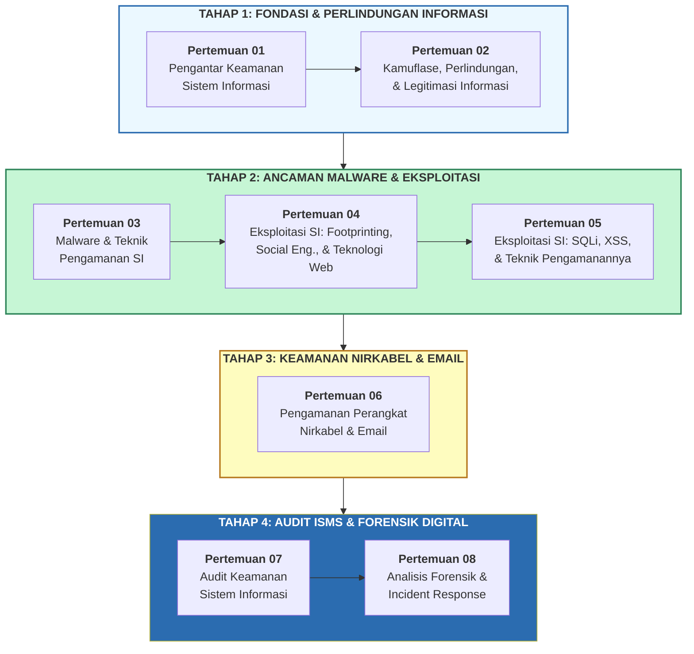

# Keamanan Sistem Informasi (`STSI4405`) — Ringkasan Materi Kuliah & Panduan Tutorial

* **Kode & Nama Mata Kuliah:** `STSI4405` — Keamanan Sistem Informasi (*Information Systems Security*)
* **Bobot SKS:** 2 SKS
* **Program Studi:** Sistem Informasi (Program Sarjana) — Fakultas Sains dan Teknologi, Universitas Terbuka
* **Referensi BMP Utama:** *Keamanan Sistem Informasi* (`STSI4405`), Universitas Terbuka
* **Pengembang RAT:** Fitria Amastini

---

## Daftar Isi

1. [Deskripsi Mata Kuliah dan Capaian Pembelajaran (CPMK)](#1-deskripsi-mata-kuliah-dan-capaian-pembelajaran-cpmk)
2. [Peta Konsep Alur Pembelajaran Keamanan Sistem Informasi](#2-peta-konsep-alur-pembelajaran-keamanan-sistem-informasi)
3. [Indeks Materi Pertemuan (Sesi 01 – Sesi 08)](#3-indeks-materi-pertemuan-sesi-01--sesi-08)
4. [Rincian Rancangan Aktivitas Tutorial (RAT)](#4-rincian-rancangan-aktivitas-tutorial-rat)
5. [Struktur Aktivitas, Modus Belajar, dan Tugas Tutorial](#5-struktur-aktivitas-modus-belajar-dan-tugas-tutorial)
6. [Daftar Pustaka Resmi](#6-daftar-pustaka-resmi)

---

## 1. Deskripsi Mata Kuliah dan Capaian Pembelajaran (CPMK)

### Deskripsi Singkat Mata Kuliah

Mata kuliah **Keamanan Sistem Informasi (`STSI4405`)** membekali mahasiswa dengan pengetahuan konseptual dan pengalaman praktis mengenai:

1. Pengertian keamanan, sistem, dan keamanan sistem informasi (`CIA Triad`).
2. Evaluasi keamanan sistem dan manajemen risiko informasi.
3. Pengamanan sistem informasi melalui metode kamuflase, perlindungan, dan legitimasi data (kriptografi, *digital signature*, *watermarking*, *steganografi*).
4. Keamanan email serta investigasi insiden pada layanan surat elektronik.
5. Keamanan aplikasi web dan penanganan kerentanan (`OWASP`, *SQL Injection*, `XSS`).
6. Eksploitasi keamanan sistem (*information gathering*, rekayasa sosial, metode peretasan, dan teknik pengamanannya).
7. Aspek hukum siber (*cyber law*) dan kepatuhan regulasi.
8. Keamanan jaringan nirkabel (*wireless* / `WiFi` & *Bluetooth*).
9. Manajemen keamanan informasi (`ISMS`, `ISO 27001`, `NIST`), audit jaringan, serta analisis forensik digital dan tanggap insiden.

### Capaian Pembelajaran Mata Kuliah (`CPMK`)

Setelah menempuh mata kuliah **Keamanan Sistem Informasi (`STSI4405`)**, mahasiswa diharapkan memiliki kemampuan untuk **menerapkan teknik-teknik dalam mengelola, mengevaluasi, dan mengamankan sistem informasi** (mencakup aplikasi web, email, infrastruktur jaringan kabel maupun nirkabel, hingga penanganan insiden forensik) berdasarkan pengetahuan yang telah diperolehnya.

---

## 2. Peta Konsep Alur Pembelajaran Keamanan Sistem Informasi

Keseluruhan materi dalam 8 sesi tutorial disusun secara sistematis mulai dari fondasi keamanan informasi dan kriptografi, pertahanan sistem terhadap *malware*, teknik eksploitasi dan pengamanan web/nirkabel, hingga audit tata kelola `ISMS` dan analisis forensik:

---

## 3. Indeks Materi Pertemuan (Sesi 01 – Sesi 08)

Berikut adalah navigasi langsung ke seluruh file catatan terstruktur untuk setiap pertemuan tutorial mata kuliah **`STSI4405`**:

| Sesi | Pokok Bahasan | File Catatan Markdown | Fokus Topik & Kerangka Utama |
| :---: | :--- | :--- | :--- |
| **01** | **Pengantar Keamanan Sistem Informasi** | [`pertemuan-01/README.md`](./pertemuan-01/README.md) | `CIA Triad`, sumber masalah keamanan (*firewall*, *patch*, *insider threat* / `NDA`), *Zero-Day Attack*, kerentanan `OWASP`, dan peran pengelola `ISMS`. |
| **02** | **Metode Kamuflase, Perlindungan, dan Legitimasi Informasi** | [`pertemuan-02/README.md`](./pertemuan-02/README.md) | Kriptografi *symmetric* vs *asymmetric*, *Caesar Cipher*, *Block Cipher* (`ECB`/`CBC`) vs *Stream Cipher*, *Hash Function*, `PKI`, *Digital Signature*, `PGP`, *Watermarking*, dan *Steganography*. |
| **03** | **Malware dan Teknik Pengamanan Sistem Informasi** | [`pertemuan-03/README.md`](./pertemuan-03/README.md) | Klasifikasi & penyebaran *Malware*, *Authentication* vs *Authorization*, faktor & kerentanan otentikasi, *SQL Injection*, `SSL`, `SSH`/*Tunnel*, *Patch*, *Firewall* (`WAF`), dan `IDS` vs `IPS`. |
| **04** | **Eksploitasi Keamanan Sistem Informasi (Bagian 1)** | [`pertemuan-04/README.md`](./pertemuan-04/README.md) | *Information Gathering* (*OSINT* vs Aktif), rekayasa sosial, pencarian infrastruktur (`WHOIS`, `Nslookup`, `Ping`, `Fping`, `Nmap`), protokol `HTTP`, *Cookies*, *Sessions*, dan *Proxy*. |
| **05** | **Eksploitasi Keamanan Sistem Informasi (Bagian 2)** | [`pertemuan-05/README.md`](./pertemuan-05/README.md) | Mekanisme & eksploitasi *SQL Injection*, *Blind SQL Injection* (Boolean), anatomi *Cross-Site Scripting* (`XSS`), tipe `XSS` (*Reflected*, *Persistent*, *DOM-Based*), serta mitigasinya. |
| **06** | **Teknologi Pengamanan Perangkat Jaringan Nirkabel dan Email** | [`pertemuan-06/README.md`](./pertemuan-06/README.md) | Komponen `WiFi` (`IEEE 802.11`), enkripsi (`WEP`, `WPA/TKIP`, `WPA2/AES-CCMP`, `EAP/RADIUS`), 5 kategori ancaman nirkabel, peretasan *Bluetooth*, kejahatan & forensik email. |
| **07** | **Audit Keamanan Sistem Informasi** | [`pertemuan-07/README.md`](./pertemuan-07/README.md) | Kerangka `ISMS`, siklus `PDCA` (`ISO 27001`), 5 fungsi inti `NIST CSF`, arsitektur keamanan jaringan (`DMZ`), manajemen log (`ELK Stack`), protokol monitoring, dan *Security Onion*. |
| **08** | **Analisis Forensik** | [`pertemuan-08/README.md`](./pertemuan-08/README.md) | Proses forensik `NIST SP 800-86`, jenis bukti, urutan volatilitas `IETF RFC 3227`, *Chain of Custody*, atribusi serangan (`MITRE ATT&CK`, *Cyber Kill Chain*, *Diamond Model*), *Incident Response*, dan `CMMC`. |

---

## 4. Rincian Rancangan Aktivitas Tutorial (RAT)

Berdasarkan dokumen resmi **Rancangan Aktivitas Tutorial (`RAT`) STSI4405**, berikut adalah pemetaan **Sub Pokok Bahasan** dan **Capaian Pembelajaran Khusus (`CPK`)** untuk setiap sesi tutorial:

### Tutorial 1: Pengantar Keamanan Sistem Informasi
* **Sub Pokok Bahasan:**
  1. Pengenalan Masalah Keamanan Sistem Informasi
  2. Pengertian, Tujuan, dan Pengelolaan Keamanan SI
* **Capaian Pembelajaran Khusus:** Menjelaskan contoh permasalahan keamanan informasi, menguraikan penanggung jawab keamanan SI beserta perannya, menjelaskan *Zero-Day Attack* dan tindakan penyelesaiannya, menguraikan jenis kerawanan keamanan, serta menjelaskan pengertian, tujuan, aset, risiko, dan evaluasi keamanan SI.

### Tutorial 2: Metode Kamuflase, Perlindungan dan Legitimasi Informasi
* **Sub Pokok Bahasan:**
  1. Kriptografi dan *Digital Signature*
  2. *Watermarking* dan Steganografi
* **Capaian Pembelajaran Khusus:** Menjelaskan definisi dan klasifikasi kriptografi, *cryptographic hash function*, `PKI`, *digital signature*, *Pretty Good Privacy* (`PGP`), klasifikasi dan aplikasi *digital watermarking*, serta konsep, tipe, aplikasi, dan perbedaan *digital steganography* dengan *watermarking*.

### Tutorial 3: Malware dan Teknik Pengamanan Sistem Informasi
* **Sub Pokok Bahasan:**
  1. *Malware*
  2. Teknik dan Metodologi Pengamanan Sistem Informasi
* **Capaian Pembelajaran Khusus:** Menjelaskan definisi, klasifikasi, dan teknik penyebaran *malware*; membedakan otentikasi dan otorisasi; menguraikan faktor dan kerentanan otentikasi; serta menjelaskan *bypass* otentikasi, modifikasi parameter, *SQL Injection*, `SSL`, `SSH`/*SSH Tunnel*, penggunaan *patch*, *firewall*, `IDS`, dan `IPS`.

### Tutorial 4: Eksploitasi Keamanan Sistem Informasi (Bagian 1)
* **Sub Pokok Bahasan:**
  1. Pengumpulan Informasi dan Rekayasa Sosial
  2. Teknologi dalam Website
* **Capaian Pembelajaran Khusus:** Menjelaskan definisi dan teknik pengumpulan informasi (*footprinting*), rekayasa sosial yang lazim terjadi, pemanfaatan *Search Engine* dan media sosial untuk pengumpulan informasi, serta menguraikan teknologi website (*HTTP Protocol Basic*, *Cookies*, *Session*, dan *Proxy*).

### Tutorial 5: Eksploitasi Keamanan Sistem Informasi (Bagian 2)
* **Sub Pokok Bahasan:**
  * Metode Peretasan dan Teknik Pengamanannya (*SQL Injection* dan *Cross-Site Scripting*)
* **Capaian Pembelajaran Khusus:** Menguraikan mekanisme eksploitasi dan teknik pengamanan terhadap serangan *SQL Injection* (`SQLi`) serta *Cross-Site Scripting* (`XSS`).

### Tutorial 6: Teknologi Pengamanan Perangkat Jaringan Nirkabel dan Email
* **Sub Pokok Bahasan:**
  1. Pengamanan Perangkat Jaringan Nirkabel (*Wireless*)
  2. Teknologi Email, Peretasan dan Keamanannya
* **Capaian Pembelajaran Khusus:** Menjelaskan konsep keamanan, komponen perangkat, tipe enkripsi, permasalahan, ancaman, serta metode peretasan dan pertahanan pada jaringan *wireless* maupun *Bluetooth*; serta menguraikan dasar-dasar sistem email, peristilahan email, tindakan kriminal melalui email, dan investigasi forensik email.

### Tutorial 7: Audit Keamanan SI
* **Sub Pokok Bahasan:**
  * Audit Keamanan Informasi dan Kebijakan Keamanan Jaringan
* **Capaian Pembelajaran Khusus:** Menguraikan pengelolaan keamanan sistem (`ISMS`) dan sistem audit keamanan informasi, kebijakan dan infrastruktur keamanan jaringan, analisis data keamanan jaringan (*Network Security Data*), teknologi serta protokol pemantauan sistem/jaringan, hingga analisis dan evaluasi peringatan sistem (*System Alert*).

### Tutorial 8: Analisis Forensik
* **Sub Pokok Bahasan:**
  * Sistem Analisis Forensik
* **Capaian Pembelajaran Khusus:** Menjelaskan dan melakukan analisis forensik atas data digital, menguraikan penanganan barang bukti dan penindakan (*Chain of Custody* & *Order of Volatility*), menjelaskan konsep *The Cyber Kill Chain* dan *The Diamond Model of Intrusion Analysis*, serta menerapkan konsep dan penanganan tanggap insiden (*Incident Response*).

---

## 5. Struktur Aktivitas, Modus Belajar, dan Tugas Tutorial

### Aktivitas Belajar & Modus Pelaksanaan

Tutorial mata kuliah `STSI4405` diselenggarakan melalui modus **Tutorial Tatap Muka / Tutorial Webinar (`TTM`/`Tuweb`)** maupun **Tutorial Online (`Tuton`)** dengan aktivitas belajar berikut:

1. **Studi Mandiri Modul:** Mahasiswa mempelajari materi pokok dalam Buku Materi Pokok (`BMP`) `STSI4405` dan materi inisiasi pada setiap sesi.
2. **Diskusi Tutorial:** Mahasiswa berpartisipasi aktif membahas studi kasus dan topik keamanan sistem informasi di forum diskusi.
3. **Pengerjaan Tugas Tutorial:** Mahasiswa menyelesaikan tugas terstruktur pada sesi evaluasi yang telah ditetapkan.

### Pemetaan Jadwal Tugas Tutorial (`RAT`)

Berdasarkan matriks `RAT` mata kuliah **Keamanan Sistem Informasi (`STSI4405`)**, evaluasi terstruktur dilaksanakan melalui **3 Tugas Tutorial** pada Sesi 3, Sesi 5, dan Sesi 7:

```mermaid
flowchart LR
    S12["<b>Sesi 1 – 2</b><br/>Pengantar Keamanan SI &<br/>Kriptografi / Legitimasi"]
    TT1["<b>TUGAS TUTORIAL 1</b><br/><i>Dilaksanakan pada Sesi 3</i><br/>Mencakup Materi Sesi 1–3"]
    S34["<b>Sesi 3 – 4</b><br/>Malware, Pengamanan SI,<br/>Footprinting, & Tek. Web"]
    TT2["<b>TUGAS TUTORIAL 2</b><br/><i>Dilaksanakan pada Sesi 5</i><br/>Mencakup Materi Sesi 4–5"]
    S56["<b>Sesi 5 – 6</b><br/>SQLi, XSS, Keamanan<br/>Nirkabel, & Email"]
    TT3["<b>TUGAS TUTORIAL 3</b><br/><i>Dilaksanakan pada Sesi 7</i><br/>Mencakup Materi Sesi 6–7"]
    S78["<b>Sesi 7 – 8</b><br/>Audit Keamanan SI (ISMS)<br/>& Analisis Forensik"]

    S12 --> S34 --> TT1
    TT1 --> S56 --> TT2
    TT2 --> S78 --> TT3

    style TT1 fill:#fefcbf,stroke:#b7791f,stroke-width:2px
    style TT2 fill:#fefcbf,stroke:#b7791f,stroke-width:2px
    style TT3 fill:#fefcbf,stroke:#b7791f,stroke-width:2px
    style S12 fill:#ebf8ff,stroke:#2b6cb0
    style S34 fill:#ebf8ff,stroke:#2b6cb0
    style S56 fill:#c6f6d5,stroke:#2f855a
    style S78 fill:#c6f6d5,stroke:#2f855a
```

---

## 6. Daftar Pustaka Resmi

1. **Pustaka Utama (`RAT`):** Buku Materi Pokok (`BMP`) **`STSI4405` — *Keamanan Sistem Informasi***, Program Studi Sistem Informasi, Fakultas Sains dan Teknologi, Universitas Terbuka.
2. **Materi Tutorial Online:** Materi Inisiasi Sesi 1 – Sesi 8, Mata Kuliah Keamanan Sistem Informasi (`STSI4405`), Universitas Terbuka.
3. **Stallings, W., & Brown, L.** *Computer Security: Principles and Practice*. Pearson Education.
4. **NIST Special Publications:** *NIST SP 800-86 (Forensic Techniques)*, *NIST SP 800-61 Rev. 2 (Incident Handling)*, dan *NIST Cybersecurity Framework (`CSF`)*.
5. **ISO/IEC 27001:** *Information Security Management Systems (`ISMS`) — Requirements*.