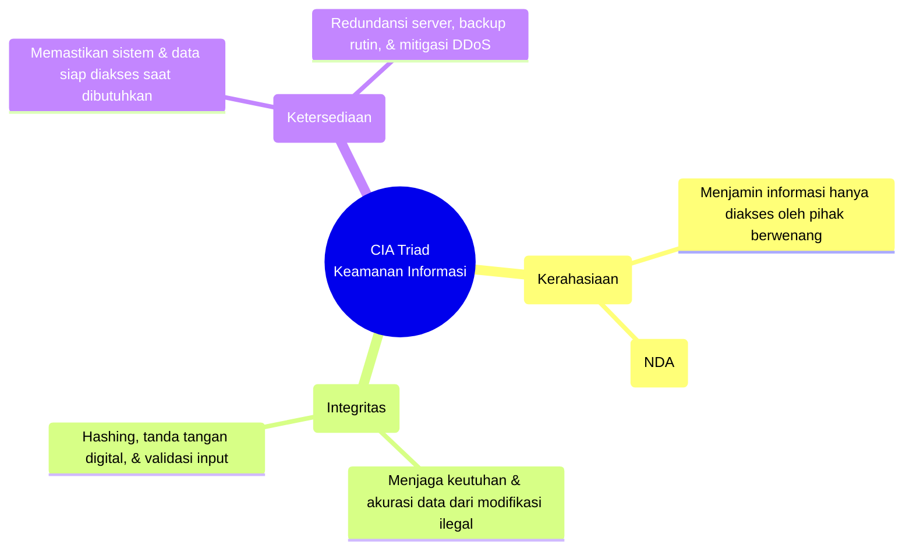
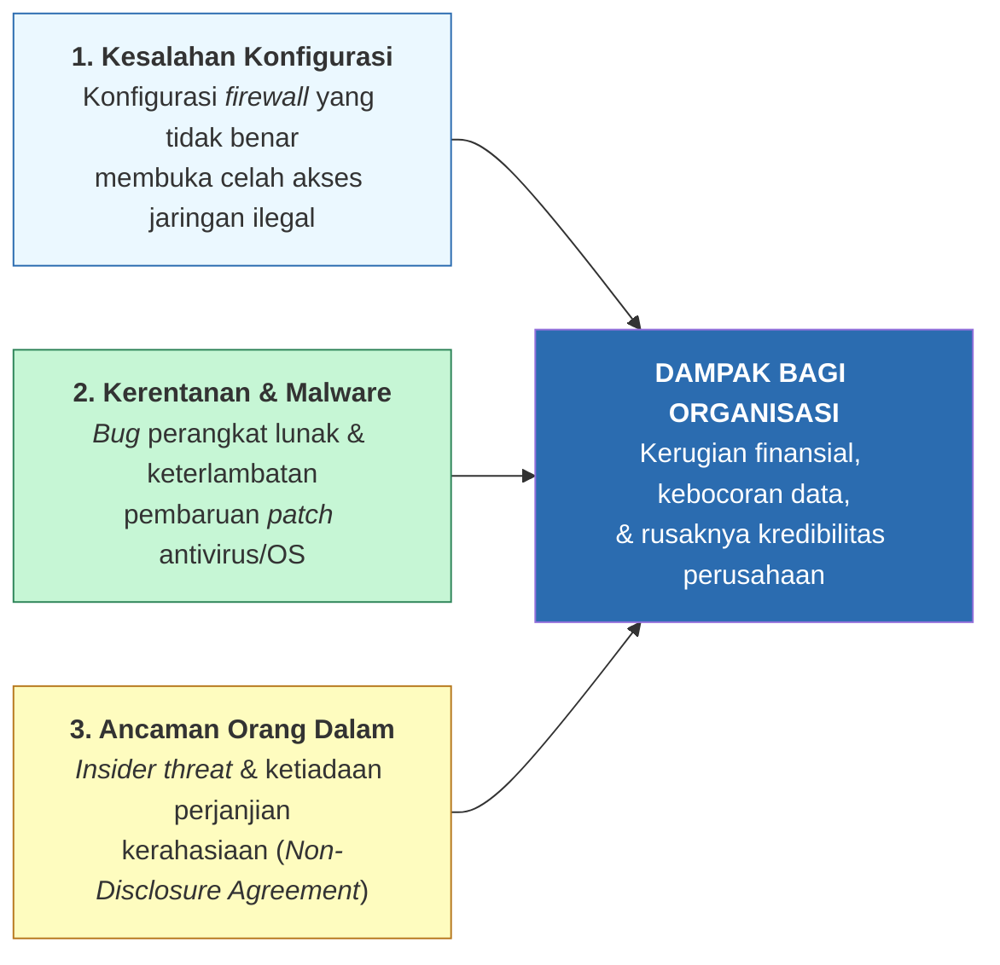
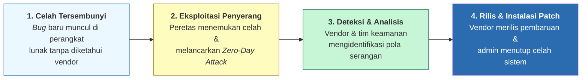
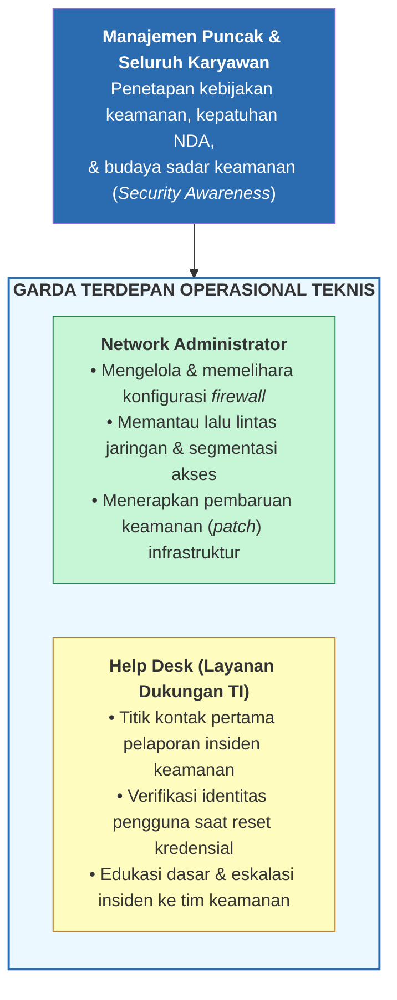

# Pertemuan 01: Pengantar Keamanan Sistem Informasi

* **Mata Kuliah:** Keamanan Sistem Informasi (`STSI4405`)
* **Program Studi:** Sistem Informasi — Fakultas Sains dan Teknologi, Universitas Terbuka
* **Topik:** Konsep Dasar Keamanan Informasi (`CIA Triad`), Sumber Masalah & Ancaman Keamanan SI, Kerentanan Aplikasi Web (`OWASP Top 10`), serta Tanggung Jawab Sistem Manajemen Keamanan Informasi (`ISMS`)

---

## Daftar Isi

1. [Konsep Dasar Keamanan Sistem Informasi](#1-konsep-dasar-keamanan-sistem-informasi)
2. [Pengenalan Masalah dan Sumber Ancaman Keamanan SI](#2-pengenalan-masalah-dan-sumber-ancaman-keamanan-si)
3. [Kerentanan Perangkat Lunak dan Zero-Day Attack](#3-kerentanan-perangkat-lunak-dan-zero-day-attack)
4. [Daftar Kerentanan Aplikasi Web (OWASP)](#4-daftar-kerentanan-aplikasi-web-owasp)
5. [Tanggung Jawab Sistem Manajemen Keamanan Informasi (ISMS)](#5-tanggung-jawab-sistem-manajemen-keamanan-informasi-isms)
6. [Referensi Resmi](#6-referensi-resmi)

---

## 1. Konsep Dasar Keamanan Sistem Informasi

### Pengertian Keamanan Sistem Informasi

**Keamanan Sistem Informasi** (*Information Systems Security*) adalah sekumpulan kebijakan, prosedur teknis, kontrol manajerial, dan mekanisme perlindungan yang diterapkan untuk menjaga aset informasi, perangkat keras, perangkat lunak, serta infrastruktur jaringan organisasi dari akses tidak sah, penyalahgunaan, gangguan, pengungkapan, perubahan, maupun perusakan.

> *"Keamanan informasi bukan sekadar urusan perangkat teknis semata, melainkan kombinasi sinergis antara teknologi, proses operasional, dan kesadaran manusia di dalam organisasi."*
> — **Modul Tutorial Online `STSI4405`** (*Universitas Terbuka*)

### Tiga Pilar Utama Keamanan Informasi (*CIA Triad*)

Setiap upaya pengamanan sistem informasi bertumpu pada keseimbangan tiga prinsip fundamental yang dikenal sebagai **CIA Triad**:

---

## 2. Pengenalan Masalah dan Sumber Ancaman Keamanan SI

Permasalahan keamanan pada sistem informasi dapat muncul dari celah konfigurasi teknis, kelalaian pemeliharaan sistem, maupun faktor kelalaian atau niat buruk manusia (*human factor*).

### Tiga Sumber Masalah Utama Keamanan SI

1. **Kesalahan Konfigurasi *Firewall* (*Misconfiguration*):**
   * *Firewall* berfungsi sebagai gerbang penyaring lalu lintas jaringan masuk dan keluar. Apabila aturan (*rule set*) pada *firewall* dikonfigurasi secara keliru—misalnya membiarkan *port* layanan sensitif terbuka untuk publik—penyerang dapat dengan mudah menyusup ke jaringan internal.
2. **Kerentanan akibat *Bug* dan Pembaruan *Patch* yang Terlambat:**
   * Perangkat lunak yang memiliki cacat pemrograman (*bug*) menciptakan celah keamanan (*vulnerability*). Selain itu, munculnya varian virus atau *malware* baru yang tidak diimbangi dengan pembaruan definisi (*update patch*) antivirus maupun sistem operasi membuat sistem rentan terinfeksi.
3. **Ancaman Orang Dalam (*Insider Threat*) dan Ketiadaan *NDA*:**
   * Ancaman tidak hanya datang dari peretas eksternal, tetapi juga dari personel internal organisasi (karyawan, kontraktor, maupun mitra). Jika organisasi tidak menerapkan perjanjian kerahasiaan (**Non-Disclosure Agreement / `NDA`**) serta pembatasan hak akses, kebocoran informasi strategis oleh orang dalam dapat menimbulkan kerugian materiil dan merusak kredibilitas perusahaan.

---

## 3. Kerentanan Perangkat Lunak dan Zero-Day Attack

### Konsep *Vulnerability*, *Exploit*, dan *Zero-Day Attack*

| Istilah Keamanan | Definisi Konseptual | Dampak dan Mekanisme |
| :--- | :--- | :--- |
| ***Vulnerability*** (Kerentanan) | Kelemahan atau celah pada desain, implementasi, konfigurasi, maupun manajemen sistem/perangkat lunak. | Menjadi titik masuk potensial bagi ancaman untuk menembus pertahanan sistem. |
| ***Zero-Day Vulnerability*** | Celah keamanan pada perangkat lunak yang **baru ditemukan dan belum diketahui** oleh pengembang (*vendor*) maupun publik. | Karena belum diketahui pengembang, **belum tersedia *patch* perbaikan** resmi saat celah tersebut ditemukan. |
| ***Zero-Day Attack*** | Serangan siber yang secara aktif mengeksploitasi *zero-day vulnerability* sebelum pengembang sempat merilis pembaruan keamanan. | Memiliki tingkat bahaya sangat tinggi karena pertahanan berbasis tanda tangan (*signature-based antivirus*) tradisional belum mampu mengenalinya. |

### Alur Terjadinya *Zero-Day Attack*

---

## 4. Daftar Kerentanan Aplikasi Web (OWASP)

**OWASP** (*Open Worldwide Application Security Project*) merupakan komunitas nirlaba global yang secara berkala merilis daftar risiko keamanan paling kritis pada aplikasi web (*OWASP Top 10*). Berdasarkan materi sesi ini, terdapat tiga kerentanan aplikasi utama yang sering dieksploitasi:

| Jenis Kerentanan (`OWASP`) | Mekanisme Terjadinya Kerentanan | Dampak Keamanan & Mitigasi Utama |
| :--- | :--- | :--- |
| **1. *Injection Flaws* (Contoh: *SQL Injection*)** | Penyerang menyisipkan kode atau perintah berbahaya (*malicious query*) melalui kolom input pengguna yang tidak divalidasi dengan benar sehingga dieksekusi langsung oleh penerjemah basis data. | **Dampak:** Pencurian isi basis data, modifikasi data ilegal, hingga pengambilalihan kendali peladen. **Mitigasi:** Validasi input ketat dan penggunaan *Parameterized Queries* (*Prepared Statements*). |
| **2. *Broken Authentication* (Otentikasi Rusak)** | Kelemahan pada mekanisme verifikasi identitas dan pengelolaan sesi (*session management*), seperti token sesi (*session token*) yang tidak diacak secara aman, tidak kedaluwarsa saat *logout*, atau terekspos di URL. | **Dampak:** Pembajakan akun pengguna (*session hijacking*) dan penyamaran identitas sebagai administrator. **Mitigasi:** Penerapan autentikasi multi-faktor (`MFA`), rotasi *session ID*, dan masa berlaku token yang ketat. |
| **3. *Sensitive Data Exposure* (Keterpaparan Data Sensitif)** | Aplikasi gagal melindungi data rahasia (kata sandi, nomor kartu kredit, identitas pribadi) karena tidak menerapkan enkripsi yang kuat baik saat penyimpanan maupun saat transmisi jaringan. | **Dampak:** Pencurian identitas (*identity theft*) dan penyalahgunaan data finansial pengguna. **Mitigasi:** Enkripsi data saat transit menggunakan protokol `HTTPS` (`TLS`) dan enkripsi kuat saat disimpan (*hashing* kata sandi & enkripsi *at-rest*). |

---

## 5. Tanggung Jawab Sistem Manajemen Keamanan Informasi (ISMS)

### Siapa yang Bertanggung Jawab terhadap Keamanan Informasi?

Keberhasilan **Sistem Manajemen Keamanan Informasi** (*Information Security Management System* / `ISMS`) menuntut keterlibatan seluruh lapisan organisasi—mulai dari manajemen puncak yang menetapkan kebijakan, pengguna akhir yang mematuhi prosedur, hingga tim teknis garda terdepan:

### Perbandingan Peran Teknis: *Network Administrator* vs *Help Desk*

| Peran / Unit Kerja | Tanggung Jawab Utama dalam Keamanan Sistem Informasi |
| :--- | :--- |
| **Network Administrator** | Bertanggung jawab menjaga keamanan arsitektur jaringan, melakukan konfigurasi *firewall* secara tepat, mengendalikan hak akses jaringan, memantau anomali lalu lintas data, serta memastikan *patch* keamanan diterapkan tepat waktu. |
| **Help Desk** | Bertindak sebagai lini pertama (*first line of defense*) dalam menerima laporan gangguan atau dugaan insiden dari pengguna, memverifikasi keabsahan identitas pengguna sebelum melakukan perubahan akun/kata sandi (mencegah rekayasa sosial), dan meneruskan insiden kritis ke tim spesialis keamanan. |
| **Seluruh Pengguna & Manajemen** | Mematuhi kebijakan keamanan informasi, menjaga kerahasiaan kredensial akun, menandatangani serta menaati *Non-Disclosure Agreement* (`NDA`), dan melaporkan aktivitas mencurigakan secara cepat. |

---

## 6. Referensi Resmi

1. **Modul Tutorial Online UT:** Materi Tutorial Online Sesi 1 — *Pengantar Keamanan Sistem Informasi*, Mata Kuliah Keamanan Sistem Informasi (`STSI4405`), Program Studi Sistem Informasi, Fakultas Sains dan Teknologi, Universitas Terbuka.
2. **Buku Materi Pokok (BMP) UT:** *Keamanan Sistem Informasi* (`STSI4405`), Universitas Terbuka.
3. **OWASP Foundation:** *OWASP Top Ten Web Application Security Risks*.
4. **ISO/IEC 27001:** *Information Security Management Systems (ISMS) — Requirements*. International Organization for Standardization.
5. **Whitman, M. E., & Mattord, H. J.** *Principles of Information Security*. Cengage Learning.