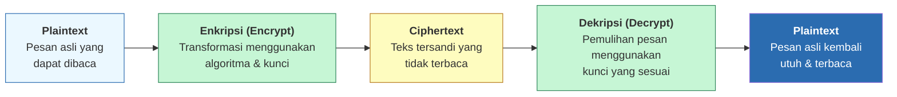
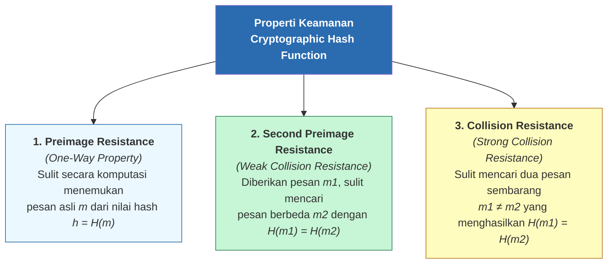
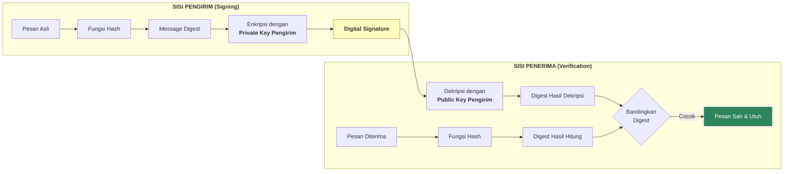

# Pertemuan 02: Metode Kamuflase, Perlindungan, dan Legitimasi Informasi

* **Mata Kuliah:** Keamanan Sistem Informasi (`STSI4405`)
* **Program Studi:** Sistem Informasi — Fakultas Sains dan Teknologi, Universitas Terbuka
* **Topik:** Konsep & Klasifikasi Kriptografi (*Symmetric* & *Asymmetric*), *Caesar Cipher*, *Block Cipher* (`ECB` & `CBC`) vs *Stream Cipher*, *Cryptographic Hash Function*, *Public Key Infrastructure* (`PKI`), *Digital Signature*, *Pretty Good Privacy* (`PGP`), *Watermarking*, dan *Digital Steganography*

---

## Daftar Isi

1. [Konsep Dasar Kriptografi dan Empat Tujuan Utamanya](#1-konsep-dasar-kriptografi-dan-empat-tujuan-utamanya)
2. [Klasifikasi Kriptografi: Symmetric vs Asymmetric Key](#2-klasifikasi-kriptografi-symmetric-vs-asymmetric-key)
3. [Block Cipher (ECB & CBC) dan Stream Cipher](#3-block-cipher-ecb--cbc-dan-stream-cipher)
4. [Cryptographic Hash Function](#4-cryptographic-hash-function)
5. [Public Key Infrastructure (PKI), Digital Signature, dan PGP](#5-public-key-infrastructure-pki-digital-signature-dan-pgp)
6. [Watermarking dan Digital Steganography](#6-watermarking-dan-digital-steganography)
7. [Referensi Resmi](#7-referensi-resmi)

---

## 1. Konsep Dasar Kriptografi dan Empat Tujuan Utamanya

### Pengertian dan Alur Proses Umum Kriptografi

**Kriptografi** (*Cryptography*) adalah seni dan ilmu untuk mengamankan komunikasi serta informasi dengan mengubah data yang dapat dibaca menjadi format tersandi sehingga hanya pihak yang berhak yang dapat memahaminya.

### Empat Fokus Pembahasan (Tujuan) Kriptografi

1. **Kerahasiaan (*Confidentiality*):** Menjaga agar isi pesan atau informasi tidak dapat dibaca oleh pihak yang tidak berwenang.
2. **Integritas (*Integrity*):** Memastikan pesan tidak mengalami perubahan, penyisipan, atau penghapusan selama proses transmisi maupun penyimpanan.
3. **Otentikasi (*Authentication*):** Memverifikasi dan memastikan keaslian identitas pihak pengirim maupun penerima pesan.
4. **Tidak Dapat Disangkal (*Non-Repudiation*):** Mencegah pengirim menyangkal bahwa dirinya telah mengirimkan pesan atau melakukan transaksi tertentu.

---

## 2. Klasifikasi Kriptografi: Symmetric vs Asymmetric Key

### Perbandingan *Symmetric Key* vs *Public Key (Asymmetric)*

| Aspek Pembeda | *Symmetric Key Cryptography* | *Public Key Cryptography* (*Asymmetric Key*) |
| :--- | :--- | :--- |
| **Jumlah & Jenis Kunci** | Menggunakan **satu kunci rahasia bersama (*shared key*)** yang sama untuk enkripsi maupun dekripsi. | Menggunakan **sepasang kunci berbeda**: **kunci publik (*public key*)** untuk mengenkripsi/memverifikasi dan **kunci privat (*private key*)** untuk mendekripsi/menandatangani. |
| **Kecepatan Komputasi** | Sangat cepat dan efisien untuk mengenkripsi volume data besar. | Relatif lebih lambat karena melibatkan perhitungan matematis kompleks (seperti faktorisasi bilangan prima). |
| **Tantangan Utama** | Distribusi kunci rahasia (*key distribution*) secara aman kepada pihak penerima. | Kebutuhan infrastruktur sertifikasi (`PKI`) untuk memvalidasi kepemilikan kunci publik. |
| **Contoh Algoritma** | `DES`, `3DES`, `AES`, `RC4`, `Blowfish`, *Caesar Cipher*. | `RSA` (*Rivest-Shamir-Adleman*), `DSA`, *Elliptic Curve Cryptography* (`ECC`). |

### Ilustrasi *Caesar Cipher* (Kriptografi Substitusi Klasik)

**Caesar Cipher** merupakan teknik kriptografi substitusi monoalfabetik yang menggantikan setiap huruf pada *plaintext* dengan huruf lain yang bergeser sejauh jumlah langkah tertentu (*parameter shift*). Pada contoh pergeseran **3 alfabet ke kanan** ($k = 3$):

* *Plaintext:* `T` $\rightarrow$ *Ciphertext:* `W`
* *Plaintext:* `U` $\rightarrow$ *Ciphertext:* `X`
* *Plaintext:* `V` $\rightarrow$ *Ciphertext:* `Y`
* *Plaintext:* `W` $\rightarrow$ *Ciphertext:* `Z`

Secara matematis, enkripsi dan dekripsi *Caesar Cipher* dirumuskan sebagai:

$$E_n(x) = (x + n) \pmod{26}, \qquad D_n(x) = (x - n) \pmod{26}$$

---

## 3. Block Cipher (ECB & CBC) dan Stream Cipher

Dalam mekanisme enkripsi simetris, cara memecah dan memproses *plaintext* dibagi menjadi dua pendekatan utama:

1. **Stream Cipher:** Memproses dan mengenkripsi data secara berkelanjutan **bit demi bit** atau **byte demi byte** menggunakan aliran kunci (*keystream*). Cocok untuk komunikasi *real-time* seperti aliran audio/video.
2. **Block Cipher:** Membagi *plaintext* ke dalam blok-blok berukuran bit tetap (misalnya 64-bit atau 128-bit) sebelum dienkripsi.

### Perbandingan Mode Operasi *Block Cipher*: `ECB` vs `CBC`

| Mode Operasi | Mekanisme Pemrosesan Blok | Karakteristik dan Keamanan |
| :--- | :--- | :--- |
| ***Electronic Code Book* (`ECB`)** | Setiap blok *plaintext* dienkripsi **secara terpisah dan independen** menggunakan kunci yang sama. | Sederhana dan dapat diproses paralel, namun blok *plaintext* yang identik akan menghasilkan blok *ciphertext* yang sama sehingga pola data masih dapat terbaca. |
| ***Cipher Block Chaining* (`CBC`)** | Setiap blok *plaintext* di-`XOR`-kan terlebih dahulu dengan blok *ciphertext* sebelumnya sebelum dienkripsi. Blok pertama menggunakan ***Initialization Vector* (`IV`)**. | Jauh lebih aman karena menyamarkan pola data; perubahan satu bit pada blok awal akan memengaruhi seluruh blok *ciphertext* berikutnya. |

---

## 4. Cryptographic Hash Function

### Pengertian dan Karakteristik Fungsi *Hash*

**Cryptographic Hash Function** adalah algoritma matematis satu arah (*one-way function*) dan deterministik yang menerima masukan (*input*) pesan dengan panjang bervariasi (*arbitrary length*) dan menghasilkan keluaran (*output*) berukuran tetap (*fixed length*) yang disebut **nilai *hash*** atau ***message digest***.

* **Algoritma *Hash* Populer:** `MD4`, `MD5`, `SHA` (*Secure Hash Algorithm*), `SHA-1`, `SHA-256`, dan `RIPEMD`.

### Tiga Properti Keamanan Utama Fungsi *Hash*

---

## 5. Public Key Infrastructure (PKI), Digital Signature, dan PGP

### Public Key Infrastructure (`PKI`)

**PKI** adalah kerangka terpadu yang terdiri atas perangkat keras, perangkat lunak, sumber daya manusia, kebijakan (*policy*), dan prosedur untuk **membuat, mengelola, menyimpan, mendistribusikan, serta mencabut sertifikat digital (*digital certificate*)**.

* **Peran *Certificate Authority* (`CA`):** Pihak ketiga tepercaya yang memverifikasi identitas individu maupun organisasi serta menerbitkan sertifikat digital untuk menjamin keabsahan kunci publik.

### Digital Signature (Tanda Tangan Digital)

**Digital Signature** adalah mekanisme kriptografi asimetris yang digunakan untuk membuktikan keaslian sumber pesan (*authentication*), memvalidasi keutuhan isi pesan (*integrity*), serta menjamin sifat tidak dapat disangkal (*non-repudiation*).

### Pretty Good Privacy (`PGP`)

**PGP** adalah program komputer yang dikembangkan oleh **Philip Zimmermann** pada tahun **1991** untuk menyediakan privasi kriptografi dan otentikasi pada komunikasi elektronik (seperti surel dan berkas), yang kemudian distandarkan melalui **OpenPGP**.

Empat komponen utama dalam sebuah kunci `PGP`:

1. **Identitas Pemilik:** Nama dan alamat surel pemilik kunci beserta nilai numerik penyusun kunci.
2. **Tujuan Penggunaan Kunci:** Penanda fungsi kunci (misalnya untuk penandatanganan/*signing* atau untuk enkripsi).
3. **Jenis Algoritma Pembangkit Kunci:** Algoritma kriptografi yang digunakan (seperti `RSA` atau `DSA`).
4. **Tanggal Kedaluwarsa (*Expiration Date*):** Masa berlaku kunci (bersifat opsional).

---

## 6. Watermarking dan Digital Steganography

Selain kriptografi yang menyamarkan isi pesan menjadi teks acak (*ciphertext*), perlindungan dan legitimasi informasi juga dilakukan dengan menyisipkan informasi ke dalam media digital:

| Aspek Pembeda | *Digital Watermarking* | *Digital Steganography* |
| :--- | :--- | :--- |
| **Tujuan Utama** | Melindungi hak cipta (*copyright*), membuktikan kepemilikan, dan melacak distribusi ilegal aset digital. | **Menyembunyikan keberadaan pesan rahasia** di dalam kanal atau media digital yang tampak normal (*cover medium*). |
| **Visibilitas** | Dapat bersifat terlihat (*visible watermark*, seperti logo transparan) maupun tidak terlihat (*invisible watermark*). | Selalu dirancang **tidak terdeteksi** oleh indra manusia maupun analisis kasat mata agar tidak menimbulkan kecurigaan. |
| **Contoh Penerapan** | Penyisipan identitas pemilik pada foto digital, dokumen PDF resmi, berkas audio, atau video komersial. | Menyisipkan teks rahasia ke dalam piksel gambar (`LSB`), berkas audio, atau paket jaringan. |

---

## 7. Referensi Resmi

1. **Modul Tutorial Online UT:** Materi Sesi 2 — *Metode Kamuflase, Perlindungan, dan Legitimasi Informasi*, Mata Kuliah Keamanan Sistem Informasi (`STSI4405`), Universitas Terbuka.
2. **Buku Materi Pokok (BMP) UT:** *Keamanan Sistem Informasi* (`STSI4405`), Universitas Terbuka.
3. **Stallings, W.** *Cryptography and Network Security: Principles and Practice*. Pearson Education.
4. **Schneier, B.** *Applied Cryptography: Protocols, Algorithms, and Source Code in C*. John Wiley & Sons.
5. **Zimmermann, P. R.** (1995). *The Official PGP User's Guide*. MIT Press.