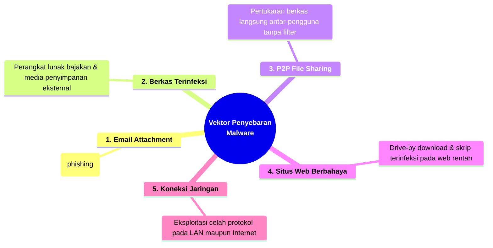
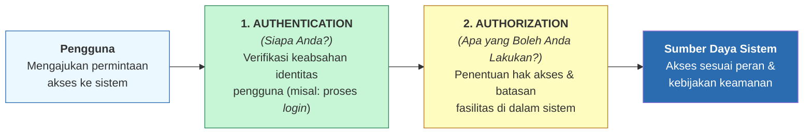
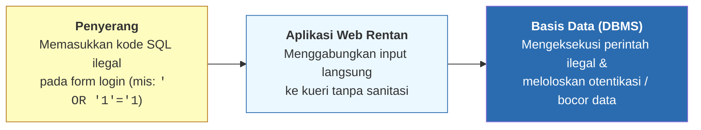
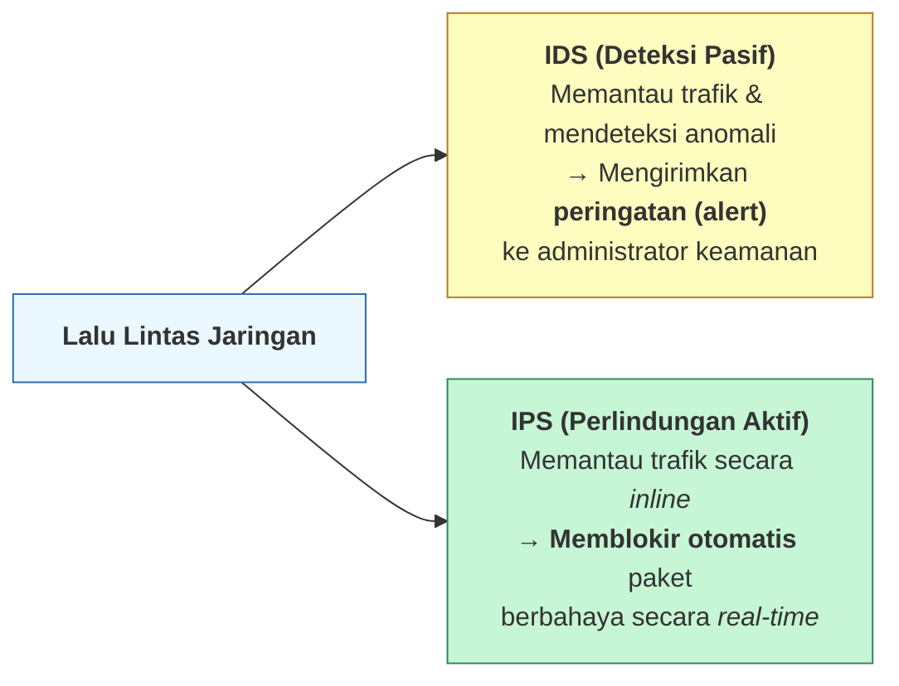

# Pertemuan 03: Malware dan Teknik Pengamanan Sistem Informasi

* **Mata Kuliah:** Keamanan Sistem Informasi (`STSI4405`)
* **Program Studi:** Sistem Informasi — Fakultas Sains dan Teknologi, Universitas Terbuka
* **Topik:** Konsep, Klasifikasi & Penyebaran *Malware*, *Authentication* vs *Authorization*, Faktor & Kerentanan Otentikasi beserta Mitigasinya, *SQL Injection*, Protokol Komunikasi Aman (`SSL`, `SSH`, *SSH Tunnel*), Pembaruan *Patch*, *Firewall* (`WAF`), serta `IDS` vs `IPS`

---

## Daftar Isi

1. [Malware: Konsep, Klasifikasi, dan Vektor Penyebaran](#1-malware-konsep-klasifikasi-dan-vektor-penyebaran)
2. [Authentication vs Authorization dan Faktor Otentikasi](#2-authentication-vs-authorization-dan-faktor-otentikasi)
3. [Kerentanan Otentikasi dan Teknik Mitigasinya](#3-kerentanan-otentikasi-dan-teknik-mitigasinya)
4. [Serangan SQL Injection](#4-serangan-sql-injection)
5. [Protokol Komunikasi Aman: SSL, SSH, dan SSH Tunnel](#5-protokol-komunikasi-aman-ssl-ssh-dan-ssh-tunnel)
6. [Teknik Pertahanan Sistem dan Jaringan: Patch, Firewall, IDS, dan IPS](#6-teknik-pertahanan-sistem-dan-jaringan-patch-firewall-ids-dan-ips)
7. [Referensi Resmi](#7-referensi-resmi)

---

## 1. Malware: Konsep, Klasifikasi, dan Vektor Penyebaran

### Pengertian Malware

**Malware** (*Malicious Software*) adalah perangkat lunak berbahaya yang mewakili berbagai bentuk kode program penyusup (*intrusive*), bersifat merusak atau bermusuhan, dan dirancang untuk mengganggu fungsi normal sistem komputer, mencuri data, maupun mengambil alih kendali perangkat tanpa izin pemiliknya.

### Klasifikasi Jenis-Jenis Malware

| Jenis Malware | Karakteristik dan Mekanisme Kerja | Dampak Utama pada Sistem |
| :--- | :--- | :--- |
| **Virus** | Kode berbahaya yang menempelkan dirinya pada berkas program (*executable*) dan aktif ketika berkas tersebut dijalankan. | Merusak data, memodifikasi berkas sistem, dan menyebar ke program lain. |
| **Worm** | Program berbahaya yang mampu **menggandakan dirinya sendiri** secara otomatis melalui jaringan tanpa memerlukan berkas inang atau interaksi pengguna. | Menghabiskan *bandwidth* jaringan, membebani memori/CPU, dan menyebar sangat cepat. |
| **Trojan Horse** | Perangkat lunak yang menyamar sebagai program sah/bermanfaat untuk menipu pengguna agar menginstalnya. | Membuka akses jarak jauh bagi penyerang dan mencuri informasi sensitif. |
| **Ransomware** | *Malware* yang mengenkripsi seluruh berkas atau mengunci akses sistem korban hingga tebusan (*ransom*) dibayarkan. | Melumpuhkan operasional organisasi dan mengakibatkan kehilangan akses data kritis. |
| **Rootkit & Bootkit** | Perangkat lunak tersembunyi yang memodifikasi inti sistem operasi (*kernel*) atau sektor *boot* (*Master Boot Record*) agar tidak terdeteksi antivirus. | Memberikan hak akses administrator tertinggi (*root*) kepada penyerang secara persisten. |
| **Backdoor** | Mekanisme tersembunyi yang melewati prosedur otentikasi normal untuk masuk kembali ke dalam sistem. | Memungkinkan penyerang mengakses sistem sewaktu-waktu tanpa diketahui administrator. |
| **Spyware & Keylogger** | *Spyware* memantau aktivitas pengguna secara diam-diam; *Keylogger* khusus merekam setiap ketikan tombol *keyboard*. | Pencurian kata sandi, nomor kartu kredit, dan rahasia perusahaan. |
| **Adware & Greyware** | *Adware* menampilkan iklan tidak diinginkan secara agresif; *Greyware* mencakup aplikasi tidak diinginkan (*PUP*) yang mengganggu privasi/performa. | Menurunkan kinerja perangkat dan berpotensi mengarahkan pengguna ke situs berbahaya. |
| **Botnet** | Jaringan komputer terinfeksi (*zombie*) yang dikendalikan secara terpusat oleh penyerang (*Botmaster*). | Digunakan untuk melancarkan serangan masif seperti *DDoS* atau pengiriman *spam*. |
| **Dialer & Data-Stealing** | *Dialer* membajak koneksi modem/telepon ke nomor berbiaya tinggi; *Data-stealing malware* menargetkan pencurian basis data atau kredensial. | Kerugian finansial langsung dan kebocoran aset informasi. |

### Lima Vektor Utama Penyebaran Malware

---

## 2. Authentication vs Authorization dan Faktor Otentikasi

### Perbedaan Fundamental: *Authentication* vs *Authorization*

Dalam arsitektur kendali akses (*access control*), proses verifikasi identitas dan pemberian hak akses merupakan dua tahapan berurutan yang berbeda fungsi:

* **Otentikasi (*Authentication*):** Proses menentukan keabsahan identitas seseorang untuk dapat masuk ke dalam suatu sistem.
* **Otorisasi (*Authorization*):** Proses menentukan hak akses seseorang untuk melakukan tindakan tertentu setelah berhasil terotentikasi. Keberhasilan *login* tidak berarti pengguna memiliki kendali penuh atas seluruh fitur sistem, melainkan dibatasi sesuai hak yang diberikan (*principle of least privilege*).

### Tiga Faktor dan Metode Otentikasi

1. **Tiga Faktor Otentikasi (*Authentication Factors*):**
   * **Faktor Pengetahuan (*Something You Know*):** Sesuatu yang diketahui dan diingat oleh pengguna, seperti *password*, `PIN`, atau jawaban pertanyaan rahasia.
   * **Faktor Kepemilikan (*Something You Have*):** Sesuatu yang secara fisik dimiliki oleh pengguna, seperti *security token*, ponsel pintar (*OTP*), atau *bank online token*.
   * **Faktor Pewarisan / Biometrik (*Something You Are*):** Profil fisik atau perilaku alami pengguna yang unik dan sulit diubah, seperti sidik jari (*fingerprint*), pola retina, pengenalan wajah (*face recognition*), atau tanda tangan.

2. **Metode Otentikasi (*Authentication Methods*):**
   * ***Single-Factor Authentication* (`SFA`):** Pengguna hanya diminta memberikan **salah satu** dari tiga faktor otentikasi (contoh: memasukkan *password* saja).
   * ***Two-Factor Authentication* (`2FA`):** Pengguna diwajibkan memberikan **kombinasi dua** faktor otentikasi yang berbeda (contoh: `PIN` sebagai faktor pengetahuan + *Token* sebagai faktor kepemilikan).

---

## 3. Kerentanan Otentikasi dan Teknik Mitigasinya

Implementasi mekanisme otentikasi dan manajemen sesi (*session management*) pada aplikasi web sering memiliki kelemahan yang dapat dieksploitasi penyerang. Berikut adalah pemetaan kerentanan lazim beserta langkah mitigasinya:

### A. Kerentanan Kredensial dan Kata Sandi

| Kerentanan Lazim (*Common Vulnerability*) | Teknik Mitigasi dan Pengamanan |
| :--- | :--- |
| **Pengiriman kredensial melalui kanal tidak terenkripsi** (*Credential Over Unencrypted Channel*) | Mewajibkan penggunaan protokol terenkripsi (`HTTPS`/`TLS`) pada seluruh halaman transaksi dan *login*. |
| **Kebijakan kata sandi lemah** (*Inadequate Password Policy*) & penggunaan akun *default* | Menerapkan kebijakan kata sandi kuat (*strong password policy*), mengganti seluruh kredensial bawaan (*default*), serta menyimpan kata sandi dalam bentuk **nilai *hash* ber-salt** (bukan *plaintext*). |
| **Serangan *Brute Force*, *Dictionary Attack*, & *User Enumeration*** | Menerapkan pembatasan jumlah percobaan *login* (*account lockout* / *blocking request*), menggunakan *CAPTCHA*, serta merancang **pesan *error* generik** (misal: *"Username atau password salah"*) agar tidak membocorkan informasi akun valid kepada peretas. |
| **Eksploitasi fungsi *"Remember Me"*** melalui *browser cache*, *cookie*, dan *web storage* | Menonaktifkan fungsi *autocomplete* pada kolom sensitif dan mengamankan token penyimpanan lokal dengan atribut `HttpOnly` dan `Secure`. |

### B. Kerentanan Fitur Reset Kata Sandi dan *Logout*

* **Kerentanan Fitur Reset Kata Sandi:** Pertanyaan rahasia yang mudah ditebak, kesempatan menebak tidak terbatas, serta tautan (*link*) reset yang mudah diprediksi, dapat digunakan berulang kali (*reusable*), dan tidak memiliki batas waktu kedaluwarsa (*expiration*).
  * **Mitigasi:** Menggunakan mekanisme verifikasi berlapis dan menyisipkan **token khusus** pada tautan reset dengan kriteria:
    1. Panjang minimal $N$ karakter ($N > 6$).
    2. Himpunan karakter yang luas (contoh: kombinasi alfanumerik `[A-Za-z0-9]`).
    3. Dihasilkan secara acak kriptografis (*cryptographically random*) sehingga tidak dapat diprediksi.
    4. Memiliki masa berlaku singkat (misalnya **30 hingga 60 menit**) dan hanya berlaku untuk satu kali pakai (*single-use*).
* **Kelemahan *Logout* (*Logout Weakness*):** Validasi akhir sesi yang tidak sempurna (*incorrect session destruction*) sehingga pengguna yang telah keluar masih dapat diakses sesinya, atau kegagalan pembatasan akses `URL` (*bypassing authentication*).
  * **Mitigasi:** Menghancurkan seluruh data sesi di sisi peladen (*server-side session invalidation*) saat *logout* serta menambahkan blok kode pemeriksaan validitas sesi pada setiap halaman terproteksi.

### C. Kerentanan Manipulasi Sesi dan *Redirection*

* **Kerentanan Lazim:** Modifikasi parameter pada tautan (`URL`), pengalihan halaman yang tidak tepat (*incorrect redirection*), intersepsi respons *HTTP* melalui *proxy*, serta pendugaan nilai `SessionID` yang berpola.
* **Mitigasi:**
  1. Mengenkripsi parameter sensitif yang dikirimkan melalui tautan.
  2. Menambahkan perintah penghentian eksekusi skrip (misalnya `exit()` atau `die()`) segera setelah memanggil fungsi *redirect* agar konten terproteksi di bawahnya tidak ikut dikirimkan ke klien.
  3. Merancang `SessionID` yang benar-benar acak, tidak dapat diprediksi, hanya valid untuk satu sesi aktif, dan dibatasi waktu (*time-limited*).

---

## 4. Serangan SQL Injection

### Konsep dan Mekanisme *SQL Injection*

**SQL Injection (`SQLi`)** adalah teknik serangan yang menyisipkan perintah atau kueri `SQL` berbahaya melalui kolom masukan (*input*) pengguna pada aplikasi web untuk memanipulasi basis data di belakangnya. Serangan ini terjadi apabila masukan pengguna tidak melalui proses **sanitasi** dan validasi yang benar sebelum dieksekusi oleh mesin basis data.

* **Kerentanan Lazim:** Formulir otentikasi (*login form*) atau kolom pencarian yang menyusun kueri basis data secara dinamis melalui penggabungan *string* (*string concatenation*) tanpa menggunakan *Prepared Statements* atau *Parameterized Queries*.

---

## 5. Protokol Komunikasi Aman: SSL, SSH, dan SSH Tunnel

| Protokol | Kepanjangan & Definisi | Mekanisme Keamanan & Penggunaan Utama |
| :--- | :--- | :--- |
| **SSL** *(berkembang menjadi TLS)* | ***Secure Sockets Layer*** — Protokol kriptografi untuk menciptakan saluran komunikasi aman melalui jaringan internet. | Memadukan **Public Key Infrastructure (`PKI`)** (untuk otentikasi identitas dan pertukaran kunci) dengan **enkripsi simetris** (untuk mengenkripsi isi komunikasi) sehingga pihak ketiga tidak dapat menyadap atau mengubah data tanpa terdeteksi. |
| **SSH** | ***Secure Shell*** — Protokol jaringan kriptografis untuk pertukaran data dan kendali jarak jauh (*remote access*) secara aman. | Lazim digunakan pada sistem operasi berbasis **Unix/Linux** sebagai pengganti protokol lama yang tidak terenkripsi seperti **Telnet** (yang mengirimkan data dan kata sandi dalam format teks polos/*plaintext*). |
| **SSH Tunnel** | ***SSH Port Forwarding / Tunneling*** — Metode pengiriman lalu lintas data sembarang (*arbitrary data*) melalui terowongan koneksi `SSH` yang terenkripsi. | Melindungi protokol atau aplikasi yang tidak memiliki fitur enkripsi bawaan agar tetap aman saat melintasi jaringan publik. |

---

## 6. Teknik Pertahanan Sistem dan Jaringan: Patch, Firewall, IDS, dan IPS

### Penggunaan Pembaruan *Patch* (*Patch Management*)

**Patch** adalah potongan kode perangkat lunak yang dirilis oleh pengembang (*vendor*) untuk memperbarui program komputer maupun data pendukungnya. Empat fungsi utama penerapan *patch*:
1. Memperbaiki kelemahan keamanan (*security vulnerability*).
2. Memperbaiki kesalahan pemrograman (*bug*).
3. Menambahkan fitur atau kapabilitas baru.
4. Meningkatkan kinerja (*performance*) dan stabilitas sistem.

### Pemasangan Proteksi *Firewall* dan *WAF*

**Firewall** adalah sistem keamanan jaringan (berupa perangkat keras maupun perangkat lunak) yang mengawasi dan mengendalikan lalu lintas data masuk dan keluar antara jaringan internal yang tepercaya dengan jaringan eksternal (internet) berdasarkan aturan keamanan yang ditetapkan administrator TI.

* ***Web Application Firewall* (`WAF`):** Bentuk *firewall* berbasis perangkat lunak yang bekerja khusus pada lapisan aplikasi (`HTTP`/`HTTPS`) untuk menyaring, memantau, dan memblokir serangan web seperti *SQL Injection* dan *Cross-Site Scripting* (`XSS`).

### Perbandingan *Intrusion Detection System* (`IDS`) vs *Intrusion Prevention System* (`IPS`)

| Dimensi Perbandingan | *Intrusion Detection System* (`IDS`) | *Intrusion Prevention System* (`IPS`) |
| :--- | :--- | :--- |
| **Sifat Kerja** | **Pemantauan pasif** (*passive monitoring*). | **Perlindungan aktif** (*active prevention* / *inline*). |
| **Respons terhadap Ancaman** | Mendeteksi potensi gangguan dan **mengirimkan peringatan (*alert*)** kepada petugas keamanan untuk diselidiki dan ditindaklanjuti. | Mendeteksi ancaman sekaligus **secara otomatis memblokir atau menjatuhkan (*drop*)** lalu lintas berbahaya sebelum mencapai target. |
| **Metode Deteksi** | Berbasis tanda tangan serangan (*signature-based*), analisis anomali perilaku (*anomaly-based*), atau kombinasi keduanya (*hybrid*). | Menggunakan metode deteksi *signature*, anomali, maupun *hybrid* yang terintegrasi dengan aturan pemblokiran otomatis. |

---

## 7. Referensi Resmi

1. **Modul Tutorial Online UT:** Materi Sesi 3 — *Malware dan Teknik Pengamanan Sistem Informasi*, Mata Kuliah Keamanan Sistem Informasi (`STSI4405`), Universitas Terbuka.
2. **Buku Materi Pokok (BMP) UT:** *Keamanan Sistem Informasi* (`STSI4405`), Universitas Terbuka.
3. **Stallings, W., & Brown, L.** *Computer Security: Principles and Practice*. Pearson Education.
4. **Pfleeger, C. P., Pfleeger, S. L., & Margulies, J.** *Security in Computing*. Prentice Hall.
5. **OWASP Foundation.** *OWASP Authentication Cheat Sheet & SQL Injection Prevention Cheat Sheet*.