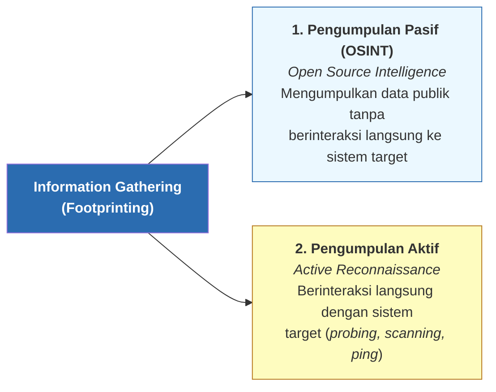
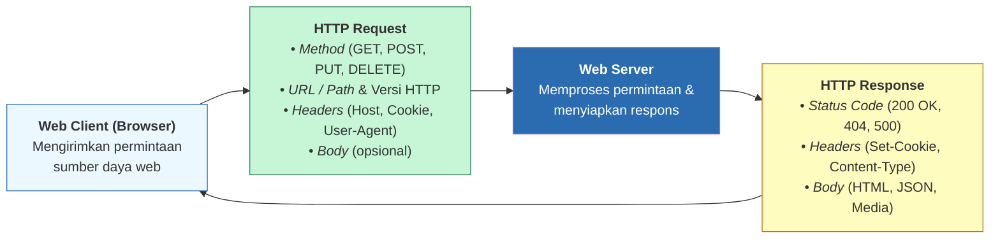
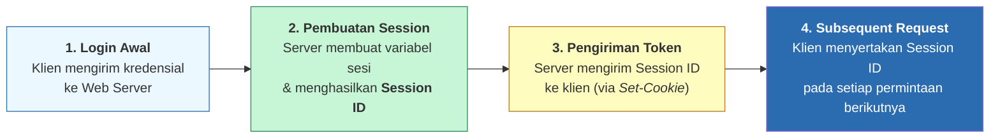

# Pertemuan 04: Eksploitasi Keamanan Sistem Informasi

* **Mata Kuliah:** Keamanan Sistem Informasi (`STSI4405`)
* **Program Studi:** Sistem Informasi — Fakultas Sains dan Teknologi, Universitas Terbuka
* **Topik:** Pengumpulan Informasi (*Information Gathering* / *Footprinting*), *OSINT* vs *Active Reconnaissance*, Rekayasa Sosial (*Social Engineering*), Pencarian Informasi Infrastruktur (`WHOIS`, `Nslookup`, `Ping`, `Fping`, `Nmap`), serta Teknologi dalam Website (`HTTP`, *Cookies*, *Sessions*, dan *Proxy*)

---

## Daftar Isi

1. [Pengumpulan Informasi (Information Gathering) dan Rekayasa Sosial](#1-pengumpulan-informasi-information-gathering-dan-rekayasa-sosial)
2. [Teknik Mendapatkan Informasi Bisnis dan Rekayasa Sosial](#2-teknik-mendapatkan-informasi-bisnis-dan-rekayasa-sosial)
3. [Pencarian Informasi Infrastruktur: Domain, DNS, dan IP Address](#3-pencarian-informasi-infrastruktur-domain-dns-dan-ip-address)
4. [Teknologi dalam Website: Protokol HTTP](#4-teknologi-dalam-website-protokol-http)
5. [Manajemen Keadaan Web: Cookies dan Sessions](#5-manajemen-keadaan-web-cookies-dan-sessions)
6. [Arsitektur dan Tipe Proxy Server](#6-arsitektur-dan-tipe-proxy-server)
7. [Referensi Resmi](#7-referensi-resmi)

---

## 1. Pengumpulan Informasi (Information Gathering) dan Rekayasa Sosial

### Konsep *Penetration Testing* dan *Footprinting*

Dalam praktik **Penetration Testing** atau **Ethical Hacking**, setiap tahapan pengujian harus dilaksanakan secara metodis, terorganisir, dan terkontrol agar efektif dalam mengkaji celah keamanan target. Langkah paling krusial pada fase awal pengujian adalah **Pengumpulan Informasi (*Information Gathering*)** atau ***Footprinting*** untuk memetakan profil organisasi, jaringan, dan sistem target.



### Perbandingan Pengumpulan Informasi Pasif vs Aktif

| Dimensi Perbandingan | Pengumpulan Informasi Pasif (`OSINT`) | Pengumpulan Informasi Aktif (*Active*) |
| :--- | :--- | :--- |
| **Mekanisme Kerja** | Mengumpulkan informasi tentang jaringan dan sistem target dari sumber-sumber terbuka yang tersedia secara publik. | Melakukan interaksi atau pengiriman paket secara langsung ke infrastruktur dan sistem target. |
| **Jejak / Eksposur** | **Tidak mengekspos** identitas maupun keberadaan pengumpul informasi ke dalam log keamanan target. | Berpotensi meninggalkan jejak di log sistem (`Firewall` / `IDS`) dan dapat terdeteksi oleh administrator target. |
| **Contoh Aktivitas** | Penelusuran mesin pencari, analisis media sosial, kueri basis data `WHOIS`, dan arsip dokumen publik. | Pemindaian jaringan menggunakan `Nmap`, pengiriman paket `Ping` / `Fping`, dan *banner grabbing*. |

---

## 2. Teknik Mendapatkan Informasi Bisnis dan Rekayasa Sosial

Sebelum melakukan pengujian teknis terhadap peladen, penguji keamanan mengumpulkan konteks bisnis dan memetakan faktor manusia (*human element*) untuk kebutuhan **Rekayasa Sosial (*Social Engineering*)**—yakni teknik manipulasi psikologis untuk memengaruhi target agar membocorkan informasi rahasia atau melakukan tindakan tertentu.

### Tiga Sumber Utama Informasi Bisnis & Infrastruktur

1. **Mesin Pencari (*Search Engine*):**
   * Menelusuri situs web resmi organisasi, daftar mitra dan rekanan bisnis, pengumuman lowongan pekerjaan (yang sering mengungkap teknologi/perangkat lunak internal yang digunakan), laporan keuangan, dokumen publik yang terindeks (*Google Dorking*), serta situs pengarsipan web (*Web Archive*).
2. **Media Sosial (*Social Media*):**
   * Mempelajari budaya perusahaan, struktur hierarki jabatan, alur proses bisnis, teknologi yang diadopsi, serta aplikasi internal.
   * Membangun **peta jaringan orang (*people network mapping*)** guna memilih target individu yang paling tepat dan rentan terhadap serangan manipulasi psikologis (*social engineering*).
3. **Infrastruktur Teknis:**
   * Mengidentifikasi nama domain utama dan subdomain, *DNS server* yang digunakan, *mail server* (`MX`), serta alamat IP (*IP Address*) dari peladen utama.

---

## 3. Pencarian Informasi Infrastruktur: Domain, DNS, dan IP Address

### A. Pencarian Informasi Domain (`WHOIS`)

Layanan dan perangkat lunak `WHOIS` digunakan untuk mengetahui informasi pendaftaran domain, pemilik (*registrant*), kontak administratif, tanggal kedaluwarsa, serta *name server* yang mengelola domain target:

* **Layanan Berbasis Web:** `http://who.is`, `http://whois.domaintools.com`, `http://bgp.he.net/`, `http://networking.ringofsaturn.com/Tools/whois.php`, `http://www.networksolutions.com/whois/index.jsp`, `http://www.betterwhois.com/`.
* **Aplikasi Desktop:** **SmartWhois** (untuk sistem operasi Windows).

### B. Pencarian Informasi *DNS Server* (`Nslookup`)

`Nslookup` (*Name Server Lookup*) adalah utilitas baris perintah (*command-line*) maupun layanan web (seperti `http://network-tools.com/nslook/`) untuk mengkueri catatan *Domain Name System* (`DNS`):

```bash
# Kueri dasar DNS pada Windows maupun Linux/Unix
nslookup targetorganization.com

# Pencarian Reverse DNS (PTR) berdasarkan alamat IP
nslookup -type=PTR <IPAddress>

# Pencarian Mail Exchange (MX) server milik domain
nslookup -type=MX domain.com

# Pencarian Name Server (NS) otoritatif milik domain
nslookup -type=NS domain.com
```

### C. Pencarian Informasi *IP Address* dan Pemindaian Jaringan (`Ping`, `Fping`, `Nmap`)

| Perangkat (*Tool*) | Contoh Perintah (*Command*) | Fungsi dan Keterangan Teknis |
| :--- | :--- | :--- |
| **`Ping`** | `ping organizationtarget.com` | Menguji keterjangkauan (*reachability*) host target melalui protokol `ICMP` sekaligus mengetahui alamat IP-nya. |
| **`Fping`** | `fping -a -g 192.168.1.0/24`<br>`fping -a -g 192.168.1.0 192.168.1.255` | Mengirimkan paket `ICMP Echo` ke banyak host sekaligus dalam rentang subnet; opsi `-a` menampilkan host yang aktif (*alive*) dan `-g` menghasilkan daftar IP dari rentang jaringan. |
| **`Nmap`** *(Ping Scan)* | `nmap -sn 10.0.0.0/24`<br>`nmap -sn 10.0.0.0-255` | Melakukan penemuan host aktif (*host discovery*) tanpa pemindaian port (pada versi terbaru `Nmap`, opsi lama `-sP` digantikan oleh `-sn`). |
| **`Nmap`** *(OS & TCP Scan)* | `nmap -O -sT 192.168.1.0/24` | Mendeteksi jenis sistem operasi target (`-O`) menggunakan metode koneksi penuh *TCP Connect Scan* (`-sT`). |
| **`Nmap`** *(Stealth & Version)* | `nmap -sS -sV -p 192.168.1.0` | Melakukan pemindaian setengah terbuka *TCP SYN Stealth Scan* (`-sS`) dan mendeteksi versi layanan/aplikasi (`-sV`) pada port tertentu (`-p`). |

---

## 4. Teknologi dalam Website: Protokol HTTP

**HTTP** (*Hypertext Transfer Protocol*) merupakan protokol komunikasi dasar pada arsitektur *World Wide Web* yang bekerja dengan model **klien-peladen (*client-server*)** melalui pertukaran pesan permintaan dan tanggapan:



---

## 5. Manajemen Keadaan Web: Cookies dan Sessions

Karena protokol `HTTP` bersifat *stateless* (tidak menyimpan status antar-permintaan secara bawaan), aplikasi web menggunakan **Cookies** dan **Sessions** untuk mengenali identitas dan status pengguna di setiap halaman:



### Perbandingan *Cookies* vs *Sessions*

| Aspek Pembeda | *Cookies* | *Sessions* |
| :--- | :--- | :--- |
| **Lokasi Penyimpanan** | Disimpan secara lokal pada **sisi klien** (*browser* pengguna). | Variabel sesi disimpan di **sisi peladen (*server*)**, sedangkan sisi klien hanya menyimpan **token sesi (*Session ID*)**. |
| **Masa Berlaku (*Lifespan*)** | Dapat bertahan lama sesuai konfigurasi atribut `Expires` / `Max-Age`. | **Lebih singkat** dibandingkan *cookies*; otomatis berakhir ketika pengguna menutup peramban, *logout*, atau melewati batas waktu (*timeout*). |
| **Struktur & Atribut Keamanan** | Memiliki format:<br>• **`Domain`:** cakupan domain (mis. `google.com`)<br>• **`Path`:** direktori akses (mis. `/downloads`)<br>• **`Expires`:** batas waktu kedaluwarsa<br>• **`Content`:** pasangan `nama=value`<br>• **`HttpOnly` flag:** mencegah akses *cookie* lewat JavaScript (`XSS`)<br>• **`Secure` flag:** mewajibkan pengiriman hanya melalui `HTTPS` | Bergantung pada keacakan dan kerahasiaan **Session ID** yang dikirimkan kembali oleh klien pada setiap permintaan lanjutan (*subsequent request*). |

---

## 6. Arsitektur dan Tipe Proxy Server

### Pengertian, Fungsi, dan Alasan Penggunaan *Proxy*

**Proxy Server** adalah sistem perantara (*intermediary*) yang berdiri di antara klien dan peladen tujuan untuk meneruskan, menyaring, maupun memodifikasi permintaan dan respons jaringan.

* **Tiga Fungsi Utama Proxy:**
  1. Berperan sebagai *firewall* dan melakukan penyaringan (*filtering*) lalu lintas data jaringan.
  2. Berbagi koneksi jaringan (*connection sharing*) antar-pengguna internal.
  3. Penyimpanan data sementara (*caching*) untuk mempercepat akses konten berulang.

* **Lima Alasan Organisasi Menggunakan Proxy:**
  1. ***Monitoring and Filtering:*** Mengawasi aktivitas akses internet karyawan dan memblokir situs berbahaya atau tidak produktif.
  2. ***Improving Performance:*** Menyimpan salinan halaman/berkas (*web caching*) untuk menghemat *bandwidth* dan mempercepat waktu muat.
  3. ***Translation:*** Menerjemahkan protokol atau format permintaan jaringan antar-sistem.
  4. **Akses Layanan Secara Anonim:** Menyembunyikan alamat IP asli klien dari peladen eksternal.
  5. **Keamanan (*Security*):** Menyaring kode berbahaya dan melindungi identitas topologi jaringan internal.

### Tiga Tipe Utama *Proxy*

| Tipe Proxy | Posisi dan Mekanisme Kerja | Contoh Penggunaan |
| :--- | :--- | :--- |
| **1. *Forward Proxy*** | Berada di sisi **klien**; menerima permintaan dari klien internal dan meneruskannya ke internet atas nama klien. | *Proxy* jaringan kantor atau sekolah untuk menyaring akses keluar dan melakukan *caching*. |
| **2. *Open Proxy*** | *Forward proxy* yang dapat diakses secara bebas oleh **siapa saja** di internet tanpa otentikasi khusus. | Sering dimanfaatkan untuk menyembunyikan alamat IP asli (*anonymizer*), namun berisiko disalahgunakan. |
| **3. *Reverse Proxy*** | Berada di depan **peladen (*web server*)**; menerima permintaan dari klien eksternal di internet dan meneruskannya ke peladen internal di belakangnya. | Penyeimbangan beban (*load balancing*), terminasi `SSL`, proteksi serangan `DDoS`, dan `WAF` (mis. Cloudflare, Nginx). |

---

## 7. Referensi Resmi

1. **Modul Tutorial Online UT:** Materi Sesi 4 — *Eksploitasi Keamanan Sistem Informasi: Pengumpulan Informasi dan Rekayasa Sosial, Teknologi dalam Website*, Mata Kuliah Keamanan Sistem Informasi (`STSI4405`), Universitas Terbuka.
2. **Buku Materi Pokok (BMP) UT:** *Keamanan Sistem Informasi* (`STSI4405`), Universitas Terbuka.
3. **Engebretson, P.** *The Basics of Hacking and Penetration Testing: Ethical Hacking and Penetration Testing Made Easy*. Syngress / Elsevier.
4. **Lyon, G. F.** *Nmap Network Scanning: The Official Nmap Project Guide to Network Discovery and Security Scanning*. Insecure.Com LLC.
5. **Stuttard, D., & Pinto, M.** *The Web Application Hacker's Handbook: Finding and Exploiting Security Flaws*. John Wiley & Sons.