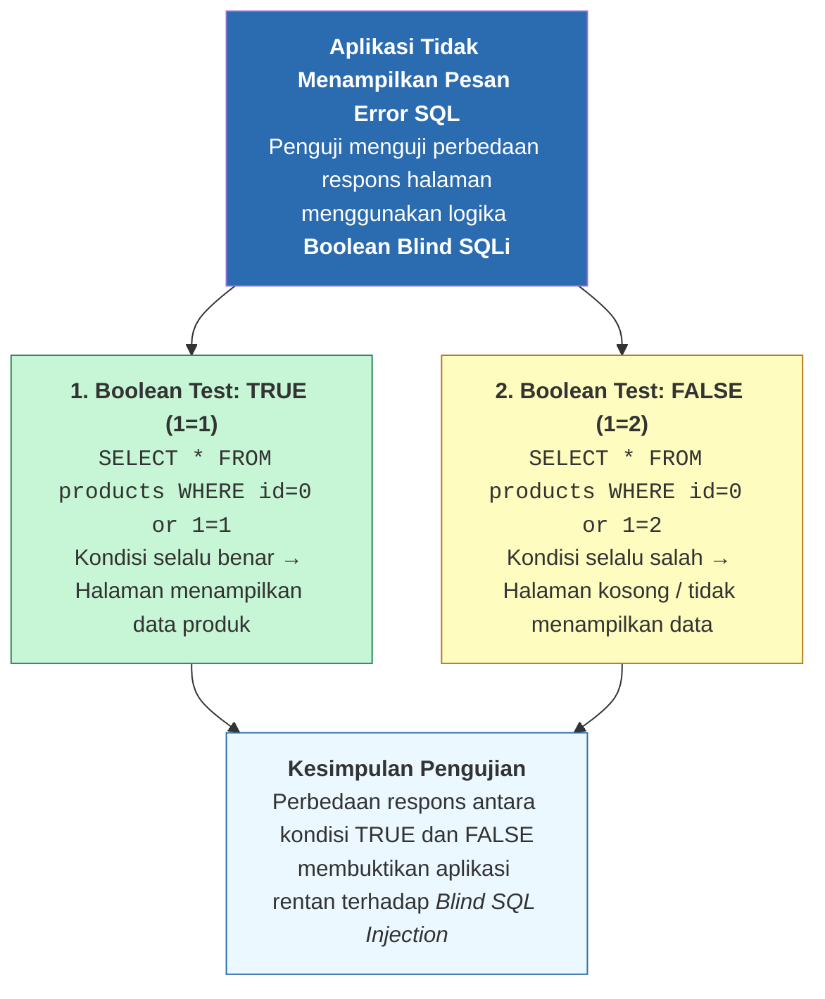
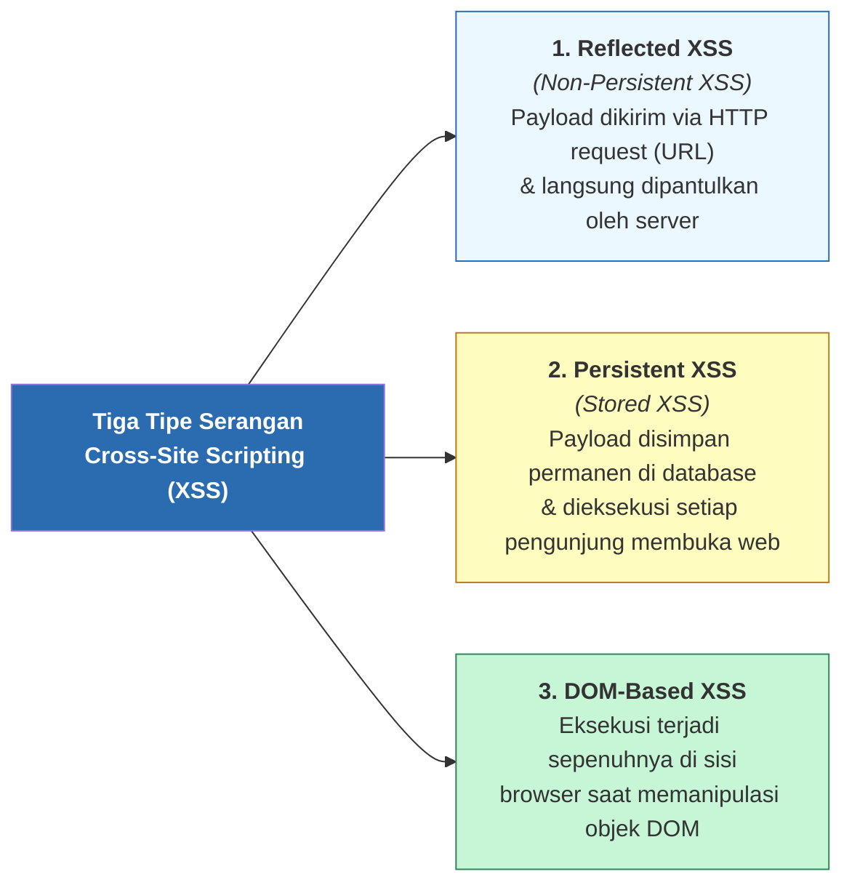

# Pertemuan 05: Eksploitasi Keamanan Sistem Informasi: Metode Peretasan dan Teknik Pengamanannya

* **Mata Kuliah:** Keamanan Sistem Informasi (`STSI4405`)
* **Program Studi:** Sistem Informasi — Fakultas Sains dan Teknologi, Universitas Terbuka
* **Topik:** Konsep & Cara Kerja *SQL Injection* (`SQLi`), Teknik Penemuan & *Blind SQL Injection*, Konsep & Anatomi *Cross-Site Scripting* (`XSS`), Tiga Tipe `XSS` (*Reflected*, *Persistent*, *DOM-Based*), serta Teknik Pengamanan dan Mitigasinya

---

## Daftar Isi

1. [Konsep dan Bahaya Serangan SQL Injection (SQLi)](#1-konsep-dan-bahaya-serangan-sql-injection-sqli)
2. [Cara Kerja dan Mekanisme Eksploitasi SQL Injection](#2-cara-kerja-dan-mekanisme-eksploitasi-sql-injection)
3. [Teknik Penemuan Celah dan Blind SQL Injection](#3-teknik-penemuan-celah-dan-blind-sql-injection)
4. [Konsep dan Cara Kerja Cross-Site Scripting (XSS)](#4-konsep-dan-cara-kerja-cross-site-scripting-xss)
5. [Anatomi Eksploitasi dan Tiga Tipe Serangan XSS](#5-anatomi-eksploitasi-dan-tiga-tipe-serangan-xss)
6. [Teknik Pengamanan dan Mitigasi SQL Injection serta XSS](#6-teknik-pengamanan-dan-mitigasi-sql-injection-serta-xss)
7. [Referensi Resmi](#7-referensi-resmi)

---

## 1. Konsep dan Bahaya Serangan SQL Injection (SQLi)

### Pengertian *SQL Injection*

**SQL Injection (`SQLi`)** adalah tindakan menyisipkan perintah `SQL` (*injecting SQL command*) buatan penyerang ke dalam kolom masukan (*input*) aplikasi web yang tidak semestinya, dengan tujuan mengakses, membaca, memanipulasi, atau merusak isi basis data di balik aplikasi tersebut.

```php
// Ilustrasi koneksi dan eksekusi kueri basis data pada aplikasi web
$dbh = mysql_connect("192.168.3.1", "user", "password");
mysql_select_db("test_db");
mysql_query("SELECT * FROM users");
```

### Dampak dan Bahaya Serangan *SQL Injection*

Apabila penyerang berhasil mengeksploitasi celah `SQLi`, dampak yang ditimbulkan melampaui sekadar perubahan tampilan halaman web:

1. **Pencurian Data Sensitif dan Kredensial:** Mengakses daftar akun pengguna beserta kata sandinya, Nomor Induk Kependudukan (`NIK`), nama ibu kandung, nomor telepon, hingga nomor kartu kredit pelanggan.
2. **Manipulasi dan Penghapusan Data:** Mengubah saldo transaksi, memodifikasi hak akses akun menjadi administrator, atau menghapus tabel basis data secara permanen.
3. **Pelumpuhan Layanan (*Denial of Service*):** Menghabiskan seluruh sumber daya (*resource* CPU/memori/koneksi) peladen basis data melalui kueri berat sehingga sistem basis data tidak dapat berfungsi melayani pengguna sah.

---

## 2. Cara Kerja dan Mekanisme Eksploitasi SQL Injection

Serangan *SQL Injection* terjadi karena aplikasi web langsung menggabungkan masukan pengguna (*unsanitized data*) ke dalam struktur perintah kueri `SQL` tanpa melalui proses penyaringan (*sanitasi*) maupun validasi tipe data terlebih dahulu.

### Contoh Kode Rentan pada PHP

```php
// KODE RENTAN: Input dari parameter $_GET["username"] digabung langsung ke kueri SQL
mysql_query("SELECT * FROM users WHERE username = '" . $_GET["username"] . "'");
```

### Perbandingan Eksekusi Normal vs Eksploitasi *SQL Injection*

| Skenario Permintaan (`URL Request`) | Kueri `SQL` yang Terbentuk di Peladen | Dampak Eksekusi pada Basis Data |
| :--- | :--- | :--- |
| **Input Normal:**<br>`http://localhost/test_sqli.php?username=armando` | `SELECT * FROM users WHERE username='armando'` | Mesin basis data hanya mencari dan mengembalikan baris data milik pengguna bernama `armando`. |
| **Input Eksploitasi (`SQLi`):**<br>`http://localhost/test_sqli.php?username=foo' or ''='` | `SELECT * FROM users WHERE username='foo' or ''=''` | Karena kondisi `''=''` selalu bernilai benar (`TRUE`), klausa `WHERE` menjadi benar untuk **seluruh baris**, sehingga seluruh data tabel `users` terbuka atau otentikasi terlewati (*bypass*). |

---

## 3. Teknik Penemuan Celah dan Blind SQL Injection

### Langkah Identifikasi Celah *SQL Injection*

Untuk mendeteksi keberadaan kerentanan `SQLi` pada sebuah aplikasi web, penguji keamanan melakukan tahapan berikut:

1. **Pemetaan dan Kategorisasi Parameter Input:** Mengidentifikasi dan mencatat seluruh titik masuk data yang dikirimkan klien ke peladen, mencakup parameter `GET`, `POST`, *HTTP Headers*, dan `Cookies`.
2. **Pengujian Karakter Khusus (*Fuzzing*):** Memasukkan karakter sintaksis `SQL` (seperti tanda petik tunggal `'`, tanda kutip ganda `"`, atau koma `,`) ke dalam parameter input untuk memaksa kueri menjadi tidak valid secara sintaksis dan memicu pesan kesalahan (*error message*).

#### Skenario Sederhana: *Error-Based SQL Injection*
* **Konteks:** Halaman `ecommerce.php` menerima parameter `id` bertipe bilangan bulat (*integer*) untuk menampilkan detail produk dari basis data.
* **Pengujian:** Ketika nilai parameter `id` diganti dengan karakter koma (`,`), peladen menampilkan pesan kesalahan: `error: incorrect SQL query`.
* **Informasi yang Bocor:** Pesan kesalahan mentah (*verbose error*) tersebut mengungkapkan jenis sistem manajemen basis data (`DBMS`) yang dipakai, struktur kueri, serta lokasi penempatan berkas kode program di peladen—yang kemudian dimanfaatkan penyerang untuk menyusun eksploitasi lanjutan.

### *Blind SQL Injection* (Pengujian Berbasis Boolean)

Apabila administrator telah menonaktifkan tampilan pesan kesalahan *database* sehingga tidak muncul pesan `incorrect SQL query` pada layar, penguji menggunakan teknik *fingerprinting* yang disebut **Blind SQL Injection** melalui pengujian logika **Boolean** (`TRUE` vs `FALSE`):



---

## 4. Konsep dan Cara Kerja Cross-Site Scripting (XSS)

### Pengertian *Cross-Site Scripting* (`XSS`)

**Cross-Site Scripting (`XSS`)** adalah jenis serangan injeksi kode berbahaya (*input validation attack*) di mana penyerang menyisipkan skrip sisi klien (umumnya *JavaScript* atau tag `HTML`) ke dalam halaman web tepercaya. Serangan ini terjadi karena aplikasi tidak melakukan validasi dan sanitasi memadai pada data masukan pengguna sebelum data tersebut ditampilkan kembali (*output*) di peramban (*browser*) pengguna.

### Contoh Kode Rentan pada PHP

```php
// KODE RENTAN: Variabel $_GET['name'] langsung dicetak ke halaman HTML tanpa sanitasi
<?php
echo '<h4>Hello ' . $_GET['name'] . '</h4>';
?>
```

#### Perbandingan Eksekusi Normal vs Injeksi Skrip `XSS`

* **Permintaan Normal:**
  * *URL:* `http://vulnsite/welcome.php?name=armando`
  * *Output HTML di Browser:* `<h4>Hello armando</h4>` (Teks ditampilkan normal).
* **Permintaan Injeksi `XSS`:**
  * *URL:* `http://vulnsite/welcome.php?name=</h4><script>alert('This is an XSS');</script>`
  * *Output HTML di Browser:*
    ```html
    <h4>Hello </h4><script>alert('This is an XSS');</script><h4></h4>
    ```
  * *Dampak:* Tag `<h4>` ditutup lebih awal dan peramban mengeksekusi blok `<script>` berbahaya seolah-olah skrip tersebut berasal secara sah dari peladen `vulnsite`.

---

## 5. Anatomi Eksploitasi dan Tiga Tipe Serangan XSS

### Anatomi Pencurian *Session Cookie* melalui `XSS`

1. **Identifikasi Celah pada Domain yang Sama (*Same-Origin*):** Jika peladen otentikasi situs target berada di subdomain `auth.y.com` dan menyimpan *session cookie* pada cakupan domain tersebut, penyerang harus menemukan celah `XSS` pada domain/subdomain yang sama (`auth.y.com`) agar skrip memiliki hak akses membaca `document.cookie`.
2. **Pembuatan dan Pengiriman *Payload*:** Penyerang menyusun tautan berbahaya (*malicious link*) yang memuat skrip *JavaScript* pencuri *cookie* (atau menyamarkannya di balik tautan gambar) lalu mengirimkannya kepada korban agar diklik.
3. **Pengambilalihan Sesi (*Session Hijacking*):** Saat korban mengeklik tautan tersebut, peramban korban menjalankan skrip dan mengirimkan *session cookie* korban ke peladen milik penyerang.

### Tiga Tipe Serangan *Cross-Site Scripting* (`XSS`)



| Tipe `XSS` | Mekanisme Penyimpanan & Eksekusi | Karakteristik & Tingkat Dampak |
| :--- | :--- | :--- |
| ***Reflected XSS*** (*Non-Persistent*) | *Payload* tidak disimpan di peladen, melainkan disisipkan pada parameter permintaan `HTTP` (tautan `URL`) dan langsung dipantulkan kembali dalam respons halaman web. | Membutuhkan rekayasa sosial agar korban mengeklik tautan berbahaya yang dikirimkan oleh penyerang. |
| ***Persistent XSS*** (*Stored XSS*) | *Payload* berbahaya disimpan secara permanen di dalam basis data peladen (misalnya melalui kolom komentar, forum, atau profil pengguna) tanpa sanitasi. | **Paling berbahaya** karena kode otomatis dieksekusi di peramban **semua pengguna** yang mengunjungi halaman tersebut tanpa perlu mengeklik tautan khusus. |
| ***DOM-Based XSS*** | Kerentanan berada pada kode *JavaScript* sisi klien (*client-side*) yang memproses dan memodifikasi struktur *Document Object Model* (`DOM`) halaman secara tidak aman. | Proses eksploitasi terjadi langsung di dalam peramban korban tanpa harus melalui respons baru dari peladen. |

---

## 6. Teknik Pengamanan dan Mitigasi SQL Injection serta XSS

Untuk menutup celah kerentanan aplikasi web dari serangan `SQLi` maupun `XSS`, pengembang dan administrator sistem menerapkan pertahanan berlapis (*defense-in-depth*):

| Jenis Serangan | Teknik Pengamanan dan Mitigasi Utama | Penjelasan Implementasi Teknis |
| :--- | :--- | :--- |
| **Mitigasi *SQL Injection* (`SQLi`)** | **1. *Prepared Statements* (*Parameterized Queries*)** | Memisahkan struktur perintah `SQL` dari data parameter masukan menggunakan `PDO` atau `MySQLi` sehingga input pengguna selalu diperlakukan sebagai nilai literal, bukan kode perintah. |
| **Mitigasi *SQL Injection* (`SQLi`)** | **2. Validasi Input (*Allow-listing*)** | Memastikan tipe data parameter sesuai ketentuan (misalnya memaksa parameter `id` menjadi bilangan bulat menggunakan `(int)` atau `filter_var()`). |
| **Mitigasi *SQL Injection* (`SQLi`)** | **3. Penonaktifan *Verbose Error* & *Least Privilege*** | Menyembunyikan pesan kesalahan mentah basis data di lingkungan produksi dan membatasi hak akses akun basis data aplikasi. |
| **Mitigasi *Cross-Site Scripting* (`XSS`)** | **1. *Context-Aware Output Encoding*** | Mengonversi karakter khusus `HTML` (`<`, `>`, `&`, `"`, `'`) menjadi entitas aman menggunakan fungsi seperti `htmlspecialchars()` sebelum dicetak ke halaman web. |
| **Mitigasi *Cross-Site Scripting* (`XSS`)** | **2. Sanitasi Input & *Content Security Policy* (`CSP`)** | Membersihkan tag `HTML`/skrip berbahaya pada input teks kaya dan menerapkan *header* `CSP` untuk membatasi sumber eksekusi skrip di peramban. |
| **Mitigasi *Cross-Site Scripting* (`XSS`)** | **3. Pengamanan *Session Cookie* (`HttpOnly`)** | Menambahkan atribut `HttpOnly` pada *session cookie* sehingga *cookie* tidak dapat dibaca atau dicuri melalui skrip `JavaScript` (`document.cookie`). |

---

## 7. Referensi Resmi

1. **Modul Tutorial Online UT:** Materi Sesi 5 — *Eksploitasi Keamanan Sistem Informasi: Metode Peretasan dan Teknik Pengamanannya*, Mata Kuliah Keamanan Sistem Informasi (`STSI4405`), Universitas Terbuka.
2. **Buku Materi Pokok (BMP) UT:** *Keamanan Sistem Informasi* (`STSI4405`), Universitas Terbuka.
3. **OWASP Foundation.** *OWASP SQL Injection Prevention Cheat Sheet & Cross-Site Scripting (XSS) Prevention Cheat Sheet*.
4. **Stallings, W., & Brown, L.** *Computer Security: Principles and Practice*. Pearson Education.
5. **Stuttard, D., & Pinto, M.** *The Web Application Hacker's Handbook: Finding and Exploiting Security Flaws*. John Wiley & Sons.