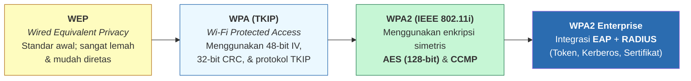
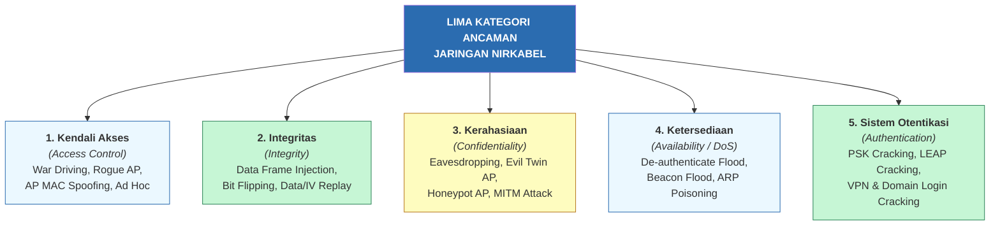
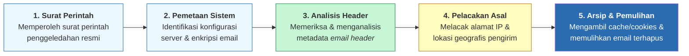

# Pertemuan 06: Teknologi Pengamanan Perangkat Jaringan Nirkabel dan Email

* **Mata Kuliah:** Keamanan Sistem Informasi (`STSI4405`)
* **Program Studi:** Sistem Informasi — Fakultas Sains dan Teknologi, Universitas Terbuka
* **Topik:** Konsep, Komponen, Otentikasi & Enkripsi Jaringan Nirkabel (`WiFi` / `IEEE 802.11`), Lima Kategori Ancaman Jaringan Nirkabel, Serangan Peretasan *Bluetooth*, Tindakan Kriminal & Penyalahgunaan Email, serta Prosedur Investigasi Forensik Email

---

## Daftar Isi

1. [Konsep dan Komponen Perangkat Jaringan Nirkabel (Wireless)](#1-konsep-dan-komponen-perangkat-jaringan-nirkabel-wireless)
2. [Model Otentikasi dan Tipe Enkripsi Jaringan Nirkabel](#2-model-otentikasi-dan-tipe-enkripsi-jaringan-nirkabel)
3. [Lima Kategori Ancaman pada Jaringan Nirkabel](#3-lima-kategori-ancaman-pada-jaringan-nirkabel)
4. [Ancaman dan Peretasan pada Teknologi Bluetooth](#4-ancaman-dan-peretasan-pada-teknologi-bluetooth)
5. [Tindakan Kriminal dan Penyalahgunaan Email](#5-tindakan-kriminal-dan-penyalahgunaan-email)
6. [Prosedur Investigasi Forensik Email](#6-prosedur-investigasi-forensik-email)
7. [Referensi Resmi](#7-referensi-resmi)

---

## 1. Konsep dan Komponen Perangkat Jaringan Nirkabel (Wireless)

### Keuntungan dan Kekurangan *Wireless Fidelity* (`WiFi` / `IEEE 802.11`)

Teknologi *Wireless Local Area Network* (`WLAN`) atau **Wireless Fidelity (`WiFi`)** dikembangkan berdasarkan standar **Institute of Electrical and Electronics Engineers (`IEEE`) `802.11`**.

| Keuntungan Penerapan Jaringan Nirkabel | Kekurangan dan Tantangan Jaringan Nirkabel |
| :--- | :--- |
| **Pemasangan cepat dan mudah** tanpa memerlukan penarikan kabel fisik menembus dinding maupun langit-langit. | **Risiko keamanan lebih tinggi** karena sinyal radio dipancarkan secara terbuka di udara dan rentan disadap. |
| **Konektivitas di area sulit** yang tidak memungkinkan instalasi infrastruktur kabel. | **Penurunan *bandwidth* dan kompleksitas perencanaan** saat jumlah perangkat terhubung bertambah secara dinamis. |
| **Portabilitas dan mobilitas tinggi**, memungkinkan akses jaringan dari mana saja di dalam jangkauan titik akses. | **Ketergantungan pada pembaruan standar perangkat keras** ketika standar `WiFi` berevolusi. |
| **Ketersediaan akses publik** yang luas di lokasi umum seperti bandara, perpustakaan, sekolah, dan kedai kopi. | **Rentan interferensi gelombang elektromagnetik** dari peralatan elektronik lain di sekitarnya. |

### Enam Istilah dan Komponen Utama Teknologi Nirkabel

1. ***Access Point*** **(`AP`):** Simpul (*node*) pusat pada jaringan nirkabel berbasis standar `IEEE 802.11` yang menghubungkan perangkat klien nirkabel ke jaringan kabel (`LAN`).
2. ***Base Transceiver Station*** **(`BTS`):** Perangkat pemancar dan penerima sinyal yang fungsinya setara dengan `AP` pada domain protokol `802.11`, namun digunakan oleh operator seluler untuk menyediakan jangkauan sinyal perangkat bergerak (*mobile*).
3. ***Wireless Controller*** **(`WLC`):** Perangkat manajemen terpusat yang digunakan pada lingkungan perusahaan berskala besar untuk mengonfigurasi, memantau, dan mengendalikan ratusan hingga ribuan unit `AP` secara serentak.
4. ***Service Set Identifier*** **(`SSID`):** Nama pengenal unik yang menunjukkan identitas sebuah jaringan `WLAN` agar dapat dikenali dan dipilih oleh perangkat klien.
5. ***Cell*** **(Sel):** Wilayah cakupan geografis yang dapat dijangkau oleh pancaran sinyal antena sebuah `AP` atau `BTS`.
6. ***Channel*** **(Kanal):** Pita frekuensi radio terpisah yang dikonfigurasi pada jaringan nirkabel untuk mendukung standar `802.11` dan mencegah tabrakan sinyal antar-`AP` yang berdekatan.

---

## 2. Model Otentikasi dan Tipe Enkripsi Jaringan Nirkabel

### Tiga Model Otentikasi `WiFi`

1. ***Open Authentication*** **(Otentikasi Terbuka):** Tidak memerlukan kredensial khusus saat asosiasi awal; biasanya digunakan pada *hotspot* publik yang kemudian dialihkan ke *captive portal*.
2. ***EAP-Based 4-Way Handshake* (dengan `WPA`/`WPA2`):** Proses pertukaran kunci empat langkah antara klien dan `AP` untuk memverifikasi kunci rahasia bersama (*Pre-Shared Key* / `PSK`) atau kredensial `EAP` tanpa mengirimkan kata sandi secara langsung di udara.
3. **Otentikasi Menggunakan *Centralized Authentication Server*:** Model keamanan tingkat perusahaan (*Enterprise*) yang memverifikasi identitas setiap pengguna ke peladen terpusat (seperti peladen `RADIUS`) sebelum memberikan akses jaringan.

### Evolusi Standar Enkripsi dan Protokol Keamanan Nirkabel

| Protokol / Standar | Deskripsi dan Mekanisme Keamanan |
| :--- | :--- |
| **`WEP`** (*Wired Equivalent Privacy*) | Standar keamanan nirkabel paling awal yang memiliki kelemahan kriptografi fatal sehingga kuncinya dapat diretas dengan sangat mudah. |
| **`WPA`** & **`TKIP`** (*Temporal Key Integrity Protocol*) | Protokol keamanan pengganti `WEP` yang menerapkan vektor inisialisasi (`IV`) 48-bit, *Cyclic Redundancy Check* (`CRC`) 32-bit, serta rotasi kunci dinamis melalui `TKIP`. |
| **`IEEE 802.11i`** & **`WPA2`** | Standar keamanan resmi `IEEE` untuk jaringan `802.11` yang menggantikan `TKIP` dengan algoritma enkripsi simetris kuat **`AES` (128-bit)** dan protokol **`CCMP`**. |
| **`CCMP`** (*Counter Mode Cipher Block Chaining MAC Protocol*) | Protokol enkripsi pada `WPA2` yang menggunakan kunci 128-bit dan `IV` 48-bit untuk menjamin kerahasiaan, integritas data, serta deteksi serangan pengulangan (*replay attack*). |
| **`EAP`** & **`WPA2 Enterprise`** | *Extensible Authentication Protocol* (`EAP`) mengintegrasikan enkripsi `WPA2` dengan berbagai metode otentikasi kuat seperti kartu token, **Kerberos**, dan sertifikat digital. |
| **`LEAP`** & **`RADIUS`** | `LEAP` (*Lightweight EAP*) adalah protokol otentikasi `WLAN` eksklusif milik Cisco, sedangkan **`RADIUS`** adalah peladen sistem manajemen otentikasi, otorisasi, dan akuntansi (`AAA`) terpusat. |

---

## 3. Lima Kategori Ancaman pada Jaringan Nirkabel

Ancaman terhadap keamanan jaringan nirkabel diklasifikasikan ke dalam **lima kategori utama** berdasarkan aspek keamanan yang diserang:

| Kategori Ancaman | Tujuan Penyerang | Jenis-Jenis Serangan Spesifik |
| :--- | :--- | :--- |
| **1. Serangan terhadap Kendali Akses** (*Access Control*) | Menembus jaringan dan melewati mekanisme pembatasan akses `WLAN` (seperti *MAC address filtering* dan kontrol port). | *War Driving*, *Rogue Access Points Attack*, *AP MAC Spoofing*, *Ad Hoc Associations Attack*, *AP Misconfiguration*, *Client Mis-Association*, *Unauthorized Association*, dan *Promiscuous Client*. |
| **2. Serangan terhadap Integritas** (*Integrity*) | Mengelabui jaringan nirkabel dengan menyisipkan atau memodifikasi paket data guna memicu kesalahan pengarahan maupun serangan lanjutan (`DoS`). | *Data Frame Injection*, *WEP Injection*, *Bit Flipping Attacks*, *Extensible AP Replay*, *Data Replay*, *RADIUS Replay*, *Initialization Vector (`IV`) Replay Attacks*, dan *Wireless Network Viruses*. |
| **3. Serangan terhadap Kerahasiaan** (*Confidentiality*) | Menyadap dan mencuri informasi rahasia yang dikirimkan melalui gelombang radio nirkabel. | *Eavesdropping* (penyadapan), *Traffic Analysis*, *Cracking WEP Key*, ***Evil Twin AP*** (titik akses palsu yang meniru `SSID` sah), *Honeypot Access Point*, *Session Hijacking*, dan *Man-in-the-Middle* (`MITM`) / *Masquerading*. |
| **4. Serangan terhadap Ketersediaan** (*Availability*) | Melumpuhkan layanan jaringan (*Denial of Service* / `DoS`) agar pengguna sah tidak dapat mengakses sumber daya nirkabel. | *Access Point Theft*, *Disassociation Attacks*, *EAP-Failure*, *De-authenticate Flood*, *Routing Attacks*, *Beacon Flood*, *TKIP MIC Exploit*, *Power Saving Attacks*, *Authenticate Flood*, dan *ARP Cache Poisoning Attack*. |
| **5. Serangan terhadap Sistem Otentikasi** (*Authentication*) | Mencuri identitas klien `WiFi` dan kredensial masuk untuk memperoleh akses tidak sah ke sumber daya jaringan. | **Pencurian Aplikasi Login:** *Shared Key Guessing*, *Pre-Shared Key (`PSK`) Cracking*, *Domain Login Cracking*. **Pencurian Identitas:** *Password Speculation*, *VPN Login Cracking*, dan *LEAP Cracking*. |

---

## 4. Ancaman dan Peretasan pada Teknologi Bluetooth

Selain `WiFi`, konektivitas jarak pendek berbasis **Bluetooth** juga memiliki empat bentuk ancaman dan eksploitasi utama:

| Istilah Peretasan Bluetooth | Mekanisme dan Dampak Serangan |
| :--- | :--- |
| ***BlueSmacking*** | Serangan *Denial of Service* (`DoS`) yang membanjiri perangkat berkemampuan Bluetooth dengan paket berukuran besar secara acak sehingga menyebabkan perangkat macet (*crash*). |
| ***BlueSnarfing*** | **Pencurian informasi sensitif** (seperti daftar kontak, pesan, kalender, atau berkas) dari perangkat nirkabel korban secara diam-diam melalui celah koneksi Bluetooth. |
| ***Bluejacking*** | Pengiriman pesan atau kartu nama elektronik (`vCard`) yang tidak diminta secara anonim melalui Bluetooth ke perangkat di sekitarnya (ponsel/PDA) untuk mengganggu atau memancing korban. |
| ***BlueSniff*** | Konsep kode utilitas *wardriving* khusus Bluetooth yang digunakan untuk memindai dan menemukan perangkat Bluetooth aktif yang tersembunyi (*non-discoverable*) di suatu area. |

---

## 5. Tindakan Kriminal dan Penyalahgunaan Email

### Klasifikasi Kejahatan Berbasis Email

1. **Kejahatan yang Dilakukan dengan Mengirim Email:** Aktivitas berbahaya yang menjadikan email sebagai medium serangan langsung, meliputi *email spamming* (pengiriman pesan massal tak diinginkan), *mail bombing* (membanjiri kotak masuk korban hingga penuh/lumpuh), dan *phishing* (penipuan untuk mencuri kredensial atau menyebarkan *malware*).
2. **Kejahatan yang Didukung oleh Email:** Tindak pidana konvensional maupun siber yang memanfaatkan email sebagai sarana komunikasi atau koordinasi, meliputi pelecehan dan perundungan daring (*harassment & cyberbullying*), pemerasan dunia maya (*cyber extortion*), penipuan identitas, dan distribusi konten ilegal/pornografi.

### Enam Bentuk Penyalahgunaan Email

* Mencari dan menandai calon korban (*mark*) untuk skema permainan penipuan.
* Menghubungi calon korban secara langsung untuk membangun kepercayaan (*social engineering*).
* Berkomunikasi dan berkoordinasi secara rahasia dengan sesama kaki tangan kejahatan.
* Memikat pengguna agar mengeklik tautan menuju situs web palsu dan menyerahkan data pribadi.
* Mengirimkan pesan pelecehan atau intimidasi psikologis kepada korban.
* Mengirimkan surat tuntutan tebusan atau ancaman pemerasan.

---

## 6. Prosedur Investigasi Forensik Email

Ketika terjadi insiden kejahatan berbasis email, investigator forensik digital menjalankan tujuh tahapan sistematis berikut agar barang bukti sah secara hukum (*admissible*):

1. **Memperoleh Surat Perintah Penggeledahan:** Memastikan seluruh proses penyitaan dan pemeriksaan data memiliki dasar legalitas hukum yang sah.
2. **Mengumpulkan Gambaran Sistem Email:** Mengidentifikasi arsitektur dan konfigurasi peladen email (*SMTP/IMAP/POP3*), penyedia layanan, serta jenis enkripsi yang digunakan.
3. **Memeriksa *Header* Email:** Mengambil informasi lengkap *header* pesan (bukan hanya isi badan email) untuk melihat jalur transmisi server.
4. **Menganalisis *Header* Email:** Memverifikasi keaslian `Message-ID`, stempel waktu (*timestamp*), rute peladen pengirim (`Received: from`), dan mendeteksi pemalsuan alamat pengirim (*email spoofing*).
5. **Melacak Asal Email:** Menelusuri alamat IP pengirim asal (*originating IP address*) untuk mengidentifikasi penyedia layanan internet (`ISP`) dan lokasi fisik pengirim.
6. **Mengumpulkan Arsip Email Lokal:** Mengekstraksi sisa bukti digital dari riwayat peramban (*history*), *cookies*, serta berkas sementara (*temp files*) yang tersimpan pada program klien atau *webmail*.
7. **Memulihkan Email yang Dihapus:** Menggunakan perangkat lunak forensik pemulihan data (seperti *Stellar Phoenix Deleted Email Recovery*) untuk mengembalikan berkas email (`.pst`, `.ost`, `.mbox`) yang telah dihapus oleh pelaku.

---

## 7. Referensi Resmi

1. **Modul Tutorial Online UT:** Materi Sesi 6 — *Teknologi Pengamanan Perangkat Jaringan Nirkabel dan Email*, Mata Kuliah Keamanan Sistem Informasi (`STSI4405`), Universitas Terbuka.
2. **Buku Materi Pokok (BMP) UT:** *Keamanan Sistem Informasi* (`STSI4405`), Universitas Terbuka.
3. **Stallings, W.** *Cryptography and Network Security: Principles and Practice*. Pearson Education.
4. **IEEE Standards Association.** *IEEE Std 802.11i: Wireless LAN Medium Access Control (MAC) and Physical Layer (PHY) Specifications — Security Enhancements*.
5. **Nelson, B., Phillips, A., & Steuart, C.** *Guide to Computer Forensics and Investigations*. Cengage Learning.