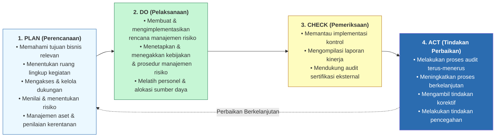
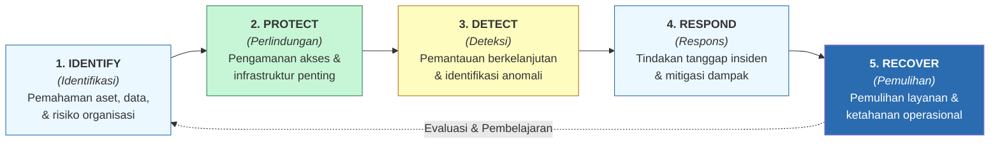
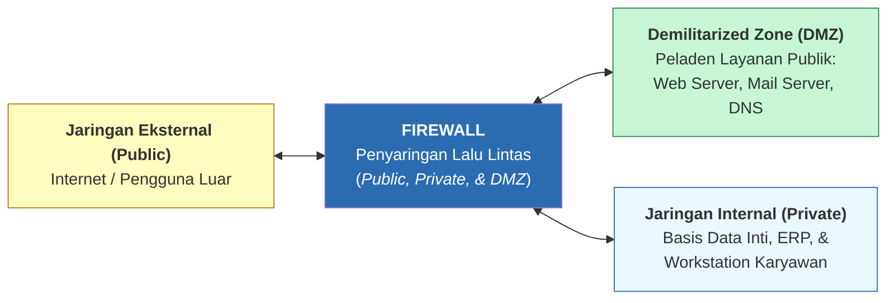
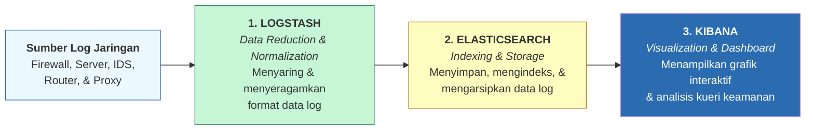

# Pertemuan 07: Audit Keamanan Sistem Informasi

* **Mata Kuliah:** Keamanan Sistem Informasi (`STSI4405`)
* **Program Studi:** Sistem Informasi — Fakultas Sains dan Teknologi, Universitas Terbuka
* **Topik:** *Information Security Management System* (`ISMS`), Standar `ISO 27001` (`PDCA`), *NIST Cybersecurity Framework* (`CSF`), Infrastruktur & Arsitektur Keamanan Jaringan (`DMZ`, *Three-Layer Model*), Manajemen Log (`ELK Stack`), Teknologi & Protokol Monitoring, serta Evaluasi *Alert* (`Security Onion`)

---

## Daftar Isi

1. [Information Security Management System (ISMS) dan Audit Kepatuhan](#1-information-security-management-system-isms-dan-audit-kepatuhan)
2. [Standar ISO/IEC 27001 dan Siklus PDCA](#2-standar-isoiec-27001-dan-siklus-pdca)
3. [NIST Cybersecurity Framework (CSF)](#3-nist-cybersecurity-framework-csf)
4. [Infrastruktur dan Arsitektur Keamanan Jaringan](#4-infrastruktur-dan-arsitektur-keamanan-jaringan)
5. [Manajemen Log Terpusat: ELK Stack dan Data Keamanan Jaringan](#5-manajemen-log-terpusat-elk-stack-dan-data-keamanan-jaringan)
6. [Teknologi Monitoring, Protokol, dan Evaluasi Alert (Security Onion)](#6-teknologi-monitoring-protokol-dan-evaluasi-alert-security-onion)
7. [Referensi Resmi](#7-referensi-resmi)

---

## 1. Information Security Management System (ISMS) dan Audit Kepatuhan

### Pengertian *Information Security Management System* (`ISMS`)

**Information Security Management System (`ISMS`)** adalah kerangka kerja manajemen sistematis di mana organisasi mengidentifikasi, menganalisis, mengelola, dan menangani risiko keamanan informasi secara berkelanjutan.

* **Kerangka Kerja Utama:** Siklus ***Plan-Do-Check-Act*** (`PDCA`).
* **Standar Rujukan Internasional:** **`ISO/IEC 27001`** dan **`NIST Cybersecurity Framework`**.

### Tiga Pertanyaan Fundamental dalam Audit Keamanan Informasi

Dalam melaksanakan audit keamanan dan tata kelola kepatuhan (*compliance*), auditor maupun manajemen organisasi harus menjawab tiga pertanyaan mendasar:

1. **Siapa yang bertanggung jawab menyediakan peraturan kepatuhan?** *(Pihak regulator, pemerintah, badan standar internasional, serta manajemen puncak yang menetapkan kebijakan keamanan internal).*
2. **Siapa yang memiliki kewajiban mematuhi peraturan kepatuhan tersebut?** *(Seluruh entitas di dalam organisasi: karyawan, administrator TI, mitra pihak ketiga, hingga vendor yang mengakses sistem).*
3. **Apa yang harus dilakukan jika mereka gagal mematuhi?** *(Penerapan sanksi administratif/hukum, tindakan korektif, pemulihan sistem, serta peninjauan ulang kontrol keamanan untuk mencegah pelanggaran berulang).*

---

## 2. Standar ISO/IEC 27001 dan Siklus PDCA

Standar **`ISO/IEC 27001`** mengadopsi pendekatan proses berbasis siklus **Plan-Do-Check-Act (`PDCA`)** untuk membangun, mengimplementasikan, memelihara, dan meningkatkan `ISMS` secara berkesinambungan:

---

## 3. NIST Cybersecurity Framework (CSF)

**NIST Cybersecurity Framework (`CSF`)** merupakan kerangka kerja pengelolaan risiko keamanan siber yang membagi kapabilitas pertahanan organisasi ke dalam **lima fungsi inti (*Core Functions*)** yang saling berkesinambungan:

### Matriks Fungsi Utama dan Kategori Keluaran (*Outcome Categories*) NIST CSF

| Fungsi Utama (*Core Function*) | Fokus Tujuan Operasional | Kategori Keluaran-Hasil (*Outcome Categories*) |
| :--- | :--- | :--- |
| **1. `IDENTIFY`** *(Identifikasi)* | Mengembangkan pemahaman organisasi untuk mengelola risiko keamanan siber terhadap sistem, aset, data, dan kapabilitas. | • Pengelolaan Aset (*Asset Management*) • Lingkungan Bisnis (*Business Environment*) • Tata Kelola / Pemerintahan (*Governance*) • Pengukuran Risiko (*Risk Assessment*) • Strategi Pengelolaan Risiko (*Risk Management Strategy*) |
| **2. `PROTECT`** *(Perlindungan)* | Mengembangkan dan menerapkan perlindungan yang tepat untuk memastikan penyampaian layanan infrastruktur penting. | • Manajemen Identitas & Pengendalian Hak Akses (*Identity Management and Access Control*) • Proses & Prosedur Pengendalian Informasi (*Information Protection Processes and Procedures*) • Perawatan (*Maintenance*) • Perlindungan Teknologi (*Protective Technology*) |
| **3. `DETECT`** *(Deteksi)* | Mengembangkan dan menerapkan kegiatan yang sesuai untuk mengidentifikasi terjadinya peristiwa keamanan siber secara cepat. | • Anomali dan Peristiwa Keamanan (*Anomalies and Events*) • Proses Pemantauan Keamanan Berkelanjutan dan Deteksi (*Security Continuous Monitoring Detection Processes*) |
| **4. `RESPOND`** *(Respons)* | Mengembangkan dan menerapkan aktivitas untuk bertindak secara tepat terhadap insiden keamanan siber yang terdeteksi. | • Perencanaan Respons (*Response Planning*) • Komunikasi Insiden (*Communications*) • Analisis Forensik/Insiden (*Analysis*) • Mitigasi Dampak (*Mitigation*) • Peningkatan Kapabilitas (*Improvements*) |
| **5. `RECOVER`** *(Pemulihan)* | Mempertahankan rencana ketahanan (*resilience*) dan memulihkan kemampuan atau layanan yang terganggu akibat serangan. | • Perencanaan Pemulihan (*Recovery Planning*) • Peningkatan Berkelanjutan (*Improvements*) • Komunikasi Pemulihan (*Communications*) |

---

## 4. Infrastruktur dan Arsitektur Keamanan Jaringan

### Dokumentasi Topologi Jaringan

Arsitek dan administrator jaringan wajib memetakan bagaimana setiap perangkat terhubung dan di mana posisi penempatannya melalui **diagram topologi**:

1. **Topologi Fisik (*Physical Topology*):** Menggambarkan tata letak fisik perangkat keras, perkabelan, rak peladen, serta jalur koneksi antar-gedung.
2. **Topologi Logik (*Logical Topology*):** Menggambarkan bagaimana data mengalir di dalam jaringan, pengalamatan `IP`, segmentasi `VLAN`, serta rute lalu lintas antar-simpul.

### Desain Jaringan Hierarkis (*Three-Layer Network Design Model*)

Pada jaringan berskala kampus atau perusahaan (`LAN` kabel yang terhubung ke `WAN` dan Internet), digunakan **model desain hierarkis tiga lapisan** (*Access Layer*, *Distribution Layer*, dan *Core Layer*) yang memisahkan topologi ke dalam kelompok modular. Pemisahan modular ini menyederhanakan perancangan, mempermudah penerapan kebijakan keamanan di setiap lapisan, serta mempercepat pemeliharaan jaringan.

### Arsitektur *Firewall* dan Segmentasi Zona Keamanan

Desain *firewall* menentukan aturan pada antarmuka perangkat untuk mengizinkan (*allow*) atau menolak (*deny*) lalu lintas berdasarkan alamat sumber, tujuan, dan jenis protokol.

* **Tiga Desain *Firewall* Umum:**
  1. **Public & Private:** Pemisahan langsung antara antarmuka jaringan luar (tidak tepercaya) dan jaringan dalam (tepercaya).
  2. ***Demilitarized Zone* (`DMZ`):** Subjaringan penyangga (*buffer zone*) yang menampung layanan publik (seperti *Web Server* dan *Mail Server*) sehingga jika peladen di `DMZ` diretas, penyerang tetap terisolasi dan tidak dapat langsung menembus jaringan internal (*Private*).
  3. **Peralatan dan Layanan Keamanan Jaringan:** Integrasi perangkat keras/lunak keamanan (*Network Security Devices*, seperti `IDS/IPS`, `VPN Concentrator`) beserta layanan keamanan jaringan (*Network Security Services*).

---

## 5. Manajemen Log Terpusat: ELK Stack dan Data Keamanan Jaringan

### Kerangka Kerja *Elasticsearch, Logstash, dan Kibana* (`ELK Stack`)

**`ELK Stack`** adalah kerangka kerja modular dan skalabel untuk mengumpulkan, memproses, menyimpan, menganalisis, serta memvisualisasikan catatan aktivitas (*log*) keamanan dari berbagai perangkat jaringan secara terpusat:

* **Tiga Fitur Utama Pengelolaan Log pada `ELK`:**
  1. ***Data Reduction* (Reduksi Data):** Menyaring dan membatasi pengumpulan entri log, paket, atau peringatan yang tidak relevan agar kapasitas penyimpanan lebih hemat dan pencarian di *Elasticsearch* jauh lebih cepat.
  2. ***Data Normalization* (Normalisasi Data):** Menyeragamkan format catatan log yang berasal dari beragam perangkat dan vendor berbeda ke dalam satu struktur skema baku melalui *Logstash*.
  3. ***Data Archiving* (Pengarsipan Data):** Menyimpan riwayat catatan log jangka panjang untuk kebutuhan audit kepatuhan maupun investigasi forensik di masa mendatang.

### Sumber Data Keamanan Jaringan (*Network Security Data*)

| Jenis Sumber Data Log | Penjelasan dan Informasi yang Direkam |
| :--- | :--- |
| ***Host Logs* & *Server Logs*** | Catatan aktivitas sistem operasi, proses aplikasi, kegagalan *login*, serta perubahan konfigurasi pada peladen maupun komputer klien. |
| ***Syslog*** | Protokol standar pengiriman pesan log kejadian (*event logging*) secara terpusat dari berbagai perangkat jaringan (*router*, *switch*, *firewall*) ke peladen log. |
| ***SIEM & Log Collection*** | *Security Information and Event Management* (`SIEM`) yang mengorelasikan log dari seluruh infrastruktur secara *real-time* untuk mendeteksi pola serangan kompleks. |
| ***Network Logs* (`Tcpdump`, `NetFlow`)** | Rekaman metadata aliran lalu lintas jaringan (`NetFlow`) maupun tangkapan paket mentah (*packet capture* via `Tcpdump`) untuk analisis mendalam. |
| ***Proxy Logs*** | Catatan seluruh permintaan akses web (`URL`), alamat `IP` klien, dan status respons yang melewati peladen *proxy*. |

---

## 6. Teknologi Monitoring, Protokol, dan Evaluasi Alert (Security Onion)

### Protokol Monitoring dan Teknologi *System Security*

* **Protokol Monitoring Umum:**
  * `Syslog` dan `NTP` (*Network Time Protocol* — sangat krusial untuk menyinkronkan stempel waktu/*timestamp* seluruh log agar urutan kronologis insiden akurat).
  * `DNS`, `HTTP` & `HTTPS`, protokol *Email* (`SMTP`, `IMAP`, `POP3`), serta `ICMP`.
* **Teknologi pada *System Security*:**
  * *Access Control Lists* (`ACLs`), `NAT` (*Network Address Translation*) dan `PAT` (*Port Address Translation*).
  * Enkripsi (*Encryption*), Enkapsulasi (*Encapsulation*), dan *Tunneling* (`VPN`).
  * Jaringan *Peer-to-Peer* (`P2P`) dan jaringan anonim `TOR`, serta *Load Balancing* untuk menjaga ketersediaan layanan.

### Evaluasi *Alert* dengan *Security Onion*

**Security Onion** adalah distribusi *Linux* (*Ubuntu-based*) sumber terbuka (*open-source*) yang dirancang khusus untuk **Network Security Monitoring (`NSM`)**, deteksi intrusi (`IDS`), dan manajemen log keamanan. Platform ini mengintegrasikan empat perangkat analisis utama:

| Perangkat (*Tool*) dalam *Security Onion* | Fungsi Utama dalam Evaluasi *Alert* dan Analisis Keamanan |
| :--- | :--- |
| **1. `Sguil`** | Menyediakan antarmuka konsol tingkat tinggi bagi analis keamanan untuk menyelidiki, memverifikasi, dan mengelompokkan peringatan (*alert*) keamanan dari berbagai sensor `IDS`. |
| **2. `Kibana`** | Antarmuka dasbor interaktif untuk data *Elasticsearch* yang memungkinkan pencarian cepat (*querying*) dan visualisasi tren data `NSM`. |
| **3. `Wireshark`** | Aplikasi penganalisis dan penangkap paket jaringan (*packet analyzer*) yang terintegrasi untuk memeriksa isi paket (*payload*) secara detail hingga tingkat *byte*. |
| **4. `Zeek`** *(sebelumnya Bro)* | Kerangka kerja penganalisis lalu lintas jaringan (*network traffic analyzer*) yang memantau aktivitas jaringan secara mendalam dan menghasilkan catatan log protokol yang sangat terstruktur. |

---

## 7. Referensi Resmi

1. **Modul Tutorial Online UT:** Materi Sesi 7 — *Audit Keamanan Sistem Informasi*, Mata Kuliah Keamanan Sistem Informasi (`STSI4405`), Universitas Terbuka.
2. **Buku Materi Pokok (BMP) UT:** *Keamanan Sistem Informasi* (`STSI4405`), Universitas Terbuka.
3. **ISO/IEC 27001:2022.** *Information Security, Cybersecurity and Privacy Protection — Information Security Management Systems — Requirements*. International Organization for Standardization.
4. **National Institute of Standards and Technology (`NIST`).** *Framework for Improving Critical Infrastructure Cybersecurity (NIST Cybersecurity Framework)*.
5. **Bejtlich, R.** *The Practice of Network Security Monitoring: Understanding Incident Detection and Response*. No Starch Press.