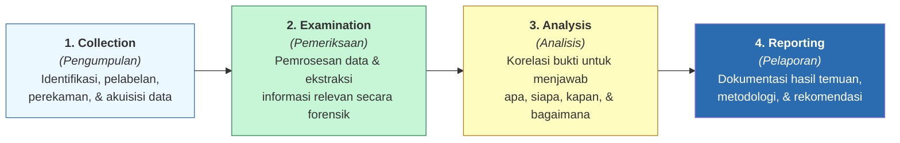
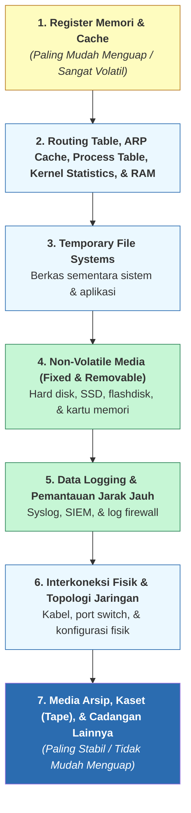
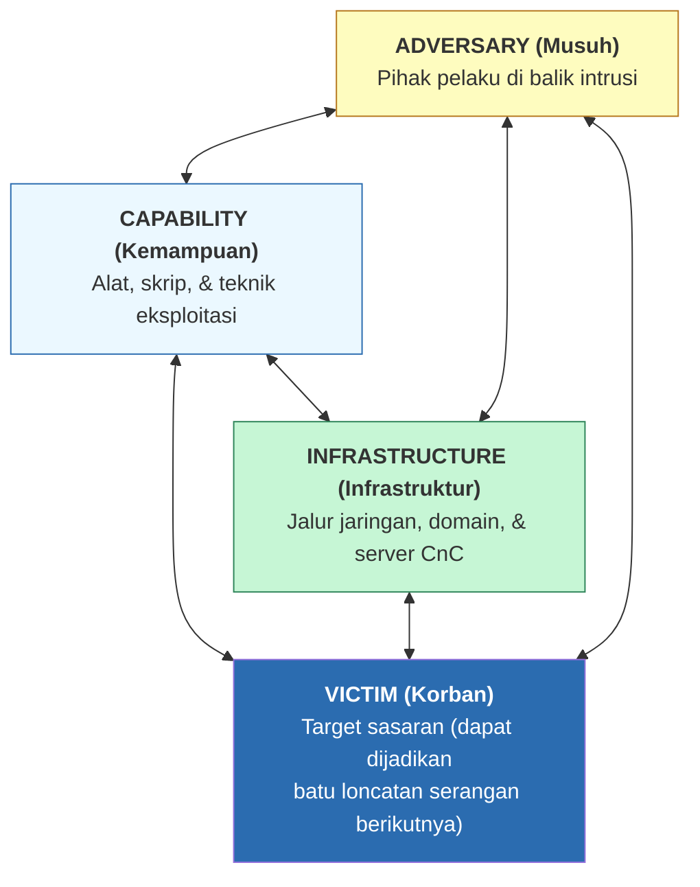
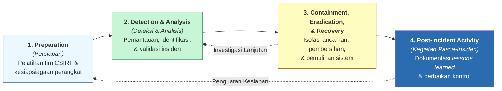

# Pertemuan 08: Analisis Forensik

* **Mata Kuliah:** Keamanan Sistem Informasi (`STSI4405`)
* **Program Studi:** Sistem Informasi — Fakultas Sains dan Teknologi, Universitas Terbuka
* **Topik:** Proses Digital Forensik (`NIST SP 800-86`), Jenis & Urutan Pengumpulan Bukti (`IETF RFC 3227`), *Chain of Custody* & Integritas Data, *Attack Attribution* (`MITRE ATT&CK`, *Cyber Kill Chain*, *Diamond Model*), *Incident Response* (`CSIRC` & *NIST Life Cycle*), serta *Cybersecurity Maturity Model Certification* (`CMMC`)

---

## Daftar Isi

1. [Proses Digital Forensik dan Jenis Barang Bukti](#1-proses-digital-forensik-dan-jenis-barang-bukti)
2. [Urutan Pengumpulan Bukti (Order of Volatility) dan Chain of Custody](#2-urutan-pengumpulan-bukti-order-of-volatility-dan-chain-of-custody)
3. [Attack Attribution dan Kerangka Pemodelan Ancaman](#3-attack-attribution-dan-kerangka-pemodelan-ancaman)
4. [Incident Response: CSIRC, Pemangku Kepentingan, dan Siklus Hidup NIST](#4-incident-response-csirc-pemangku-kepentingan-dan-siklus-hidup-nist)
5. [Cybersecurity Maturity Model Certification (CMMC)](#5-cybersecurity-maturity-model-certification-cmmc)
6. [Referensi Resmi](#6-referensi-resmi)

---

## 1. Proses Digital Forensik dan Jenis Barang Bukti

### Panduan Proses Digital Forensik (`NIST SP 800-86`)

**NIST Special Publication 800-86** (*Guide to Integrating Forensic Techniques into Incident Response*) merupakan pedoman utama bagi organisasi dalam mengintegrasikan teknik forensik digital ke dalam manajemen tanggap insiden melalui proses empat fase utama:

### Tiga Jenis Barang Bukti (*Types of Evidence*)

| Jenis Bukti | Definisi Konseptual | Contoh Penerapan dalam Investigasi |
| :--- | :--- | :--- |
| **Bukti Terbaik** (*Best Evidence*) | Barang bukti asli yang memiliki kekuatan pembuktian tertinggi dan dapat dibuktikan tidak mengalami perubahan. | Perangkat penyimpanan fisik milik tersangka, atau arsip/citra disk (*bit-stream image*) yang terverifikasi integritasnya. |
| **Bukti yang Menguatkan** (*Corroborating Evidence*) | Bukti tambahan yang mendukung dan memperkuat pernyataan atau kesimpulan yang dibangun dari bukti terbaik. | Log autentikasi peladen, rekaman kamera pengawas (`CCTV`), atau catatan transaksi jaringan yang selaras dengan temuan pada disk. |
| **Bukti Tidak Langsung** (*Indirect / Circumstantial Evidence*) | Bukti yang apabila dikombinasikan dengan fakta-fakta lain dapat membangun suatu hipotesis atau pola keterlibatan. | Bukti bahwa seseorang pernah melakukan kejahatan siber serupa sebelumnya untuk mendukung dugaan keterlibatan pada kasus yang dituduhkan. |

---

## 2. Urutan Pengumpulan Bukti (Order of Volatility) dan Chain of Custody

### Urutan Pengumpulan Bukti Berdasarkan Volatilitas (`IETF RFC 3227`)

Pedoman **IETF RFC 3227** menetapkan bahwa pengumpulan bukti digital harus dimulai dari data yang **paling mudah menguap (*most volatile*)** menuju data yang **paling stabil (*least volatile*)** agar bukti di memori tidak hilang saat sistem dimatikan atau mengalami perubahan:

### *Chain of Custody* (Rantai Pengawasan Barang Bukti)

Agar barang bukti digital sah secara hukum dan tidak terbantahkan di pengadilan (*admissible*), organisasi wajib menerapkan rantai pengawasan (**Chain of Custody**) yang ketat dan terdokumentasi:

* **Identitas Penemu & Pengumpul:** Mencatat siapa yang menemukan dan mengumpulkan bukti beserta rincian waktu, tempat, dan personel yang terlibat.
* **Riwayat Tanggung Jawab:** Mendokumentasikan siapa pemegang tanggung jawab utama atas barang bukti, kapan diserahkan, dan kapan terjadi pergantian tanggung jawab.
* **Kontrol Akses Fisik:** Membatasi akses fisik ke ruang penyimpanan barang bukti hanya bagi personel yang paling berwenang.

### Integritas dan Pelestarian Data (*Data Preservation*)

1. **Mempertahankan *Timestamp*:** Bukti asli tidak boleh dianalisis secara langsung agar metadata waktu (*timestamp*) file tidak berubah; analisis **hanya dilakukan pada salinan bukti**.
2. **Salinan Tingkat Bit (*Bit-Stream Copy*):** Membuat duplikat persis bit-demi-bit (*forensic imaging*) dari volume penyimpanan asli.
3. **Pengarsipan Disk Asli:** Menyegel dan menyimpan media asli dalam kondisi utuh sehingga citra disk yang diselidiki selalu dapat dibandingkan nilai *hash*-nya dengan citra arsip asli untuk membuktikan tidak ada manipulasi isi.

---

## 3. Attack Attribution dan Kerangka Pemodelan Ancaman

**Attack Attribution** (atribusi serangan) adalah tindakan mengidentifikasi individu, kelompok organisasi, atau negara yang bertanggung jawab atas suatu intrusi siber dengan menghubungkan **Taktik, Teknik, dan Prosedur (`TTP`)** penyerang (lokasi *host*/domain asal, struktur kode *malware*, serta alat yang digunakan) dengan pola eksploitasi yang diketahui.

### 1. *The MITRE ATT&CK Framework*

**MITRE ATT&CK** (*Adversarial Tactics, Techniques & Common Knowledge*) adalah basis pengetahuan global yang memodelkan perilaku aktor ancaman berdasarkan pengamatan eksploitasi dunia nyata. Kerangka ini memetakan `TTP` penyerang untuk membantu tim keamanan mendeteksi ancaman dan melakukan atribusi serangan secara sistematis.

### 2. *The Cyber Kill Chain*

Dikembangkan oleh Lockheed Martin, **Cyber Kill Chain** memetakan tujuh tahapan berurutan yang harus diselesaikan penyerang untuk mencapai tujuannya (memutus satu rantai saja sudah cukup menghentikan serangan):

```mermaid
flowchart LR
    K1["<b>1. Reconnaissance</b><br/>Pengintaian target"]
    K2["<b>2. Weaponization</b><br/>Perakitan senjata/malware"]
    K3["<b>3. Delivery</b><br/>Pengiriman payload ke target"]
    K4["<b>4. Exploitation</b><br/>Eksploitasi celah sistem"]
    K5["<b>5. Installation</b><br/>Pemasangan backdoor/akses"]
    K6["<b>6. Command & Control</b><br/>Kendali jarak jauh (CnC)"]
    K7["<b>7. Actions on Objectives</b><br/>Eksekusi tujuan akhir"]

    K1 --> K2 --> K3 --> K4 --> K5 --> K6 --> K7

    style K1 fill:#ebf8ff,stroke:#2b6cb0
    style K2 fill:#ebf8ff,stroke:#2b6cb0
    style K3 fill:#c6f6d5,stroke:#2f855a
    style K4 fill:#fefcbf,stroke:#b7791f
    style K5 fill:#fefcbf,stroke:#b7791f
    style K6 fill:#c6f6d5,stroke:#2f855a
    style K7 fill:#2b6cb0,color:#ffffff
```

### 3. *The Diamond Model of Intrusion Analysis*

Dalam **Diamond Model**, setiap peristiwa intrusi dianalisis sebagai aktivitas terikat waktu di mana **Musuh (*Adversary*)** menggunakan **Kemampuan (*Capability*)** melalui **Infrastruktur (*Infrastructure*)** untuk menyerang **Korban (*Victim*)**:

#### Skenario Rangkaian Serangan (*Pivoting* pada Diamond Model)
1. **Pengintaian Awal:** Musuh menelusuri domain `gadgets.com` milik *Gadgets, Inc.* melalui pencarian web dan menemukan alamat surel administrator jaringan (`NA1`) di forum publik.
2. **Pengiriman & Eksploitasi:** Musuh mengirim surel *phishing* berlampir *Trojan Horse* kepada `NA1`. Saat lampiran dibuka, *malware* terpasang dan mendaftarkan *host* `NA1` ke peladen *Command and Control* (`CnC`) melalui `HTTP POST` (dilengkapi alamat IP cadangan).
3. **Kompromi Infrastruktur (*Pivoting*):** Melalui respons `CnC`, *malware* mengubah *host* `NA1` menjadi *web proxy* bagi koneksi `TCP` baru—sehingga **Korban 1 (`NA1`) berubah fungsi menjadi bagian dari Infrastruktur musuh**.
4. **Serangan Lanjutan ke Korban Kedua:** Memanfaatkan *proxy* dan daftar kontak surel `NA1`, musuh menemukan *Chief Research Officer* dari *Interesting Research Inc.* (**Korban 2**) dan mengirimkan *spear-phishing* bermuatan serupa menggunakan alamat surel sah milik `NA1`.

---

## 4. Incident Response: CSIRC, Pemangku Kepentingan, dan Siklus Hidup NIST

### Komponen Utama *Incident Response* (`CSIRC`)

**Incident Response** mencakup metode, kebijakan, dan prosedur terstruktur untuk membatasi dampak serangan siber, menilai kerusakan, serta memulihkan operasional. Langkah awalnya adalah membentuk **Computer Security Incident Response Capability (`CSIRC`)** yang ditopang oleh tiga elemen:
1. **Kebijakan (*Policy*):** Merinci prinsip penanganan insiden sesuai misi, skala, dan fungsi organisasi.
2. **Rencana (*Plan*):** Peta jalan strategis untuk meminimalkan dampak kerusakan akibat insiden.
3. **Prosedur (*Procedure*):** Langkah teknis operasional yang dieksekusi tim selama penanganan insiden.

### Pemangku Kepentingan Tanggap Insiden (*Incident Response Stakeholders*)

| Pemangku Kepentingan | Peran dan Tanggung Jawab dalam Tanggap Insiden |
| :--- | :--- |
| **Manajemen (*Management*)** | Menetapkan kebijakan, mengalokasikan anggaran, memimpin koordinasi lintas departemen, dan meminimalkan dampak bisnis. |
| **Jaminan Informasi (*Information Assurance*)** | Memodifikasi kontrol keamanan (seperti aturan *firewall*) selama fase penahanan (*containment*) dan pemulihan. |
| **Dukungan TI (*IT Support*)** | Menangani infrastruktur teknis secara langsung untuk meredam serangan dan menjaga keutuhan barang bukti digital. |
| **Departemen Hukum (*Legal Department*)** | Meninjau kepatuhan hukum atas kebijakan/prosedur insiden serta menangani proses penuntutan dan validitas bukti hukum. |
| **Urusan Publik & Hubungan Media** | Mengelola komunikasi krisis kepada publik dan media apabila insiden melibatkan kebocoran data pribadi pelanggan. |
| **Sumber Daya Manusia (*HR*)** | Menangani tindakan disipliner apabila insiden keamanan disebabkan oleh pelanggaran karyawan internal. |
| **Business Continuity Planners** | Menyelaraskan dampak insiden keamanan dengan rencana kelangsungan bisnis (`BCP`) dan penilaian risiko organisasi. |
| **Keamanan Fisik & Manajemen Fasilitas** | Menangani insiden berbasis akses fisik (seperti *tailgating* atau *shoulder surfing*) serta mengamankan lokasi fisik bukti. |

### Siklus Hidup Tanggap Insiden NIST (*NIST Incident Response Life Cycle*)

---

## 5. Cybersecurity Maturity Model Certification (CMMC)

**Cybersecurity Maturity Model Certification (`CMMC`)** adalah kerangka penilaian tingkat kematangan keamanan siber yang dikembangkan untuk mengevaluasi kapabilitas organisasi mitra rantai pasok **Department of Defense (`DoD`) AS** dalam melindungi informasi sensitif dari gangguan maupun serangan siber.

* **Cakupan Kerangka:** `CMMC` menetapkan **17 domain kapabilitas keamanan** yang diukur secara bertingkat (*maturity levels*) mulai dari praktik kebersihan siber dasar (*basic cyber hygiene*) hingga kapabilitas pertahanan proaktif tingkat lanjut (*advanced/progressive*) untuk menangkal ancaman persisten tingkat tinggi (*Advanced Persistent Threats* / `APT`).

---

## 6. Referensi Resmi

1. **Modul Tutorial Online UT:** Materi Sesi 8 — *Analisis Forensik*, Mata Kuliah Keamanan Sistem Informasi (`STSI4405`), Universitas Terbuka.
2. **Buku Materi Pokok (BMP) UT:** *Keamanan Sistem Informasi* (`STSI4405`), Universitas Terbuka.
3. **Kent, K., Chevalier, S., Grance, T., & Dang, H.** (2006). *NIST Special Publication 800-86: Guide to Integrating Forensic Techniques into Incident Response*. National Institute of Standards and Technology.
4. **Cichonski, P., Millar, T., Grance, T., & Scarfone, K.** (2012). *NIST Special Publication 800-61 Rev. 2: Computer Security Incident Handling Guide*. National Institute of Standards and Technology.
5. **Brezinski, D., & Killalea, T.** (2002). *IETF RFC 3227: Guidelines for Evidence Collection and Archiving*. Internet Engineering Task Force.
6. **Caltagirone, S., Pendergast, A., & Betz, C.** (2013). *The Diamond Model of Intrusion Analysis*. Center for Cyber Intelligence Analysis and Threat Research.
7. **MITRE Corporation.** *MITRE ATT&CK® Framework*.