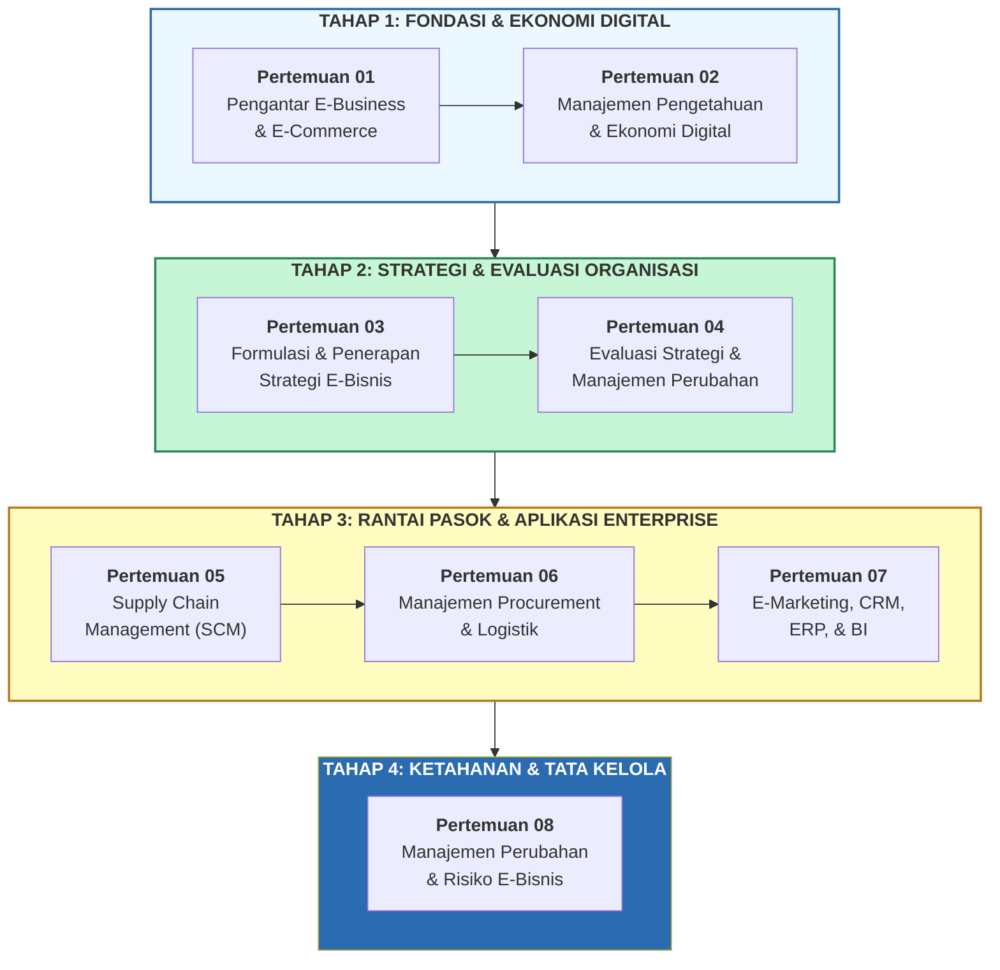

# E-Business (STSI4408)

* **Kode & Nama Mata Kuliah:** `STSI4408` — E-Bisnis (*E-Business*)
* **Bobot SKS:** 3 SKS
* **Program Studi:** Sistem Informasi (Program Sarjana) — Universitas Terbuka
* **Referensi BMP Utama:** *E-Business* (`MSIM4409`) — Zainal Arifin & Livia Avianty (2024), Universitas Terbuka
* **Pengembang & Penelaah RAT:** Mochamad Bagoes Satria Junianto, S.Kom., M.Kom. & Ir. Argadatta Sigit, M.Ed. (Tahun Pengembangan: 2024)

---

## Daftar Isi

1. [Deskripsi Mata Kuliah dan Capaian Pembelajaran (CPMK)](#1-deskripsi-mata-kuliah-dan-capaian-pembelajaran-cpmk)
2. [Peta Konsep Alur Pembelajaran E-Business](#2-peta-konsep-alur-pembelajaran-e-business)
3. [Indeks Materi Pertemuan (Sesi 01 – Sesi 08)](#3-indeks-materi-pertemuan-sesi-01--sesi-08)
4. [Rincian Rancangan Aktivitas Tutorial (RAT)](#4-rincian-rancangan-aktivitas-tutorial-rat)
5. [Struktur Aktivitas, Modus Belajar, dan Tugas Tutorial](#5-struktur-aktivitas-modus-belajar-dan-tugas-tutorial)
6. [Daftar Pustaka Resmi](#6-daftar-pustaka-resmi)

---

## 1. Deskripsi Mata Kuliah dan Capaian Pembelajaran (CPMK)

### Deskripsi Singkat Mata Kuliah

Mata kuliah **E-Business (`STSI4408`)** membahas secara komprehensif konsep dan praktik transformasi bisnis digital, mulai dari definisi dasar *e-business* dan *e-commerce*, manajemen pengetahuan dan implikasi ekonomi digital, formulasi serta penerapan strategi *e-business*, evaluasi strategi dan manajemen perubahan, pengelolaan rantai pasok (*Supply Chain Management*), manajemen pengadaan (*Procurement*) dan logistik, hingga penerapan sistem enterprise (*E-Marketing*, *CRM*, *ERP*, *Business Intelligence*) serta manajemen perubahan dan risiko *e-business*.

### Capaian Pembelajaran Mata Kuliah (`CPMK`)

Setelah menempuh mata kuliah ini, mahasiswa diharapkan mampu:

1. **Menganalisis konsep *E-Business* dan *E-Commerce*** beserta perbedaan fundamentalnya dengan bisnis konvensional serta infrastruktur teknologi dan sistem informasi pendukungnya.
2. **Menentukan formulasi, penerapan, dan evaluasi strategi *E-Business*** menggunakan berbagai kerangka analisis strategis (*Value Chain*, *Porter's Five Forces*, strategi generik, kontrol strategis, dan budaya organisasi).
3. **Menganalisis penerapan *E-Business* pada ekosistem operasional dan enterprise**, yang mencakup:
   * *Supply Chain Management* (`SCM`)
   * Manajemen *Procurement* (`E-Procurement`) dan Logistik (`E-Logistics`)
   * *E-Marketing* dan *Customer Relationship Management* (`CRM` / `E-CRM`)
   * *Enterprise Resource Planning* (`ERP`) dan *Business Intelligence* (`BI`)
4. **Merancang proses manajemen perubahan (*Change Management*) dan manajemen risiko (*Risk Management*)** untuk menjaga keberlangsungan serta ketahanan operasional *e-business*.

---

## 2. Peta Konsep Alur Pembelajaran E-Business

Keseluruhan materi dalam 8 sesi tutorial disusun secara berurutan dari fondasi konseptual, perumusan dan evaluasi strategi, integrasi rantai pasok dan sistem aplikasi *enterprise*, hingga tata kelola perubahan dan risiko:

---

## 3. Indeks Materi Pertemuan (Sesi 01 – Sesi 08)

Berikut adalah navigasi langsung ke seluruh file catatan terstruktur untuk setiap pertemuan tutorial:

| Sesi | Pokok Bahasan | File Catatan Markdown | Fokus Topik & Kerangka Utama |
| :---: | :--- | :--- | :--- |
| **01** | **Pengantar E-Business** | [`pertemuan-01/README.md`](./pertemuan-01/README.md) | Konsep bisnis & *e-business*, alur transaksi *e-commerce*, model `B2B`/`B2C`/`C2C`/`C2B`, bisnis konvensional vs digital, infrastruktur TI, dan peran SI (*O'Brien*). |
| **02** | **Manajemen dan Ekonomi E-Bisnis** | [`pertemuan-02/README.md`](./pertemuan-02/README.md) | Fungsi manajemen *e-bisnis*, *tacit* vs *explicit knowledge*, model konversi `SECI`, pilar `KMS`, aplikasi enterprise, kompetensi SDM, dan ekonomi digital/informasi. |
| **03** | **Formulasi & Penerapan Strategi E-Bisnis** | [`pertemuan-03/README.md`](./pertemuan-03/README.md) | Siklus perumusan strategi, analisis internal (*Value Chain*), analisis eksternal (*Porter's Five Forces*), strategi generik & *omnichannel*, kontrol strategis, dan budaya organisasi. |
| **04** | **Evaluasi Strategi & Manajemen Perubahan** | [`pertemuan-04/README.md`](./pertemuan-04/README.md) | Kontrol *feedforward/concurrent/feedback*, evaluasi SDM, metrik digital, indikator efektivitas TI, *Force Field Analysis* (Lewin), konversi sistem, dan skala `BPR`/`BPI`. |
| **05** | **Supply Chain Management (`SCM`)** | [`pertemuan-05/README.md`](./pertemuan-05/README.md) | Segmen *upstream-midstream-downstream*, aliran material-informasi-dana, siklus `SCOR`, model *push-pull-hybrid*, *Information Supply Chain* (`ISC`), dan studi kasus global. |
| **06** | **Manajemen Procurement dan Logistik** | [`pertemuan-06/README.md`](./pertemuan-06/README.md) | *Procurement* vs *purchasing*, prinsip *6 Rights*, jejak audit dokumen (`PR`–`IP`), *e-procurement*, logistik vs *supply chain*, *e-logistics*, `JIT`, `3PL`, dan *reverse logistics*. |
| **07** | **E-Marketing, CRM, ERP & BI** | [`pertemuan-07/README.md`](./pertemuan-07/README.md) | Kerangka `SOSTAC`, tujuan `5S`, bauran `7P`/`4C`, siklus & model `CRM` (`IDIC`, *Value Chain*, Gartner), `E-CRM`, arsitektur modular `ERP`, serta arsitektur & siklus hidup `BI`. |
| **08** | **Manajemen Perubahan & Risiko E-Bisnis** | [`pertemuan-08/README.md`](./pertemuan-08/README.md) | Model perubahan Lewin, Kotter, dan Anderson, mitigasi resistensi SDM, tahapan `BPR` Davenport, standar `ISO 31000`, 6 jenis risiko *e-bisnis*, keamanan siber, dan `BCP`. |

---

## 4. Rincian Rancangan Aktivitas Tutorial (RAT)

Berdasarkan dokumen resmi **Rancangan Aktivitas Tutorial (`RAT`) STSI4408**, berikut adalah pemetaan **Sub Pokok Bahasan** dan **Capaian Pembelajaran Khusus (`CPK`)** pada setiap tutorial:

### Tutorial 1: Pengantar E-Bisnis
* **Sub Pokok Bahasan:**
  * `a.` Konsep E-Bisnis dan E-Commerce
  * `b.` Teknologi & Sistem Informasi E-Bisnis
* **Capaian Pembelajaran Khusus:** Menjelaskan pengertian *e-bisnis*, pengertian *e-commerce*, perbedaan *e-bisnis* dan *e-commerce*, perbandingan bisnis konvensional dan *e-bisnis*, serta teknologi dan sistem informasi pendukungnya.

### Tutorial 2: Manajemen dan Ekonomi E-Bisnis
* **Sub Pokok Bahasan:**
  * `a.` Manajemen E-Bisnis
  * `b.` Implikasi Ekonomi E-Bisnis
* **Capaian Pembelajaran Khusus:** Menjelaskan konsep manajemen pengetahuan dalam mendukung *e-bisnis*, merinci model dan proses manajemen pengetahuan, menjelaskan *Knowledge Management System* (`KMS`), pengelolaan sistem aplikasi, pengelolaan keterampilan SDM, serta menganalisis pengaruh TIK terhadap lingkungan kompetitif dan munculnya ekonomi digital.

### Tutorial 3: Formulasi & Penerapan Strategi E-Bisnis
* **Sub Pokok Bahasan:**
  * `a.` Formulasi Strategi E-Bisnis
  * `b.` Implementasi Strategis E-Bisnis
* **Capaian Pembelajaran Khusus:** Memahami pengertian strategi, mengidentifikasi proses perumusan strategi *e-bisnis*, membedakan analisis internal (*Value Chain*) dan analisis eksternal (*Porter's Five Forces*), mengidentifikasi strategi generik, serta menjelaskan konsep kontrol strategis dan peran budaya organisasi.

### Tutorial 4: Evaluasi Strategi dan Manajemen Perubahan E-Bisnis
* **Sub Pokok Bahasan:**
  * `a.` Evaluasi Strategi E-Bisnis
  * `b.` Manajemen Perubahan
* **Capaian Pembelajaran Khusus:** Menjelaskan proses evaluasi dan kontrol organisasi, menentukan peran SDM, mengidentifikasi strategi dan model *e-bisnis* beserta keunggulan dan kelemahannya, menjelaskan efektivitas penggunaan teknologi, menerapkan *Force Field Analysis*, serta mengidentifikasi aspek dan skala perubahan organisasi.

### Tutorial 5: Supply Chain Management
* **Sub Pokok Bahasan:**
  * `a.` Pengantar *Supply Chain Management*
  * `b.` *Electronic Supply Chain Management*
* **Capaian Pembelajaran Khusus:** Menjelaskan konsep dasar dan elemen dasar `SCM`, menguraikan model-model `SCM`, menganalisis peran *e-bisnis* dalam restrukturisasi `SCM`, menganalisis kontribusi TI terhadap inovasi `SCM`, serta memberikan contoh inovasi rantai pasok pada perusahaan.

### Tutorial 6: Manajemen Procurement dan Logistik
* **Sub Pokok Bahasan:**
  * `a.` Manajemen Pengadaan (*Procurement*)
  * `b.` Manajemen Logistik
* **Capaian Pembelajaran Khusus:** Menjelaskan perbedaan antara *procurement* dan *purchasing*, mengidentifikasi tahapan proses pengadaan efektif, menganalisis hubungan antar-tahap alur pengadaan dan pembelian, menjelaskan peran *e-procurement*, membedakan logistik dan rantai pasok, serta merinci dukungan dan contoh penerapan konsep logistik.

### Tutorial 7: E-Marketing, CRM, Enterprise Resource Planning & Business Intelligence
* **Sub Pokok Bahasan:**
  * `a.` Konsep & Strategi *E-Marketing* serta *Customer Relationship Management* (`CRM`)
  * `b.` *Enterprise Resource Planning* (`ERP`) dan *Business Intelligence* (`BI`) *(Catatan RAT: selaras dengan CPK sesi 7 mengenai evaluasi & penerapan sistem enterprise)*
* **Capaian Pembelajaran Khusus:** Menjelaskan konsep *marketing* dan *e-marketing*, menganalisis perencanaan menggunakan kerangka `SOSTAC`, menerapkan strategi *marketing* serta konsep dan model `CRM`/`e-CRM`, menjelaskan konsep, komponen, siklus hidup, contoh perangkat lunak, dan manfaat `ERP`, serta merinci konsep, komponen, siklus hidup, contoh perangkat lunak, dan manfaat `Business Intelligence` (`BI`).

### Tutorial 8: Manajemen Perubahan & Risiko E-Bisnis
* **Sub Pokok Bahasan:**
  * `a.` Manajemen Perubahan
  * `b.` Manajemen Risiko
* **Capaian Pembelajaran Khusus:** Menjelaskan konsep, jenis-jenis, dan model manajemen perubahan, serta menganalisis konsep, proses, manfaat, dan kerangka kerja manajemen risiko dalam *e-bisnis*.

---

## 5. Struktur Aktivitas, Modus Belajar, dan Tugas Tutorial

### Aktivitas Belajar & Modus Pelaksanaan

Setiap sesi tutorial (Sesi 1 hingga Sesi 8) dijalankan melalui kombinasi aktivitas belajar berikut:

1. **Belajar Mandiri:** Mempelajari Buku Materi Pokok (`BMP`) dan materi inisiasi pada setiap sesi.
2. **Diskusi:** Partisipasi aktif dalam forum diskusi kelas tutorial (`Tuton` / `TTM` / `Tuweb`).
3. **Tanya Jawab:** Pendalaman konsep dan pembahasan studi kasus bersama tutor.

### Pemetaan Jadwal Tugas Tutorial

Berdasarkan matriks `RAT`, terdapat **3 Tugas Tutorial wajib** yang diujikan pada titik evaluasi tertentu selama masa tutorial (berada pada Sesi 3, Sesi 5, dan Sesi 7 sesuai standar Tuton UT, dengan penandaan kesiapan evaluasi pada rancangan sesi):

```mermaid
flowchart LR
    T1["<b>Sesi 1 – 2</b><br/>Fondasi E-Bisnis &<br/>Manajemen Pengetahuan"]
    TT1["<b>TUGAS TUTORIAL 1</b><br/><i>Evaluasi Sesi 1–3</i><br/>Strategi & Analisis Bisnis"]
    T2["<b>Sesi 3 – 4</b><br/>Formulasi, Evaluasi Strategi,<br/>& Manajemen Perubahan"]
    TT2["<b>TUGAS TUTORIAL 2</b><br/><i>Evaluasi Sesi 4–5</i><br/>SCM & Transformasi Proses"]
    T3["<b>Sesi 5 – 6</b><br/>Supply Chain Management,<br/>Procurement, & Logistik"]
    TT3["<b>TUGAS TUTORIAL 3</b><br/><i>Evaluasi Sesi 6–8</i><br/>Enterprise System & Risiko"]
    T4["<b>Sesi 7 – 8</b><br/>E-Marketing, CRM, ERP, BI,<br/>& Manajemen Risiko"]

    T1 --> T2 --> TT1
    TT1 --> T3 --> TT2
    TT2 --> T4 --> TT3

    style TT1 fill:#fefcbf,stroke:#b7791f,stroke-width:2px
    style TT2 fill:#fefcbf,stroke:#b7791f,stroke-width:2px
    style TT3 fill:#fefcbf,stroke:#b7791f,stroke-width:2px
    style T1 fill:#ebf8ff,stroke:#2b6cb0
    style T2 fill:#ebf8ff,stroke:#2b6cb0
    style T3 fill:#c6f6d5,stroke:#2f855a
    style T4 fill:#c6f6d5,stroke:#2f855a
```

> **Catatan Administratif RAT:** Pada tabel matriks RAT `STSI4408`, penandaan tugas/evaluasi tercatat pada Tutorial 1, 2, 4, 5, 6, dan 8 sesuai pemetaan capaian sesi, yang pada pelaksanaan Tutorial Online (`Tuton`) Universitas Terbuka dikonsolidasikan menjadi **Tugas Tutorial 1 (Sesi 3)**, **Tugas Tutorial 2 (Sesi 5)**, dan **Tugas Tutorial 3 (Sesi 7)**.

---

## 6. Daftar Pustaka Resmi

1. **Pustaka Utama (`RAT`):** Arifin, Z., & Avianty, L. (2024). *E-Business* (`MSIM4409` / `STSI4408`). Tangerang Selatan: Universitas Terbuka.
2. **Modul Inisiasi Tutorial:** Materi Inisiasi Sesi 1 – Sesi 8, Mata Kuliah E-Business (`STSI4408`), Program Studi Sistem Informasi, Universitas Terbuka.
3. **Materi Perkuliahan Pendukung:** Sulqifli. *Slide Perkuliahan E-Business (Sesi 1 – Sesi 8)*.
4. **Chaffey, D.** *Digital Business and E-Commerce Management*. Pearson Education.
5. **Turban, E., King, D., Lee, J. K., Liang, T. P., & Turban, D. C.** *Electronic Commerce: A Managerial and Social Networks Perspective*. Springer.
6. **O'Brien, J. A., & Marakas, G. M.** *Management Information Systems*. McGraw-Hill/Irwin.