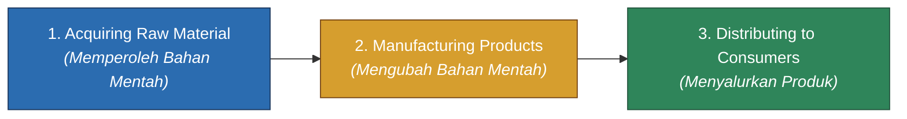
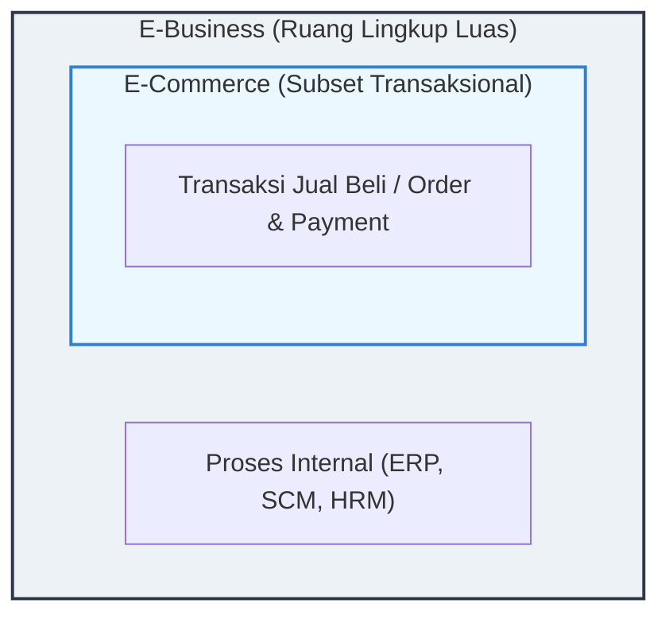
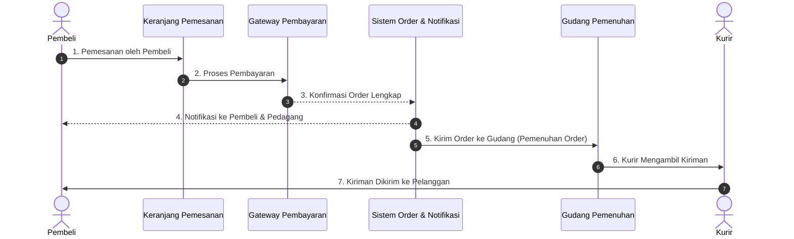
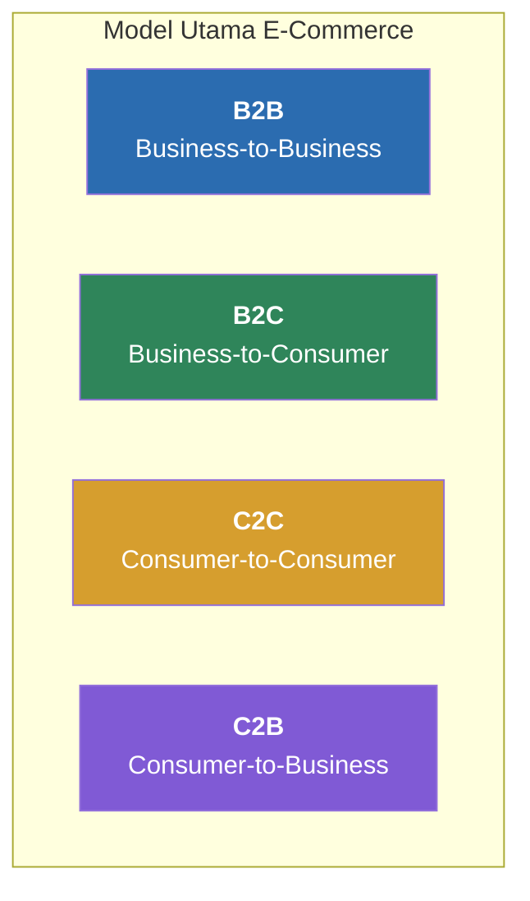
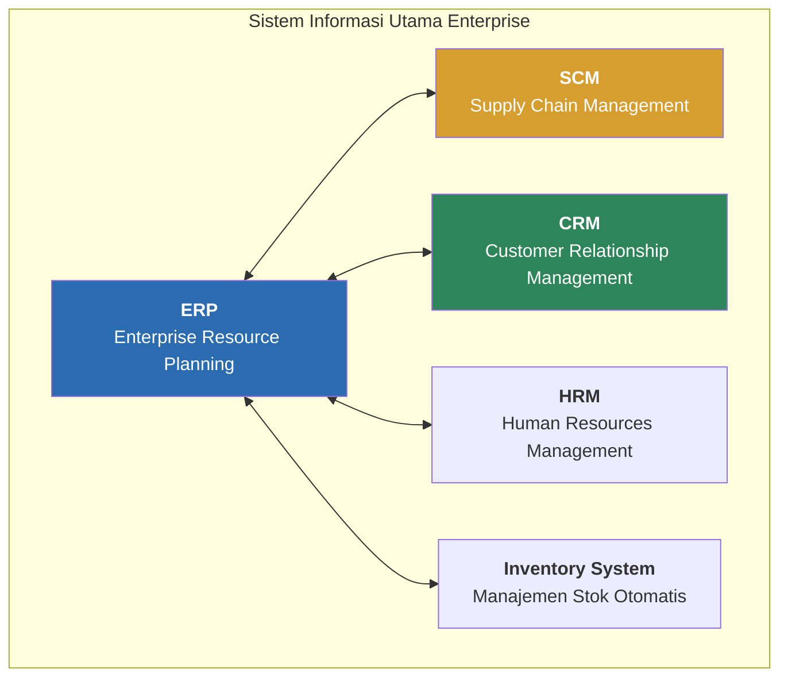

# Pertemuan 01: Pengantar E-Business

* **Mata Kuliah:** E-Bisnis (`STSI4408` / `MSIM4409`)
* **Program Studi:** Sistem Informasi — Universitas Terbuka
* **Topik:** Konsep Dasar E-Business, E-Commerce, Komparasi Bisnis Konvensional, dan Sistem Informasi Enterprise

---

## Daftar Isi
1. [Pengenalan & Konsep Dasar Bisnis](#1-pengenalan--konsep-dasar-bisnis)
2. [Konsep dan Definisi E-Business](#2-konsep-dan-definisi-e-business)
3. [E-Commerce dan Proses Bisnis Transaksional](#3-e-commerce-dan-proses-bisnis-transaksional)
4. [Perbandingan Bisnis Konvensional dan E-Business](#4-perbandingan-bisnis-konvensional-dan-e-business)
5. [Infrastruktur Teknologi Informasi & Sistem Informasi Enterprise](#5-infrastruktur-teknologi-informasi--sistem-informasi-enterprise)
6. [Referensi Resmi](#6-referensi-resmi)

---

## 1. Pengenalan & Konsep Dasar Bisnis

### Apa itu Bisnis?
**Bisnis** merupakan suatu aktivitas yang dilakukan secara individu maupun kolektif (organisasi) untuk menyediakan barang atau jasa yang diperlukan masyarakat guna memperoleh keuntungan melalui proses transaksi.

> *"Business is an organization that provides goods or services in order to earn profit."*  
> — **Hughes & Kapoor (2011)**

### Tujuan Utama Kegiatan Bisnis
Menurut **Steinhoff (1979)** dalam *The World of Business*, aktivitas utama dalam rantai kegiatan bisnis terbagi menjadi 3 tahapan mendasar:

---

## 2. Konsep dan Definisi E-Business

### Definisi E-Business

Istilah **E-Business** pertama kali diperkenalkan oleh **Louis Gerstner** (CEO IBM). Secara umum, *e-business* merupakan mekanisme yang dilakukan suatu organisasi untuk mendukung dan melakukan transformasi proses bisnis sehingga menjadi lebih efektif dan efisien dengan memanfaatkan kemampuan teknologi informasi dan komunikasi (TIK).

### Pandangan Para Ahli mengenai E-Business

| Tokoh / Ahli | Fokus Pandangan / Definisi |
| --- | --- |
| **O’Brien & Marakas** | Penggunaan teknologi internet untuk menghubungkan dan memberdayakan proses bisnis, e-commerce, serta kolaborasi antar entitas bisnis. |
| **Laudon & Traver** | Penggunaan internet dan teknologi digital untuk menjalankan seluruh proses bisnis yang tersentralisasi dalam organisasi. |
| **Chaffey** | Pengelolaan seluruh transaksi bisnis elektronik, baik internal maupun eksternal organisasi. |
| **Mohan Sawhney / Colin Combe / Dhillon & Kaur** | Integrasi jaringan digital dalam menciptakan nilai tambah (*value creation*) pada seluruh rantai pasok. |

### Manfaat Utama Penerapan E-Business

1. **Menghemat Biaya (*Cost Efficiency*):** Mengurangi biaya operasional, pencetakan dokumen fisik, dan administrasi manual.
2. **Meningkatkan Pendapatan (*Revenue Growth*):** Membuka jangkauan pasar yang jauh lebih luas tanpa batasan geografis.
3. **Peluang Bisnis Baru (*New Opportunities*):** Memunculkan model bisnis berbasis digital dan platform inovatif.

---

## 3. E-Commerce dan Proses Bisnis Transaksional

### Definisi E-Commerce

**E-Commerce** merupakan konsep penerapan *e-business* yang berfokus pada strategi transaksi jual beli barang atau jasa menggunakan jaringan elektronik, sistem manajemen inventori otomatis, dan pemrosesan data digital.

* **Para Tokoh Pengembang Konsep:** Laudon & Traver, E. Turban, Colin Combe, Chaffey, Guay.

### Hubungan E-Business dan E-Commerce

*E-Commerce* merupakan sub-bagian (*subset*) dari *E-Business*. E-Business mencakup seluruh rantai nilai internal dan eksternal, sedangkan E-Commerce secara khusus menangani aspek transaksional komersial.

### Alur Kerja Transaksi E-Commerce

Berikut adalah diagram alur kerja pemrosesan order pada sistem *E-Commerce*:

### Klasifikasi Model Bisnis E-Commerce

Berdasarkan entitas yang berinteraksi dalam transaksi:

* **Business to Business (B2B):** Transaksi antar perusahaan atau entitas bisnis (misal: pemasok ke pabrik).
* **Business to Consumer (B2C):** Perusahaan menjual produk/jasa langsung ke konsumen akhir.
* **Consumer to Consumer (C2C):** Transaksi antar individu/konsumen melalui platform marketplace.
* **Consumer to Business (C2B):** Individu menawarkan produk/jasa (freelance, lisensi foto) ke entitas bisnis.

---

## 4. Perbandingan Bisnis Konvensional dan E-Business

| Karakteristik | Bisnis Konvensional | E-Business |
| --- | --- | --- |
| **Interaksi / Komunikasi** | Dilakukan secara fisik / tatap muka | Multichannel digital / online |
| **Kecepatan Pemrosesan** | Tidak bersifat *real-time* (Manual) | *Real-time* dan terotomatisasi |
| **Format Dokumen** | Berkas fisik (*hardcopy*) | Berkas digital (*softcopy*) |
| **Jangkauan Operasional** | Terbatas pada lokasi geografis tertentu | Akses global tanpa batas wilayah |
| **Keterlibatan Stakeholder** | Memerlukan kehadiran di lokasi | Komunikasi lebih efektif & efisien via TIK |

---

## 5. Infrastruktur Teknologi Informasi & Sistem Informasi Enterprise

### Teknologis Pendukung E-Business

Perkembangan *e-business* didukung oleh berbagai fondasi teknologi informasi modern:

1. **Internet & World Wide Web (WWW):** Infrastruktur komunikasi global.
2. **Arsitektur Klien/Server:** Pemrosesan data terdistribusi.
3. **Perangkat Mobile:** Memungkinkan transaksi kapan saja (*M-Commerce*).
4. **Komputasi Awan (*Cloud Computing*):** Skalabilitas server dan infrastruktur fleksibel.
5. **Internet of Things (IoT):** Pelacakan barang dan otomatisasi perangkat.
6. **Big Data:** Pengolahan data analitis skala besar untuk memahami konsumen.

### Peran Sistem Informasi Enterprise

Menurut **O’Brien (2010)**, Sistem Informasi memiliki 3 peran utama dalam organisasi:

* **Dukungan Proses Bisnis dan Operasi:** Mengoptimalkan alur kerja harian.
* **Dukungan Pengambilan Keputusan:** Memberikan data presisi bagi manajemen.
* **Keunggulan Kompetitif (*Competitive Advantage*):** Menjadi pembeda strategis dibanding pesaing.

### Evolusi Platform E-Business

Munculnya berbagai platform aplikasi digital—seperti **Media Sosial** (Instagram, TikTok, WhatsApp, Facebook)—telah mempercepat evolusi model *e-business* baru (*Social Commerce*), yang memudahkan interaksi dan penjualan langsung kepada pengguna secara masif.

---

## 6. Referensi Resmi

1. **Buku Materi Pokok (BMP) UT:** *E-Business* (`MSIM4409` / `STSI4408`), Universitas Terbuka.
2. **Chaffey, D. (2015):** *Digital Business and E-Commerce Management*, Pearson.
3. **Hughes, R. J., & Kapoor, J. R. (2011):** *Business*, Cengage Learning.
4. **Laudon, K. C., & Traver, C. G. (2021):** *E-Commerce: Business, Technology, Society*, Pearson.
5. **O'Brien, J. A., & Marakas, G. M. (2010):** *Management Information Systems*, McGraw-Hill.
6. **Steinhoff, D. (1979):** *The World of Business*, McGraw-Hill.