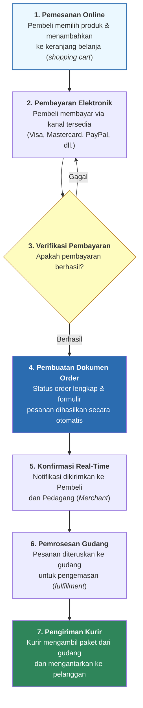
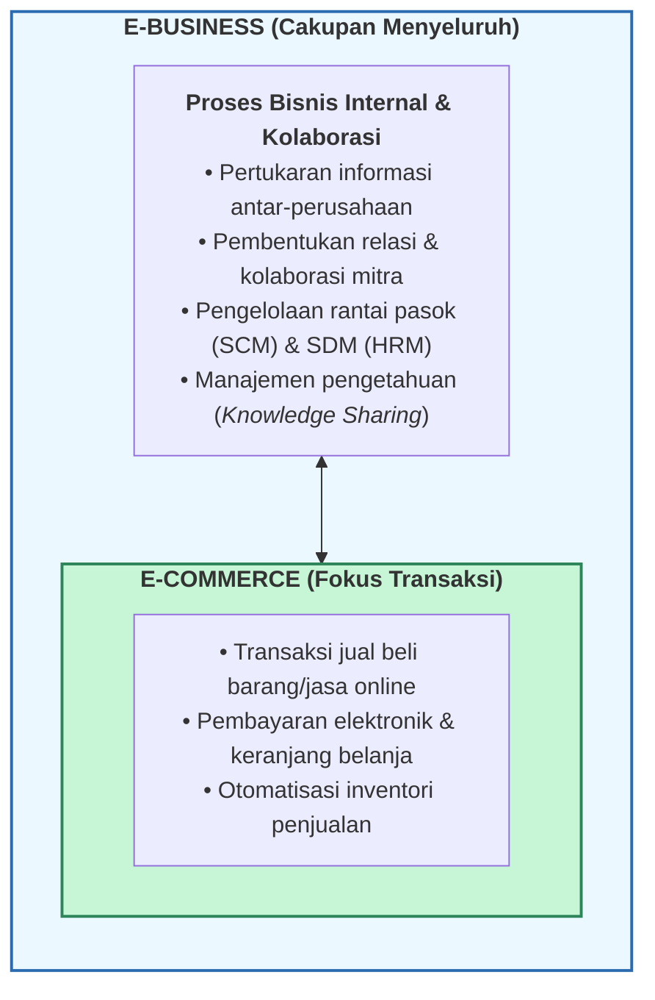
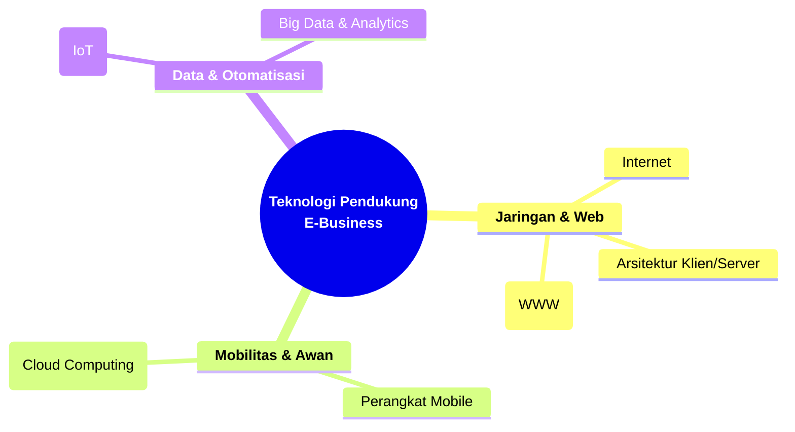
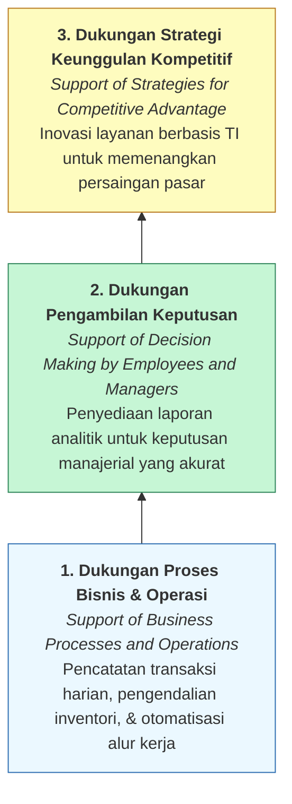

# Pertemuan 01: Pengantar E-Business

* **Mata Kuliah:** E-Business (`STSI4408`) *(Referensi BMP: E-Business `MSIM4409`)*
* **Program Studi:** Sistem Informasi — Universitas Terbuka
* **Topik:** Konsep Dasar Bisnis & E-Business, E-Commerce, Perbandingan Bisnis Konvensional vs E-Business, Teknologi Pendukung, dan Sistem Informasi Enterprise

---

## Daftar Isi

1. [Konsep Dasar Bisnis dan E-Business](#1-konsep-dasar-bisnis-dan-e-business)
2. [Konsep E-Commerce dan Alur Proses Transaksi](#2-konsep-e-commerce-dan-alur-proses-transaksi)
3. [Perbedaan E-Business vs E-Commerce & Model Transaksi](#3-perbedaan-e-business-vs-e-commerce--model-transaksi)
4. [Perbandingan Bisnis Konvensional vs E-Business](#4-perbandingan-bisnis-konvensional-vs-e-business)
5. [Teknologi Informasi Pendukung E-Business](#5-teknologi-informasi-pendukung-e-business)
6. [Peran Sistem Informasi dalam E-Business](#6-peran-sistem-informasi-dalam-e-business)
7. [Referensi Resmi](#7-referensi-resmi)

---

## 1. Konsep Dasar Bisnis dan E-Business

### Pengertian dan Tujuan Utama Bisnis

**Bisnis** adalah suatu aktivitas yang dilakukan secara individu maupun bersama-sama (organisasi) untuk menyediakan barang atau jasa yang dibutuhkan masyarakat guna memperoleh keuntungan (*profit*) melalui mekanisme transaksi.

> *"Business is an organization that provides goods or services in order to earn profit."*
> — **Hughes & Kapoor** (*Business*, 2011)

Menurut **Steinhoff** (*The World of Business*, 1979), terdapat **tiga tujuan utama** dalam aktivitas bisnis:

1. **Memperoleh bahan mentah** (*acquiring raw materials*).
2. **Mengubah bahan mentah menjadi barang jadi** (*manufacturing raw materials into products*).
3. **Menyalurkan produk yang dihasilkan kepada konsumen** (*distributing products to consumers*).

### Pengertian E-Business

**E-Business** (*Electronic Business*) merupakan mekanisme yang dilakukan suatu organisasi untuk mendukung serta melakukan **transformasi proses bisnis** agar menjadi lebih **efektif dan efisien** dengan memanfaatkan kapabilitas teknologi informasi dan komunikasi (TIK).

* **Sejarah Istilah:** Istilah *e-business* pertama kali diperkenalkan oleh **Louis Gerstner** (CEO IBM) pada tahun 1997.
* **Tokoh Akademisi:** Konsep *e-business* banyak dikaji dan didefinisikan oleh pakar sistem informasi dan manajemen digital seperti **O'Brien & Marakas**, **Laudon & Traver**, **Dhillon & Kaur**, **Colin Combe**, **Dave Chaffey**, serta **Mohan Sawhney**.

### Manfaat Strategis Penerapan E-Business

Penerapan *e-business* secara efektif memberikan tiga dampak strategis utama bagi organisasi:

1. **Efisiensi Biaya (*Cost Reduction*):** Menekan biaya operasional, administrasi dokumen fisik, dan biaya komunikasi.
2. **Peningkatan Pendapatan (*Revenue Growth*):** Memperluas jangkauan pasar tanpa batas geografis dan mempercepat siklus penjualan.
3. **Peluang Bisnis Baru (*New Business Opportunities*):** Membuka inovasi model bisnis digital, produk berbasis informasi, dan kemitraan lintas ekosistem.

---

## 2. Konsep E-Commerce dan Alur Proses Transaksi

### Pengertian E-Commerce

**E-Commerce** (*Electronic Commerce*) merupakan bagian dari penerapan *e-business* yang memfokuskan strategi pada **transaksi jual beli barang atau jasa** menggunakan jaringan elektronik, sistem manajemen inventori, serta pengumpulan data secara otomatis.

* E-commerce mengubah lanskap persaingan usaha, meningkatkan kecepatan tindakan bisnis, serta menyederhanakan interaksi, distribusi produk, dan mekanisme pembayaran antara pelanggan dengan perusahaan maupun antara perusahaan dengan pemasok.
* **Tokoh Akademisi:** Definisi *e-commerce* dikembangkan oleh para ahli seperti **Laudon & Traver**, **Efraim Turban**, **Colin Combe**, **Dave Chaffey**, dan **Guay**.

### Alur Proses Transaksi E-Commerce

Berikut adalah alur tahapan pemrosesan pesanan dalam sistem *e-commerce* modern dari sisi pembeli, sistem pembayaran, pedagang, hingga logistik pengiriman:

---

## 3. Perbedaan E-Business vs E-Commerce & Model Transaksi

### Hubungan dan Cakupan E-Business vs E-Commerce

Meskipun sering digunakan secara bergantian, *e-business* memiliki cakupan yang jauh lebih luas dibandingkan *e-commerce*. **E-Commerce merupakan irisan (bagian) dari E-Business** yang berfokus pada transaksi komersial eksternal.

| Aspek Pembeda | E-Commerce | E-Business |
| :--- | :--- | :--- |
| **Fokus Utama** | Mekanisme transaksi jual beli barang/jasa secara elektronik. | Transformasi seluruh rantai nilai dan proses bisnis menggunakan TIK. |
| **Cakupan Aktivitas** | Transaksi eksternal dengan pelanggan atau pemasok. | Mencakup *e-commerce*, kolaborasi mitra, pertukaran informasi antar-organisasi, dan sistem internal. |
| **Aliran Nilai** | Berorientasi pada pertukaran moneter (transaksi finansial). | Berorientasi pada efisiensi operasional, relasi entitas, dan keunggulan kompetitif. |

### Jenis-Jenis Model Transaksi E-Commerce

| Model | Kepanjangan | Deskripsi Mekanisme | Contoh Penerapan |
| :--- | :--- | :--- | :--- |
| **B2B** | *Business-to-Business* | Transaksi antar-pelaku bisnis atau organisasi, umumnya menggunakan sistem terotomatisasi antar-perusahaan. | Pengadaan barang antara toko/perusahaan dengan platform *B2B marketplace* (Mbiz, Indonetwork). |
| **B2C** | *Business-to-Consumer* | Transaksi ritel langsung antara perusahaan penjual dengan konsumen perorangan. | Pembelian sepatu oleh pelanggan di toko ritel online (misal: Zalora, situs resmi *brand*). |
| **C2C** | *Consumer-to-Consumer* | Transaksi jual beli barang/jasa yang terjadi antar-sesama konsumen melalui platform perantara. | Jual beli barang bekas atau individu di OLX, eBay, dan *marketplace* C2C. |
| **C2B** | *Consumer-to-Business* | Individu (konsumen) menawarkan produk, keahlian, atau eksposur nilai kepada organisasi bisnis. | *Influencer* / *affiliate marketer* menawarkan jasa promosi media sosial, atau fotografer melisensikan foto ke agensi. |

---

## 4. Perbandingan Bisnis Konvensional vs E-Business

Perbedaan paling mendasar antara bisnis konvensional dan *e-business* terletak pada **kebiasaan *stakeholder* bisnis dalam memanfaatkan kapabilitas teknologi informasi dan internet**.

| Dimensi Perbandingan | Bisnis Konvensional (Tradisional) | E-Business |
| :--- | :--- | :--- |
| **Mekanisme Komunikasi** | Dilakukan secara fisik / tatap muka langsung. | Terjalin langsung maupun tidak langsung di ruang digital secara lebih efektif dan efisien. |
| **Kecepatan Proses** | Tidak bersifat *real-time* (memerlukan jeda waktu administratif). | Bersifat ***real-time*** dan terotomatisasi antar-sistem. |
| **Format Dokumen** | Menggunakan dokumen fisik berbasis kertas (*hardcopy*). | Menggunakan dokumen digital (*softcopy*) yang mudah disimpan dan dibagikan. |
| **Jangkauan Pasar** | Relatif terbatas pada lokasi geografis tertentu. | Jangkauan global tanpa batas ruang dan waktu (24/7). |
| **Perilaku *Stakeholder*** | Bergantung pada interaksi manual dan perantara fisik. | Terbiasa memanfaatkan sistem informasi, internet, dan platform kolaborasi digital. |

---

## 5. Teknologi Informasi Pendukung E-Business

Perkembangan pesat *e-business* ditopang oleh konvergensi berbagai infrastruktur teknologi informasi modern:

1. **Internet:** Infrastruktur jaringan global yang menghubungkan seluruh entitas bisnis dan konsumen.
2. **Arsitektur Klien/Server (*Client/Server*):** Model komputasi terdistribusi di mana perangkat pengguna (*client*) meminta layanan atau data dari peladen (*server*).
3. **World Wide Web (`WWW`):** Antarmuka standar berbasis web untuk menyajikan katalog informasi, aplikasi transaksi, dan portal layanan.
4. **Perangkat Mobile:** Ponsel pintar dan tablet yang memungkinkan akses transaksi kapan saja dan di mana saja (*mobile commerce*).
5. **Komputasi Awan (*Cloud Computing*):** Penyediaan sumber daya komputasi, penyimpanan data, dan aplikasi bisnis secara fleksibel melalui internet.
6. **Internet of Things (`IoT`):** Jaringan perangkat fisik bersensor yang saling bertukar data secara otomatis (sangat krusial untuk pelacakan logistik dan manajemen gudang cerdas).
7. **Big Data:** Pengolahan volume data transaksi dan perilaku pelanggan berskala besar untuk menghasilkan wawasan bisnis (*business insights*).

---

## 6. Peran Sistem Informasi dalam E-Business

### Tiga Peran Strategis Sistem Informasi (O'Brien, 2010)

Menurut **James A. O'Brien (2010)**, sistem informasi memiliki tiga peran fundamental dalam mendukung keberhasilan bisnis perusahaan:

### Sistem Informasi Enterprise Pendukung E-Business

Untuk mencapai kecepatan optimal, jangkauan global, peningkatan produktivitas, pengelolaan pelanggan, serta berbagi pengetahuan (*knowledge sharing*) demi meraih keunggulan kompetitif (*competitive advantage*), organisasi mengintegrasikan berbagai sistem informasi berikut:

| Sistem Informasi | Kepanjangan | Peran Utama dalam E-Business |
| :--- | :--- | :--- |
| **ERP** | *Enterprise Resource Planning* | Mengintegrasikan seluruh proses bisnis inti (keuangan, produksi, pengadaan, distribusi) dalam satu basis data terpadu. |
| **CRM** | *Customer Relationship Management* | Mengelola interaksi, riwayat transaksi, layanan purnajual, dan loyalitas pelanggan secara terpersonalisasi. |
| **HRM** | *Human Resources Management* | Mengelola administrasi, kinerja, pengembangan talenta, dan produktivitas sumber daya manusia organisasi. |
| **SCM** | *Supply Chain Management* | Mengoordinasikan aliran barang, informasi, dan keuangan mulai dari pemasok bahan baku hingga ke tangan konsumen akhir. |
| **IMS** | *Inventory Management System* | Memantau ketersediaan stok barang secara *real-time* untuk mencegah kekurangan stok (*stockout*) maupun penumpukan gudang. |

> **Evolusi Model E-Business Baru:** Kemunculan platform aplikasi *e-commerce* dan **Media Sosial** (*Social Commerce*) turut mendorong lahirnya model bisnis digital baru yang mengandalkan interaksi komunitas, pemasaran konten, dan transaksi langsung di dalam jejaring sosial.

---

## 7. Referensi Resmi

1. **Modul UT:** Materi Inisiasi 1 — *Pengantar E-Business*, Mata Kuliah E-Business (`STSI4408`), Universitas Terbuka.
2. **Buku Materi Pokok (BMP) UT:** *E-Business* (`MSIM4409`), Universitas Terbuka.
3. **O'Brien, J. A., & Marakas, G. M.** (2010). *Management Information Systems* (10th ed.). New York: McGraw-Hill/Irwin.
4. **Laudon, K. C., & Traver, C. G.** *E-Commerce: Business, Technology, Society*. Pearson Education.
5. **Chaffey, D.** *Digital Business and E-Commerce Management*. Pearson Education.
6. **Turban, E., King, D., Lee, J. K., Liang, T. P., & Turban, D. C.** *Electronic Commerce: A Managerial and Social Networks Perspective*. Springer.
7. **Combe, C.** *Introduction to E-Business: Management and Strategy*. Butterworth-Heinemann.
8. **Hughes, R. J., & Kapoor, J. R.** (2011). *Business*. Cengage Learning.
9. **Steinhoff, D.** (1979). *The World of Business*. McGraw-Hill.