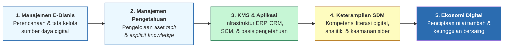
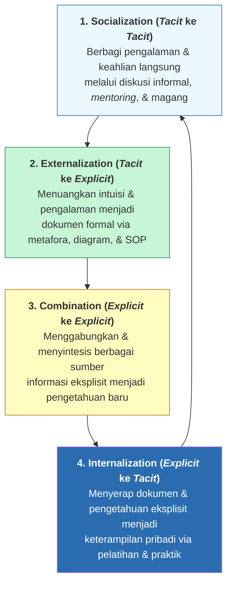
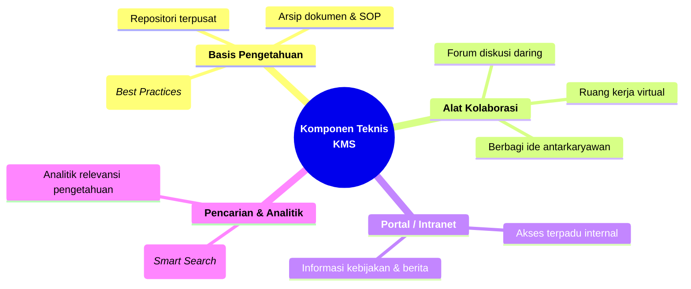

# Pertemuan 02: Manajemen Pengetahuan & Implikasi Ekonomi Digital

* **Mata Kuliah:** E-Business (`STSI4408`) *(Referensi BMP: E-Business `MSIM4409`)*
* **Program Studi:** Sistem Informasi — Universitas Terbuka
* **Topik:** Konsep Manajemen E-Bisnis, Manajemen Pengetahuan (SECI), *Knowledge Management System* (KMS), Pengelolaan Aplikasi & Keterampilan SDM, Lingkungan Kompetitif, serta Ekonomi Digital & Informasi

---

## Daftar Isi

1. [Konsep Manajemen E-Bisnis](#1-konsep-manajemen-e-bisnis)
2. [Manajemen Pengetahuan dan Model SECI](#2-manajemen-pengetahuan-dan-model-seci)
3. [Knowledge Management System (KMS)](#3-knowledge-management-system-kms)
4. [Pengelolaan Sistem Aplikasi untuk E-Bisnis](#4-pengelolaan-sistem-aplikasi-untuk-e-bisnis)
5. [Pengelolaan Keterampilan SDM dalam E-Bisnis](#5-pengelolaan-keterampilan-sdm-dalam-e-bisnis)
6. [Peran TI dan Pengaruh Internet terhadap Lingkungan Kompetitif](#6-peran-ti-dan-pengaruh-internet-terhadap-lingkungan-kompetitif)
7. [Ekonomi Digital dan Ekonomi Informasi](#7-ekonomi-digital-dan-ekonomi-informasi)
8. [Referensi Resmi](#8-referensi-resmi)

---

## 1. Konsep Manajemen E-Bisnis

### Pengertian Manajemen E-Bisnis

**Manajemen E-Bisnis** adalah proses perencanaan, pengorganisasian, pelaksanaan, dan pengendalian seluruh sumber daya digital perusahaan (infrastruktur TIK, data, aplikasi, dan SDM) guna mencapai tujuan bisnis secara elektronis.

> *"Pengetahuan adalah aset strategis — dikelola dengan tepat, ia menjadi motor utama transformasi menuju ekonomi digital."*
> — **Dr. Sulqifli, S.E., M.M.** (*Materi Kuliah E-Business*)

### Keterkaitan Antar-Konsep dalam Ekosistem E-Bisnis

Keberhasilan transformasi bisnis digital tidak hanya bergantung pada teknologi semata, melainkan pada sinergi berkelanjutan antar-elemen organisasi berikut:

### Empat Fungsi Utama Manajemen E-Bisnis

1. **Perencanaan Strategis (*Strategic Planning*):** Menentukan arah dan prioritas pemanfaatan TIK agar selaras dengan visi dan tujuan bisnis jangka panjang perusahaan.
2. **Pengorganisasian Sumber Daya (*Resource Organizing*):** Mengatur serta mengalokasikan infrastruktur jaringan, basis data, sistem aplikasi, dan SDM digital secara efisien.
3. **Pelaksanaan Operasional (*Operational Execution*):** Menjalankan proses bisnis elektronik sehari-hari (pemasaran, transaksi, layanan pelanggan, rantai pasok) sesuai standar operasional yang ditetapkan.
4. **Pengendalian dan Evaluasi (*Controlling & Evaluation*):** Memantau kinerja sistem, mengukur efektivitas layanan digital, menjaga keamanan, serta melakukan perbaikan berkelanjutan (*continuous improvement*).

### Faktor Keberhasilan Kritis (*Critical Success Factors*)

Berdasarkan kajian dalam buku *E-Business* (Purnia dkk., 2022), manajemen e-bisnis perlu mengadopsi pendekatan yang berpusat pada pelanggan (*customer-centric*) melalui:

* **Kepemimpinan Eksekutif:** Komitmen pimpinan puncak dalam memahami implikasi teknologi baru dan mengintegrasikannya ke dalam strategi perusahaan.
* **Kelincahan Seperti Pendatang Baru:** Menghindari zona nyaman (*status quo*), peka membaca tren pasar lebih awal, dan gesit mengambil keputusan.
* **Kerja Sama *Outsourcing*:** Memanfaatkan mitra eksternal untuk fungsi non-inti guna menekan biaya operasional dan meningkatkan skalabilitas layanan.
* **Manajemen Informasi untuk Produk Turunan:** Mengolah data dan informasi menjadi nilai tambah baru (penguatan merek, loyalitas pelanggan, dan integrasi pemasok).

---

## 2. Manajemen Pengetahuan dan Model SECI

### Pengertian Manajemen Pengetahuan

**Manajemen Pengetahuan** (*Knowledge Management* / KM) adalah proses sistematis dalam mengelola pengetahuan organisasi—baik yang bersifat pengalaman personal maupun yang terdokumentasi—agar dapat diciptakan, disimpan, dibagikan, dan diterapkan untuk menghasilkan keunggulan bersaing.

### Perbandingan *Explicit Knowledge* vs *Tacit Knowledge*

| Aspek Pembeda | *Explicit Knowledge* (Pengetahuan Eksplisit) | *Tacit Knowledge* (Pengetahuan Tasit) |
| :--- | :--- | :--- |
| **Definisi** | Pengetahuan yang sudah dikodifikasi, terdokumentasi secara formal, dan mudah ditransfer atau dibagikan. | Pengetahuan yang melekat dalam pikiran individu, berbasis pengalaman, intuisi, dan pemahaman personal. |
| **Sifat Pengetahuan** | Objektif, terstruktur, dan mudah disimpan dalam media fisik maupun digital. | Subjektif, kontekstual, serta sulit diformalkan atau dituliskan secara langsung. |
| **Contoh Penerapan** | Buku panduan, SOP (manual prosedur), laporan keuangan, dokumen kebijakan, dan basis data. | Keterampilan negosiasi, intuisi membaca peluang pasar, keahlian teknis senior, dan *insight* manajerial. |

### Model Konversi Pengetahuan SECI

Model **SECI** (*Socialization, Externalization, Combination, Internalization*) yang diperkenalkan oleh Nonaka & Takeuchi menjelaskan bagaimana pengetahuan berputar dan berkembang di dalam organisasi melalui empat proses konversi:

### Siklus Proses Manajemen Pengetahuan

Proses manajemen pengetahuan berjalan secara **siklis** (berkelanjutan), karena pengetahuan yang diterapkan akan menghasilkan pengalaman baru yang kembali diidentifikasi dan dikelola melalui enam tahapan berikut:

1. **Identifikasi Pengetahuan:** Memetakan pengetahuan kritis yang dibutuhkan organisasi beserta lokasi sumbernya (ahli internal maupun eksternal).
2. **Akuisisi dan Penciptaan Pengetahuan:** Memperoleh pengetahuan dari luar (riset, perekrutan, kemitraan) maupun menciptakan pengetahuan baru di internal organisasi melalui inovasi dan proses SECI.
3. **Pengembangan Pengetahuan:** Mengolah, menyaring, memvalidasi, dan menyusun pengetahuan agar relevan dengan kebutuhan bisnis.
4. **Penyimpanan Pengetahuan:** Mendokumentasikan dan mengorganisasikan pengetahuan ke dalam repositori digital agar tidak hilang akibat pergantian karyawan (*turnover*).
5. **Distribusi / Berbagi (*Knowledge Sharing*):** Menyebarkan pengetahuan kepada pihak yang tepat pada waktu yang tepat melalui budaya berbagi dan sarana teknologi.
6. **Pemanfaatan / Penerapan:** Mengaplikasikan pengetahuan tersebut dalam pengambilan keputusan, pemecahan masalah operasional, dan penciptaan inovasi produk.

---

## 3. Knowledge Management System (KMS)

### Pengertian dan Tiga Pilar Utama KMS

**Knowledge Management System (`KMS`)** adalah sistem berbasis teknologi informasi yang dirancang untuk mendukung dan mengotomatisasi proses penciptaan, penyimpanan, pencarian, dan penyebaran pengetahuan di seluruh organisasi.

Implementasi `KMS` bertumpu pada keseimbangan **tiga pilar utama**:

* **People (Manusia):** Budaya berbagi pengetahuan (*knowledge sharing culture*), motivasi karyawan, dan dukungan pimpinan.
* **Process (Proses):** Alur kerja dan standar operasional dalam mendokumentasikan, memvalidasi, serta memperbarui pengetahuan.
* **Technology (Teknologi):** Infrastruktur perangkat lunak, basis data, dan jaringan yang memfasilitasi penyimpanan serta kolaborasi.

### Komponen Teknis Utama KMS

* **Contoh Perangkat Lunak KMS:** Microsoft SharePoint, Corporate Wikis (seperti Confluence), dan *Document Management Systems* (`DMS`).

---

## 4. Pengelolaan Sistem Aplikasi untuk E-Bisnis

### Pengertian dan Strategi Pengelolaan Aplikasi

Pengelolaan sistem aplikasi e-bisnis mencakup proses memilih, mengintegrasikan, mengimplementasikan, dan memelihara perangkat lunak bisnis agar operasional berjalan efektif dan efisien.

Empat strategi kunci dalam mengelola arsitektur aplikasi e-bisnis:

1. **Integrasi Sistem:** Menghubungkan aliran data antar-departemen (*front-office* dan *back-office*) tanpa duplikasi input manual.
2. **Keamanan Informasi:** Melindungi aplikasi dan basis data transaksi dari peretasan dan kebocoran data melalui enkripsi, *firewall*, dan kontrol akses.
3. **Skalabilitas:** Memastikan arsitektur aplikasi mampu menampung lonjakan trafik pengguna dan pertumbuhan volume transaksi di masa depan.
4. **Pemanfaatan *Cloud* dan *Hybrid Systems*:** Menggunakan komputasi awan (*cloud computing*) maupun kombinasi peladen lokal dan awan (*hybrid*) demi fleksibilitas akses, efisiensi biaya infrastruktur, dan keandalan pemulihan bencana (*disaster recovery*).

### Aplikasi Utama dalam Ekosistem E-Bisnis

| Aplikasi | Kepanjangan | Peran dan Fungsi Utama dalam E-Bisnis |
| :--- | :--- | :--- |
| **ERP** | *Enterprise Resource Planning* | Sistem *back-office* yang mengintegrasikan dan mengotomatisasi seluruh proses bisnis internal (produksi, keuangan, akuntansi, SDM, pergudangan) secara *real-time*. |
| **CRM** | *Customer Relationship Management* | Mengelola interaksi dan hubungan dengan pelanggan melalui kustomisasi serta personalisasi layanan berdasarkan riwayat dan preferensi pembeli. |
| **SCM** | *Supply Chain Management* | Menyinkronkan dan mengoordinasikan aliran barang, informasi, dan keuangan mulai dari pemasok bahan baku hingga sampai ke konsumen akhir. |
| **E-P** | *E-Procurement* | Mengotomasi proses pengadaan barang dan jasa perusahaan secara elektronik (pemilihan vendor, tender daring, hingga pemesanan) untuk efisiensi dan transparansi. |
| **EAI** | *Enterprise Application Integration* | Perangkat perantara (*middleware*) yang menghubungkan berbagai aplikasi yang sebelumnya berdiri sendiri (misalnya ERP dengan CRM dan SCM) agar dapat bertukar data. |

### Lima Aspek Kunci Operasional E-Bisnis (Nugroho, 2006)

1. **Pelanggan:** Pelayanan lebih cepat, fitur *self-service*, ragam pilihan produk, dan solusi terintegrasi.
2. **e-Service:** Pembayaran fleksibel, dukungan pelanggan memadai, pengiriman andal, serta waktu proses singkat.
3. **Organisasi:** Kerja sama *outsourcing*, kontrak manufaktur yang efisien, dan kapabilitas distribusi virtual.
4. **Pegawai:** Penyaringan perekrutan sesuai kompetensi digital dan retensi karyawan terbaik.
5. **Teknologi:** Antarmuka web yang ramah pengguna (*user-friendly*), konvergensi infrastruktur, dan keandalan penyedia layanan (*service provider*).

---

## 5. Pengelolaan Keterampilan SDM dalam E-Bisnis

### Lima Kompetensi Utama SDM E-Bisnis

Teknologi digital yang mutakhir hanya akan memberikan dampak optimal apabila dioperasikan oleh sumber daya manusia yang kompeten. Pengembangan SDM e-bisnis berfokus pada lima keterampilan utama:

1. **Literasi Digital:** Kemampuan dasar hingga mahir dalam mengoperasikan perangkat keras, perangkat lunak produktivitas, dan platform digital.
2. **Analisis Data (*Data Analytics*):** Kemampuan membaca, mengolah, dan memanfaatkan data transaksi maupun perilaku pelanggan sebagai dasar keputusan bisnis.
3. **Keamanan Informasi (*Cyber Security*):** Pemahaman prinsip perlindungan data, pencegahan ancaman siber (*phishing*, *malware*), serta kepatuhan menjaga kerahasiaan data perusahaan.
4. **Manajemen Proyek Digital:** Kemampuan merencanakan, mengeksekusi, dan mengawasi proyek berbasis teknologi secara terstruktur.
5. **Komunikasi Daring (*Virtual Communication*):** Kemampuan berkolaborasi, berkoordinasi, dan berkomunikasi secara efektif melalui berbagai platform digital.

### Strategi Pengembangan Keterampilan SDM

* **Pelatihan Berbasis Kebutuhan (*Upskilling & Reskilling*):** Menyelenggarakan pelatihan teknis berkala sesuai perkembangan perangkat lunak dan teknologi industri.
* **Sertifikasi Kompetensi:** Mendorong karyawan memperoleh sertifikasi profesional (analitik data, keamanan informasi, manajemen proyek) guna menjamin standar kapabilitas.
* **Pembelajaran Berkelanjutan (*Continuous Learning*):** Membangun budaya belajar mandiri melalui portal *e-learning* internal dan sesi berbagi pengetahuan antar-tim.

---

## 6. Peran TI dan Pengaruh Internet terhadap Lingkungan Kompetitif

### Peran Strategis Teknologi Informasi (TI) dalam E-Bisnis

* **Otomatisasi Proses Bisnis:** Menggantikan pekerjaan administratif manual yang berulang menjadi alur digital yang cepat dan akurat.
* **Kolaborasi Daring:** Memungkinkan koordinasi *real-time* antara karyawan, pemasok, dan mitra bisnis lintas lokasi geografis.
* **Layanan Digital 24/7:** Membuka akses layanan pelanggan sepanjang waktu tanpa batasan jam operasional fisik.
* **Data Analytics dan Personalisasi:** Mengolah rekam jejak digital konsumen untuk menghadirkan rekomendasi produk dan pengalaman layanan yang dipersonalisasi.

### Pengaruh Internet terhadap Lingkungan Kompetitif

1. **Mengurangi Hambatan Masuk (*Entry Barrier*):** Pelaku usaha baru dan UMKM dapat memasuki pasar dengan kebutuhan modal fisik yang jauh lebih rendah, sehingga memunculkan lebih banyak pesaing baru.
2. **Meningkatkan Persaingan dan Transparansi:** Konsumen dapat membandingkan harga, spesifikasi, dan ulasan produk dari berbagai penjual secara instan, sehingga meningkatkan daya tawar pembeli.
3. **Mendorong Inovasi Model Bisnis:** Perusahaan dituntut untuk terus berinovasi menciptakan diferensiasi layanan dan nilai tambah baru agar tetap relevan di pasar.

### Empat Model Strategi Kompetitif E-Bisnis

1. ***Low-Cost Leadership* (Kepemimpinan Biaya Rendah):** Memanfaatkan otomatisasi sistem informasi untuk menekan biaya operasional dan pemasaran sehingga mampu menawarkan harga paling kompetitif.
2. ***Product Differentiation* (Diferensiasi Produk):** Mengembangkan fitur produk atau layanan digital unik yang sulit ditiru pesaing.
3. ***Focus on Market Niche* (Fokus pada Ceruk Pasar):** Membidik segmen pasar spesifik dengan produk dan layanan yang disesuaikan secara khusus bagi kelompok pelanggan tertentu.
4. ***Strengthen Customer and Supplier Intimacy* (Kedekatan Pelanggan & Pemasok):** Memanfaatkan CRM dan SCM untuk membangun ikatan jangka panjang sehingga meningkatkan loyalitas pelanggan dan efisiensi pemasok.

---

## 7. Ekonomi Digital dan Ekonomi Informasi

### Pengertian dan Karakteristik Ekonomi Digital

**Ekonomi Digital** (*Digital Economy*), yang pertama kali diperkenalkan oleh **Don Tapscott** (1995) dan berkembang pesat pada era Revolusi Industri 4.0, adalah aktivitas ekonomi yang menjadikan teknologi digital dan jaringan internet sebagai penggerak utama penciptaan nilai tambah dan transaksi.

* **Ciri Utama:** Kecepatan tinggi, konektivitas global tanpa batas geografis, efisiensi biaya, integrasi horizontal, serta jaringan vertikal (*vertical networking*).
* **Ekosistem Teknologi:** Transaksi elektronik (*e-commerce*), platform digital, *sharing economy* (ekonomi berbagi), *Financial Technology* (`Fintech`), *Artificial Intelligence* (`AI`), *Internet of Things* (`IoT`), dan *Big Data*.

### Implikasi TIK terhadap Ekonomi Digital

| Aspek Dampak | Penjelasan dan Implikasi Bisnis |
| :--- | :--- |
| **Efisiensi** | Mempercepat siklus proses bisnis dan menekan biaya operasional maupun biaya transaksi secara signifikan. |
| **Perluasan Pasar** | Membuka akses pasar nasional hingga global tanpa dibatasi oleh letak geografis toko fisik. |
| **Model Bisnis Baru** | Memunculkan platform digital, *marketplace*, layanan berlangganan (*subscription*), dan ekonomi berbagi (*sharing economy*). |
| **Disrupsi** | Mengubah pola persaingan industri dan menggeser pelaku bisnis konvensional yang lambat beradaptasi. |
| **Inklusi Digital** | Meningkatkan literasi teknologi, akses layanan keuangan digital, dan partisipasi UMKM dalam perekonomian. |

> **Kontribusi Ekonomi Digital (McKinsey, 2018):** Penerapan perdagangan digital memberikan dampak pada empat area utama: (1) ***Financial Benefits*** (pertumbuhan nilai ekonomi & PDB), (2) ***Job Creation*** (penciptaan lapangan kerja baru melalui UMKM), (3) ***Buyer Benefits*** (harga lebih kompetitif & variasi produk), serta (4) ***Social Equality*** (inklusi keuangan dan pemerataan akses ekonomi).

### Ekonomi Informasi (*Information Economy*)

**Ekonomi Informasi** adalah paradigma ekonomi di mana **informasi dan pengetahuan berperan sebagai aset strategis utama** serta sumber penciptaan kekayaan perusahaan, melampaui aset fisik tradisional (seperti tanah, gedung, atau mesin produksi).

* **Karakteristik Informasi:** Dapat digandakan dengan biaya marjinal yang sangat rendah, tidak berkurang ketika dibagikan, dan nilainya meningkat saat dianalisis.
* **Contoh Aset Strategis:** Data pelanggan (profil, riwayat transaksi, preferensi), *insight* pasar (analisis tren permintaan dan intelijen kompetitif), serta Hak Kekayaan Intelektual seperti paten teknologi dan algoritma perangkat lunak.

---

## 8. Referensi Resmi

1. **Modul UT:** Materi Inisiasi 2 — *Manajemen & Ekonomi E-Bisnis*, Mata Kuliah E-Business (`STSI4408`), Universitas Terbuka.
2. **Buku Materi Pokok (BMP) UT:** *E-Business* (`MSIM4409`), Universitas Terbuka.
3. **Materi Perkuliahan:** Sulqifli. *Manajemen Pengetahuan dan Implikasi Ekonomi Digital*, Mata Kuliah E-Business.
4. **Purnia, D. S., Ratningsih, Adiwisastra, M. F., & Denilla, K. S. P.** (2022). *E-Business*. Yogyakarta: Expert (CV. Graha Ilmu).
5. **Nonaka, I., & Takeuchi, H.** (1995). *The Knowledge-Creating Company*. Oxford University Press.
6. **Tapscott, D.** (1995). *The Digital Economy: Promise and Peril in the Age of Networked Intelligence*. McGraw-Hill.
7. **Nugroho, A.** (2006). *E-Commerce: Memahami Perdagangan Modern di Dunia Maya*. Bandung: Penerbit Informatika.
8. **Turban, E., King, D., Lee, J. K., Liang, T. P., & Turban, D. C.** (2015). *Electronic Commerce: A Managerial and Social Networks Perspective* (8th ed.). Springer.