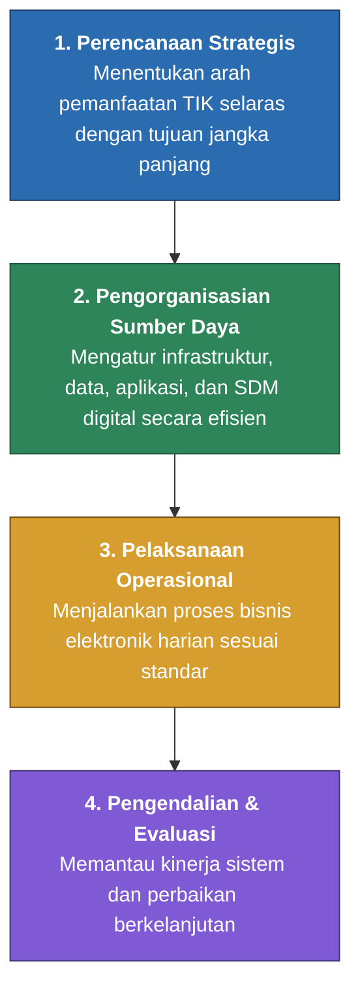
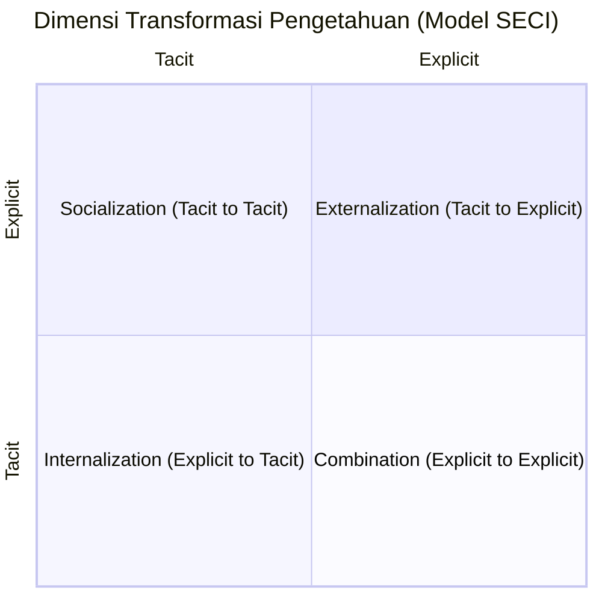
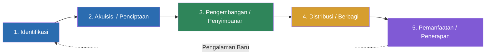
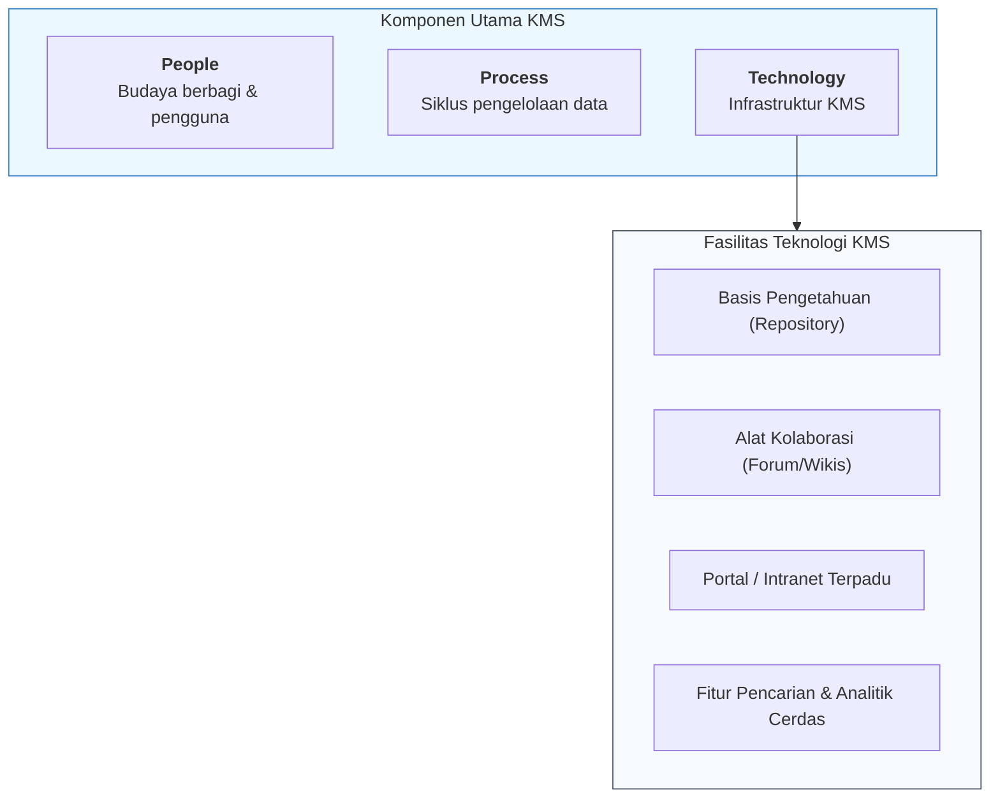
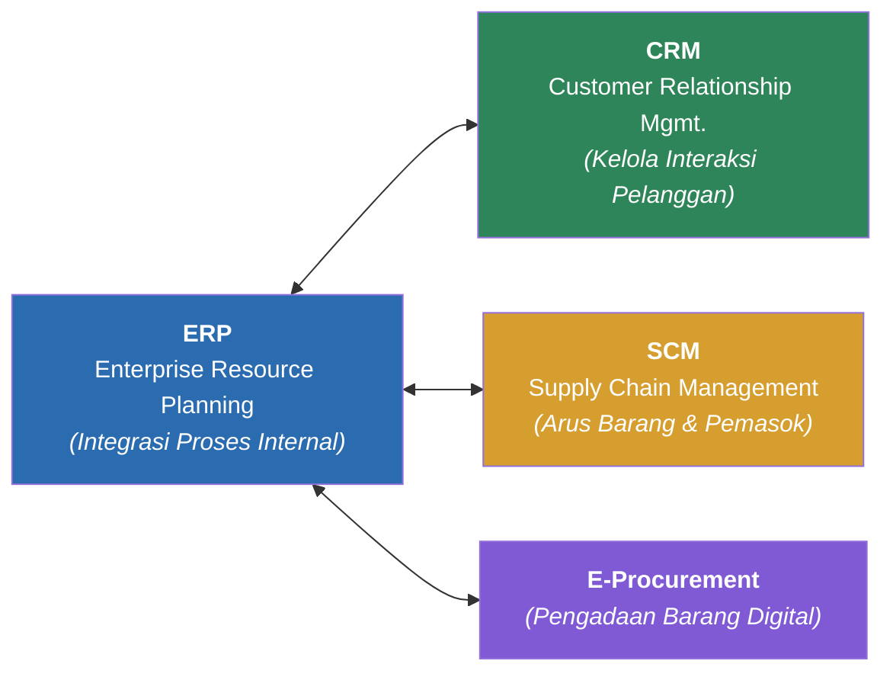
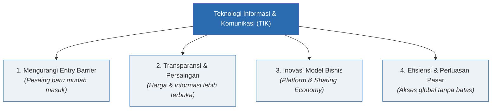

# Pertemuan 02: Manajemen Pengetahuan & Implikasi Ekonomi Digital dalam E-Bisnis

* **Mata Kuliah:** E-Bisnis (`STSI4408` / `MSIM4409`)
* **Program Studi:** Sistem Informasi — Universitas Terbuka
* **Topik:** Manajemen Pengetahuan (KM), Model SECI, KMS, Pengelolaan Aplikasi & Keterampilan, dan Ekonomi Digital

---

## Daftar Isi
1. [Konsep Manajemen E-Bisnis](#1-konsep-manajemen-e-bisnis)
2. [Model & Proses Manajemen Pengetahuan (Knowledge Management)](#2-model--proses-manajemen-pengetahuan-knowledge-management)
3. [Knowledge Management System (KMS)](#3-knowledge-management-system-kms)
4. [Pengelolaan Aplikasi E-Bisnis](#4-pengelolaan-aplikasi-e-bisnis)
5. [Pengelolaan Keterampilan SDM dalam E-Bisnis](#5-pengelolaan-keterampilan-sdm-dalam-e-bisnis)
6. [Implikasi TIK terhadap Ekonomi Digital & Ekonomi Informasi](#6-implikasi-tik-terhadap-ekonomi-digital--ekonomi-informasi)
7. [Referensi Resmi](#7-referensi-resmi)

---

## 1. Konsep Manajemen E-Bisnis

### Apa itu Manajemen E-Bisnis?
**Manajemen E-Bisnis** adalah proses perencanaan, pengorganisasian, pelaksanaan, dan pengendalian seluruh sumber daya digital perusahaan untuk mencapai tujuan bisnis secara elektronik.

### Fungsi Utama Manajemen E-Bisnis

---

## 2. Model & Proses Manajemen Pengetahuan (Knowledge Management)

### Explicit vs Tacit Knowledge

| Tipe Pengetahuan | Definisi | Contoh |
| --- | --- | --- |
| **Explicit Knowledge** | Pengetahuan yang telah terdokumentasi, terstruktur, dan mudah ditransfer antar individu. | Buku, dokumen, SOP, manual prosedur, basis data. |
| **Tacit Knowledge** | Pengetahuan berbasis pengalaman personal, intuisi, dan konteks yang sulit diartikulasikan. | Keterampilan praktis, *insight*, keahlian teknis, pengalaman kerja. |

### Model SECI (Nonaka & Takeuchi)

Model SECI menjelaskan transformasi siklis antara *Tacit* dan *Explicit Knowledge*:

1. **Socialization (Tacit $\rightarrow$ Tacit):** Berbagi pengalaman langsung, observasi, dan magang.
2. **Externalization (Tacit $\rightarrow$ Explicit):** Memformulasikan pengalaman menjadi konsep, diagram, atau dokumen.
3. **Combination (Explicit $\rightarrow$ Explicit):** Menggabungkan dan mengintegrasikan berbagai dokumen/informasi eksplisit.
4. **Internalization (Explicit $\rightarrow$ Tacit):** Mengubah pengetahuan terdokumentasi menjadi pemahaman personal melalui pelatihan dan praktik.

### Siklus Proses Manajemen Pengetahuan

---

## 3. Knowledge Management System (KMS)

### Definisi KMS

**Knowledge Management System (KMS)** adalah sistem berbasis teknologi informasi yang mendukung proses penciptaan, penyimpanan, pengorganisasian, dan penyebaran pengetahuan di dalam organisasi.

### Komponen Utama & Arsitektur KMS

---

## 4. Pengelolaan Aplikasi E-Bisnis

Pengelolaan aplikasi e-bisnis melibatkan pemilihan, pengintegrasian, dan pemeliharaan perangkat lunak enterprise untuk efisiensi operasional.

### Ekosistem Aplikasi Enterprise Mainstream

### Strategi Pengelolaan Aplikasi

* **Integrasi System:** Menghubungkan berbagai modul aplikasi agar data mengalir secara *real-time*.
* **Keamanan & Skalabilitas:** Mengadopsi arsitektur *Cloud* (Private/Public/Hybrid) untuk mendukung pertumbuhan volume transaksi.

---

## 5. Pengelolaan Keterampilan SDM dalam E-Bisnis

Upaya pengembangan kompetensi sumber daya manusia (SDM) digital meliputi 5 pilar utama:

| No | Kompetensi Utama | Deskripsi & Strategi Pengembangan |
| --- | --- | --- |
| **1** | **Literasi Digital** | Kemampuan dasar mengoperasikan perangkat, aplikasi, dan platform digital modern. |
| **2** | **Analitis Data** | Kemampuan membaca, menganalisis, dan mengambil keputusan berbasis data (*data-driven decision*). |
| **3** | **Keamanan Informasi** | Pemahaman prinsip *cybersecurity* untuk menjaga privasi data perusahaan dan pelanggan. |
| **4** | **Manajemen Proyek Digital** | Mengelola eksekusi proyek berbasis teknologi informasi secara terstruktur dan agile. |
| **5** | **Komunikasi Daring** | Berkolaborasi secara efektif melalui perantara platform komunikasi virtual. |

---

## 6. Implikasi TIK terhadap Ekonomi Digital & Ekonomi Informasi

### Ekonomi Digital vs Ekonomi Informasi

* **Ekonomi Digital:** Aktivitas ekonomi yang berbasis pada teknologi digital sebagai penggerak utama nilai tambah, transaksi, dan konektivitas (termasuk AI, IoT, e-commerce, dan platform sharing).
* **Ekonomi Informasi:** Aktivitas ekonomi di mana informasi dinilai sebagai aset strategis utama (contoh: data pelanggan, analisis tren pasar, hak paten).

### Dampak TIK terhadap Lingkungan Kompetitif

---

## 7. Referensi Resmi

1. **Buku Materi Pokok (BMP) UT:** *E-Business* (`MSIM4409` / `STSI4408`), Universitas Terbuka.
2. **Nonaka, I., & Takeuchi, H. (1995):** *The Knowledge-Creating Company*, Oxford University Press.
3. **Laudon, K. C., & Laudon, J. P. (2020):** *Management Information Systems: Managing the Digital Firm*, Pearson.
4. **Chaffey, D. (2015):** *Digital Business and E-Commerce Management*, Pearson.