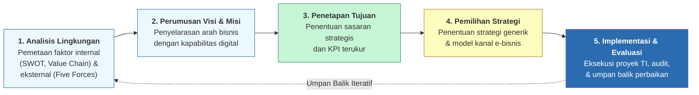
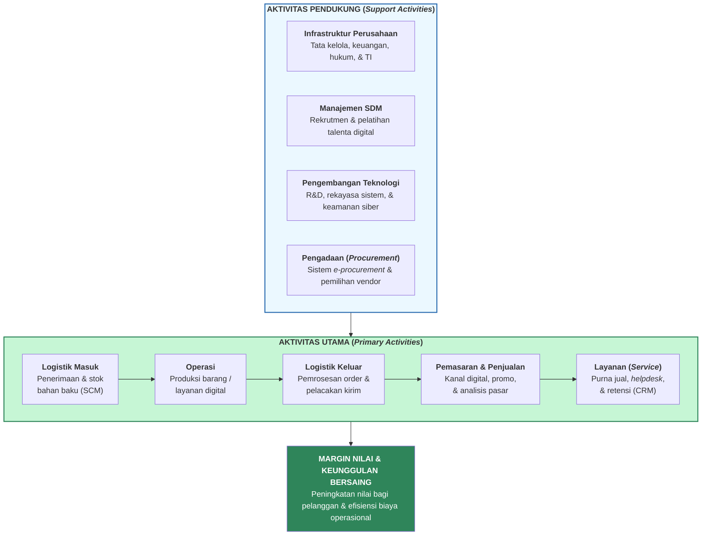
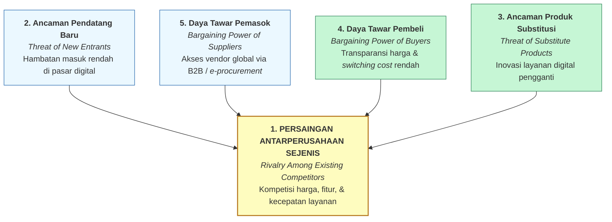
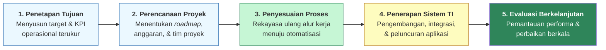

# Pertemuan 03: Formulasi dan Penerapan Strategi E-Bisnis

* **Mata Kuliah:** E-Business (`STSI4408`) *(Referensi BMP: E-Business `MSIM4409`)*
* **Program Studi:** Sistem Informasi — Universitas Terbuka
* **Topik:** Konsep & Perumusan Strategi E-Bisnis, Analisis Internal (*Value Chain*), Analisis Eksternal (*Porter's Five Forces*), Strategi Generik & Spesifik, Implementasi & Mitigasi Tantangan, Kontrol Strategis, dan Budaya Organisasi

---

## Daftar Isi

1. [Pengertian dan Perumusan Strategi E-Bisnis](#1-pengertian-dan-perumusan-strategi-e-bisnis)
2. [Analisis Lingkungan Internal: Value Chain Analysis](#2-analisis-lingkungan-internal-value-chain-analysis)
3. [Analisis Lingkungan Eksternal: Porter's Five Forces](#3-analisis-lingkungan-eksternal-porters-five-forces)
4. [Strategi Generik dan Model Strategi E-Bisnis Spesifik](#4-strategi-generik-dan-model-strategi-e-bisnis-spesifik)
5. [Implementasi Strategi E-Bisnis dan Mitigasi Tantangan](#5-implementasi-strategi-e-bisnis-dan-mitigasi-tantangan)
6. [Konsep Kontrol Strategis dalam E-Bisnis](#6-konsep-kontrol-strategis-dalam-e-bisnis)
7. [Peran Budaya Organisasi dalam E-Bisnis](#7-peran-budaya-organisasi-dalam-e-bisnis)
8. [Referensi Resmi](#8-referensi-resmi)

---

## 1. Pengertian dan Perumusan Strategi E-Bisnis

### Pengertian Strategi E-Bisnis

**Strategi** adalah rencana komprehensif yang mengarahkan organisasi dalam mencapai tujuan jangka panjang di tengah dinamika perubahan lingkungan bisnis dan teknologi. Dalam konteks digital, **Strategi E-Bisnis** merupakan rencana jangka panjang yang mengintegrasikan Teknologi Informasi dan Komunikasi (TIK) ke dalam seluruh proses bisnis perusahaan untuk meningkatkan daya saing dan menciptakan keunggulan kompetitif (*competitive advantage*).

* **Contoh Penerapan:** Pemanfaatan platform digital untuk pemasaran terpadu (*digital marketing*), otomatisasi layanan pelanggan berbasis CRM, serta integrasi rantai pasok menggunakan sistem ERP.

> *"Strategi tanpa kontrol dan budaya pendukung hanya akan menjadi rencana di atas kertas."*
> — **Dr. Sulqifli, S.E., M.M.** (*Materi Kuliah E-Business*)

### Empat Elemen Utama Strategi

1. **Tujuan Jangka Panjang:** Arah dan sasaran terukur yang ingin dicapai organisasi dalam kurun waktu tertentu.
2. **Alokasi Sumber Daya:** Penentuan penggunaan anggaran, infrastruktur TIK, data, dan SDM secara efektif dan efisien.
3. **Keunggulan Bersaing (*Competitive Advantage*):** Cara unik organisasi memenangkan persaingan di tengah pasar yang dinamis.
4. **Adaptasi Lingkungan:** Kemampuan merespons perubahan teknologi, regulasi pemerintah, dan perilaku konsumen digital.

### Tujuan Formulasi Strategi E-Bisnis

* Menyelaraskan strategi bisnis perusahaan dengan perkembangan teknologi terkini.
* Menciptakan dan mempertahankan keunggulan kompetitif di tingkat lokal maupun global.
* Meningkatkan efisiensi operasional internal serta kualitas pelayanan kepada pelanggan.

### Siklus Iteratif Perumusan Strategi E-Bisnis

Secara hierarkis, pembangunan strategi e-bisnis mencakup tiga tingkatan: **strategi analisis**, **strategi pemilihan**, dan **strategi implementasi**. Dalam praktiknya, perumusan strategi e-bisnis dijalankan secara **iteratif** melalui lima tahapan berikut:

---

## 2. Analisis Lingkungan Internal: Value Chain Analysis

### Pengertian Analisis Internal dan Alat Bantu

Formulasi strategi diawali dengan memetakan kekuatan dan kelemahan internal (*Strengths & Weaknesses* pada analisis **SWOT**), melakukan **Benchmarking** (membandingkan kinerja dan praktik terbaik dengan pemimpin industri), serta membedah aktivitas internal melalui **Model Rantai Nilai (*Value Chain Analysis*)** yang dikembangkan oleh **Michael Porter**.

### Struktur Rantai Nilai (*Value Chain*) dalam E-Bisnis

Kerangka *Value Chain* membagi aktivitas perusahaan menjadi **Aktivitas Utama** (*Primary Activities*) yang menghasilkan produk/jasa secara langsung dan **Aktivitas Pendukung** (*Support Activities*) yang memastikan aktivitas utama berjalan optimal:

### Peran Digitalisasi pada Setiap Aktivitas Rantai Nilai

| Kategori | Aktivitas | Bentuk Digitalisasi dan Penciptaan Nilai E-Bisnis |
| :--- | :--- | :--- |
| **Aktivitas Utama** | **Logistik Masuk** (*Inbound Logistics*) | Otomatisasi pemesanan bahan baku dan pemantauan inventaris gudang secara *real-time* melalui sistem SCM. |
| **Aktivitas Utama** | **Operasi** (*Operations*) | Integrasi proses produksi dan penyediaan layanan digital berbasis ERP untuk menekan kesalahan dan waktu proses. |
| **Aktivitas Utama** | **Logistik Keluar** (*Outbound Logistics*) | Pemrosesan pesanan otomatis (*order fulfillment*) dan integrasi sistem pelacakan kurir (*shipment tracking*). |
| **Aktivitas Utama** | **Pemasaran & Penjualan** (*Marketing & Sales*) | Pengelolaan toko daring, kampanye digital terpersonalisasi, serta penentuan harga dinamis berbasis analitik data. |
| **Aktivitas Utama** | **Layanan** (*Service*) | Dukungan pelanggan 24/7 melalui *chatbot*, portal *self-service*, dan pengelolaan riwayat keluhan berbasis CRM. |
| **Aktivitas Pendukung** | **Infrastruktur Perusahaan** | Sistem informasi manajemen eksekutif, akuntansi digital, dan tata kelola kepatuhan regulasi elektronik. |
| **Aktivitas Pendukung** | **Manajemen SDM** | Rekrutmen daring, portal *e-learning* pelatihan digital, dan evaluasi kinerja karyawan berbasis sistem HRM. |
| **Aktivitas Pendukung** | **Pengembangan Teknologi** | Pengembangan aplikasi web/*mobile*, arsitektur *cloud*, serta penerapan keamanan siber dan enkripsi transaksi. |
| **Aktivitas Pendukung** | **Pengadaan** (*Procurement*) | Tender elektronik (*e-tendering*) dan pembelian perlengkapan operasional melalui platform B2B *e-procurement*. |

---

## 3. Analisis Lingkungan Eksternal: Porter's Five Forces

### Kerangka Lima Kekuatan Porter

Untuk memetakan peluang dan ancaman eksternal (*Opportunities & Threats* pada analisis **SWOT**), perusahaan menggunakan **Model Lima Kekuatan Porter (*Porter's Five Forces*)** guna menilai tingkat intensitas persaingan dan daya tarik suatu industri digital:

### Analisis Dampak Lima Kekuatan dalam Konteks E-Bisnis

1. **Persaingan Antarperusahaan Sejenis (*Rivalry Among Existing Competitors*):** Intensitas persaingan meningkat tajam karena internet menghapus batas geografis dan memperluas jangkauan kompetitor di pasar yang sama.
2. **Ancaman Pendatang Baru (*Threat of New Entrants*):** Hambatan masuk (*entry barrier*) menjadi lebih rendah karena pelaku usaha baru tidak membutuhkan investasi toko fisik besar untuk mulai beroperasi secara daring.
3. **Ancaman Produk atau Jasa Substitusi (*Threat of Substitute Products/Services*):** Inovasi digital memunculkan berbagai alternatif layanan pengganti berbasis teknologi (misalnya layanan *streaming* menggantikan media fisik, atau dompet digital menggantikan transaksi tunai).
4. **Daya Tawar Pembeli (*Bargaining Power of Buyers*):** Sangat tinggi karena pembeli dapat membandingkan harga, kualitas, dan ulasan produk dalam hitungan detik serta berpindah ke pesaing dengan biaya perpindahan (*switching cost*) yang hampir nol.
5. **Daya Tawar Pemasok (*Bargaining Power of Suppliers*):** Perusahaan dapat menekan daya tawar pemasok konvensional melalui *e-procurement* yang membuka akses ke lebih banyak vendor, namun ketergantungan terhadap penyedia infrastruktur teknologi inti (seperti layanan *cloud* utama) dapat meningkatkan daya tawar pemasok teknologi.

---

## 4. Strategi Generik dan Model Strategi E-Bisnis Spesifik

### Strategi Generik Porter dalam Konteks E-Bisnis

| Strategi Generik | Pendekatan Kompetitif | Implementasi dalam E-Bisnis |
| :--- | :--- | :--- |
| **Keunggulan Biaya** (*Cost Leadership*) | Menawarkan produk/jasa dengan biaya operasional dan harga jual terendah di industri. | Otomatisasi proses bisnis, pengurangan perantara distribusi, pemasaran digital berbiaya rendah, dan layanan mandiri (*self-service*). |
| **Diferensiasi** (*Differentiation*) | Menciptakan nilai, fitur, merek, atau pengalaman pelanggan yang unik dan sulit ditiru. | Personalisasi rekomendasi berbasis AI, antarmuka aplikasi yang unggul, layanan purna jual responsif, dan integrasi fitur ekosistem. |
| **Fokus** (*Focus*) | Menyasar segmen pasar spesifik (*niche market*) dengan layanan yang disesuaikan kebutuhan khusus. | Portal atau *marketplace* khusus komunitas tertentu (misalnya *e-commerce* perlengkapan hobi spesifik, produk ramah lingkungan, atau B2B industri tertentu). |

### Model Strategi E-Bisnis Spesifik

Dalam merancang kanal interaksi dan model operasional digitalnya, organisasi dapat memilih pendekatan berikut:

1. ***Pure-Play* (Murni Digital):** Perusahaan beroperasi sepenuhnya di ruang digital tanpa memiliki gerai fisik konvensional (contoh: Tokopedia, Bukalapak, Netflix).
2. ***Click-and-Mortar* (*Bricks-and-Clicks*):** Perusahaan menggabungkan operasional toko fisik tradisional dengan kanal transaksi daring untuk saling melengkapi jangkauan pasar.
3. ***Omnichannel*:** Pengembangan terpadu dari *click-and-mortar* yang menyinkronkan seluruh titik sentuh (*touchpoints*) fisik dan digital secara mulus (*seamless*), misalnya fitur pesan lewat aplikasi dan ambil di toko (*click-and-collect*) atau pengembalian barang lintas kanal.
4. **Strategi Berbasis Komunitas Online dan Ekosistem Digital:** Membangun platform yang mengintegrasikan berbagai layanan komplementer (transportasi, pembayaran digital, pesan-antar, belanja) serta memanfaatkan interaksi komunitas pengguna untuk menciptakan efek jaringan (*network effect*).

---

## 5. Implementasi Strategi E-Bisnis dan Mitigasi Tantangan

### Lima Langkah Implementasi Strategi E-Bisnis

### Faktor Penentu Keberhasilan Implementasi

* **Dukungan Manajemen Puncak:** Komitmen aktif pimpinan dalam mengalokasikan sumber daya dan mengawal arah transformasi digital.
* **Infrastruktur Teknologi yang Memadai:** Kesiapan jaringan, peladen/*cloud*, perangkat lunak, dan sistem keamanan yang andal.
* **Keterlibatan Pengguna (*User Involvement*):** Melibatkan karyawan dan perwakilan pelanggan sejak tahap analisis kebutuhan agar sistem sesuai praktik lapangan.
* **Pelatihan dan Pengembangan SDM:** Membekali karyawan dengan keterampilan digital yang dibutuhkan untuk mengoperasikan sistem baru.
* **Manajemen Perubahan (*Change Management*):** Komunikasi transparan dan pendampingan agar seluruh elemen organisasi siap beradaptasi dengan cara kerja baru.

> **Ilustrasi Studi Kasus:** *Perusahaan X* mengimplementasikan sistem **CRM berbasis cloud** untuk menyatukan seluruh saluran layanan pelanggannya. Hasilnya, perusahaan berhasil **meningkatkan kepuasan pelanggan**, **memangkas waktu tanggapan keluhan**, dan **mendorong kenaikan penjualan**.

### Tantangan Implementasi dan Strategi Mitigasinya

| Tantangan Implementasi | Dampak Terhadap Organisasi | Strategi Mitigasi |
| :--- | :--- | :--- |
| **Resistensi terhadap Perubahan** | Karyawan enggan meninggalkan cara kerja lama sehingga adopsi sistem berjalan lambat. | Menerapkan *change management*, sosialisasi manfaat sistem, pelatihan intensif, dan insentif adopsi. |
| **Biaya Implementasi Tinggi** | Membebani arus kas perusahaan pada tahap awal investasi infrastruktur dan lisensi. | Implementasi bertahap berdasarkan skala prioritas, pemanfaatan layanan *cloud* (*pay-as-you-go*), dan analisis ROI. |
| **Keamanan Data dan Privasi** | Risiko kebocoran data pelanggan, serangan siber, dan hilangnya kepercayaan konsumen. | Penerapan enkripsi data, *firewall*, sertifikat SSL, audit keamanan berkala, dan kepatuhan regulasi privasi data. |
| **Integrasi Sistem Lama (*Legacy System*)** | Data terpisah-pisah (*silo*) dan sulit bertukar informasi antara aplikasi lama dengan sistem baru. | Penggunaan perangkat perantara (*middleware* / EAI) dan antarmuka pemrograman aplikasi (`API`) standar. |

---

## 6. Konsep Kontrol Strategis dalam E-Bisnis

### Pengertian dan Instrumen Kontrol Strategis

**Kontrol Strategis** adalah proses memantau, mengukur, dan mengevaluasi pelaksanaan strategi e-bisnis secara berkelanjutan guna memastikan kesesuaiannya dengan tujuan yang telah ditetapkan.

Tiga instrumen utama dalam melakukan kontrol strategis e-bisnis:

1. **Pengukuran Kinerja (*Key Performance Indicators* / KPI):** Memantau metrik bisnis dan teknis seperti tingkat konversi penjualan, *uptime* sistem, biaya akuisisi pelanggan (*CAC*), dan tingkat retensi pengguna.
2. **Audit Sistem TI:** Pemeriksaan berkala terhadap kepatuhan prosedur operasional, efisiensi infrastruktur, serta kerentanan keamanan siber.
3. ***Feedback* Pengguna dan Pelanggan:** Mengumpulkan umpan balik melalui survei kepuasan, ulasan aplikasi, dan analitik perilaku pengguna (*web/app analytics*).

### Empat Jenis Kontrol Strategis

| Jenis Kontrol | Fokus Pengawasan | Fungsi dalam E-Bisnis |
| :--- | :--- | :--- |
| **Kontrol Premis** (*Premise Control*) | Validitas asumsi dasar penyusunan strategi. | Menguji apakah asumsi awal mengenai pertumbuhan pasar digital, regulasi, atau perilaku konsumen masih relevan. |
| **Kontrol Implementasi** (*Implementation Control*) | Kesesuaian pelaksanaan proyek dengan rencana. | Menilai pencapaian tonggak proyek (*milestones*) dan menentukan apakah arah strategi perlu disesuaikan di tengah jalan. |
| **Pengawasan Strategis** (*Strategic Surveillance*) | Pemantauan menyeluruh faktor internal & eksternal. | Mengamati tren teknologi baru, pergerakan kompetitor, dan perubahan ekosistem industri yang berpotensi memengaruhi strategi. |
| **Kontrol Peringatan Khusus** (*Special Alert Control*) | Respons cepat terhadap krisis mendadak. | Meninjau ulang strategi secara segera apabila terjadi kejadian tak terduga (seperti serangan siber besar atau gangguan rantai pasok). |

---

## 7. Peran Budaya Organisasi dalam E-Bisnis

**Budaya Organisasi** adalah kumpulan nilai, norma, keyakinan, dan kebiasaan bersama yang memengaruhi cara anggota organisasi berpikir, berinteraksi, dan mengambil keputusan dalam menjalankan strategi e-bisnis. Organisasi dengan budaya inovatif mampu mengintegrasikan sistem e-bisnis dan merespons perubahan pasar jauh lebih cepat dibandingkan organisasi yang kaku.

### Lima Pilar Budaya Organisasi Pendukung E-Bisnis

1. **Nilai Bersama (*Shared Values*):** Pedoman etika, orientasi pelanggan, dan standar perilaku digital yang dijalankan di seluruh tingkatan organisasi.
2. **Adaptabilitas (*Adaptability*):** Keterbukaan terhadap perubahan teknologi, fleksibilitas cara kerja, dan kesiapan meninggalkan prosedur lama yang tidak efisien.
3. **Kolaborasi (*Collaboration*):** Kerja sama lintas divisi (antara tim TI, pemasaran, operasional, dan keuangan) tanpa sekat ego sektoral dalam proyek digital.
4. **Inovasi (*Innovation*):** Budaya eksperimen kreatif, keberanian menguji ide baru, dan pembelajaran berkelanjutan (*continuous learning*).
5. **Komitmen Pemimpin (*Leadership Commitment*):** Keteladanan dan dukungan nyata dari pimpinan puncak dalam mendorong transformasi digital.

---

## 8. Referensi Resmi

1. **Modul UT:** Materi Inisiasi 3 — *Formulasi dan Penerapan Strategi E-Bisnis*, Mata Kuliah E-Business (`STSI4408`), Universitas Terbuka.
2. **Buku Materi Pokok (BMP) UT:** *E-Business* (`MSIM4409`), Universitas Terbuka.
3. **Materi Perkuliahan:** Sulqifli. *Formulasi dan Penerapan Strategi E-Bisnis*, Mata Kuliah E-Business.
4. **Porter, M. E.** (1985). *Competitive Advantage: Creating and Sustaining Superior Performance*. New York: Free Press.
5. **Porter, M. E.** (2001). *Strategy and the Internet*. Harvard Business Review, 79(3), 62–78.
6. **Purnia, D. S., Ratningsih, Adiwisastra, M. F., & Denilla, K. S. P.** (2022). *E-Business*. Yogyakarta: Expert (CV. Graha Ilmu).
7. **Chaffey, D.** *Digital Business and E-Commerce Management*. Pearson Education.
8. **Pearce, J. A., & Robinson, R. B.** *Strategic Management: Formulation, Implementation, and Control*. McGraw-Hill.