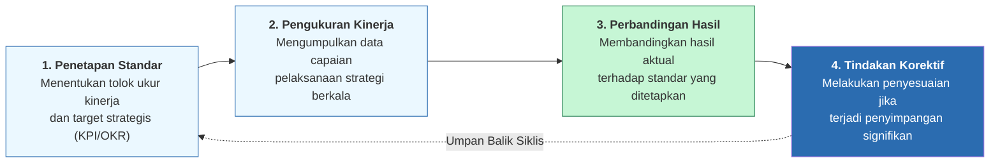
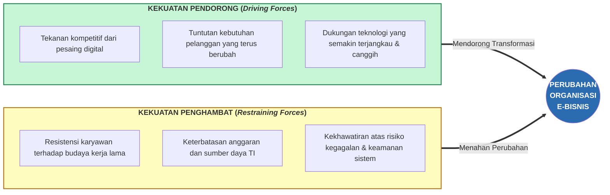
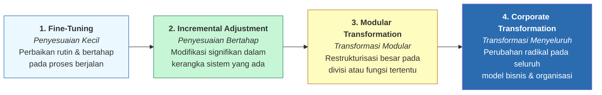

# Pertemuan 04: Evaluasi Strategi dan Manajemen Perubahan E-Bisnis

* **Mata Kuliah:** E-Business (`STSI4408`) *(Referensi BMP: E-Business `MSIM4409`)*
* **Program Studi:** Sistem Informasi — Universitas Terbuka
* **Topik:** Proses Evaluasi & Kontrol Organisasi, Evaluasi Finansial & Peran SDM, Evaluasi Strategi & Model E-Bisnis, Efektivitas Teknologi, *Force Field Analysis*, Aspek Perubahan & Konversi Sistem, serta Skala Perubahan (`BPR` & `BPI`)

---

## Daftar Isi

1. [Proses Evaluasi dan Kontrol Organisasi](#1-proses-evaluasi-dan-kontrol-organisasi)
2. [Evaluasi Finansial dan Peran Sumber Daya Manusia (SDM)](#2-evaluasi-finansial-dan-peran-sumber-daya-manusia-sdm)
3. [Evaluasi Strategi dan Model E-Bisnis](#3-evaluasi-strategi-dan-model-e-bisnis)
4. [Evaluasi Efektivitas Teknologi dalam Operasional E-Bisnis](#4-evaluasi-efektivitas-teknologi-dalam-operasional-e-bisnis)
5. [Analisis Manajemen Perubahan: Force Field Analysis](#5-analisis-manajemen-perubahan-force-field-analysis)
6. [Aspek Perubahan Organisasi dan Metode Konversi Sistem](#6-aspek-perubahan-organisasi-dan-metode-konversi-sistem)
7. [Skala Perubahan dan Transformasi Paradigma E-Bisnis](#7-skala-perubahan-dan-transformasi-paradigma-e-bisnis)
8. [Referensi Resmi](#8-referensi-resmi)

---

## 1. Proses Evaluasi dan Kontrol Organisasi

### Pengertian dan Siklus Evaluasi Strategi

Setelah strategi e-bisnis diimplementasikan, organisasi wajib melakukan **evaluasi dan kontrol** secara sistematis untuk menilai kesesuaian hasil kinerja aktual dengan rencana strategis, mengukur efektivitas dan efisiensi operasional, serta mengambil tindakan korektif apabila terjadi penyimpangan.

> *"Perubahan yang berhasil adalah perubahan yang terukur, terkendali, dan didukung penuh oleh manusia di dalamnya."*
> — **Dr. Sulqifli, S.E., M.M.** (*Materi Kuliah E-Business*)

### Tiga Jenis Kontrol Organisasi

Berdasarkan waktu pelaksanaannya dalam siklus operasional, mekanisme kontrol dibagi menjadi tiga kategori utama:

| Jenis Kontrol | Waktu Pelaksanaan | Fokus Pengawasan | Contoh Penerapan dalam E-Bisnis |
| :--- | :--- | :--- | :--- |
| ***Feedforward Control*** (Kontrol Pencegahan) | **Sebelum** aktivitas berlangsung | Mengantisipasi potensi masalah pada input dan kesiapan sumber daya. | Rekrutmen daring berbasis tes kompetensi untuk menjamin kualitas SDM dan menekan biaya seleksi. |
| ***Concurrent Control*** (Kontrol Berjalan) | **Saat** proses sedang berjalan | Memantau kepatuhan pelaksanaan kerja terhadap standar operasional secara *real-time*. | Pemantauan *dashboard* SLA layanan pelanggan dan deteksi anomali transaksi pembayaran secara langsung. |
| ***Feedback Control*** (Kontrol Umpan Balik) | **Sesudah** aktivitas selesai | Mengevaluasi *output* (kuantitas dan kualitas hasil) sebagai dasar perbaikan berikutnya. | Analisis laporan penjualan bulanan, tingkat kepuasan pelanggan (*CSAT*), dan audit pasca-proyek. |

---

## 2. Evaluasi Finansial dan Peran Sumber Daya Manusia (SDM)

### Karakteristik Finansial dan Struktur SDM E-Bisnis

Organisasi berbasis e-bisnis cenderung **mempekerjakan lebih sedikit tenaga kerja operasional** dibandingkan perusahaan konvensional karena adanya otomatisasi dan digitalisasi alur kerja. Namun, efisiensi jumlah karyawan tersebut menuntut kualitas talenta digital yang jauh lebih tinggi serta pengelolaan biaya investasi teknologi yang terukur.

### Empat Peran Kunci SDM dalam Perubahan E-Bisnis

1. **Agen Perubahan (*Change Agents*):** Menjadi motor penggerak, fasilitator, dan teladan dalam mendorong adopsi transformasi digital di seluruh lini kerja.
2. **Pengembangan Kompetensi:** Meningkatkan keterampilan digital secara berkelanjutan agar selaras dengan evolusi teknologi perusahaan.
3. **Keterlibatan Karyawan (*Employee Engagement*):** Mendorong partisipasi aktif karyawan dalam perumusan ide perbaikan maupun eksekusi strategi.
4. **Manajemen Kinerja:** Menerapkan sistem penilaian dan penghargaan (*reward*) yang adil berdasarkan pencapaian target strategis.

### Empat Tingkatan Evaluasi SDM pada E-Bisnis

| Tingkatan Evaluasi | Fokus Pengukuran | Indikator dan Praktik Utama |
| :--- | :--- | :--- |
| **1. Rekrutmen & Retensi Kapabilitas Inti** | Ketersediaan talenta strategis | Kualitas kandidat digital, kecepatan proses rekrutmen (*time-to-hire*), serta rencana suksesi dan penjagaan talenta kunci. |
| **2. Evaluasi Kinerja Berbasis Target** | Kontribusi terukur individu/tim | Penetapan `KPI` / `OKR` yang jelas, tingkat produktivitas, kualitas hasil kerja, dan kepatuhan standar operasional. |
| **3. Umpan Balik & Motivasi** | Keterikatan dan pengembangan diri | Evaluasi umpan balik `360°`, survei keterikatan karyawan (*engagement survey*), serta *coaching* sebagai dasar perbaikan kebijakan. |
| **4. Kebijakan SDM Digital** | Kerangka tata kelola kerja | Definisi matriks kompetensi, program pelatihan, skema kompensasi, fleksibilitas kerja *hybrid/remote*, serta kode etik & keamanan digital. |

---

## 3. Evaluasi Strategi dan Model E-Bisnis

### Perbedaan Evaluasi Strategi E-Bisnis vs Strategi Tradisional

Evaluasi strategi e-bisnis bertujuan memastikan arah transformasi digital tetap selaras dengan visi jangka panjang perusahaan. Dibandingkan evaluasi bisnis tradisional, pendekatan digital memiliki lima perbedaan mendasar:

1. **Pemahaman Kapabilitas Internet:** Menilai sejauh mana atribut internet (interaktivitas, konektivitas global, personalisasi) telah dioptimalkan dalam setiap fungsi bisnis.
2. **Arsitektur Pengukuran Digital:** Mengubah metrik evaluasi tradisional menjadi indikator kinerja digital yang relevan, seperti *website traffic*, *conversion rate*, *Customer Acquisition Cost* (`CAC`), *Customer Lifetime Value* (`LTV`), *churn rate*, dan *system uptime*.
3. **Definisi Proses *End-to-End*:** Memetakan proses bisnis secara jelas sebagai rangkaian aktivitas digital terintegrasi dari hulu ke hilir (*end-to-end digital flow*).
4. **Interdependensi Lintas Tim:** Mengevaluasi kolaborasi dalam organisasi berbentuk jejaring (*networked organization*), di mana tim TI, pemasaran, operasional, dan keuangan tidak lagi bekerja terpisah (*silo*).
5. **Dampak Ekosistem Eksternal:** Memperhitungkan dinamika mitra platform, perubahan regulasi digital, serta pergerakan kompetitor global.

### Empat Model Utama E-Bisnis

| Model E-Bisnis | Mekanisme Penciptaan Nilai | Contoh Penerapan |
| :--- | :--- | :--- |
| ***Marketplace*** | Menyediakan platform perantara digital yang mempertemukan banyak penjual dan pembeli dalam satu ekosistem transaksi. | Tokopedia, Shopee, Amazon, Blibli. |
| ***Aggregator*** | Mengumpulkan informasi atau layanan dari berbagai penyedia di bawah satu merek dan standar kualitas terpadu. | Traveloka, Tiket.com, Gojek, Grab. |
| ***Subscription*** (Berlangganan) | Menawarkan akses berkelanjutan terhadap produk fisik maupun konten/perangkat lunak digital dengan biaya berkala. | Netflix, Spotify, Microsoft 365, Adobe Creative Cloud. |
| ***On-Demand*** | Menyediakan produk atau jasa secara instan tepat pada saat dibutuhkan oleh pengguna melalui aplikasi *real-time*. | Layanan pesan-antar makanan, transportasi daring, dan konsultasi *telemedicine*. |

### Keunggulan dan Kelemahan Model Strategi E-Bisnis

| Keunggulan Model Strategi E-Bisnis | Kelemahan dan Tantangan Model Strategi E-Bisnis |
| :--- | :--- |
| **Fleksibilitas tinggi** dalam merespons perubahan tren pasar dan perilaku konsumen. | **Ketergantungan tinggi** pada kestabilan infrastruktur jaringan dan teknologi informasi. |
| **Efisiensi biaya operasional** melalui otomatisasi alur kerja dan pengurangan perantara. | **Risiko keamanan data** dan ancaman serangan siber (*hacking*, kebocoran data privasi). |
| **Jangkauan pasar luas** tanpa batasan wilayah geografis maupun jam operasional fisik. | **Kebutuhan investasi awal** yang cukup besar untuk pembangunan sistem dan akuisisi pengguna. |
| **Pengukuran kinerja *real-time*** berbasis analitik data untuk keputusan cepat. | **Kesenjangan kompetensi digital** pada SDM dalam mengoperasikan dan mengelola teknologi baru. |

---

## 4. Evaluasi Efektivitas Teknologi dalam Operasional E-Bisnis

### Fokus Evaluasi Penggunaan Teknologi

Teknologi merupakan pendorong utama (*enabler*) e-bisnis yang ditargetkan untuk menekan biaya, mempercepat operasional, serta memperlancar komunikasi antarfungsi, mitra, dan pelanggan. Evaluasi teknologi mencakup:

* **Efektivitas Aplikasi Berjalan:** Menilai kesesuaian fitur aplikasi saat ini dengan kebutuhan operasional dan tingkat utilisasinya oleh pengguna.
* **Pemilihan Teknologi Baru:** Mengkaji kelayakan adopsi teknologi mutakhir (seperti *cloud*, AI, atau analitik lanjutan) berdasarkan analisis biaya-manfaat (*ROI*).
* **Kesiapan Kapabilitas SDM:** Mengevaluasi kebutuhan keterampilan operasional sistem, efektivitas program pelatihan staf, serta rencana ekspansi keahlian teknis.

### Lima Indikator Efektivitas Teknologi

| Indikator | Fokus Pengukuran Operasional |
| :--- | :--- |
| **1. Kecepatan Proses** | Seberapa singkat waktu penyelesaian transaksi, pemrosesan pesanan, dan waktu tanggap layanan pelanggan. |
| **2. Akurasi Data** | Tingkat ketepatan dan minimnya kesalahan (*human error*) dalam pencatatan transaksi, pengolahan data, dan pelaporan. |
| **3. Kepuasan Pengguna** | Tingkat kemudahan penggunaan (*usability*) dan kepuasan baik dari sisi pelanggan eksternal maupun karyawan internal. |
| **4. Efisiensi Biaya** | Besarnya penghematan biaya operasional, administrasi, dan komunikasi dibandingkan metode kerja konvensional. |
| **5. Skalabilitas** | Kemampuan arsitektur sistem untuk menangani lonjakan volume transaksi dan ekspansi bisnis tanpa penurunan performa. |

---

## 5. Analisis Manajemen Perubahan: Force Field Analysis

### Konsep *Force Field Analysis* (Kurt Lewin)

**Force Field Analysis** adalah kerangka analisis yang dikembangkan oleh psikolog organisasi **Kurt Lewin** untuk memetakan dan menakar keseimbangan antara **kekuatan pendorong (*Driving Forces*)** yang mendukung terjadinya perubahan dengan **kekuatan penghambat (*Restraining Forces*)** yang mempertahankan kondisi saat ini (*status quo*).

> **Prinsip Pengambilan Keputusan:** Perubahan organisasi akan berhasil apabila manajemen mampu **memperkuat faktor pendorong** sekaligus secara sistematis **mengurangi atau menghilangkan faktor penghambat** melalui komunikasi, pelatihan, dan alokasi sumber daya yang tepat.

---

## 6. Aspek Perubahan Organisasi dan Metode Konversi Sistem

### Lima Dimensi Utama Perubahan Organisasi

Agar transformasi menuju e-bisnis berjalan menyeluruh dan tidak timpang, manajemen harus menyelaraskan lima aspek berikut (disertai pertimbangan cakupan, waktu, biaya, serta analisis risiko dan manfaat):

1. **Struktur Organisasi:** Penyesuaian hierarki dan pembentukan tim lintas fungsi (*cross-functional teams*) yang lebih lincah dalam mendukung proses digital.
2. **Proses Bisnis:** Penyederhanaan dan otomatisasi alur kerja (*workflow*) dari prosedur manual menjadi proses digital terintegrasi.
3. **Teknologi:** Pemilihan dan pembaruan infrastruktur perangkat keras, jaringan, aplikasi, serta sistem keamanan informasi yang relevan.
4. **Manusia (SDM):** Penyesuaian pola pikir (*mindset*), peningkatan keterampilan teknis, serta kesiapan mental karyawan menghadapi peran baru.
5. **Budaya Organisasi:** Pergeseran nilai dan kebiasaan kerja menuju budaya kolaboratif, berbasis data (*data-driven*), dan terbuka terhadap inovasi.

### Metode Konversi Sistem Lama ke Sistem Baru

Dalam aspek infrastruktur teknologi, transisi dari sistem informasi lama (*legacy system*) menuju sistem e-bisnis baru dapat dilakukan melalui empat metode konversi utama:

| Metode Konversi | Mekanisme Pelaksanaan | Keunggulan Utama | Risiko / Kelemahan |
| :--- | :--- | :--- | :--- |
| **Konversi Paralel** (*Parallel Conversion*) | Sistem lama dan sistem baru dijalankan **bersamaan** selama periode tertentu hingga sistem baru terbukti stabil. | Tingkat keamanan tertinggi; jika sistem baru gagal, operasional tetap berjalan di sistem lama. | Biaya operasional ganda dan beban kerja berlebih bagi karyawan yang harus menginput data dua kali. |
| **Konversi Bertahap** (*Phased Conversion*) | Sistem baru diterapkan **secara bertahap** berdasarkan modul fungsi atau unit/cabang tertentu. | Risiko kegagalan terlokalisasi dan tim memiliki waktu untuk belajar dari tiap tahapan. | Membutuhkan waktu implementasi keseluruhan yang lebih lama serta integrasi sementara antarmodul. |
| **Konversi Pilot** (*Pilot Conversion*) | Sistem baru diujicobakan secara penuh pada **satu lokasi atau divisi percontohan** sebelum diterapkan menyeluruh. | Masalah teknis dan operasional dapat dideteksi dan diperbaiki pada skala terbatas terlebih dahulu. | Memerlukan penyesuaian alur komunikasi antara unit percontohan dengan unit lain yang masih memakai sistem lama. |
| **Konversi Langsung** (*Direct Cutover*) | Sistem lama **langsung dihentikan** dan digantikan sepenuhnya oleh sistem baru pada waktu yang ditentukan. | Biaya paling hemat dan transisi berlangsung cepat tanpa duplikasi operasional sistem. | Risiko sangat tinggi apabila terjadi kegagalan sistem (*bug* fatal) karena tidak ada sistem cadangan aktif. |

---

## 7. Skala Perubahan dan Transformasi Paradigma E-Bisnis

### Empat Tingkatan Skala Perubahan Organisasi

Manajer perlu menentukan skala perubahan yang tepat sesuai urgensi kebutuhan dan kesiapan kapasitas organisasi:

### Perubahan Paradigma Proses Bisnis: Otomatisasi, BPI, dan BPR

Dalam praktik rekayasa proses bisnis di era e-bisnis, perubahan diklasifikasikan ke dalam tiga pendekatan utama berdasarkan tingkat radikalitas dan dampaknya:

| Pendekatan Perubahan | Sifat Perubahan | Fokus dan Karakteristik Utama | Penerapan dalam E-Bisnis |
| :--- | :--- | :--- | :--- |
| **Otomatisasi Proses Bisnis** (*Business Process Automation*) | Efisiensi teknis pada tugas rutin | Menggunakan teknologi untuk menjalankan tugas operasional berulang tanpa (atau minim) campur tangan manusia. | Pemrosesan pesanan daring otomatis, pengiriman notifikasi/faktur elektronik, dan pembaruan stok otomatis. |
| ***Business Process Improvement* (`BPI`)** | Perubahan bertahap (*Incremental*) | Menganalisis, meninjau, dan menyempurnakan proses bisnis yang sudah berjalan guna meningkatkan kualitas dan efisiensi. | Penambahan fitur pelacakan kurir *real-time* atau aplikasi layanan pelanggan baru pada sistem distribusi yang ada. |
| ***Business Process Re-Engineering* (`BPR`)** | Perubahan radikal & mendasar | Diperkenalkan oleh **Michael Hammer (1990)**; merombak total proses bisnis dari nol untuk mencapai lonjakan besar pada biaya, kualitas, layanan, dan kecepatan. | Implementasi **ERP** terintegrasi penuh yang menghapus sekat antardivisi, mengotomatisasi produksi-SDM, dan membentuk tim lintas fungsi yang lincah. |

---

## 8. Referensi Resmi

1. **Modul UT:** Materi Inisiasi 4 — *Evaluasi Strategi dan Manajemen Perubahan E-Bisnis*, Mata Kuliah E-Business (`STSI4408`), Universitas Terbuka.
2. **Buku Materi Pokok (BMP) UT:** *E-Business* (`MSIM4409`), Universitas Terbuka.
3. **Materi Perkuliahan:** Sulqifli. *Evaluasi Strategi dan Manajemen Perubahan E-Bisnis*, Mata Kuliah E-Business.
4. **Lewin, K.** (1951). *Field Theory in Social Science: Selected Theoretical Papers*. New York: Harper & Row.
5. **Hammer, M.** (1990). *Reengineering Work: Don't Automate, Obliterate*. Harvard Business Review, 68(4), 104–112.
6. **Chaffey, D.** *Digital Business and E-Commerce Management*. Pearson Education.
7. **Turban, E., King, D., Lee, J. K., Liang, T. P., & Turban, D. C.** *Electronic Commerce: A Managerial and Social Networks Perspective*. Springer.
8. **Laudon, K. C., & Laudon, J. P.** *Management Information Systems: Managing the Digital Firm*. Pearson Education.