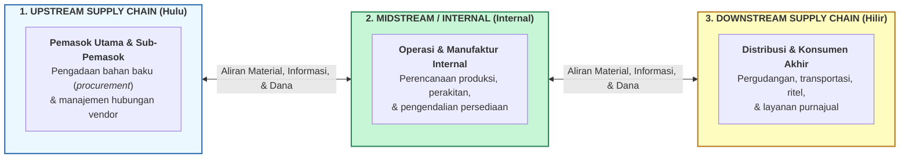
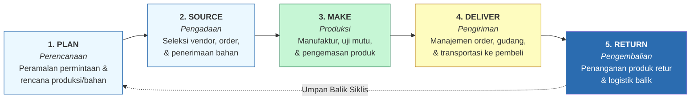
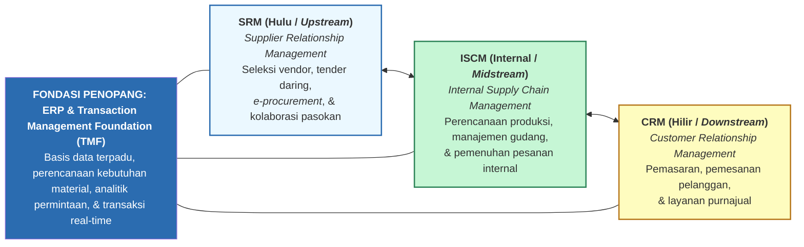

# Pertemuan 05: Supply Chain Management (SCM)

* **Mata Kuliah:** E-Business (`STSI4408`) *(Referensi BMP: E-Business `MSIM4409`)*
* **Program Studi:** Sistem Informasi — Universitas Terbuka
* **Topik:** Konsep Dasar & Segmen SCM, Tiga Aliran Utama, Elemen SCM & Model `SCOR`, Model Rantai Pasok (*Push*, *Pull*, *Hybrid*), Restrukturisasi SCM & *Information Supply Chain* (`ISC`), Peran TI & Aplikasi SCM, serta Studi Kasus Global

---

## Daftar Isi

1. [Konsep Dasar dan Segmen Supply Chain Management](#1-konsep-dasar-dan-segmen-supply-chain-management)
2. [Elemen Dasar SCM dan Model SCOR](#2-elemen-dasar-scm-dan-model-scor)
3. [Model Rantai Pasok: Push, Pull, dan Hybrid](#3-model-rantai-pasok-push-pull-dan-hybrid)
4. [Restrukturisasi SCM dan Information Supply Chain (ISC)](#4-restrukturisasi-scm-dan-information-supply-chain-isc)
5. [Peran Teknologi Informasi dan Aplikasi dalam Inovasi SCM](#5-peran-teknologi-informasi-dan-aplikasi-dalam-inovasi-scm)
6. [Studi Kasus Inovasi SCM Perusahaan Global](#6-studi-kasus-inovasi-scm-perusahaan-global)
7. [Referensi Resmi](#7-referensi-resmi)

---

## 1. Konsep Dasar dan Segmen Supply Chain Management

### Pengertian Supply Chain Management (SCM)

**Supply Chain Management (`SCM`)** adalah jaringan organisasi dan proses bisnis terintegrasi—melibatkan pemasok, manufaktur, distributor, hingga peritel—yang berkolaborasi dalam rantai nilai (*value chain*) untuk mengelola aliran material, informasi, dan keuangan mulai dari pengadaan bahan baku hingga produk sampai ke tangan konsumen akhir.

> *"Rantai pasok yang unggul adalah rantai pasok yang terintegrasi, transparan, dan didukung teknologi yang tepat guna."*
> — **Dr. Sulqifli, S.E., M.M.** (*Materi Kuliah E-Business*)

### Definisi SCM Menurut Para Ahli

* **Schroeder:** Perencanaan, perancangan, dan pengendalian aliran informasi serta material di sepanjang rantai pasok untuk memenuhi kebutuhan pelanggan secara efisien.
* **O'Brien:** Sistem lintas perusahaan (*inter-enterprise system*) yang memanfaatkan dukungan teknologi informasi untuk mengoordinasikan seluruh proses bisnis antara perusahaan dengan para mitra dagangnya.
* **Simchi-Levi dkk.:** Serangkaian pendekatan yang digunakan untuk mengintegrasikan pemasok, produsen, gudang, dan toko secara efisien sehingga barang diproduksi dan didistribusikan dalam jumlah, lokasi, dan waktu yang tepat guna meminimalkan biaya total sekaligus memenuhi tingkat layanan pelanggan.
* **Tan, Leong & Wisner:** Koordinasi dan integrasi berbagai aktivitas bisnis dalam rantai pasok guna meningkatkan efisiensi operasional, kualitas produk, layanan pelanggan, serta keunggulan kompetitif berkelanjutan.

### Empat Karakteristik Utama SCM

1. **Integrasi Aliran (*End-to-End Flow Integration*):** Menyatukan pergerakan barang, pertukaran data, dan transaksi pembayaran secara menyeluruh dari hulu ke hilir.
2. **Koordinasi Mitra (*Partner Synchronization*):** Membangun sinergi operasional antara pemasok bahan baku, pabrik manufaktur, penyedia logistik, distributor, dan peritel.
3. **Efisiensi Biaya Total (*Total Cost Minimization*):** Menekan biaya pengadaan, penyimpanan gudang, produksi, dan transportasi di seluruh jaringan rantai pasok.
4. **Kepuasan Pelanggan (*Customer Fulfillment*):** Memastikan produk diterima pelanggan akhir secara tepat waktu, tepat jumlah, tepat lokasi, dan sesuai standar kualitas.

### Tiga Aliran Utama dalam SCM

| Jenis Aliran | Arah Pergerakan | Komponen dan Tantangan Utama |
| :--- | :--- | :--- |
| **1. Aliran Material** (*Material Flow*) | Pemasok $\rightarrow$ Produsen $\rightarrow$ Distributor $\rightarrow$ Konsumen *(serta aliran balik untuk retur)* | Pergerakan fisik bahan mentah, barang setengah jadi, produk jadi, transfer internal, hingga barang pengembalian (*retur*). Tantangan utamanya adalah kecepatan dan efisiensi distribusi fisik. |
| **2. Aliran Informasi** (*Information Flow*) | **Dua arah** (Hulu $\leftrightarrow$ Hilir) | Data dari konsumen ke pemasok (ramalan permintaan, pesanan, keluhan) serta dari produsen ke konsumen (katalog penawaran, status inventori, nomor resi pelacakan). |
| **3. Aliran Dana / Keuangan** (*Financial Flow*) | Konsumen $\rightarrow$ Produsen $\rightarrow$ Pemasok *(atau sebaliknya saat pengembalian dana)* | Arus pembayaran elektronik, faktur (*invoice*), syarat kredit (*credit terms*), catatan debit, dan penyelesaian tagihan antar-entitas. |

### Segmen Rantai Pasok (Turban)

Menurut **Efraim Turban**, struktur rantai pasok terbagi menjadi tiga segmen utama yang saling terhubung:

---

## 2. Elemen Dasar SCM dan Model SCOR

### Empat Elemen Dasar SCM

1. ***Supply* (Pasokan):** Pengelolaan hubungan strategis dengan pemasok, mencakup seleksi vendor, standar kualitas bahan, negosiasi harga, dan keandalan waktu kirim.
2. ***Operations* (Operasi):** Pengelolaan aktivitas transformasi produksi, penjadwalan kapasitas pabrik, dan pengendalian tingkat inventori internal.
3. ***Logistics* (Logistik):** Pengelolaan arus fisik barang yang meliputi manajemen pergudangan, pengemasan, pemilihan moda transportasi, dan jaringan distribusi.
4. ***Integration* (Integrasi):** Penyelarasan dan koordinasi terpadu antara fungsi pasokan, operasi, dan logistik melalui dukungan sistem informasi lintas organisasi.

### Lima Komponen Inti Model SCOR

Model **SCOR (*Supply Chain Operations Reference*)** memetakan lima proses inti yang membentuk siklus operasional rantai pasok secara berkelanjutan:

* **Alur Proses Operasional SCM:** Berawal dari tahap **Perencanaan** (menetapkan jadwal produksi dan kebutuhan material), dilanjutkan **Pengadaan** (pemilihan pemasok, negosiasi, pemesanan, penerimaan barang), **Pergudangan** (penyimpanan dan pengendalian stok), **Produksi** (konversi bahan mentah menjadi produk jadi), hingga **Distribusi dan Pemasaran** (penyiapan, pengemasan, dan pengiriman pesanan ke tangan pelanggan).

---

## 3. Model Rantai Pasok: Push, Pull, dan Hybrid

Perusahaan dapat merancang aliran produksi dan distribusinya menggunakan salah satu dari tiga pendekatan model rantai pasok berikut:

| Dimensi Perbandingan | *Push-Based Model* (Proaktif) | *Pull-Based Model* (Responsif) | *Push-Pull Model* (*Hybrid*) |
| :--- | :--- | :--- | :--- |
| **Pemicu Utama** | Prakiraan permintaan (*demand forecasting*) jangka panjang sebelum pesanan diterima. | Permintaan aktual pelanggan (*real-time customer order*) yang masuk ke sistem. | Kombinasi prakiraan di tahap hulu (*push*) dan pesanan aktual di tahap hilir (*pull*). |
| **Tingkat Persediaan** | Stok barang jadi relatif besar di gudang distribusi (*make-to-stock*). | Stok barang sangat minim atau mendekati nol (*make-to-order* / *just-in-time*). | Komponen standar disimpan sebagai stok, sedangkan perakitan akhir menunggu pesanan. |
| **Keunggulan Utama** | Efisiensi biaya produksi massal (*economies of scale*) dan ketersediaan barang siap kirim. | Biaya penyimpanan gudang sangat rendah dan minim risiko barang usang/tak terjual. | Menyeimbangkan efisiensi biaya produksi massal dengan fleksibilitas respons pasar. |
| **Risiko / Kelemahan** | Rentan mengalami kelebihan stok (*overstock*) jika prediksi pasar meleset (*bullwhip effect*). | Membutuhkan koordinasi pemasok yang sangat cepat agar waktu tunggu (*lead time*) tidak lama. | Memerlukan penentuan titik batas (*decoupling point*) dan sistem TI yang terintegrasi. |

---

## 4. Restrukturisasi SCM dan Information Supply Chain (ISC)

### Strategi Restrukturisasi SCM

Untuk menyesuaikan jangkauan kontrol dan efisiensi operasional dengan dinamika e-bisnis, organisasi melakukan restrukturisasi rantai pasok melalui tiga pilihan strategis:

1. **Integrasi Vertikal (*Vertical Integration*):** Perusahaan menguasai dan menjalankan sebagian besar rantai pasok secara internal (dari sumber bahan baku hingga distribusi ritel) guna memperoleh kendali penuh atas kualitas dan pasokan.
2. **Integrasi Virtual (*Virtual Integration*):** Perusahaan berfokus pada kompetensi utamanya (*core competencies*) dan membangun kemitraan strategis berbasis teknologi informasi (*outsourcing* & pertukaran data *real-time*) dengan pemasok maupun mitra logistik sehingga beroperasi layaknya satu perusahaan terpadu.
3. **Disintegrasi Vertikal (*Vertical Disintegration*):** Perusahaan melepas fungsi-fungsi operasional non-inti kepada penyedia jasa pihak ketiga (*third-party providers*, seperti perusahaan logistik 3PL/4PL) agar struktur organisasi lebih ramping dan adaptif.

### Bentuk Restrukturisasi SCM Berbasis E-Bisnis

* **Otomasi Transaksi:** Proses pemesanan, penerbitan faktur (*e-invoicing*), dan pembayaran dilakukan secara elektronik tanpa dokumen kertas (*paperless*).
* **Visibilitas Rantai Pasok (*Supply Chain Visibility*):** Pelacakan status dan posisi barang secara transparan dan *real-time* di setiap titik distribusi.
* **Kolaborasi Digital:** Berbagi data perencanaan produksi, jadwal kirim, dan tingkat stok secara langsung antara pemasok, produsen, dan distributor.
* **Disintermediasi:** Memangkas mata rantai perantara distribusi yang tidak efisien sehingga produsen dapat menjangkau konsumen secara langsung (*direct-to-consumer*).

### Konsep *Information Supply Chain* (`ISC`)

**Information Supply Chain (`ISC`)** adalah paradigma pengelolaan rantai pasok yang mengandalkan pertukaran dan distribusi informasi digital secara akurat antar-mitra untuk menggantikan penumpukan persediaan fisik yang tidak perlu.

* **Tujuan Utama:** Mencapai efisiensi biaya dan efektivitas kecepatan pemenuhan pesanan di seluruh rantai pasok.
* **Prasyarat Keberhasilan:** Kelincahan organisasi (*agility*), fleksibilitas proses bisnis, serta dukungan infrastruktur teknologi informasi yang terintegrasi.

### Manfaat Strategis Penerapan E-Bisnis dalam SCM

| Bidang Manfaat | Mekanisme dan Dampak Operasional |
| :--- | :--- |
| **Efisiensi Biaya & Operasional** | Pemanfaatan dokumen elektronik, aplikasi berbasis awan (*SaaS*), dan perampingan tingkat persediaan menekan biaya administrasi serta gudang. |
| **Perkiraan Permintaan Akurat** | Penerapan ***Efficient Consumer Response (`ECR`)*** menyelaraskan rencana pasokan dengan data permintaan aktual konsumen. |
| **Kelancaran Pengiriman Produk** | Penerapan ***Vendor-Managed Inventory (`VMI`)*** memungkinkan pemasok memantau stok dan mengisi ulang persediaan secara otomatis. |
| **Pengelolaan Persediaan Optimal** | Mencegah risiko kelebihan stok (*overstock*) maupun kekosongan barang (*stockout*) melalui analitik peramalan (*forecasting*). |
| **Akses Informasi *Marketplace*** | Mempercepat pencarian pemasok alternatif secara global dan memperpendek siklus peluncuran produk baru (*time-to-market*). |

---

## 5. Peran Teknologi Informasi dan Aplikasi dalam Inovasi SCM

### Peran Strategis TI dan Visibilitas SCM

Teknologi informasi bertindak sebagai penggerak utama (*enabler*) inovasi SCM modern dengan menyediakan **visibilitas informasi *real-time*** bagi seluruh pemangku kepentingan (pelanggan, pemasok, karyawan, dan mitra logistik) melalui basis data terintegrasi (*single source of truth*) yang menampilkan antarmuka sesuai kebutuhan tiap pengguna.

### Arsitektur Aplikasi Utama dalam SCM

### Teknologi Mutakhir Pendorong Inovasi SCM

| Teknologi | Peran Strategis dalam Inovasi SCM |
| :--- | :--- |
| **ERP** (*Enterprise Resource Planning*) | Mengintegrasikan data dan proses bisnis lintas departemen (keuangan, produksi, gudang, pengadaan) serta menghubungkannya dengan mitra rantai pasok. |
| **IoT** (*Internet of Things*) | Memantau lokasi armada, suhu, kelembaban, dan kondisi fisik barang secara *real-time* menggunakan sensor cerdas dan `RFID`. |
| **Big Data & Analytics** | Mengolah data historis dan tren pasar untuk memprediksi permintaan (*predictive forecasting*), mengoptimalkan rute kirim, dan mengatur tingkat stok. |
| **Cloud Computing** | Menyediakan akses kolaborasi data rantai pasok secara fleksibel kapan saja dan di mana saja bagi seluruh mitra bisnis dengan biaya infrastruktur efisien. |
| **Blockchain** | Meningkatkan transparansi, ketertelusuran asal-usul produk (*traceability*), dan keamanan kontrak pintar (*smart contracts*) antar-mitra tanpa manipulasi data. |

---

## 6. Studi Kasus Inovasi SCM Perusahaan Global

### 1. Dell Computer — *Direct Sales* & Integrasi Virtual (*Just-in-Time*)

* **Model Penjualan Langsung & Disintermediasi:** Dell menjual perangkat komputer secara langsung kepada pelanggan tanpa melalui perantara toko ritel konvensional. Pelanggan dapat menentukan spesifikasi konfigurasi PC sesuai kebutuhan (*build-to-order*), yang menekan biaya distribusi dan meningkatkan margin perusahaan.
* **Integrasi Virtual & *Just-in-Time* (`JIT`):** Dell mewajibkan pemasok komponennya membuka pusat inventaris (*supplier hub*) di dekat pabrik perakitan Dell. Dell membagikan data penjualan dan jadwal produksi secara *real-time* kepada pemasok sehingga komponen dikirim tepat saat dibutuhkan. Hasilnya, tingkat persediaan Dell sangat minimal, respons pasar cepat, dan harga jual tetap kompetitif.

### 2. Amazon — *Predictive Shipping* & Automasi Gudang

* **Inovasi Logistik:** Amazon memanfaatkan *Big Data* dan algoritma analitik prediktif untuk memperkirakan produk yang akan dibeli pelanggan di suatu wilayah bahkan sebelum transaksi dilakukan (*anticipatory/predictive shipping*), dipadukan dengan robotika gudang otomatis untuk memangkas waktu pemrosesan dan pengiriman pesanan.

### 3. Alibaba (Cainiao Network) — Integrasi Ekosistem Logistik Digital

* **Inovasi Platform Logistik:** Alibaba membangun **Cainiao Network**, platform jaringan logistik pintar berbasis data yang menghubungkan ribuan perusahaan kurir, pengelola gudang, dan penjual secara *real-time* untuk mengoptimalkan rute pengiriman dan mempercepat distribusi lintas kota maupun lintas negara.

### 4. Zara (Inditex) — Rantai Pasok *Fast-Fashion* Responsif

* **Inovasi Model *Pull-Responsive*:** Zara menerapkan siklus rantai pasok super cepat dengan mengumpulkan data tren dan penjualan harian dari seluruh gerai secara *real-time*. Informasi tersebut langsung diteruskan ke tim desain dan pusat produksi yang terintegrasi untuk memproduksi dan mendistribusikan koleksi baru dalam hitungan minggu.

---

## 7. Referensi Resmi

1. **Modul UT:** Materi Inisiasi 5 — *Supply Chain Management*, Mata Kuliah E-Business (`STSI4408`), Universitas Terbuka.
2. **Buku Materi Pokok (BMP) UT:** *E-Business* (`MSIM4409`), Universitas Terbuka.
3. **Materi Perkuliahan:** Sulqifli. *Supply Chain Management*, Mata Kuliah E-Business.
4. **Simchi-Levi, D., Kaminsky, P., & Simchi-Levi, E.** *Designing and Managing the Supply Chain: Concepts, Strategies, and Case Studies*. McGraw-Hill.
5. **Chopra, S., & Meindl, P.** *Supply Chain Management: Strategy, Planning, and Operation*. Pearson Education.
6. **Turban, E., King, D., Lee, J. K., Liang, T. P., & Turban, D. C.** *Electronic Commerce: A Managerial and Social Networks Perspective*. Springer.
7. **O'Brien, J. A., & Marakas, G. M.** *Management Information Systems*. McGraw-Hill/Irwin.
8. **Schroeder, R. G.** *Operations Management: Contemporary Concepts and Cases*. McGraw-Hill.