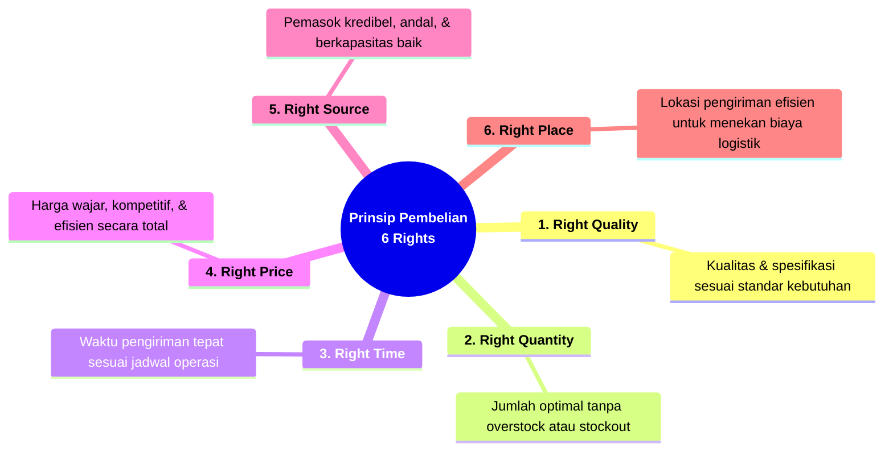
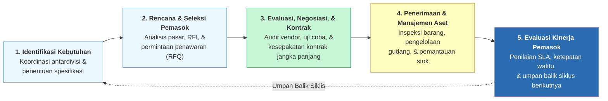
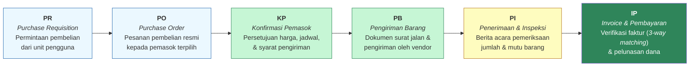
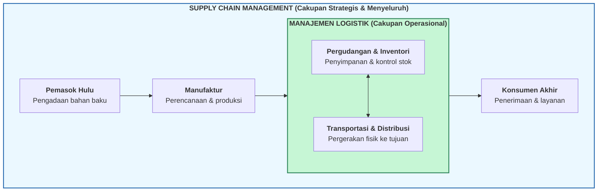
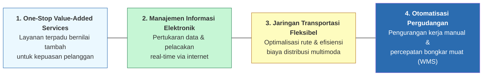
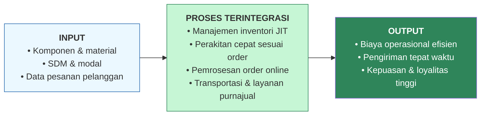

# Pertemuan 06: Manajemen Procurement dan Logistik

* **Mata Kuliah:** E-Business (`STSI4408`) *(Referensi BMP: E-Business `MSIM4409`)*
* **Program Studi:** Sistem Informasi — Universitas Terbuka
* **Topik:** *Procurement* vs *Purchasing*, Prinsip Pembelian (*6 Rights*), Tahapan & Alur Pengadaan, *E-Procurement*, Logistik vs *Supply Chain*, Komponen & Distribusi Fisik, *E-Logistics*, serta Penerapan Konsep Logistik Modern

---

## Daftar Isi

1. [Konsep Dasar Procurement dan Purchasing](#1-konsep-dasar-procurement-dan-purchasing)
2. [Tahapan dan Alur Proses Pengadaan serta Pembelian](#2-tahapan-dan-alur-proses-pengadaan-serta-pembelian)
3. [E-Procurement dalam E-Business](#3-e-procurement-dalam-e-business)
4. [Logistik vs Supply Chain dan Komponen Utama Logistik](#4-logistik-vs-supply-chain-dan-komponen-utama-logistik)
5. [Peran Logistik dalam Keunggulan Kompetitif dan E-Logistics](#5-peran-logistik-dalam-keunggulan-kompetitif-dan-e-logistics)
6. [Penerapan Konsep Logistik Modern dan Studi Kasus](#6-penerapan-konsep-logistik-modern-dan-studi-kasus)
7. [Referensi Resmi](#7-referensi-resmi)

---

## 1. Konsep Dasar Procurement dan Purchasing

### Pengertian Procurement Menurut Para Ahli dan Regulasi

**Procurement** (pengadaan) merupakan fungsi strategis dalam rantai pasok yang mengelola seluruh aktivitas perolehan barang dan jasa dari pemasok eksternal untuk mendukung operasional maupun penciptaan nilai organisasi.

* **Efraim Turban:** Mendefinisikan *procurement* secara komprehensif yang mencakup aktivitas pembelian sekaligus manajemen logistik terkait (transportasi, penyimpanan gudang, dan distribusi).
* **Mangan & Lalwani:** Menjelaskan *procurement* sebagai proses menentukan kebutuhan, mengevaluasi berbagai alternatif pasokan, serta memperoleh sumber daya yang hemat biaya dan berkelanjutan.
* **Perpres No. 70 Tahun 2012:** Mengartikan pengadaan barang/jasa sebagai kegiatan untuk memperoleh barang/jasa yang prosesnya dimulai dari **perencanaan kebutuhan** sampai diselesaikannya seluruh kegiatan untuk memperoleh barang/jasa tersebut.

> *"Pengadaan yang baik adalah awal dari rantai pasok yang kuat, dan logistik yang andal adalah penentu akhirnya."*
> — **Dr. Sulqifli, S.E., M.M.** (*Materi Kuliah E-Business*)

### Perbandingan *Procurement* vs *Purchasing*

Meskipun sering dianggap sama dalam percakapan sehari-hari, *procurement* dan *purchasing* memiliki cakupan serta orientasi yang berbeda:

| Dimensi Perbandingan | *Procurement* (Pengadaan) | *Purchasing* (Pembelian) |
| :--- | :--- | :--- |
| **Sifat & Orientasi** | **Proses strategis** yang berorientasi pada penciptaan nilai dan hubungan kemitraan jangka panjang. | **Proses transaksional** dan operasional yang berjangka pendek. |
| **Ruang Lingkup** | Luas; mencakup penetapan spesifikasi kebutuhan, seleksi & evaluasi pemasok, negosiasi kontrak, analisis efisiensi biaya, hingga pengelolaan relasi. | Terbatas; merupakan salah satu bagian aktivitas dalam *procurement* yang berfokus pada pemesanan barang/jasa. |
| **Fokus Utama** | Total biaya kepemilikan (*Total Cost of Ownership*), keandalan pasokan, kualitas, dan manajemen risiko vendor. | Harga satuan, syarat pembayaran, pembuatan dokumen order (`PR`/`PO`), penerimaan barang, dan pelunasan tagihan. |

### Prinsip Dasar Pembelian (*The 6 Rights of Purchasing*)

Agar aktivitas pembelian memberikan nilai optimal bagi organisasi, setiap transaksi harus memenuhi enam prinsip tepat (*6 Rights*):

---

## 2. Tahapan dan Alur Proses Pengadaan serta Pembelian

### Siklus Tahapan Proses *Procurement*

Secara sistematis, siklus pengadaan strategis organisasi berjalan melalui tahapan berkesinambungan berikut:

1. **Identifikasi Kebutuhan:** Menentukan jenis, spesifikasi teknis, dan volume barang/jasa yang diperlukan melalui koordinasi antar-departemen.
2. **Perencanaan Pengadaan & Pemilihan Pemasok:** Menyusun strategi pengadaan (lelang atau penunjukan langsung), melakukan analisis pasar, mengirimkan *Request for Information* (`RFI`), serta mengundang penawaran harga melalui *Request for Quotation* (`RFQ`).
3. **Evaluasi Tender, Negosiasi, dan Kontrak:** Membandingkan penawaran berdasarkan harga, kualitas, kapasitas produksi, referensi, audit vendor, dan uji coba produk sebelum menyusun kontrak resmi dan membangun relasi jangka panjang.
4. **Penerimaan Barang, Manajemen Aset, dan Gudang:** Mengelola jadwal pengiriman, pemrosesan pesanan, kodefikasi produk, penyimpanan gudang, serta pemantauan aset.
5. **Evaluasi Kinerja Pemasok:** Mengukur kepatuhan pemasok terhadap perjanjian tingkat layanan (*SLA*) sebagai dasar pertimbangan pada siklus pengadaan berikutnya.

### Alur Dokumen Pengadaan dan Pembelian (*Audit Trail*)

Pada level operasional pembelian, setiap tahapan transaksional menghasilkan dokumen resmi yang berfungsi sebagai **jejak audit (*audit trail*)** untuk menjamin akuntabilitas keuangan dan barang:

### Metode Pengadaan dan Mekanisme *E-Purchasing* (`LKPP`)

* **Metode Pengadaan Umum:** Pelelangan umum, pelelangan terbatas, pemilihan langsung, penunjukan langsung, serta swakelola.
* **Alur *E-Purchasing* (Model LKPP di Indonesia):**
  1. **Tanpa Negosiasi:** Pembeli memilih langsung produk/jasa yang tercantum pada katalog elektronik (*e-catalogue*) sesuai harga tayang yang telah ditetapkan.
  2. **Dengan Negosiasi:** Pembeli melakukan proses tawar-menawar harga dan syarat teknis secara elektronik kepada penyedia di dalam sistem sebelum menerbitkan pesanan.

---

## 3. E-Procurement dalam E-Business

### Pengertian dan Lima Prinsip Dasar *E-Procurement*

**E-Procurement** (pengadaan elektronik) adalah pemanfaatan teknologi informasi dan jaringan internet untuk melaksanakan seluruh proses pengadaan barang dan jasa secara digital guna mewujudkan sistem pengadaan yang lebih cepat, terukur, dan bebas penyimpangan.

Lima prinsip utama penyelenggaraan *e-procurement*:

1. **Efisiensi:** Menghemat biaya transaksi, administrasi dokumen fisik, dan waktu siklus pengadaan.
2. **Efektivitas:** Memastikan barang dan jasa yang diperoleh tepat sasaran sesuai kebutuhan operasional organisasi.
3. **Transparansi:** Seluruh informasi spesifikasi, jadwal tender, dan kriteria penilaian terbuka secara jelas bagi peserta yang memenuhi syarat.
4. **Kompetitif:** Membuka akses persaingan yang sehat dan adil bagi lebih banyak pemasok potensial.
5. **Akuntabilitas:** Setiap tahapan transaksi tercatat secara digital (*audit trail*) sehingga dapat dipertanggungjawabkan secara hukum dan finansial.

### Empat Bentuk Utama Aplikasi *E-Procurement*

| Bentuk *E-Procurement* | Fungsi dan Mekanisme Digital | Manfaat Utama bagi Organisasi |
| :--- | :--- | :--- |
| ***E-Sourcing*** | Pencarian, prakualifikasi, dan evaluasi pemasok baru yang potensial melalui portal jaringan internet. | Memperluas basis pemasok global dan menurunkan ketergantungan pada vendor tunggal. |
| ***E-Tendering*** | Pelaksanaan proses lelang, pengiriman dokumen `RFI`/`RFQ`, serta pengajuan penawaran secara elektronik. | Mempersingkat durasi tender dan meminimalkan potensi kecurangan atau kolusi manual. |
| ***E-Catalogue*** | Penyediaan katalog produk dan jasa terstandar dalam format digital yang dilengkapi spesifikasi dan harga. | Mempercepat pemesanan rutin (*maverick buying* berkurang) dan memudahkan perbandingan harga. |
| ***E-Payment*** | Penyelesaian verifikasi faktur elektronik (*e-invoicing*) dan transfer pembayaran dana secara otomatis. | Mempercepat siklus pelunasan kepada mitra serta meningkatkan akurasi pencatatan akuntansi. |

### Peran Strategis *E-Procurement* dalam E-Business

1. **Meningkatkan Kinerja Layanan:** Mempercepat respons dan kejelasan informasi bagi pemasok, unit internal perusahaan, maupun pelanggan akhir.
2. **Integrasi Aktivitas Rantai Pasok:** Menghubungkan aliran data pengadaan langsung dengan sistem perencanaan produksi dan manajemen inventori.
3. **Efisiensi Biaya Transaksi dan SDM:** Mengurangi pekerjaan administratif manual melalui otomatisasi pemrosesan pesanan.
4. **Menjamin Keandalan Pasokan:** Memantau performa pengiriman pemasok secara *real-time* untuk mencegah gangguan pasokan.
5. **Optimalisasi Manajemen Inventori:** Menyelaraskan jadwal pengadaan dengan tingkat stok aktual agar modal kerja tidak tertahan di gudang.
6. **Percepatan Siklus Pengadaan:** Memangkas waktu tunggu (*procurement lead time*) dari hitungan minggu menjadi hitungan hari atau jam.

---

## 4. Logistik vs Supply Chain dan Komponen Utama Logistik

### Perbandingan Logistik vs *Supply Chain*

| Aspek Pembeda | Manajemen Logistik (*Logistics*) | *Supply Chain Management* (`SCM`) |
| :--- | :--- | :--- |
| **Cakupan** | **Lebih sempit (operasional)**; merupakan salah satu bagian operasional di dalam rantai pasok. | **Lebih luas (strategis)**; mencakup seluruh jaringan lintas organisasi dari pemasok hulu hingga konsumen akhir. |
| **Fokus Utama** | Pergerakan fisik, penyimpanan, dan pengendalian aliran barang serta informasi terkait. | Perencanaan strategis, pengadaan, produksi, kolaborasi mitra, hingga distribusi menyeluruh. |
| **Tujuan Utama** | Memastikan barang sampai ke tempat yang tepat, pada waktu yang tepat, dan dalam kondisi baik secara efisien. | Menciptakan nilai pelanggan yang unggul dan keunggulan bersaing yang berkelanjutan di seluruh ekosistem bisnis. |

### Lima Komponen Utama Logistik

1. **Transportasi:** Pemilihan moda angkutan (darat, laut, udara, multimoda), manajemen armada, serta perencanaan dan penjadwalan rute pengiriman.
2. **Pergudangan dan Penanganan Material (*Warehousing & Material Handling*):** Penentuan lokasi gudang strategis, jumlah dan kapasitas depot, tata letak penyimpanan (*storage*), serta peralatan bongkar muat.
3. **Inventori (Persediaan):** Pengendalian jenis barang yang disimpan, alokasi lokasi penyimpanan, dan penentuan tingkat stok pengaman (*safety stock*).
4. **Pengemasan dan Utilitas (*Packaging & Unitization*):** Perancangan kemasan pelindung barang selama transit serta pengelompokan unit muatan (palet/kontainer) untuk memudahkan pemindahan.
5. **Informasi dan Kontrol:** Perancangan sistem informasi logistik, prosedur pengendalian mutu distribusi, dan sistem peramalan kebutuhan pengiriman.

### Tiga Prinsip Utama Manajemen Logistik

* **Terhubung dengan Pelanggan (*Customer-Linked*):** Seluruh aktivitas logistik dirancang untuk memenuhi ekspektasi kecepatan dan ketepatan layanan pelanggan.
* **Lintas Fungsional (*Cross-Functional*):** Membutuhkan koordinasi erat antar-departemen (pemasaran, produksi, pengadaan, dan keuangan) di dalam rantai pasok.
* **Berbasis Waktu (*Time-Based*):** Kecepatan pemrosesan pesanan dan ketepatan waktu tiba (*on-time delivery*) menjadi tolok ukur utama keberhasilan logistik.

### Tujuh Karakteristik Fundamental Distribusi Fisik

1. ***Procurement*:** Mengamankan ketersediaan pasokan barang/jasa dan mengelola kontrak vendor.
2. **Transportasi:** Mempercepat perpindahan fisik barang, menekan persediaan dalam perjalanan, dan meningkatkan kepuasan pelanggan.
3. **Pergudangan:** Menyediakan fasilitas penyimpanan dan pusat distribusi (*distribution center*) yang dekat dengan pasar konsumen.
4. **Pemrosesan Pesanan (*Order Processing*):** Mempercepat siklus pemenuhan pesanan melalui otomatisasi TI dan pengurangan dokumen kertas.
5. **Manajemen Inventori:** Mengendalikan keseimbangan persediaan untuk menjamin ketersediaan barang tanpa pemborosan biaya simpan.
6. **Dokumentasi dan Pengiriman:** Menjamin keakuratan dokumen pengiriman, kepabeanan, dan manifest guna mendukung perdagangan lintas wilayah maupun global.
7. ***Reverse Logistics* (Logistik Balik):** Mengelola aliran pengembalian barang rusak/retur, proses perbaikan, hingga daur ulang produk.

---

## 5. Peran Logistik dalam Keunggulan Kompetitif dan E-Logistics

### Empat Faktor Pendorong Keunggulan Kompetitif Melalui Logistik

1. **Efisiensi Biaya (*Cost Leadership*):** Optimalisasi rute transportasi, konsolidasi muatan, dan efisiensi ruang gudang menekan biaya logistik per unit sehingga perusahaan dapat menawarkan harga lebih kompetitif.
2. **Kecepatan Layanan (*Speed of Delivery*):** Pemrosesan gudang otomatis dan jaringan distribusi responsif memangkas waktu tunggu pengiriman (*delivery lead time*).
3. **Keandalan Pengiriman (*Delivery Reliability*):** Konsistensi pengiriman tepat waktu dan minim kerusakan membangun kepercayaan tinggi dari pelanggan.
4. **Fleksibilitas Operasional (*Operational Flexibility*):** Kemampuan jaringan logistik beradaptasi cepat terhadap lonjakan permintaan musiman maupun perubahan alamat/jadwal pengiriman.

### Konsep *E-Logistics* dalam E-Business

**E-Logistics** adalah penerapan teknologi informasi berbasis web dan internet untuk mendukung, mengotomatisasi, dan mengintegrasikan seluruh aktivitas akuisisi material, pergudangan, pemrosesan pesanan, serta transportasi distribusi.

* **Layanan Utama E-Logistics:** Pergudangan kontrak/publik berbasis sistem, manajemen distribusi terpadu, konsolidasi pengiriman, dan manajemen transportasi elektronik (*Transportation Management System* / `TMS`).

#### Empat Pilar Kerangka Konseptual *E-Logistics*

---

## 6. Penerapan Konsep Logistik Modern dan Studi Kasus

### Tiga Pendekatan Utama Logistik Modern

| Konsep Logistik | Mekanisme Operasional | Manfaat Strategis bagi Perusahaan |
| :--- | :--- | :--- |
| ***Just-In-Time* (`JIT`)** | Pemasok mengirimkan bahan baku atau komponen dalam jumlah tepat **sesaat sebelum** proses produksi atau perakitan dimulai. | Meminimalkan biaya penyimpanan gudang, mengurangi modal tertahan pada inventori, dan mempercepat deteksi cacat mutu. |
| ***Third-Party Logistics* (`3PL`)** | Mengalihdayakan (*outsourcing*) sebagian atau seluruh fungsi logistik (pergudangan, transportasi, pengiriman kurir) kepada penyedia jasa logistik profesional eksternal. | Perusahaan dapat fokus pada kompetensi inti bisnisnya, mengubah biaya tetap armada menjadi biaya variabel, serta memanfaatkan jaringan distribusi `3PL` yang luas. |
| ***Reverse Logistics*** | Mengelola pergerakan fisik barang **dari arah konsumen kembali ke produsen atau pusat pemrosesan** untuk keperluan retur, klaim garansi, rekondisi, atau daur ulang. | Meningkatkan kepercayaan pembeli daring melalui kebijakan retur yang mudah, memulihkan nilai sisa barang, dan mendukung keberlanjutan lingkungan (*green logistics*). |

### Studi Kasus: Sistem Logistik Perusahaan Dell

Dell menerapkan model **Direct Supply Chain** yang memadukan pengadaan komponen langsung dengan perakitan cepat (*build-to-order*) dan pengiriman langsung ke tangan pelanggan.

* **Strategi Utama:** Membangun pusat perakitan dan distribusi global yang berdekatan dengan *hub* pemasok, menyediakan layanan konfigurasi dan pelacakan pesanan secara daring, serta memberikan dukungan garansi purnajual yang panjang.
* **Tantangan dan Solusi Strategis:** Pada segmen pasar tertentu, pelanggan tetap membutuhkan pengalaman melihat fisik produk secara langsung (*product demo*) serta sensitivitas terhadap harga ritel—yang kemudian diatasi Dell dengan mengombinasikan kanal penjualan langsung daring dengan kemitraan gerai ritel terpilih (*hybrid channel*).

---

## 7. Referensi Resmi

1. **Modul UT:** Materi Inisiasi 6 — *Manajemen Procurement dan Logistik*, Mata Kuliah E-Business (`STSI4408`), Universitas Terbuka.
2. **Buku Materi Pokok (BMP) UT:** *E-Business* (`MSIM4409`), Universitas Terbuka.
3. **Materi Perkuliahan:** Sulqifli. *Manajemen Procurement dan Logistik*, Mata Kuliah E-Business.
4. **Mangan, J., & Lalwani, C.** *Global Logistics and Supply Chain Management*. John Wiley & Sons.
5. **Turban, E., King, D., Lee, J. K., Liang, T. P., & Turban, D. C.** *Electronic Commerce: A Managerial and Social Networks Perspective*. Springer.
6. **Chopra, S., & Meindl, P.** *Supply Chain Management: Strategy, Planning, and Operation*. Pearson Education.
7. **Christopher, M.** *Logistics & Supply Chain Management*. Pearson Education.
8. **Peraturan Presiden Republik Indonesia Nomor 70 Tahun 2012** tentang Perubahan Kedua atas Peraturan Presiden Nomor 54 Tahun 2010 tentang Pengadaan Barang/Jasa Pemerintah.