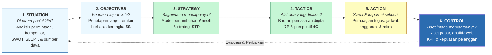
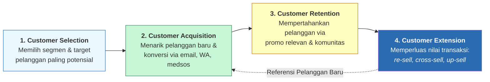
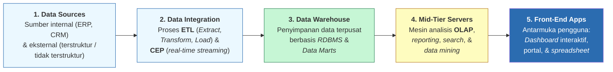

# Pertemuan 07: E-Marketing, CRM, ERP, dan Business Intelligence

* **Mata Kuliah:** E-Business (`STSI4408`) *(Referensi BMP: E-Business `MSIM4409`)*
* **Program Studi:** Sistem Informasi — Universitas Terbuka
* **Topik:** Konsep & Perencanaan *E-Marketing* (`SOSTAC`, `5S`, `7P`/`4C`), *Customer Relationship Management* (`CRM` & `E-CRM`), *Enterprise Resource Planning* (`ERP`), serta *Business Intelligence* (`BI`)

---

## Daftar Isi

1. [Konsep Pemasaran dan E-Marketing](#1-konsep-pemasaran-dan-e-marketing)
2. [Perencanaan, Taktik, dan Implementasi E-Marketing](#2-perencanaan-taktik-dan-implementasi-e-marketing)
3. [Customer Relationship Management (CRM) dan E-CRM](#3-customer-relationship-management-crm-dan-e-crm)
4. [Enterprise Resource Planning (ERP) sebagai Tulang Punggung E-Business](#4-enterprise-resource-planning-erp-sebagai-tulang-punggung-e-business)
5. [Business Intelligence (BI): Arsitektur, Siklus Hidup, dan Perangkat](#5-business-intelligence-bi-arsitektur-siklus-hidup-dan-perangkat)
6. [Referensi Resmi](#6-referensi-resmi)

---

## 1. Konsep Pemasaran dan E-Marketing

### Pengertian Pemasaran dan Evolusinya

**Pemasaran (*Marketing*)** adalah proses manajemen yang bertanggung jawab untuk mengidentifikasi, mengantisipasi, dan memuaskan kebutuhan pelanggan secara menguntungkan.

* **Empat Fungsi Utama Pemasaran (Dave Chaffey):**
  1. Riset pasar (*market research*).
  2. Manajemen merek dan produk (*brand & product management*).
  3. Hubungan masyarakat (*public relations* / PR).
  4. Layanan pelanggan (*customer service*).
* **Pendekatan Pemasaran Modern:** Seluruh fungsi organisasi—tidak hanya departemen pemasaran—berorientasi pada penciptaan nilai dan kepuasan pelanggan (*customer-centric organization*).

### Pengertian dan Fokus Utama E-Marketing

**E-Marketing** (*Electronic Marketing*) merupakan penerapan teknologi informasi dan komunikasi (TIK) untuk merencanakan serta menjalankan aktivitas promosi, komunikasi nilai, dan penjualan secara daring. Dalam ekosistem digital, *e-marketing* merupakan bagian (*subset*) dari *e-business* dan *e-commerce*.

Tiga fokus siklus pelanggan dalam *e-marketing*:

1. **Akuisisi (*Customer Acquisition*):** Menarik pengunjung potensial (*traffic*) melalui kanal digital agar mengenal penawaran produk/jasa.
2. **Konversi (*Customer Conversion*):** Mengubah pengunjung situs/aplikasi menjadi pembeli aktif melalui pengalaman transaksi yang mulus.
3. **Retensi (*Customer Retention*):** Mempertahankan pelanggan lama agar terus melakukan pembelian berulang dan menjadi pendukung merek.

---

## 2. Perencanaan, Taktik, dan Implementasi E-Marketing

### Kerangka Perencanaan *SOSTAC* (PR Smith)

Untuk merancang kampanye dan strategi pemasaran digital secara sistematis, digunakan kerangka kerja **SOSTAC**:



#### Rincian Elemen Utama dalam *SOSTAC*

* **Analisis Situasi (*Situation Analysis*):** Mengevaluasi permintaan pasar daring, pergerakan kompetitor, peran perantara digital, kapabilitas sumber daya internal, serta analisis **SWOT** (*Strengths, Weaknesses, Opportunities, Threats*) dan **SLEPT** (*Social, Legal, Economic, Political, Technological*).
* **Tujuan E-Marketing (*Objectives* — Kerangka `5S`):**
  1. ***Sell* (Menjual):** Meningkatkan volume penjualan dan pangsa pasar melalui distribusi daring.
  2. ***Serve* (Melayani):** Memberikan nilai tambah dan layanan pelanggan yang lebih cepat serta interaktif.
  3. ***Sizzle* (Memukau):** Membangun kesadaran merek (*brand awareness*) dan pengalaman digital yang berkesan.
  4. ***Speak* (Berinteraksi):** Menciptakan dialog dua arah yang lebih dekat dengan pelanggan.
  5. ***Save* (Menghemat):** Menekan biaya pemasaran, pencetakan katalog fisik, dan layanan pelanggan.
* **Strategi (*Strategy*):** Menggunakan **Matriks Pertumbuhan Ansoff** (penetrasi pasar, pengembangan pasar, pengembangan produk, diversifikasi) yang dipadukan dengan perumusan **STP** (*Segmenting, Targeting, Positioning*).

### Taktik Bauran Pemasaran: *7P* (Perspektif Penjual) vs *4C* (Perspektif Pelanggan)

| Bauran Pemasaran *7P* (*Company View*) | Padanan Perspektif Pelanggan *4C* (*Customer View*) | Implementasi Taktik dalam E-Marketing |
| :--- | :--- | :--- |
| **1. Product** (Produk) | **Customer Need / Value** (Kebutuhan & Nilai Pelanggan) | Pengembangan produk digital, kustomisasi fitur, dan pengemasan nilai solusi sesuai kebutuhan spesifik pengguna. |
| **2. Price** (Harga) | **Cost to the Customer** (Total Biaya bagi Pelanggan) | Penetapan harga dinamis (*dynamic pricing*), diskon daring, transparansi total biaya kirim, dan opsi cicilan. |
| **3. Place** (Tempat / Distribusi) | **Convenience** (Kemudahan Akses) | Kemudahan akses toko daring 24/7 melalui situs web, aplikasi seluler, dan integrasi *marketplace*. |
| **4. Promotion** (Promosi) | **Communication** (Komunikasi Dua Arah) | Kampanye *SEO/SEM*, pemasaran media sosial, *email marketing*, *content marketing*, dan interaksi komunitas. |
| **5. Process** (Proses) | *(Mendukung Convenience & Value)* | Kemudahan alur *checkout*, kecepatan pemrosesan pesanan, pelacakan pengiriman, dan prosedur retur. |
| **6. People** (SDM / Layanan) | *(Mendukung Communication & Value)* | Responsivitas tim *customer service*, dukungan *live chat*, serta kompetensi staf operasional digital. |
| **7. Physical Evidence** (Bukti Fisik) | *(Mendukung Value & Kepercayaan)* | Desain antarmuka situs (`UI/UX`), testimoni/ulasan pembeli, sertifikat keamanan SSL, dan kemasan pengiriman fisik. |

### Implementasi (*Action*) dan Pengendalian (*Control*)

* **Tindakan (*Action*):** Menjabarkan taktik ke dalam daftar tugas terperinci, alokasi sumber daya manusia, penyusunan anggaran pemasaran digital, pemilihan mitra agensi/platform, serta jadwal peluncuran kampanye.
* **Kontrol (*Control*):** Mengukur efektivitas situs web dan kampanye menggunakan **Web Analytics** (jumlah pengunjung, *bounce rate*, rasio konversi), riset kepuasan pelanggan, serta pemantauan pencapaian `KPI`.

---

## 3. Customer Relationship Management (CRM) dan E-CRM

### Empat Aktivitas Pemasaran dalam Siklus *CRM*

**Customer Relationship Management (`CRM`)** adalah strategi bisnis yang berfokus pada pengelolaan hubungan jangka panjang dengan pelanggan untuk memaksimalkan nilai dan loyalitas pelanggan melalui empat tahapan aktivitas utama:



* **Perluasan Pelanggan (*Customer Extension*):** Mencakup aktivitas penjualan ulang (*re-sell*), penawaran produk pelengkap (*cross-sell*), peningkatan kelas produk (*up-sell*), pengaktifan kembali pelanggan tidak aktif (*re-activation*), serta program referensi (*referral*).

### Tiga Model Konseptual *CRM*

1. **Model IDIC (Peppers & Rogers):**
   * ***Identification* (Identifikasi):** Mengumpulkan identitas, preferensi, dan riwayat interaksi setiap pelanggan secara individual.
   * ***Differentiation* (Diferensiasi):** Mengelompokkan pelanggan berdasarkan tingkat nilai ekonomis (*Customer Lifetime Value*) dan kebutuhan spesifiknya.
   * ***Interaction* (Interaksi):** Membangun komunikasi dua arah yang efektif dan efisien di setiap titik kontak (*touchpoints*).
   * ***Customization* (Kustomisasi):** Menyesuaikan produk, penawaran, dan layanan secara personal bagi masing-masing pelanggan.
2. **Model *Value Chain CRM* (Francis Buttle):**
   * **Lima Tahap Primer:** Analisis portofolio pelanggan, keintiman pelanggan (*customer intimacy*), pengembangan jaringan (*network development*), pengembangan proposisi nilai, dan pengelolaan siklus hidup pelanggan (*customer lifecycle*).
   * **Empat Kondisi Pendukung:** Kepemimpinan dan budaya organisasi, data dan teknologi informasi, sumber daya manusia, serta proses manajemen.
3. **Model Kompetensi *CRM* Gartner:**
   * Menekankan keseimbangan **delapan area kompetensi**: (1) Visi CRM, (2) Strategi CRM, (3) Pengalaman pelanggan (*valued customer experience*), (4) Kolaborasi organisasi, (5) Proses pelanggan, (6) Manajemen informasi pelanggan, (7) Teknologi CRM, dan (8) Metrik pengukuran CRM.

### Tiga Jenis *E-CRM* dan Studi Kasus Apple

**E-CRM** (*Electronic CRM*) adalah penerapan teknologi informasi dan internet untuk mengotomatisasi serta menyelaraskan seluruh proses pengelolaan hubungan pelanggan:

| Jenis *E-CRM* | Fokus Fungsional | Contoh Kemampuan Sistem |
| :--- | :--- | :--- |
| ***Operational E-CRM*** | Otomatisasi proses interaksi langsung dengan pelanggan (*front-office*). | Otomatisasi tenaga penjualan (*Sales Force Automation*), otomasi kampanye pemasaran, dan sistem tiket layanan pelanggan. |
| ***Analytical E-CRM*** | Pengolahan dan analisis data pelanggan untuk pengambilan keputusan. | Analisis segmentasi perilaku, prediksi pola pembelian, analisis tingkat *churn*, dan pengukuran nilai seumur hidup pelanggan. |
| ***Collaborative E-CRM*** | Berbagi informasi pelanggan lintas departemen dan kanal komunikasi. | Integrasi data antara tim *sales*, *marketing*, dan *customer support* agar pelanggan mendapat pengalaman yang konsisten di semua kanal. |

> **Studi Kasus Apple:** Apple mengimplementasikan *E-CRM* secara menyeluruh melalui survei *Net Promoter Score* (`NPS`), pengiriman *email follow-up* pasca-pembelian, personalisasi layanan di Apple Store maupun ekosistem akun Apple ID, inovasi produk terintegrasi (iPhone, iPad, iTunes/App Store), serta interaksi aktif di kanal digital yang menciptakan tingkat loyalitas pelanggan sangat tinggi.

---

## 4. Enterprise Resource Planning (ERP) sebagai Tulang Punggung E-Business

### Pengertian dan Konsep Modular *ERP*

**Enterprise Resource Planning (`ERP`)** adalah sistem informasi lintas fungsi yang mengintegrasikan dan mengotomatisasi seluruh proses bisnis inti organisasi—seperti manufaktur, logistik, akuntansi, keuangan, penjualan, dan sumber daya manusia—ke dalam satu arsitektur perangkat lunak terpadu. Menurut **James A. O'Brien**, `ERP` berperan sebagai **tulang punggung (*backbone*) e-business**.

* **Arsitektur Modular dengan Basis Data Terpusat:** `ERP` tersusun atas berbagai modul fungsional yang seluruhnya terhubung ke **satu sumber basis data terpusat (*single central database*)**.
* **Empat Manfaat Utama Basis Data Terpusat:**
  1. Menghindari duplikasi data antar-departemen.
  2. Menjamin konsistensi dan integritas data.
  3. Mengalirkan informasi operasional secara *real-time* ke seluruh unit kerja.
  4. Menyederhanakan alur koordinasi operasional lintas fungsi.

### Lima Komponen Utama *ERP* (O'Brien) dan Fungsi Kuncinya

```mermaid
mindmap
  root((<b>Komponen Utama<br/>Sistem ERP</b>))
    <b>1. Accounting & Finance</b>
      Buku besar (GL), AP, AR
      Penganggaran & peramalan (Budgeting)
    <b>2. Sales & Distribution</b>
      Manajemen pesanan & harga
      CRM (kontak & riwayat pelanggan)
    <b>3. Production Planning</b>
      Jadwal induk produksi (MPS)
      Perencanaan kapasitas & mutu
    <b>4. Integrated Logistics</b>
      Supply Chain Management (SCM)
      Inventori, stok, & tata letak gudang
    <b>5. Human Resources</b>
      Rekrutmen & administrasi gaji
      Evaluasi kinerja & perencanaan SDM
```

### Tahapan Penerapan dan Manfaat Strategis *ERP*

* **Enam Tahap Implementasi ERP:**
  1. **Pengamatan dan Perencanaan:** Analisis kebutuhan bisnis, pembentukan tim proyek, dan pemilihan vendor ERP.
  2. **Perancangan (*Design*):** Pemetaan proses bisnis (*business blueprint*) dan penyesuaian alur kerja.
  3. **Pengembangan (*Development*):** Konfigurasi modul, kustomisasi terbatas, serta migrasi data awal.
  4. **Pengujian (*Testing*):** Uji integrasi sistem (*UAT*) untuk memastikan akurasi alur data antar-modul.
  5. **Penerapan (*Deployment*):** Peluncuran sistem (*go-live*) baik melalui infrastruktur *cloud* maupun peladen lokal (*on-premise*).
  6. **Pemeliharaan dan Pembaruan:** Dukungan teknis berkelanjutan, audit keamanan, dan pembaruan versi sistem.
* **Manfaat Utama ERP:** Meningkatkan produktivitas melalui otomatisasi *real-time*, menjamin akurasi data tinggi, mendukung pengambilan keputusan eksekutif lewat laporan terintegrasi, meningkatkan kelincahan bisnis (*agility*), serta memastikan kepatuhan regulasi dan pengendalian risiko.
* **Contoh Perangkat Lunak ERP:** SAP S/4HANA, Oracle E-Business Suite, Microsoft Dynamics NAV/365, Odoo, dan Mitra ERP.

---

## 5. Business Intelligence (BI): Arsitektur, Siklus Hidup, dan Perangkat

### Pengertian dan Fungsi Utama *Business Intelligence*

**Business Intelligence (`BI`)** adalah sekumpulan proses, arsitektur, dan teknologi yang mengolah data mentah menjadi informasi bermakna dan wawasan strategis (*actionable insights*) guna mendukung pengambilan keputusan bisnis yang akurat. Dalam klasifikasi sistem informasi, `BI` termasuk dalam kategori **Decision Support System (`DSS`)**.

* **Cakupan Pandangan Analitik:** Menyediakan analisis **historis** (apa yang telah terjadi), ***real-time*** (apa yang sedang terjadi saat ini), dan **prediktif** (apa yang kemungkinan akan terjadi di masa depan).
* **Tujuh Fungsi Utama BI:** Pelaporan manajerial (*reporting*), *Online Analytical Processing* (`OLAP`), analitik bisnis, *data mining*, *benchmarking*, *text mining*, dan *predictive analytics*.

### Arsitektur Sistem *Business Intelligence* (Chaudhuri)



### Siklus Hidup Pengembangan *BI* (Atre & Moss)

1. **Justifikasi (*Justification*):** Mengidentifikasi kebutuhan bisnis utama, menyusun kasus bisnis (*business case*), menganalisis perkiraan imbal hasil investasi (*ROI*), serta memetakan risiko proyek.
2. **Perencanaan (*Planning*):** Mengevaluasi kesiapan infrastruktur teknis dan sumber daya organisasi untuk menyusun rencana proyek `BI`.
3. **Analisis Bisnis (*Business Analysis*):** Menganalisis kebutuhan data secara mendalam, mendefinisikan metadata, dan membangun prototipe tampilan laporan.
4. **Desain (*Design*):** Merancang skema basis data *data warehouse*, aturan alur kerja `ETL`, serta arsitektur penyimpanan metadata.
5. **Pembangunan (*Construction*):** Membangun skrip `ETL`, mengisi repositori *data warehouse*, serta mengembangkan aplikasi analitik dan model *data mining*.
6. **Penerapan (*Deployment*):** Meluncurkan sistem `BI` ke pengguna bisnis, memberikan pelatihan, serta melakukan evaluasi berkala atas setiap rilis.

### Manfaat Strategis dan Perangkat *BI* Populer

* **Empat Manfaat Utama BI:**
  1. Menghemat waktu dan biaya dalam mengakses serta menyusun laporan manajerial.
  2. Memudahkan pemantauan dan pengukuran kinerja organisasi (`KPI`) secara visual dan *real-time*.
  3. Meningkatkan nilai ekonomis data mentah menjadi wawasan strategis yang dapat ditindaklanjuti (*actionable insights*).
  4. Mengoptimalkan nilai investasi infrastruktur TI yang sudah dimiliki perusahaan (seperti `ERP` dan `CRM`).
* **Perangkat (*Tools*) BI Populer:**
  * **Tableau:** Unggul dalam visualisasi data interaktif berkecepatan tinggi dan integrasi ke berbagai sumber basis data.
  * **Google Looker Studio (sebelumnya *Google Data Studio*):** Gratis, berbasis awan, dan terintegrasi langsung dengan ekosistem pemasaran digital (Google Ads, Google Analytics, YouTube, BigQuery).
  * **Microsoft Power BI:** Menyediakan visualisasi interaktif yang kuat serta integrasi mulus dengan ekosistem Microsoft Excel, Azure, dan berbagai sumber data eksternal.

---

## 6. Referensi Resmi

1. **Modul UT:** Materi Inisiasi 7 — *e-Marketing, Customer Relationship Management, Enterprise Resource Planning & Business Intelligence*, Mata Kuliah E-Business (`STSI4408`), Universitas Terbuka.
2. **Buku Materi Pokok (BMP) UT:** *E-Business* (`MSIM4409`), Universitas Terbuka.
3. **Chaffey, D., & Ellis-Chadwick, F.** *Digital Marketing: Strategy, Implementation and Practice*. Pearson Education.
4. **Buttle, F., & Maklan, S.** *Customer Relationship Management: Concepts and Technologies*. Routledge.
5. **Peppers, D., & Rogers, M.** *Managing Customer Experience and Relationships: A Strategic Framework*. John Wiley & Sons.
6. **O'Brien, J. A., & Marakas, G. M.** *Management Information Systems*. McGraw-Hill/Irwin.
7. **Chaudhuri, S., Dayal, U., & Narasayya, V.** (2011). *An Overview of Business Intelligence Technology*. Communications of the ACM, 54(8), 88–98.
8. **Moss, L. T., & Atre, S.** (2003). *Business Intelligence Roadmap: The Complete Project Lifecycle for Decision-Support Applications*. Addison-Wesley.