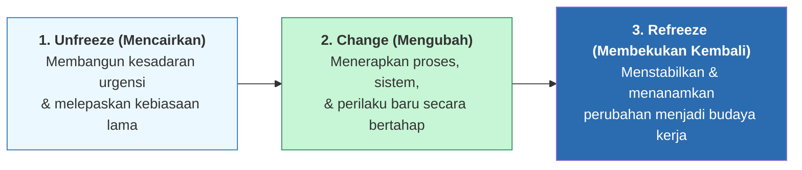
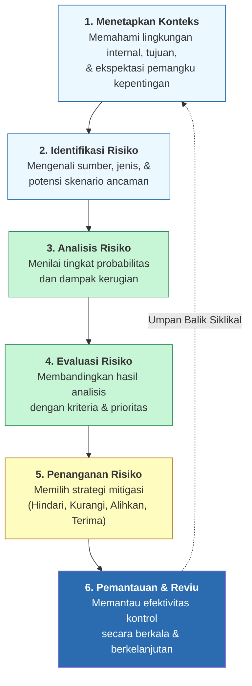

# Pertemuan 08: Manajemen Perubahan dan Risiko E-Bisnis

* **Mata Kuliah:** E-Business (`STSI4408`) *(Referensi BMP: E-Business `MSIM4409`)*
* **Program Studi:** Sistem Informasi — Universitas Terbuka
* **Topik:** Konsep & Pendorong Manajemen Perubahan E-Bisnis, Model Perubahan (Kurt Lewin, John Kotter, Anderson), Resistensi & Strategi Penanganannya, Transformasi Proses Bisnis (`BPR`), Konsep & Standar Manajemen Risiko (`ISO 31000`), Jenis Risiko E-Bisnis, serta Keamanan Siber & *Business Continuity Plan* (`BCP`)

---

## Daftar Isi

1. [Konsep Dasar dan Pendorong Perubahan E-Bisnis](#1-konsep-dasar-dan-pendorong-perubahan-e-bisnis)
2. [Jenis dan Model Manajemen Perubahan (Lewin, Kotter, Anderson)](#2-jenis-dan-model-manajemen-perubahan-lewin-kotter-anderson)
3. [Resistensi terhadap Perubahan dan Strategi Penanganannya](#3-resistensi-terhadap-perubahan-dan-strategi-penanganannya)
4. [Transformasi Bisnis melalui BPI dan BPR (Davenport)](#4-transformasi-bisnis-melalui-bpi-dan-bpr-davenport)
5. [Konsep, Standar, dan Proses Manajemen Risiko E-Bisnis](#5-konsep-standar-dan-dan-proses-manajemen-risiko-e-bisnis)
6. [Jenis Risiko E-Bisnis dan Matriks Penanganan Risiko](#6-jenis-risiko-e-bisnis-dan-matriks-penanganan-risiko)
7. [Keamanan Siber dan Business Continuity Plan (BCP)](#7-keamanan-siber-dan-business-continuity-plan-bcp)
8. [Referensi Resmi](#8-referensi-resmi)

---

## 1. Konsep Dasar dan Pendorong Perubahan E-Bisnis

### Pengertian Manajemen Perubahan E-Bisnis

**Manajemen Perubahan** (*Change Management*) adalah pendekatan terstruktur dan sistematis untuk mempersiapkan, membimbing, dan mendukung individu maupun organisasi dalam beralih dari kondisi saat ini (*current state*) menuju kondisi digital yang baru (*future state*) agar tujuan e-bisnis tercapai secara efektif.

> *"Manajemen perubahan memastikan transisi digital berjalan mulus dengan dukungan penuh dari SDM, sementara manajemen risiko melindungi organisasi dari ancaman di sepanjang proses tersebut."*
> — **Dr. Sulqifli, S.E., M.M.** (*Materi Kuliah E-Business*)

### Tiga Pilar Utama Manajemen Perubahan E-Bisnis
1. **Terencana:** Dijalankan secara sistematis dan strategis, bukan sebagai respons reaktif atau mendadak.
2. **Berpusat pada Manusia (*People-Centric*):** Menempatkan kesiapan mental, keterampilan, dan budaya SDM sebagai kunci utama keberhasilan.
3. **Berkelanjutan (*Continuous Process*):** Dikelola sebagai proses evolusi yang berkelanjutan, bukan sekadar peristiwa tunggal.

### Pendorong Perubahan Digital (*Drivers of Digital Change*)
* **Perubahan Perilaku Konsumen:** Preferensi belanja daring yang meningkat dan ekspektasi layanan instan (*on-demand*).
* **Tekanan Kompetitif:** Persaingan ketat dengan kompetitor yang telah lebih dulu mengadopsi transformasi digital.
* **Perkembangan Teknologi:** Kemunculan teknologi kecerdasan buatan (*AI*), komputasi awan (*cloud*), dan otomatisasi proses.
* **Regulasi & Kebijakan:** Aturan baru terkait perlindungan data pribadi dan standar transaksi digital.
* **Efisiensi Operasional:** Tuntutan menekan biaya administrasi dan mempercepat siklus layanan.

---

## 2. Jenis dan Model Manajemen Perubahan (Lewin, Kotter, Anderson)

### Jenis Perubahan Organisasi (Linda Ackerman Anderson)
1. **Developmental (Perbaikan Bertahap):** Peningkatan keterampilan atau proses yang sudah ada tanpa mengubah struktur dasar.
2. **Transitional (Transisional):** Penggantian sistem atau cara kerja lama dengan cara kerja baru yang terstruktur.
3. **Transformational (Transformasional):** Perubahan radikal dan mendasar yang menyentuh pola pikir (*mindset*) serta budaya organisasi secara menyeluruh.

### Model Perubahan Klasik Kurt Lewin

Model 3 tahap (*3-Stage Model*) Kurt Lewin membagi proses perubahan ke dalam siklus berikut:

### Model 8 Langkah John Kotter

Kerangka kerja kepemimpinan transformasional untuk memimpin perubahan strategis jangka panjang:
1. **Membangun Urgensi:** Menyadarkan seluruh elemen organisasi akan pentingnya perubahan segera.
2. **Membentuk Koalisi Pandu:** Menyatukan para pemimpin dan penggerak perubahan yang memiliki pengaruh kuat.
3. **Merumuskan Visi & Strategi:** Menetapkan arah masa depan yang jelas dan mudah dipahami.
4. **Mengomunikasikan Visi:** Menyebarluaskan visi secara konsisten ke seluruh lini organisasi.
5. **Memberdayakan Karyawan:** Menghilangkan hambatan struktural dan memberikan keleluasaan bertindak.
6. **Menciptakan Kemenangan Jangka Pendek (*Short-Term Wins*):** Meraih pencapaian awal untuk membangun momentum dan kepercayaan diri.
7. **Mengonsolidasikan Hasil:** Terus mendorong perbaikan berkelanjutan dan memperluas cakupan perubahan.
8. **Menanamkan dalam Budaya:** Melembagakan nilai-nilai baru ke dalam kebiasaan operasional sehari-hari.

---

## 3. Resistensi terhadap Perubahan dan Strategi Penanganannya

### Mengapa Karyawan Menolak Perubahan?
* **Ketakutan akan Ketidakpastian:** Khawatir kehilangan posisi, peran, atau tergantikan oleh otomatisasi sistem.
* **Kurangnya Pemahaman:** Minimnya informasi transparan mengenai alasan dan manfaat perubahan.
* **Zona Nyaman:** Terbiasa dengan prosedur lama yang sudah dikuasai bertahun-tahun.
* **Kurangnya Kompetensi Digital:** Merasa cemas tidak mampu menguasai teknologi atau perangkat lunak baru.
* **Trauma Perubahan Sebelumnya:** Pengalaman buruk dari proyek transformasi sebelumnya yang gagal.
* **Minim Keterlibatan:** Karyawan tidak dilibatkan sejak tahap perencanaan awal.

### Strategi Pemimpin dalam Mengatasi Resistensi
1. **Komunikasi Terbuka:** Menjelaskan secara jujur alasan, manfaat, dan dampak nyata perubahan.
2. **Pelibatan Aktif (*Participation*):** Mengikutsertakan perwakilan tim sejak tahap perancangan proses.
3. **Pelatihan dan Pendampingan:** Membekali keterampilan teknis melalui program *upskilling* yang sistematis.
4. **Keteladanan Pemimpin:** Manajemen puncak menjadi teladan nyata (*role model*) dalam adopsi sistem baru.
5. **Insentif dan Apresiasi:** Memberikan penghargaan bagi individu atau unit yang berhasil beradaptasi cepat.
6. **Evaluasi dan Umpan Balik:** Membuka kanal pengaduan dan masukan untuk menyempurnakan pendekatan.

---

## 4. Transformasi Bisnis melalui BPI dan BPR (Davenport)

Dalam mengelola transformasi proses bisnis e-bisnis, organisasi memadukan dua pendekatan utama:

### Tahapan *Business Process Reengineering* (`BPR`) menurut Davenport
1. **Identifikasi Proses Utama:** Menentukan proses inti yang memerlukan inovasi radikal (misalnya manajemen rantai pasok, CRM, atau pengadaan).
2. **Identifikasi Faktor Pendorong:** Memetakan kebutuhan teknologi, budaya, dan struktur organisasi pendukung.
3. **Penyusunan Visi Proses:** Menetapkan tujuan terukur dan mengomunikasikan alasan perubahan kepada seluruh pihak.
4. **Dokumentasi Kondisi Saat Ini:** Memetakan alur kerja eksisting dan mengukur metrik kinerjanya.
5. **Perancangan Prototipe:** Melakukan simulasi, pemodelan, dan uji coba alur proses baru sebelum implementasi penuh.

---

## 5. Konsep, Standar, dan Proses Manajemen Risiko E-Bisnis

### Pengertian dan Standar Manajemen Risiko

**Manajemen Risiko** adalah proses terkoordinasi untuk mengarahkan dan mengendalikan organisasi terkait potensi ancaman dan peluang secara sistematis. Standar rujukan utama yang digunakan meliputi **AS/NZS 4360:1999**, **SNI ISO Guide 73:2016**, serta kerangka kerja **ISO 31000:2018** (*Leadership, Integration, Design, Implementation, Evaluation, Improvement*).

### Siklus Proses Manajemen Risiko

---

## 6. Jenis Risiko E-Bisnis dan Matriks Penanganan Risiko

### Enam Kategori Utama Risiko E-Bisnis
1. **Keamanan Siber (*Cybersecurity*):** Risiko peretasan, pencurian data pelanggan, dan serangan *malware* / *ransomware*.
2. **Operasional:** Gangguan sistem peladen (*downtime*), kegagalan infrastruktur jaringan, atau *bug* aplikasi fatal.
3. **Kepatuhan (*Compliance*):** Pelanggaran terhadap regulasi privasi data (*UU PDP*), perpajakan digital, dan aturan transaksi elektronik.
4. **Finansial:** Penipuan pembayaran (*fraud*), pembatalan tagihan sepihak (*chargeback*), atau fluktuasi biaya infrastruktur *cloud*.
5. **Reputasi:** Penurunan kepercayaan publik akibat insiden kebocoran data atau pelayanan digital yang buruk.
6. **Strategis:** Kesalahan arah investasi teknologi atau pemilihan model bisnis yang tidak berkelanjutan.

### Empat Strategi Penanganan Risiko (*Risk Treatment*)
* **Menghindari (*Avoid*):** Menghentikan aktivitas atau proyek yang memiliki tingkat risiko tidak terkelola.
* **Mengurangi (*Reduce*):** Menerapkan sistem kontrol, enkripsi, dan pengamanan untuk menekan probabilitas atau dampak risiko.
* **Mengalihkan (*Transfer*):** Memindahkan sebagian beban finansial risiko kepada pihak ketiga, seperti asuransi siber atau kontrak *outsourcing*.
* **Menerima (*Accept*):** Menyadari risiko berskala kecil yang dampaknya masih berada di dalam batas toleransi organisasi.

---

## 7. Keamanan Siber dan Business Continuity Plan (BCP)

### Praktik Utama Keamanan Siber dalam E-Bisnis
* **Enkripsi Data:** Melindungi data sensitif pelanggan dan riwayat transaksi baik saat disimpan (*at rest*) maupun saat dikirimkan (*in transit*).
* **Autentikasi Multi-Faktor (`MFA`):** Memperketat verifikasi identitas pengguna dan administrator sistem.
* **Audit Keamanan Berkala:** Melakukan uji kerentanan (*penetration testing*) secara rutin.
* **Pelatihan Kesadaran Karyawan:** Mengedukasi staf mengenai ancaman *phishing* dan rekayasa sosial.
* **Penerapan *Firewall* & Sistem Deteksi Intrusi (`IDS`):** Memblokir akses jaringan mencurigakan secara otomatis.

### Rencana Kelangsungan Bisnis (*Business Continuity Plan* / BCP)
* **Penyusunan *Disaster Recovery Plan* (`DRP`):** Prosedur pemulihan sistem darurat jika terjadi bencana fisik atau serangan siber masif.
* **Pencadangan Data Rutin (*Backup*):** Menyalin basis data secara berkala ke lokasi penyimpanan terpisah atau berbasis *cloud*.
* **Simulasi Pemulihan Berkala:** Melakukan uji coba pemulihan sistem secara periodik untuk memastikan kesiapan tim krisis.

---

## 8. Referensi Resmi

1. **Modul UT:** Materi Inisiasi 8 — *Manajemen Perubahan & Risiko E-Bisnis*, Mata Kuliah E-Business (`STSI4408`), Universitas Terbuka.
2. **Buku Materi Pokok (BMP) UT:** *E-Business* (`MSIM4409`), Universitas Terbuka.
3. **Kotter, J. P.** *Leading Change*. Harvard Business Review Press.
4. **Lewin, K.** *Field Theory in Social Science*. Harper & Row.
5. **ISO 31000:2018** — *Risk Management — Guidelines*. International Organization for Standardization.
6. **Chaffey, D.** *Digital Business and E-Commerce Management*. Pearson Education.
7. **Turban, E., King, D., Lee, J. K., Liang, T. P., & Turban, D. C.** *Electronic Commerce: A Managerial and Social Networks Perspective*. Springer.